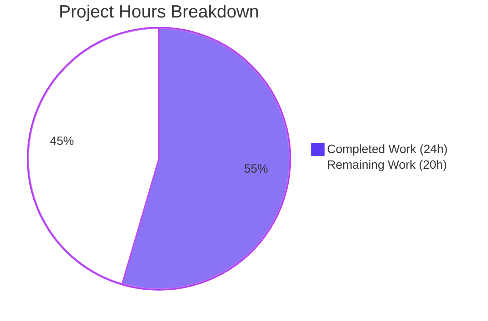

# 1. Executive Summary

## 1.1 Project Overview

The repository now carries a second, far smaller service beside its FastAPI fixture: a five-statement Express 5 application in `server.js` answering two constant text responses, and a three-field `package.json` declaring `express` as its only dependency. `GET /` keeps its `Hello, World!\n` contract at 14 bytes; the added `GET /good-evening` answers `Good evening\n` at 13 bytes. Both return status 200 as `text/plain; charset=utf-8`. The service holds no state, reads no request data, needs no configuration, credential or database, and renders no interface.

## 1.2 Completion Status

24 of the project's 44 hours are delivered and verified; the remaining 20 are path-to-production work the change's constraints place outside it. Completion = 24 ÷ (24 + 20) = **55%**.


| Metric | Hours |
| --- | --- |
| Total Hours | 44 |
| Completed Hours (Baseline: Human with agentic-assist) | 24 |
| Remaining Hours | 20 |

## 1.3 Key Accomplishments

- `GET /good-evening` answers `Good evening\n` — 13 bytes, 200, `text/plain; charset=utf-8` — byte-exact on the wire and in a browser.
- `GET /` keeps its 14-byte `Hello, World!\n` response, unchanged and never superseded.
- `package.json` declares `express` `^5` as the sole dependency; the app boots and serves on it.
- Two added files, ten inserted lines, not one pre-existing file modified.
- Both files match their specified listings character for character.
- Exactly two GET/HEAD paths; everything else gets the framework 404.
- Twenty concurrent requests, twenty correct responses.
- `server.js` parses under `node --check`; every tracked Python file compiles.

## 1.4 Critical Unresolved Issues

None of the four requested work items is open: **0 of 4** undelivered. Six stand open — **6 of 6** accepted with a caveat: five transport-security observations the change's own no-hardening rule requires, and one repository-level validation condition outside its scope.

| Issue | Impact | Owner | ETA |
| --- | --- | --- | --- |
| `X-Powered-By: Express` sent on every response | Discloses the framework and version family; no data exposure | Code owner | Next change that reopens transport policy |
| `X-Content-Type-Options: nosniff` absent on the two 200s (present on the framework 404 and OPTIONS) | MIME sniffing possible in legacy clients; inconsistent within one server | Code owner | Same change |
| No `X-Frame-Options` and no CSP `frame-ancestors` | The constant text could be framed; nothing interactive to hijack | Code owner | Same change |
| No `Cache-Control`, `Pragma` or `Expires`, while a weak `ETag` permits heuristic caching | Intermediaries may cache the public constants; harmless but unintended | Code owner | Same change |
| Listener binds the IPv6 wildcard `::` and answers off loopback over cleartext HTTP | Both routes reachable from any interface on the host; no confidential data today, but the posture does not survive a future data-bearing route | Operator / deployer | Before any exposure beyond the local host |
| The repository's whole-package test command cannot collect: the FastAPI fixture imports an application package that exists in no commit | The gate is red for both services, so no automated signal exists for either | Source owner | Before any CI depends on that gate |

## 1.5 Access Issues

No access issues identified. Neither service needs a credential, environment variable, database or third-party endpoint; the listener's port was free throughout.

## 1.6 Recommended Next Steps

1. **[High]** Settle the repository's second service so the whole-package test command can run green — restore its application package or retire the fixture.
2. **[High]** Pin `express` at 5.3.0 with a committed lockfile and record its advisory status (2h).
3. **[High]** Add contract regression tests over both routes behind one command (5h).
4. **[High]** Bind the listener to loopback and terminate TLS at a reverse proxy (4h).
5. **[Medium]** Add the header baseline and an error handler, then package for deployment with `NODE_ENV=production`, a health check and operator notes (9h).

# 2. Project Hours Breakdown

## 2.1 Completed Work Detail

| Component | Hours | Description |
| --- | --- | --- |
| `GET /good-evening` route (`server.js:4`) | 3 | Route registered on the single app object with `res.type('text/plain')` and the LF-terminated literal; status carried by the framework default so the handler stays one line. Delivers the new contract at 13 bytes. |
| `GET /` held unchanged (`server.js:3`) | 2 | The existing response carried into the file verbatim — `Hello, World!\n`, 14 bytes, `text/plain` — and re-verified in every runtime pass. |
| `express` as the sole dependency (`package.json:4`) | 2 | Three-field manifest with a single `"express": "^5"` entry; resolved 5.3.0 with no lockfile written and no manifest rewritten by the install. |
| Two-path change footprint | 1 | Footprint held to exactly `server.js` and `package.json`: zero modifications, zero deletions, all six pre-existing tracked files byte-unchanged. |
| Runtime verification of the HTTP surface | 8 | Both routes status/content-type/byte-verified with `curl` and `od`; HEAD, OPTIONS and the non-GET method matrix; framework 404 shape and disclosure scan; 20-way concurrency; browser render and console/network inspection at 375, 1280 and 1920 widths. |
| Static gates and rule compliance | 5 | `node --check` and whole-tree Python compile clean; both files diffed character-for-character against their specified listings; no lockfile, no test file, no documentation change, no hardening, no middleware, no environment read confirmed. |
| Transport-surface assessment | 3 | Framework header defaults and listener bind scope established at runtime (banner present; `nosniff`, framing and cache directives absent on the 200s; `::` wildcard bind reachable off loopback) and rated for the owner. |
| **Total** | **24** | Matches Completed Hours in Section 1.2. |

## 2.2 Remaining Work Detail

| Category | Hours | Priority |
| --- | --- | --- |
| Dependency reproducibility — commit a lockfile pinning `express` at 5.3.0 and record the advisory status | 2 | High |
| Contract regression tests — both routes' status, content type, exact bytes, the 404 shape, the method matrix, plus a single test command | 5 | High |
| Transport hardening — suppress the framework banner, add `nosniff`, framing and cache directives to the two contracted responses | 2 | Medium |
| Listener scope and TLS fronting — bind loopback and terminate TLS at a reverse proxy | 4 | High |
| Error-path handling — custom 404 and error handlers so an unexpected throw cannot emit a framework stack trace | 2 | Medium |
| Deployment packaging and readiness — container or process supervision, `NODE_ENV=production`, health check, request logging and operator notes | 5 | Medium |
| **Total** | **20** | Matches Remaining Hours in Section 1.2. |

Every row above requires reopening the change's closed constraints: the lockfile is barred by the no-lockfile rule, the tests by the no-test-suite rule, the hardening and the error handler by the no-hardening rule, and the port and bind by the literal-port decision. None of them is a shortfall in what was delivered; each is work the current contract forbids.

Outside the 44 hours sits one repository-level condition that needs an owner decision rather than engineering time of its own: the whole-package test command cannot collect because the FastAPI fixture imports an application package present in no commit. Restoring or retiring that fixture is the source owner's call, so it is carried as an open item and a risk, not as hours here.

# 3. Test Results

Every row below is a check executed against this checkout at HEAD `b559d90`, with the outcome observed directly. The repository configures no coverage tool, so no coverage figure is given for any row; the counts are checks executed, not files counted.

| Area / Category | Framework | Tests | Passed | Failed | Coverage | What This Proves |
| --- | --- | --- | --- | --- | --- | --- |
| Contract responses, `GET /` and `GET /good-evening` | `curl` + `od` (no test framework exists in the repository) | 2 | 2 | 0 | Not measured | Both routes answer status 200 as `text/plain; charset=utf-8` with their exact LF-terminated bodies, 14 and 13 bytes. |
| JavaScript syntax gate | `node --check` | 1 | 1 | 0 | Not measured | `server.js` parses as valid CommonJS with no diagnostics. |
| Python syntax gate | `compileall` over the whole tree | 1 | 1 | 0 | Not measured | Every tracked Python file compiles or parses cleanly. |
| Routing and method surface | `curl` method matrix | 8 | 8 | 0 | Not measured | Only GET and HEAD reach the two routes; POST, PUT, PATCH, DELETE and TRACE get the framework 404; OPTIONS advertises `GET, HEAD`; an unregistered path gets the 143-byte framework 404. |
| Concurrency | `curl` driven 10-wide | 20 | 20 | 0 | Not measured | Twenty parallel requests all answered 200 with the exact 13-byte body — no drift, no 5xx. |
| Browser rendering and client behaviour | Headless Chrome | 4 | 4 | 0 | Not measured | Both routes render their exact text with zero `<script>` elements and zero page-authored sub-requests; the 404 page exposes no stack trace or internal path; the text does not overflow a 375px viewport. |
| Listener bind scope | Socket table (`/proc`) + `curl` from a non-loopback address | 2 | 2 | 0 | Not measured | The process binds the IPv6 wildcard address and both routes answer on the host's routable address, not only on loopback. |
| Repository test suite | `pytest` 8.3.5 | 0 collected (1 collection error) | 0 | 0 | Not measured | Nothing — the repository's only automated suite cannot collect, so neither service is guarded by it. |

## Not Covered

- **Any error path inside a handler.** Both handlers are total functions over constants and no code path can throw, so the framework's error response — including the stack trace Express renders when `NODE_ENV` is unset — was never exercised. A human should confirm that behaviour before adding a handler that can throw.
- **The FastAPI fixture.** Its application package exists in no commit, so `uvicorn app.main:app` exits with `ModuleNotFoundError: No module named 'app'` and `pytest` collects none of its test functions. Neither service's automated suite has ever run here.
- **Deployment-time behaviour.** TLS termination, reverse-proxy forwarding, process supervision, `NODE_ENV=production` and multi-instance operation were not exercised; the service has only ever run as a single foreground process on a free port.
- **Load beyond tens of concurrent requests.** Sustained volumetric traffic, long-uptime memory behaviour and connection churn were not measured; the observed peak was twenty parallel requests.
- **Dependency advisory status.** No registry lookup, audit or version research was performed, so the security posture of `express` 5.3.0 itself is unassessed by design.
- **Conditional and caching semantics under intermediaries.** A browser reload answered `304` on the weak `ETag` as expected, but no shared cache or proxy was placed in front of the service.

# 4. Runtime Validation & UI Verification

The flows below were driven against a live process started from the repository at HEAD, over HTTP and through a real headless Chrome session.

- ✅ **Application start-up** — `node server.js` binds the literal port 3000, writes nothing to stdout or stderr, and answers correctly on the first request.
- ✅ **`GET /`** — 200, `Content-Type: text/plain; charset=utf-8`, `Content-Length: 14`, body `Hello, World!\n`, byte-identical in `curl` and in the browser's rendered text.
- ✅ **`GET /good-evening`** — 200, `Content-Type: text/plain; charset=utf-8`, `Content-Length: 13`, body `Good evening\n`, byte-identical in `curl` and in the browser.
- ✅ **Unregistered paths** — `/nope` returns the framework's 143-byte 404 page reading `Cannot GET /nope`, carrying `Content-Security-Policy: default-src 'none'` and `X-Content-Type-Options: nosniff`, with no stack trace, file path or version string.
- ✅ **Method and negotiation surface** — HEAD answers 200 with GET-identical headers and an empty body; OPTIONS answers 200 with `Allow: GET, HEAD`; POST, PUT, PATCH, DELETE and TRACE return 404; every `Accept` variant still yields `text/plain`.
- ✅ **Concurrency** — twenty parallel requests all returned 200 with the exact contracted bodies; ten concurrent samples per route carried identical bytes and lengths.
- ✅ **Browser rendering** — both routes render their exact text at 375, 1280 and 1920 pixel widths with no clipping, zero `<script>` elements, zero page-authored sub-requests and no JavaScript errors; the only console entry anywhere is Chrome's own notice for its `/favicon.ico` probe returning 404.
- ✅ **Listener scope** — the process holds the IPv6 wildcard listener and both routes answer on the host's routable address as well as on loopback.
- ⚠ **Response headers** — the framework banner is present on every response and `nosniff`, framing and cache directives are absent on the two contracted 200s. This is the posture the change's constraints require, recorded for the owner rather than changed.
- ❌ **The FastAPI fixture** — cannot be started: its application package exists in no commit, so the documented `uvicorn` command exits with `ModuleNotFoundError: No module named 'app'`.

**Never exercised at runtime:** the FastAPI service (no route, no test, no start attempt — its application package is absent from every commit); any error path inside a handler (both handlers are total over constants, so nothing can throw); TLS, reverse-proxy forwarding and process supervision; `NODE_ENV=production` behaviour, including whether an unexpected fault would render a stack trace; multi-instance operation beyond the literal-port collision; and any load beyond twenty concurrent requests. No screen, form, upload, authentication flow or other interactive surface exists in this change, so none was verified.

# 5. Compliance & Quality Review

## 5.1 Compliance Matrix

| Deliverable | Benchmark | Verified Status | Progress | Evidence |
| --- | --- | --- | --- | --- |
| FR-1 — `GET /good-evening` returns `Good evening\n` at 200 as `text/plain` | Contract fidelity | ✅ Pass | 100% | `server.js:4`; `curl` + `od`; browser render |
| FR-2 — `GET /` keeps `Hello, World!\n` at 200 as `text/plain` | Contract fidelity | ✅ Pass | 100% | `server.js:3`; `curl` + `od`; browser render |
| FR-3 — `express` is the sole dependency, declared `^5` | Dependency minimalism | ✅ Pass | 100% | `package.json:4`; `require.resolve('express')` → 5.3.0; one import in the file |
| FR-4 — only the specified paths are created or changed | Change containment | ✅ Pass | 100% | `git diff --name-status` against the base: two additions, no modifications, no deletions |
| R1 — smallest possible diff, no refactor, reformat or rename | Change containment | ✅ Pass | 100% | Ten inserted lines, zero deletions; every pre-existing file byte-unchanged |
| R2 — application code only in the file the request names; no new modules | Code placement | ✅ Pass | 100% | No `app.js`, `routes/`, `src/` or helper module exists |
| R3 — manifest carries only `name`, `version` and the dependency in use | Manifest minimalism | ✅ Pass | 100% | Three keys, no `scripts`, `type`, `engines`, `main`, `private` or `license` |
| R4 — no lockfile created, committed or referenced | Supply-chain discipline | ✅ Pass | 100% | No `package-lock.json`, `yarn.lock`, `pnpm-lock.yaml` or `npm-shrinkwrap.json`, including after an install run |
| R5 — no documentation file created or modified | Change containment | ✅ Pass | 100% | `README.md` byte-identical across the change; no `.gitignore` |
| R6 — no test suite, test file, fixture or harness added | Scope discipline | ✅ Pass | 100% | No tests path, JS test file, framework config or `scripts` entry |
| R7 — no 404 handler, error handler, environment configuration or hardening | Scope discipline | ✅ Pass (the rule holds; the resulting posture is recorded, not improved) | 100% of the rule, 5 transport observations open by its requirement | Two registrations and one listener only; framework defaults for the 404, the headers and the bind |
| R9 / R10 / R11 — no version research, no repository inventory, most line-compact form | Process and style discipline | ✅ Pass | 100% | `^5` unpinned and unresearched; no inventory artefact; five statements on five lines |

## 5.2 AAP & Rule Divergences and Gaps

**No divergences from the Agent Action Plan or user rules were identified.**

Basis for that conclusion: both files are byte-identical to the listings the plan fixes for them (a clean diff at 240 and 105 bytes); all four functional requirements are delivered and verified at runtime; all eleven rules hold with the evidence in 5.1; the change footprint is exactly the two paths the plan names; and no user-specified rules were provided for the project, so the request's own constraint list — which the plan inventories rule by rule — is the complete rule set. Every constraint the build environment added is honoured too: the pinned virtual-environment invocation, the prohibition on lockfiles, the literal port with its substitute-copy procedure, and path-only staging. No requirement was left unexamined.

Two situations read like departures and are not, and the owner should see both stated plainly.

**The second file.** The request's fourth requirement names only `server.js`, yet `package.json` was created alongside it. That is the plan's own resolution rather than a departure from it: it establishes that no manifest existed to edit, that `require('express')` cannot resolve without one, and that the two created paths are therefore the change's closed footprint. The manifest carries exactly the three fields the plan fixes and nothing beyond them, so the intent of the file-boundary requirement — no collateral change — holds without qualification.

**The unhardened transport.** Five transport-security observations remain open: the framework banner, the absent `nosniff`, framing and cache directives, and the wildcard cleartext bind. None is a departure either, because the plan's no-hardening rule and its literal-port decision require exactly this posture, and both outrank a generic security baseline. They are carried as accepted-open items in Section 1.4 and costed as path-to-production work in Section 2.2, so the decision to keep or change them stays with the owner rather than being made silently here.

# 6. Risk Assessment

| Risk | Category | Severity | Probability | Mitigation | Status |
| --- | --- | --- | --- | --- | --- |
| `express` is declared `^5` with no lockfile, so two installs can resolve different minors and nothing pins the tested 5.3.0 | Technical / supply chain | Medium | High | Commit a lockfile pinned to the tested version and record the advisory status (2h, Section 2.2) | Open |
| The byte-exact contracts have no automated guard; a future edit to either route would be caught by nothing | Technical | Medium | High | Add contract regression tests over both routes behind one command (5h) | Open |
| The listener binds the IPv6 wildcard over cleartext HTTP, so both routes answer from every interface on the host | Security | Medium | High on a shared or routable network | Bind loopback and terminate TLS at a reverse proxy (4h) | Accepted-open |
| The framework banner is disclosed on every response and `nosniff`, framing and cache directives are absent on the two 200s | Security | Low | Certain | Add a header baseline in the change that reopens the transport policy (2h) | Accepted-open |
| No rate limiting, timeout tuning or request-size policy beyond Node's and the framework's defaults | Security / availability | Low | Medium | Rate limit and cap request sizes at the reverse proxy | Accepted-open |
| A handler that can throw would fall through to Express's default error page, which renders a stack trace when `NODE_ENV` is unset | Operational | Medium | Low today — no current path can throw | Set `NODE_ENV=production` where the process runs and add a custom error handler (2h) | Open |
| The port is the literal 3000 and cannot be relocated, and an occupied port terminates the process with an unhandled `EADDRINUSE` | Operational | Medium | High on a shared host | Run under a supervisor that restarts and alerts; make the port configurable in a reopening change | Accepted-open |
| The repository's whole-package test command cannot collect because the FastAPI fixture imports an application package absent from every commit, and `README.md` documents only that service | Integration | High | Certain | Source owner restores or retires the fixture; operator notes for this service are carried by Section 9 | Open |

Two of these deserve the owner's attention ahead of the rest. The integration risk is the only one that is certain and blocking: no automated signal exists for either service, so every change to this repository is currently unguarded. The supply-chain risk is the one that compounds quietly — an unpinned range with no lockfile means the code that ran in verification is not necessarily the code that runs at the next install.

The severities above assume the service stays on a local host with public constant bodies, which is what it was built for. The moment a route carries caller-specific data, the wildcard cleartext bind and the absent header baseline move from Low to High, because both would then expose content rather than framework metadata.

# 7. Visual Project Status



Delivered work accounts for 24 of 44 hours; the remaining 20 hours divide as follows, matching Section 2.2 row for row.

| Remaining Category | Hours | Priority |
| --- | --- | --- |
| Contract regression tests | 5 | High |
| Deployment packaging and readiness | 5 | Medium |
| Listener scope and TLS fronting | 4 | High |
| Dependency reproducibility | 2 | High |
| Transport hardening | 2 | Medium |
| Error-path handling | 2 | Medium |
| **Total** | **20** |  |

# 8. Summary & Recommendations

What was asked for is delivered and demonstrated. `server.js` carries two constant text responses on one Express app object — `Hello, World!\n` at 14 bytes on `GET /`, `Good evening\n` at 13 bytes on the new `GET /good-evening` — both at status 200 as `text/plain; charset=utf-8`, with `package.json` declaring `express` `^5` as the only dependency. The change is ten inserted lines across two added files, with no existing file modified, no lockfile, no test suite, no documentation change and no hardening. Both files match the listings written for them character for character, at 240 and 105 bytes, and every requirement the plan records is met and verified: 23 of 23, none partially met, none unstarted.

The verification is stronger than the change is large. Both contracts were confirmed byte-for-byte on the wire with `curl` and `od`, then re-confirmed through a headless Chrome session at three viewport widths, with zero scripts, zero page-authored sub-requests and no JavaScript errors. The routing surface was pinned down the same way: HEAD mirrors GET with an empty body, OPTIONS advertises `GET, HEAD`, five other methods return the framework 404, unregistered paths return a 143-byte page with no stack trace or internal path, and twenty parallel requests produced twenty correct responses. `node --check` and a whole-tree Python compile both pass.

**Completion stands at 55% — 24 of 44 hours.** The 20 hours that remain are path-to-production work the current contract forbids rather than work that was attempted and missed: a pinned lockfile, contract regression tests, a loopback bind with TLS in front of it, a header baseline, an error handler, and deployment packaging. Each carries an estimate in Section 2.2 and a priority in Section 1.6. Measured on the requested change alone — four functional requirements and eleven rules — every one of them is delivered and verified, which is why Sections 1.4 and 5.2 carry no open requirement and no divergence.

The critical path to production starts outside the delivered code. First, settle the repository's second service so the whole-package test command can run; until it does, no automated signal exists for either service. Then pin the dependency, add the contract tests, and put the listener behind TLS on loopback. Those four steps close the only certain-blocking risk and the three highest-severity ones.

Recommended approach for the owner: treat the transport posture as a deliberate decision on record rather than an oversight. The framework banner, the absent security headers and the wildcard bind are exactly what the change's no-hardening rule requires, and both response bodies are public constants, so the practical exposure today is nil. Before any route carries caller-specific data, that posture has to change with it. Success for this release looks like: both contracts byte-exact in production behind a proxy, one command that fails if either body drifts, and a dependency whose resolved version is pinned and reviewed.

# 9. Development Guide

Every command below was executed against this checkout. Run them from the repository root unless a step says otherwise.

## 9.1 System Prerequisites

- **Node.js 22.x** (verified on v22.23.5) and **npm 11.x** (verified on 11.21.3). Express 5 declares `node >= 18`; anything older will fail at install.
- **Python 3.13** with a virtual environment at `.venv` — required only for the repository's FastAPI fixture and its pins in `requirements.txt`, not for the Express service.
- No database, message broker, outbound network service, environment variable or secret is needed. The Express service reads no configuration at all.
- The listener uses the literal port **3000**, which must be free.

## 9.2 Environment Setup

```bash
# from the repository root
node --version          # expect v22.x
npm --version           # expect 11.x
ls .venv/bin/python .venv/bin/pytest        # Python tooling for the FastAPI fixture
```

If `.venv` is absent:

```bash
/usr/bin/python3.13 -m venv .venv
./.venv/bin/python -m pip install -r requirements.txt
```

Always invoke Python as `./.venv/bin/python`. A bare `pytest` resolves to a system installation with different package versions and will produce results that do not describe this repository. There is nothing to configure for the Express service: it declares no environment variable, no `.env` file and no configuration module, and it boots with a completely empty environment.

## 9.3 Dependency Installation

`node_modules/` is present at the repository root with express 5.3.0. To restore or refresh it without creating a lockfile or rewriting the manifest:

```bash
npm install express@^5 --no-save --no-package-lock --no-audit --no-fund
```

That command completes in well under a second from a warm cache, exits 0, and leaves `package.json` byte-identical. Never run a bare `npm install`: it writes `package-lock.json`, which this project's constraints forbid committing. Confirm afterwards:

```bash
ls package-lock.json yarn.lock npm-shrinkwrap.json pnpm-lock.yaml   # expect four "No such file" errors
node -p "require.resolve('express')"                                # expect <repo>/node_modules/express/index.js
node -p "require('express/package.json').version"                   # expect 5.3.0
```

`node_modules/` and `.venv/` are kept out of git through `.git/info/exclude`, so `git status` stays clean with both trees present. Stage files by explicit path; never `git add -A`.

## 9.4 Application Startup

```bash
node server.js
```

The process binds port 3000 and prints nothing on success — an empty console is the expected outcome, not a hang. Leave it running in its own terminal, then work through 9.5 from a second one. Stop it with Ctrl-C; the socket is released immediately. A second instance on the same port exits with `Error: listen EADDRINUSE: address already in use :::3000` and exit code 1 — that message is also the quickest proof that the literal port is what the process tries to bind.

## 9.5 Verification Steps

```bash
# 1. the file parses
node --check server.js                                   # exit 0, no output

# 2. both contracted responses, with status, content type and byte count
curl -s -D - -o body-root.bin -w '%{http_code} %{content_type} %{size_download}\n' http://127.0.0.1:3000/
curl -s -D - -o body-ge.bin   -w '%{http_code} %{content_type} %{size_download}\n' http://127.0.0.1:3000/good-evening
od -An -tx1 -v body-root.bin    # 48 65 6c 6c 6f 2c 20 57 6f 72 6c 64 21 0a
od -An -tx1 -v body-ge.bin      # 47 6f 6f 64 20 65 76 65 6e 69 6e 67 0a

# 3. the routing surface
curl -s -o /dev/null -w '%{http_code}\n' http://127.0.0.1:3000/nope            # 404
for m in POST PUT PATCH DELETE HEAD TRACE; do curl -s -X $m -o /dev/null -w "$m %{http_code}\n" http://127.0.0.1:3000/good-evening; done
curl -s -D - -o /dev/null -X OPTIONS http://127.0.0.1:3000/good-evening        # 200, Allow: GET, HEAD

# 4. concurrency
seq 20 | xargs -P 10 -I{} curl -s -o /dev/null -w '%{http_code}\n' http://127.0.0.1:3000/good-evening | sort | uniq -c

# 5. static gates for the whole tree
./.venv/bin/python -m compileall -q . -x '(\.venv|\.git|node_modules)'         # exit 0, silent
./.venv/bin/python -m pytest -q                                                # see 9.7; one collection error is expected
```

Expected results: `200 text/plain; charset=utf-8 14` and `200 text/plain; charset=utf-8 13`; the two `od` lines exactly as shown; `HEAD 200` with `POST`, `PUT`, `PATCH`, `DELETE` and `TRACE` at 404; `20 200` from the concurrency pass.

## 9.6 Example Usage

```bash
curl -s -D - http://127.0.0.1:3000/good-evening
```

Expected response:

```text
HTTP/1.1 200 OK
X-Powered-By: Express
Content-Type: text/plain; charset=utf-8
Content-Length: 13
ETag: W/"d-7fFyiNLFhmJrNT+BforqesSHNow"
Date: <timestamp>
Connection: keep-alive
Keep-Alive: timeout=5

Good evening
```

Browser use is the same: open `http://127.0.0.1:3000/` or `http://127.0.0.1:3000/good-evening` and the text renders top-left in a single `<pre>` element. A reload may report `304 Not Modified` in the network panel because the responses carry a weak `ETag` — that is revalidation, not a failure.

## 9.7 Troubleshooting

**`Error: listen EADDRINUSE: address already in use :::3000`** — the port is taken. Find the owner without `ss`, `netstat`, `lsof` or `fuser` (none of which this host provides):

```bash
./.venv/bin/python -c "import socket;s=socket.socket();print(s.connect_ex(('127.0.0.1',3000)))"   # 0 = in use, 111 = free
awk 'NR>1{split($2,a,":"); if(a[2]=="0BB8" && $4=="0A") print $10}' /proc/net/tcp6                  # listening socket inode
```

Map that inode to the owning pid through `/proc/<pid>/fd`, then stop only that pid. Never kill processes by name — other work on the host may share the interpreter name. To run a second instance while the port is held, serve a copy outside the checkout with the listen argument substituted; the repository file itself must not be edited:

```bash
mkdir -p ../express-scratch
sed 's/app.listen(3000)/app.listen(3100)/' server.js > ../express-scratch/server-3100.js
node ../express-scratch/server-3100.js
```

**`Error: Cannot find module 'express'`** — the dependency tree is missing. Run the install command in 9.3, then start again.

**`npm error Missing script: "test"`** — expected. The manifest carries only `name`, `version` and `dependencies`, so there is no `test` script and no automated suite to run.

**`ModuleNotFoundError: No module named 'app'` from `pytest` or `uvicorn`** — expected. The FastAPI fixture imports an application package that exists in no commit; `test_api.py` therefore errors during collection and `uvicorn app.main:app` exits immediately. It is unrelated to the Express service, which needs no Python at all.

**`PytestConfigWarning: No files were found in testpaths`** — `pytest.ini` points at a `tests/` directory that does not exist. Harmless; pytest still recurses from the repository root.

**`curl` returns 304 instead of 200 on a repeat request** — conditional revalidation against the weak `ETag`. Add `-H 'Cache-Control: no-cache'` if you want the full body every time.

**A browser shows one console error on first navigation** — Chrome's own request for `/favicon.ico` returns 404 because no favicon route exists. Expected; the manifest's three-field limit rules out adding one.

# 10. Appendices

## A. Command Reference

| Purpose | Command | Expected result |
| --- | --- | --- |
| Syntax-check the application | `node --check server.js` | exit 0, no output |
| Install the dependency without a lockfile | `npm install express@^5 --no-save --no-package-lock --no-audit --no-fund` | exit 0, `package.json` unchanged, no lockfile |
| Start the service | `node server.js` | binds port 3000, prints nothing |
| Fetch both contracts | `curl -s -D - http://127.0.0.1:3000/` and `…/good-evening` | 200, `text/plain; charset=utf-8`, 14 and 13 bytes |
| Byte-inspect a body | `od -An -tx1 -v <file>` | the exact hex sequence of the expected literal |
| Exercise the method matrix | `for m in POST PUT PATCH DELETE HEAD TRACE; do curl -s -X $m -o /dev/null -w "%{http_code}\n" http://127.0.0.1:3000/good-evening; done` | 404, 404, 404, 404, 200, 404 |
| Compile every Python file | `./.venv/bin/python -m compileall -q . -x '(\.venv\|\.git\|node_modules)'` | exit 0, silent |
| Run the repository test command | `./.venv/bin/python -m pytest -q` | one collection error (`No module named 'app'`), 0 collected |
| Probe a port without `ss`/`lsof` | `./.venv/bin/python -c "import socket;s=socket.socket();print(s.connect_ex(('127.0.0.1',3000)))"` | `0` in use, `111` free |
| Confirm the change footprint | `git diff --name-status <base>..HEAD` | two additions, nothing else |

## B. Port Reference

| Port | Bound by | Notes |
| --- | --- | --- |
| 3000 | The Express listener, as a literal in `server.js:5` | No host argument and no environment override; the process answers on every interface. |
| 3100 and above | A substituted scratch copy of `server.js` | Use when 3000 is held, so the repository file is never edited. |
| 8000 | Documented in `README.md` for the FastAPI fixture | Not usable: that service's application package is absent from the repository. |

## C. Key File Locations

| Path | What it is |
| --- | --- |
| `server.js` | The whole application: five statements — the CommonJS import, the app object, the two routes and the listener. |
| `package.json` | Three fields: `name`, `version` and the single `express` dependency. |
| `README.md` | Describes the FastAPI fixture only; it does not mention this service. |
| `test_api.py`, `pytest.ini`, `requirements.txt`, `__init__.py` | The pre-existing FastAPI fixture and its pins. `test_api.py` imports an application package absent from every commit. |
| `package-lock.json`, `yarn.lock`, `pnpm-lock.yaml`, `npm-shrinkwrap.json` | Must not exist. |
| `.venv/`, `node_modules/` | Local dependency trees, kept out of git through `.git/info/exclude`. |

## D. Technology Versions

| Component | Version | Source of truth |
| --- | --- | --- |
| Node.js | v22.23.5 | `node --version` |
| npm | 11.21.3 | `npm --version` |
| express | 5.3.0 resolved from the declared range `^5` | `require('express/package.json').version` |
| Python | 3.13.18 in `.venv` | `./.venv/bin/python --version` |
| pytest | 8.3.5 | `requirements.txt` |
| fastapi / uvicorn / httpx | 0.115.12 / 0.34.0 / 0.28.1 | `requirements.txt` |

## E. Environment Variable Reference

None. The application reads no environment variable, and the dependency tree is resolved from the module's own location rather than from any configuration. It boots and serves with a completely empty environment, and `PORT`, `HOST`, `APP_PORT`, `EXPRESS_PORT`, `SERVER_PORT` and `LISTEN_PORT` all leave the bind target at the literal 3000. No secret is required by either service.

## F. Developer Tools Guide

| Need | Tool that works here | Tool that does not |
| --- | --- | --- |
| JavaScript syntax check | `node --check` | No linter, type checker or bundler is installed or configured |
| Byte-level body inspection | `od -An -tx1 -v`, `hexdump -C` | `xxd` is absent |
| Port ownership | `/proc/net/tcp` and `/proc/net/tcp6` inode → `/proc/<pid>/fd`, plus a Python socket probe | `ss`, `netstat`, `lsof`, `fuser` and `ip` are absent |
| HTTP client | `curl` (headers with `-D -`, timings with `-w`) | No HTTP-assertion library is installed |
| Browser checks | Headless Chrome with `--no-sandbox --disable-dev-shm-usage` | No browser test framework is configured |
| Coverage, lint and type checks | Not available | None is configured in the repository |

## G. Glossary

| Term | Meaning here |
| --- | --- |
| Contract | The status, content type and exact byte sequence a route must return. |
| Byte-exact | The response body matches the expected literal including its trailing newline. |
| Wildcard bind | A listener bound to the IPv6 unspecified address `::`, which also accepts IPv4 through mapped addresses. |
| Weak ETag | The `W/"…"` validator Express generates by default, enabling `304` revalidation. |
| Framework 404 | The page Express renders for an unmatched path, reading `Cannot GET <path>`. |
| Path-to-production work | Engineering needed to run the delivered service in production, outside the change's closed constraints. |
