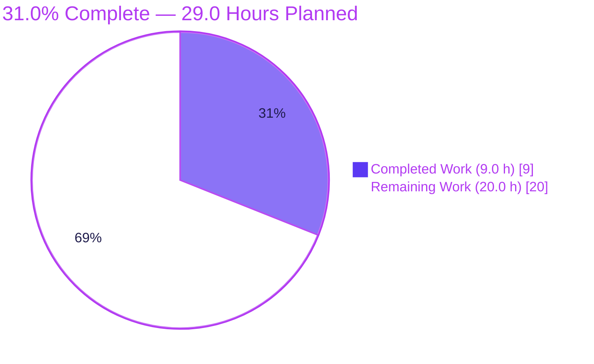
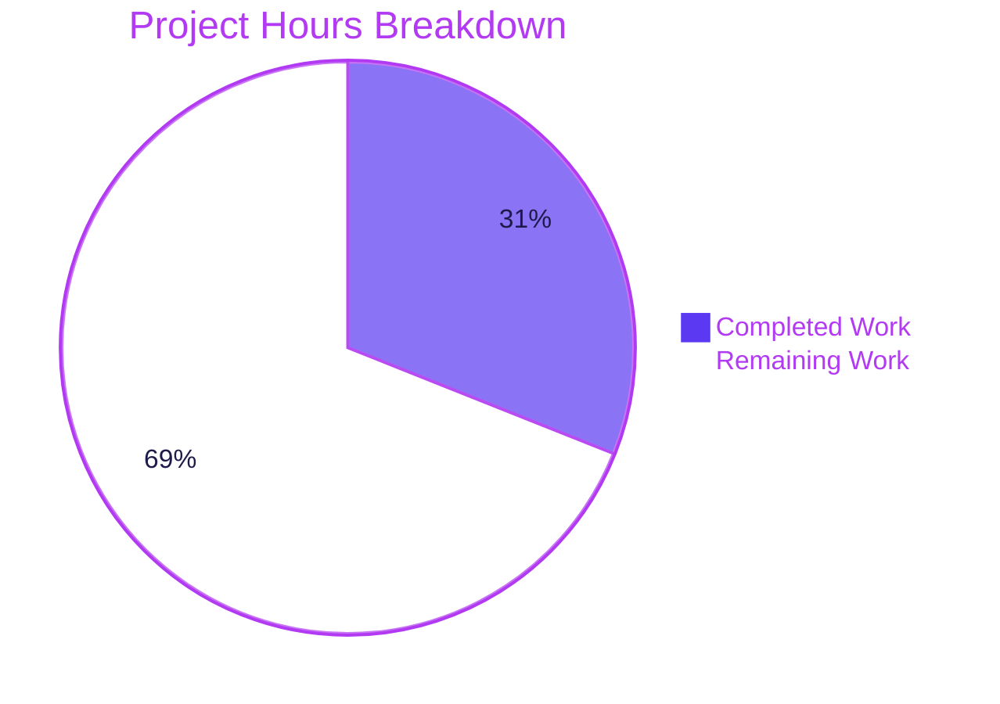
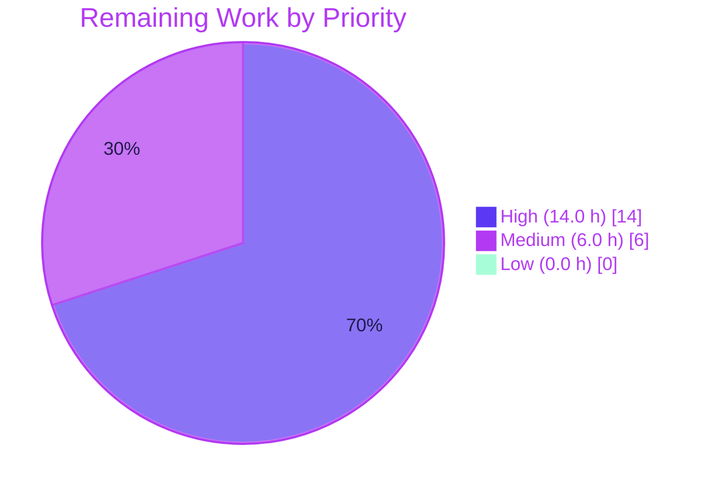

# 1. Executive Summary

The delivered documentation surface, its share of the planned work, and what remains before the repository's own instructions can be followed.

## 1.1 Project Overview

`proactive_insight` is a small FastAPI service used as a test fixture for repository-level insight scanning: an in-memory project and task API behind bearer-token role checks, with no external dependencies. This release reduces the repository's documentation to one entry point — project name, install command, run command, in nine lines — so it can be read at a glance and either command copied. It also settles the requested one-line request-handler summary. Scope: one Markdown file, `README.md`.

## 1.2 Completion Status

**31.0% complete — 9.0 of 29.0 hours.** The documentation deliverable is finished and verified end to end. The remaining 20.0 hours make the repository's own instructions followable: the FastAPI application package `README.md` documents does not exist on any branch or commit.



| Metric | Hours |
|---|---|
| Total Hours | 29.0 |
| Completed Hours (Baseline: Human with agentic-assist) | 9.0 |
| Remaining Hours | 20.0 |

Completion = 9.0 ÷ 29.0 = **31.0%**.

## 1.3 Key Accomplishments

- `README.md` reduced to the three permitted items in nine lines, byte-identical to the required text (`README.md:1-9`).
- Install command verified in a clean Python 3.13.18 environment: four exact pins, clean `pip check`, idempotent re-run.
- Both commands carried unchanged from the previous README and the `uvicorn==0.34.0` pin (`requirements.txt:2`).
- Change contained to one file (+4/−26); tracked set unchanged at six paths; no code, test, dependency or configuration touched (commit `121a5a6`).
- One-line request-handler summary correctly not delivered: no JavaScript file exists anywhere in the repository's history.

## 1.4 Critical Unresolved Issues

**Requested items: 1 of 2 delivered** — the README item is complete, the `server.js` item has no counterpart here. **Open items: 6.**

| Issue | Impact | Owner | ETA |
|---|---|---|---|
| Requested one-line summary above a request handler in `server.js`: no JavaScript file or request handler exists on any branch or commit | One of the two requested items has no counterpart in this codebase and cannot be delivered without a handler to annotate | Repository owner | Not scheduled — conditional on a JavaScript handler being introduced |
| Documented run command starts no service: `app.main` is absent, so uvicorn fails its child process with `ModuleNotFoundError` (`README.md:9`) | Anyone following the README sees uvicorn's start-up banner, then an import failure; nothing listens on the port | Backend engineer | 2 days (11.0 h) |
| Test suite collects nothing: `test_api.py:2` imports the absent `app.main` and `pytest.ini:2` targets a `tests/` directory that does not exist | No automated test verifies any behaviour in the repository | Backend engineer | 1 day (3.0 h) |
| The synthetic-fixture notice, the virtualenv step and the test command are no longer documented anywhere | A reader can miss that the project is a demo with in-memory storage and demo tokens, and an install can target a shared interpreter | Repository owner | 0.5 day (2.0 h) |
| No continuous-integration gate in the tree | A change can merge without its tests ever running | Repository owner | 0.5 day (2.0 h) |
| No coverage or dependency/security scanning configured | Vulnerable or broken pins can ship unnoticed and coverage regressions are invisible | Repository owner | 0.5 day (2.0 h) |

## 1.5 Access Issues

No access issues identified. No credential, API key, registry login, external service, database or environment variable is required; the install resolves from the public index unauthenticated. Only `ss` and `lsof` are missing from the build host, so listener checks use a TCP connect.

## 1.6 Recommended Next Steps

1. **[High]** Restore `app/__init__.py` and `app/main.py` — exporting `app`, `PROJECTS`, `TASKS`, `USAGE`, with `GET /health`, project create/list and bearer-token role checks — so the documented run command starts a service (11.0 h).
2. **[High]** Repair the harness so `pytest` collects and the three tests in `test_api.py` pass (3.0 h).
3. **[Medium]** Decide the README's scope: document the virtualenv step and the demo-fixture notice, then re-audit (2.0 h).
4. **[Medium]** Add a CI gate running the suite on every push and pull request (2.0 h).
5. **[Medium]** Add coverage and dependency/security scanning to that gate (2.0 h).

# 2. Project Hours Breakdown

The work universe is the planned documentation deliverable plus the path-to-production work its own instructions imply: 29.0 hours in total, 9.0 delivered and 20.0 outstanding.

## 2.1 Completed Work Detail

| Component | Hours | Description |
|---|---|---|
| README rewrite to the three-item form | 2.0 | Authored the nine-line file: project name, `Install:` with the install command, `Run:` with the run command, four-space indented code blocks, nothing else — the three permitted items in the required order. |
| Content and form audit | 2.5 | Byte-for-byte comparison with the required text, nine-line and 118-byte confirmation, item order, forbidden-content sweep, secret scan, ASCII/LF and trailing-whitespace checks; 15 of 15 assertions pass. |
| Request-handler summary disposition | 1.0 | Established that no `server.js`, no `.js` project file and no request handler exists on any branch or commit; confirmed no summary comment was placed in any other file and no file was created in its place. |
| Change-containment audit | 1.0 | Verified one modified path, the tracked file set unchanged at six paths, and no code, test, dependency or configuration change; 6 of 6 assertions pass. |
| Runtime validation of the documented commands | 2.0 | Clean-environment install with four exact pins, clean `pip check` and an idempotent re-run; run-command behaviour and TCP port probes; start-up proof with an equivalent application supplied from outside the repository. |
| Documentation claim verification against the tree | 0.5 | Project-name authority against the previous README, the manifest pins, and `--reload` support in the pinned uvicorn release. |
| **Total** | **9.0** | |

## 2.2 Remaining Work Detail

| Category | Hours | Priority |
|---|---|---|
| Application package restoration — `app/__init__.py` and `app/main.py` exporting `app`, `PROJECTS`, `TASKS`, `USAGE`, with `GET /health` returning `{"status": "ok"}`, project create/list, bearer-token Owner role and 401 without a token, so `README.md:9` starts a service | 11.0 | High |
| Test-harness repair and suite verification — provide the `tests/` package `pytest.ini:2` declares (or repoint `testpaths`), relocate `test_api.py`, and get its three tests passing against the restored application | 3.0 | High |
| README scope decision and revision — decide whether to keep the three-item cap or add the virtualenv step and a statement that this is a synthetic fixture with in-memory storage and demo tokens that must not be deployed or given real credentials | 2.0 | Medium |
| Continuous-integration test gate running the suite on every push and pull request | 2.0 | Medium |
| Coverage and dependency/security scanning (pytest-cov, bandit) wired into that gate, with a recorded baseline | 2.0 | Medium |
| Conditional request item — the one-line summary above a request handler, if a JavaScript handler is ever introduced (no JavaScript exists today) | 0.0 | Low |
| **Total** | **20.0** | |

## 2.3 Calculation Method and Confidence

**Formula:** Completion % = Completed Hours ÷ (Completed Hours + Remaining Hours) × 100 = 9.0 ÷ (9.0 + 20.0) × 100 = **31.0%**. Section 2.1 sums to 9.0 hours, Section 2.2 sums to 20.0 hours, and 9.0 + 20.0 = 29.0 hours, the total in Section 1.2 and the sum of the two slices in the Section 7 chart.

**Basis for the completed hours.** Each row is the effort one engineer spends on a nine-line documentation change that must be exactly right: authoring (2.0 h), an assertion-level audit of content and form (2.5 h), the disposition of a requested item whose target file does not exist (1.0 h), proving the change touched nothing else (1.0 h), exercising both documented commands in a clean environment (2.0 h), and checking the file's claims against the tree (0.5 h). Confidence: **high**.

**Basis for the remaining hours.** The largest row, application restoration (11.0 h), is bounded by the contract `test_api.py` already declares — three behaviours, in-memory stores, one role check — and splits into roughly 7 hours of implementation, 3.5 hours of tests and 0.5 hours of integration; because the service's internal design (role model, task lifecycle, billing simulation described in the repository's earlier README) is not specified anywhere in the tree, confidence there is **medium**. The remaining four rows are **high** confidence: harness repair (3.0 h), a documentation decision and edit (2.0 h), a CI gate (2.0 h) and scanning tooling (2.0 h) are all standard, well-understood work on a repository this size.

# 3. Test Results

Every row below was executed in this checkout at commit `121a5a6`, and the counts are the ones observed. The repository's own automated tests do not execute: `pytest` stops during collection, so the only executed tests are the audits and command runs listed below.

| Area / Category | Framework | Tests | Passed | Failed | Coverage | What This Proves |
|---|---|---|---|---|---|---|
| Repository unit tests (`test_api.py`) | pytest 8.3.5 | 0 executed — 1 collection error | 0 | 0 | none configured | The suite cannot import the application, so the repository's own tests verify no behaviour at all. |
| Dependency installation from the documented command | pip 26.3 in a clean Python 3.13.18 virtualenv | 7 assertions | 7 | 0 | n/a | The install command resolves exactly `fastapi 0.115.12`, `uvicorn 0.34.0`, `pytest 8.3.5` and `httpx 0.28.1`, leaves `pip check` clean and is safe to repeat. |
| Documentation content audit | `diff` / `grep` assertion set | 15 assertions | 15 | 0 | n/a | `README.md` is byte-identical to the required text: nine lines, three items in order, nothing else, ASCII/LF only, no secrets or links. |
| Change-surface audit | git | 6 assertions | 6 | 0 | n/a | One path modified, the tracked set unchanged at six files, no JavaScript present, no dependency or configuration change. |

**Not Covered.** These are the capabilities that exist on paper or are named by the repository but are exercised by no test at all:

- **The FastAPI service itself** — `GET /health`, `POST /projects`, `GET /projects`, the bearer-token Owner role and the 401 path declared in `test_api.py` are neither implemented nor tested; a human must verify each once the application package exists.
- **Task workflows, team membership and the simulated billing limit** described by the repository's earlier README — nothing in the tree implements them, so nothing tests them.
- **Install on an externally-managed interpreter** — only a private virtualenv install was exercised; a PEP 668 managed interpreter would refuse the documented command, and that path was not run.
- **Coverage** — the project configures no coverage tool, so no line or branch coverage figure exists for any code in the repository.
- **Browser rendering of `/docs` from repository code** — the page was reached only with an equivalent application supplied from outside the repository (Section 4), so how it renders for a reader of the restored service is untested.

# 4. Runtime Validation & UI Verification

- ✅ **Documented install path** — `pip install -r requirements.txt` in a clean Python 3.13.18 virtualenv: exit 0, four exact pins, `pip check` clean, immediate re-run idempotent.
- ✅ **Change containment** — the delivered commit modifies `README.md` alone (+4/−26); `git status` shows nothing but three untracked PNGs under `blitzy/screenshots/`.
- ❌ **Service start-up** — `uvicorn app.main:app --reload` prints `Uvicorn running on http://127.0.0.1:8000` and `Started reloader process … using StatReload`, then `ModuleNotFoundError: No module named 'app'`; 0 of 10 TCP connects to port 8000 succeeded during the live window, and the reloader survives until interrupted.
- ⚠ **HTTP surface (`/health`, `/docs`, `/openapi.json`)** — served only when an equivalent FastAPI application was supplied from outside the repository: `/health` returned 200 `{"status":"ok"}`, `/docs` returned 200 and `/openapi.json` returned OpenAPI 3.1.0. No repository code serves these routes.
- ❌ **Authentication and role checks** — `test_api.py:5` expects a bearer Owner token and `test_api.py:25-26` expects 401 without one, but no code implements or exercises either behaviour.
- ❌ **Repository test gate** — `pytest -q` exits 2 during collection (`test_api.py:2`), so no test runs in any pipeline that invokes it.
- ⚠ **Browser and UI verification** — the delivered change exposes no page and starts no service, so no user interface was driven. Three PNGs under `blitzy/screenshots/` capture the `/docs` page and the `/health` response of the stand-in application described above; they are untracked and must not be committed.

**Never exercised at runtime:** every route of the intended API (health, project create/list, task workflows, team membership, billing limit), the bearer-token role model and its 401 path, all in-memory state handling, and the installed dependencies' behaviour under load or concurrency. None of that code exists in the repository, so none of it could be started, called or observed.

# 5. Compliance & Quality Review

This section maps each planned deliverable to the quality and compliance benchmark it answers, then records every place the delivery departed from the agreed specification or from the user's rules, and why.

## 5.1 Compliance Matrix

| Deliverable | Benchmark | Verified Status | Progress |
|---|---|---|---|
| `README.md` carries only the three permitted items, in order | Plan §0.1 R2, §0.3 | Pass — name on line 1, install on lines 3–5, run on lines 7–9, no fourth item (`README.md:1-9`) | ✅ Complete |
| `README.md` equals the required text exactly | Plan §0.3 acceptance criterion | Pass — byte-identical, 9 lines / 118 bytes, `diff` exit 0 | ✅ Complete |
| `README.md` stays under 15 lines | Plan §0.1 R2 | Pass — 9 lines, margin 6 | ✅ Complete |
| One-line request-handler summary, delivered only where a handler exists | Plan §0.1 R1, §0.2, §0.6 | Pass — condition not triggered; no JavaScript file, no comment placed anywhere | ➖ Not applicable |
| Change contained to documentation text in one file | Plan §0.6, §0.7 | Pass — one path, +4/−26, tracked set unchanged at six files | ✅ Complete |
| No dependency, tool, lockfile or configuration added | Plan §0.5 | Pass — `requirements.txt` unchanged, no CI or manifest files | ✅ Complete |
| Documented commands are the repository's own, not invented | Plan §0.2, §0.3 | Pass — identical to the previous README's lines 15–16 and the `uvicorn==0.34.0` pin | ✅ Complete |
| No secrets, credentials, URLs or pipe-to-shell commands introduced | Enterprise baseline | Pass — scans clean; no `http`, `token`, `password` or shell operator in the file | ✅ Complete |
| Documented install command works from a clean environment | Path to production | Pass — exit 0, four exact pins, clean `pip check`, idempotent | ✅ Complete |
| Documented run command starts the service | Path to production | Fail — `ModuleNotFoundError: No module named 'app'`; nothing listens (0 of 10 connects) | ❌ Not started |
| Repository test suite executes and reports results | Path to production | Fail — `pytest` exits 2 at collection; 0 tests executed | ❌ Not started |
| Automated quality gate: tests, coverage, dependency scanning | Path to production | Absent — no CI configuration, coverage tool or scanner in the tree | ❌ Not started |

## 5.2 AAP & Rule Divergences and Gaps

No user rule was supplied for this project — no rules document exists in the repository and none accompanied the request — so no rule departure is possible. Every requirement of the plan was met as written; the rows below are the places where the delivery departs from the repository's own apparent intent, plus the plan's own settled dispositions of what the repository cannot host.

| What the AAP/Rule Required | What Was Delivered Instead | Why It Diverged | Impact | Remediation |
|---|---|---|---|---|
| A single `/** <summary> */` line immediately above the request handler in `server.js` | Nothing: no `server.js`, no `.js` file and no request handler exists, and no file was created in its place | The repository contains no JavaScript at all — it is a Python FastAPI fixture — and the plan recorded the absence while forbidding a stand-in file (§0.2, §0.4, §0.6): a sanctioned disposition | One of the two requested items has no counterpart in this codebase | None possible now; add the line if a JavaScript request handler is ever introduced |
| The documentation names the repository's own run command | `README.md:9` keeps `uvicorn app.main:app --reload` although `app.main` is absent from every branch and commit | Plan §0.3 decided to carry the documented command unchanged and R2's three-item cap forbids a caveat: a sanctioned decision | A reader who follows the file sees uvicorn's start-up banner and then an import failure; no service listens | Restore the application package (11.0 h), or change the documented command if the owner prefers |
| Only the project name, the install command and the run command appear in `README.md` | The previous README's synthetic-fixture warning ("do not deploy it or use real credentials"), its virtualenv creation and activation steps, and its `pytest -q` instructions were all removed | The three-item cap required their removal: a sanctioned decision | The safety context is gone from the repository, and a venv-less install can downgrade a shared interpreter | Owner decision plus edit (2.0 h) |
| A repository whose documented commands and tests run | The suite still cannot collect: `test_api.py:2` imports the absent `app.main`, and `pytest.ini:2` targets a `tests/` directory that does not exist | Repairing it requires application code, which the plan's scope boundary excludes; the condition predates this change and a Markdown edit cannot affect it | No automated test verifies any behaviour in the repository | 3.0 h once the application package exists |
| Enterprise baseline: an automated gate for tests, coverage and dependency hygiene | No CI configuration, coverage tool, linter or security scanner in the tree | The plan forbids adding any dependency, tool or configuration to a documentation-only change | Regressions, coverage loss and vulnerable pins can ship unnoticed | 4.0 h (CI gate 2.0 h, scanning 2.0 h) |

**The run command that cannot run — decision required.** `README.md:9` is the repository's own documented command and its server is pinned at `requirements.txt:2`, but `app.main` has never existed in this repository: `git ls-tree` over every local and remote ref returns no `app/` path and `git log --diff-filter=D -- 'app/*'` shows no deletion. Executing it produces `ModuleNotFoundError: No module named 'app'` after uvicorn prints `Uvicorn running on http://127.0.0.1:8000`, which is the most misleading line in the repository today — the banner appears before the child process imports the application, and 0 of 10 TCP connects to port 8000 succeeded while it was up. The owner must either restore the application package (11.0 h, `app/__init__.py` and `app/main.py`) or change the documented command to something the tree can honour.

**A test module that names a service nobody has written — decision required.** `test_api.py` is the only executable specification in the repository: it expects `GET /health` to return `{"status": "ok"}`, an Owner-token bearer flow to create and list projects, and a 401 without a token. None of that code exists, so `pytest` exits 2 at collection (`test_api.py:2`) and `pytest.ini:2` additionally points at a `tests/` directory that was never created. Until the application package is restored and the module is placed where `testpaths` expects it (3.0 h), the repository has no automated verification of anything, and every future change is unguarded.

**The safety notice this repository lost — decision required.** The previous README closed with a warning that the project is a synthetic QA fixture with in-memory storage and demo tokens, not to be deployed or given real credentials. The three-item cap removed it along with the virtualenv and test instructions, and the delivered file has no room to carry it back. The practical consequence is that a reader can now find nothing in the repository that says the demo tokens are not secrets or that the in-memory store is not production storage, and an install run from a shared interpreter will pin `uvicorn 0.34.0` and `pytest 8.3.5` over whatever is already there. Two hours of owner decision and editing closes both halves.

**No gate on the way in — decision required.** Nothing in the tree runs when a change is proposed: there is no CI configuration, no coverage tool and no dependency scanner (`requirements.txt` ships only the four runtime and test pins). That was the right call for a documentation-only change, since adding tooling would have breached the plan's own scope boundary, but it leaves the repository with no automated protection. A CI workflow that runs `pytest` on each push and pull request (2.0 h) plus `pytest-cov` and `bandit` on a recorded baseline (2.0 h) gives the restored application the gate it needs.

# 6. Risk Assessment

| Risk | Category | Severity | Probability | Mitigation | Status |
|---|---|---|---|---|---|
| The documented run command starts no service, and uvicorn's start-up banner makes a reader believe one is up | Technical | High | Certain (observed) | Restore the application package so `README.md:9` starts a service (11.0 h) | Open |
| No automated test executes, so any change to the repository is unverified | Technical | High | High | Repair the harness and get the three declared tests passing (3.0 h) | Open |
| Nothing in the repository states that this is a demo fixture with in-memory storage and demo tokens, so real credentials could be pointed at it or the demo deployed | Security | High | Medium | Owner decision and README revision (2.0 h) | Open |
| No dependency, coverage or vulnerability scanning exists, so a broken or vulnerable pin ships unnoticed | Security | Medium | High | Add scanning to a CI gate on a recorded baseline (4.0 h) | Open |
| The run command never exits on its own when the child fails to import (`--reload` reloader survives), so a wrapper script or CI step hangs without its own deadline | Operational | Medium | High | Set a deadline in any wrapper; re-test once the application exists | Open |
| A broad `git add -A` would commit the three untracked PNGs under `blitzy/screenshots/` and the tracked `.DS_Store` | Operational | Low | Medium | Keep validation artifacts out of the change; add a `.gitignore` in a later change | Open |
| The documented install targets whatever interpreter is active; a PEP 668 managed interpreter refuses it and a shared one is downgraded to the pinned versions | Integration | Medium | Medium | Document the virtualenv step in the README revision (2.0 h) | Open |
| The application name has a single source (`README.md:1`), so a rename in code could not be detected by searching tracked files | Technical | Low | High | Falls out of the application restoration, which puts the name in code | Open |

# 7. Visual Project Status

Completed work (dark blue) against remaining work (white), and how the remaining 20.0 hours distribute across priorities.





| Priority | Remaining Hours | Items |
|---|---|---|
| High | 14.0 | Application package restoration (11.0 h), test-harness repair (3.0 h) |
| Medium | 6.0 | README scope decision and revision (2.0 h), CI test gate (2.0 h), coverage and security scanning (2.0 h) |
| Low | 0.0 | Conditional handler summary — no estimate while no JavaScript handler exists |
| **Total** | **20.0** | |

# 8. Summary & Recommendations

The delivered documentation surface is complete on its own terms. `README.md` now carries the project name, the install command and the run command in nine lines and nothing else, byte-identical to the required text, with both commands carried unchanged from the repository's previous README and the `uvicorn==0.34.0` pin. The install command was exercised from a clean Python 3.13.18 environment and resolves the four pins exactly with a clean `pip check`. The change is one file, +4/−26 lines, with the tracked set unchanged at six paths and no code, test, dependency or configuration touched. The one-line request-handler summary was not delivered because no JavaScript file or request handler exists anywhere in the repository's history, and no file was invented to host it.

That is **31.0% of the 29.0 hours this work universe contains** (9.0 completed, 20.0 remaining). The gap is not documentation debt: it is that the service the documentation describes has never been in the repository. Executing `README.md:9` prints uvicorn's start-up banner and then `ModuleNotFoundError: No module named 'app'`, and 0 of 10 TCP connects to port 8000 succeeded while it ran. The only executable specification of the intended service is `test_api.py`, whose three tests cannot even be collected.

The critical path is short and entirely conventional. Restore the application package — `app/__init__.py` and `app/main.py` exporting `app`, `PROJECTS`, `TASKS`, `USAGE`, with `GET /health`, project create/list and bearer-token role checks (11.0 h); repair the harness so `pytest` collects and those three tests pass (3.0 h); decide the README's scope and restore the virtualenv step and the demo-fixture notice the three-item cap removed (2.0 h); then add the gate that keeps it honest — CI running the suite (2.0 h), coverage and dependency scanning on a recorded baseline (2.0 h).

| Success Metric | Target | Current |
|---|---|---|
| Documentation content audit | 15 of 15 assertions pass | ✅ 15 of 15 |
| Change surface | One path, tracked set unchanged | ✅ 6 tracked files, 1 modified |
| Documented install | Exit 0, four exact pins, clean `pip check` | ✅ Achieved |
| Documented run command | Service listening and `/health` returning 200 | ❌ Import fails, nothing listens |
| Repository test suite | Exit 0, three tests passing | ❌ Exit 2, one collection error |
| Automated gate | Tests, coverage and scanning enforced on each change | ❌ None configured |

**Production readiness: not runnable, and it never was.** Readiness splits cleanly in two. As documentation, the repository is release-ready: minimal, accurate to the tree, free of secrets and prerequisites, and identical in procedure to what it documented before. As an application, it is not deployable and cannot be verified — no application code exists, no test executes, and nothing states that the demo tokens and in-memory storage are unfit for production. The next owner should treat the 20.0 remaining hours as the definition of done, and should not deploy this repository until the run command starts a service and the suite reports results.

# 9. Development Guide

Every command below was run against this checkout. Where a command is expected to fail today, the observed output and the reason are stated.

### System Prerequisites

- **Python 3.13** — verified on 3.13.18 (`python3 -V`). Do not use 3.14: no pinned dependency declares support for it.
- **Git with Git LFS** — the repository's pre-push hook is the standard LFS hook, so `git-lfs` must stay on PATH (verified 3.7.1).
- **No infrastructure** — no database, cache, queue, object store, container, environment variable or secret. No tracked file reads an environment variable.
- **No `ss` / `lsof`** on this host — probe a port with a TCP connect (see Verification), never by killing a PID matched on name.

### Environment Setup

```bash
cd <repository root>
python3 -m venv .venv
.venv/bin/python -m pip install --upgrade pip setuptools wheel
```

The system interpreter carries a PEP 668 externally-managed marker, so plain `pip install` into it is refused. Always work inside `.venv`; the venv writes its own `.venv/.gitignore`, so it never enters a commit.

### Dependency Installation

```bash
.venv/bin/python -m pip install -r requirements.txt
.venv/bin/python -m pip check
```

Observed: exit 0, resolving `fastapi 0.115.12`, `uvicorn 0.34.0`, `pytest 8.3.5`, `httpx 0.28.1`, followed by `No broken requirements found.` A re-run reports `Requirement already satisfied` for every package and also exits 0.

### Application Startup

```bash
.venv/bin/uvicorn app.main:app --reload
```

Expected today: uvicorn logs `Will watch for changes in these directories: …`, then `Uvicorn running on http://127.0.0.1:8000 (Press CTRL+C to quit)` and `Started reloader process … using StatReload`, then fails the child process with `ModuleNotFoundError: No module named 'app'` and keeps the reloader alive until interrupted. Nothing listens on the port. The command needs the application package described in Section 2.2 before it can start a service.

Run several checkouts side by side by giving each a ten-port block; uvicorn's default is 8000:

```bash
CLONE_INDEX=3 .venv/bin/uvicorn app.main:app --reload --host 127.0.0.1 --port $((8000 + 10 * 3))
```

### Verification Steps

```bash
# 1. Dependency set is consistent
.venv/bin/python -m pip check

# 2. Syntax of the test module (works today, checks nothing at runtime)
.venv/bin/python -m py_compile test_api.py

# 3. Full suite — expected today: exit 2, "Interrupted: 1 error during collection"
.venv/bin/python -m pytest -q -p no:cacheprovider

# 4. Documentation content audit
diff <(printf '# Proactive Insights Demo API\n\nInstall:\n\n    pip install -r requirements.txt\n\nRun:\n\n    uvicorn app.main:app --reload\n') README.md && echo "README content identical"

# 5. Is anything listening? (ss and lsof are unavailable on this host)
.venv/bin/python -c "import socket;s=socket.socket();s.settimeout(1);print('listening' if s.connect_ex(('127.0.0.1',8000))==0 else 'nothing listening')"
```

Keep bytecode and pytest's cache out of the tree: `export PYTHONPYCACHEPREFIX=<your scratch dir>/pyc` and pass `-p no:cacheprovider`. There is no top-level `.gitignore`, so `__pycache__/` and `blitzy/` otherwise show as untracked.

### Example Usage

Once the application package exists, the documented endpoints are reachable at uvicorn's default port:

```bash
curl -s http://127.0.0.1:8000/health              # {"status":"ok"}
curl -s -o /dev/null -w '%{http_code}\n' http://127.0.0.1:8000/docs      # 200
curl -s http://127.0.0.1:8000/openapi.json | head -c 80                  # OpenAPI 3.1.0 document
curl -s -o /dev/null -w '%{http_code}\n' http://127.0.0.1:8000/projects  # 401 — no bearer token
```

Each response above was observed against an equivalent FastAPI application supplied from outside the repository, which is how far the current tree can take them.

### Troubleshooting

| Symptom | Cause | Resolution |
|---|---|---|
| `ModuleNotFoundError: No module named 'app'` on start-up | The application package is absent from the repository | Restore `app/__init__.py` and `app/main.py` (11.0 h, Section 2.2) |
| `Interrupted: 1 error during collection` with `test_api.py:2` in the traceback | `test_api.py` imports the same absent `app.main` | Fix follows the application restoration |
| `PytestConfigWarning: No files were found in testpaths` | `pytest.ini:2` sets `testpaths = tests`, but no `tests/` directory exists | Create `tests/` and move the module there, or repoint `testpaths` (3.0 h) |
| `error: externally-managed-environment` from `pip` | PEP 668 marker on the system interpreter | Use `.venv/bin/python -m pip …` |
| The start-up command never returns | Under `--reload` the reloader survives its child's import failure | Front it with `timeout 20 …` or press Ctrl+C; do not wait for a natural exit |
| `Address already in use` | Another checkout on the same host already holds the port | Pass `--port $((8000 + 10 * N))` for a private ten-port block |
| `ss: command not found` / no `lsof` | Neither tool is installed here | Probe with a TCP connect or `curl`, which report `http_code=000` and exit 7 when nothing listens |

# 10. Appendices

Supporting references for the commands, ports, files, versions and vocabulary used throughout this guide.

## A. Command Reference

| Purpose | Command | Observed Result |
|---|---|---|
| Create the environment | `python3 -m venv .venv` | exit 0, Python 3.13.18 |
| Install dependencies | `.venv/bin/python -m pip install -r requirements.txt` | exit 0, four exact pins |
| Check dependency consistency | `.venv/bin/python -m pip check` | `No broken requirements found.` |
| Run the test suite | `.venv/bin/python -m pytest -q -p no:cacheprovider` | exit 2, 1 collection error, 0 tests |
| Syntax-check a module | `.venv/bin/python -m py_compile test_api.py` | exit 0 |
| Start the service | `.venv/bin/uvicorn app.main:app --reload` | `ModuleNotFoundError: No module named 'app'`, nothing listening |
| Start on a private port block | `CLONE_INDEX=N .venv/bin/uvicorn app.main:app --reload --port $((8000 + 10 * N))` | same import failure today |
| Probe a listener | `.venv/bin/python -c "import socket;s=socket.socket();s.settimeout(1);print(s.connect_ex(('127.0.0.1',8000)))"` | `0` when listening, non-zero when not |
| Audit the README bytes | `sha256sum README.md` | `0d776c1b43a2552de229c3d029f55e7fd46134dba294ed4cdd77b702a8daf49c` |
| Inspect the change | `git diff --stat b8903e9..HEAD` | `README.md \| 30 ++++---…`, 1 file, +4/−26 |

## B. Port Reference

| Port | Use |
|---|---|
| 8000 | uvicorn's default, the port `README.md:9` implies; nothing listens there today |
| 8000 + 10 × N | The private ten-port block for checkout N when several clones run on one host (N=3 → 8030) |
| None | No database, cache, broker or metrics port exists; the service is the only listener the repository defines |

## C. Key File Locations

| Path | Purpose |
|---|---|
| `README.md` | The delivered documentation: project name, install command, run command (9 lines) |
| `requirements.txt` | The four exact pins; the install command's target and the run command's server pin (line 2) |
| `test_api.py` | The only executable specification of the intended service: health, project create/list, 401 without a token |
| `pytest.ini` | pytest configuration; `testpaths = tests` names a directory that does not exist |
| `__init__.py` | Empty package marker at the repository root |
| `.DS_Store` | Tracked macOS metadata file, unrelated to the project |
| `blitzy/screenshots/` | Untracked PNGs of the `/docs` page and `/health` response captured from a stand-in application; must stay out of commits |
| `.venv/` | Local virtualenv, self-ignored; never committed |

## D. Technology Versions

| Component | Version | Source |
|---|---|---|
| Python | 3.13.18 | `python3 -V` in this checkout |
| fastapi | 0.115.12 | `requirements.txt:1` |
| uvicorn | 0.34.0 | `requirements.txt:2` |
| pytest | 8.3.5 | `requirements.txt:3` |
| httpx | 0.28.1 | `requirements.txt:4` |
| starlette | 0.46.2 | resolved transitively by fastapi |
| pydantic / pydantic_core | 2.14.4 / 2.50.5 | resolved transitively |
| anyio / httpcore / h11 | 4.16.0 / 1.0.9 / 0.16.0 | resolved transitively |
| click / pluggy / iniconfig / packaging | 8.5.1 / 1.7.0 / 2.3.1 / 26.4 | resolved transitively |
| pip / setuptools / wheel | 26.3 / 84.2.1 / 0.48.0 | virtualenv bootstrap |
| Git LFS | 3.7.1 | required by the pre-push hook |

## E. Environment Variable Reference

**None.** The project reads no environment variable — no tracked file references `os.environ`, `getenv` or an `environ[...]` lookup — and none was supplied with the request. The service, once restored, is expected to run on its defaults with in-memory storage, so no variable needs to be set to build, test or start it.

## F. Developer Tools Guide

| Tool | Role in this project |
|---|---|
| `python3` / `.venv/bin/python` | Interpreter for the service, the tests and every audit command |
| `pip` | Installs the four pins; always invoked through `.venv/bin/python -m pip` |
| `pytest` | The only test runner; `pytest.ini` supplies its configuration |
| `uvicorn` | The ASGI server the documented run command starts |
| `git` | Change inspection: `git diff <base>..HEAD`, `git ls-files`, `git ls-tree` |
| `git-lfs` | Must stay on PATH for the repository's pre-push hook |
| `curl` | HTTP probes; reports `http_code=000` and exit 7 when nothing listens |
| Python `socket` | The reliable listener probe on a host without `ss` or `lsof` |
| Google Chrome | Available if a future change needs a browser view of `/docs`; nothing in the current tree serves a page to drive |
| Docker | Available on the host, but the project defines no container workflow and no image should be added without an owner decision |

## G. Glossary

| Term | Meaning in this guide |
|---|---|
| **Bearer token** | The `Authorization: Bearer <token>` header `test_api.py:5` sends; the demo uses fixed tokens such as `owner-token`, not secrets |
| **Owner role** | The privileged role the intended service checks before allowing project creation and listing |
| **In-memory store** | Module-level `PROJECTS`, `TASKS` and `USAGE` structures the tests expect; data disappears when the process stops |
| **Fixture** | A deliberately small, self-contained project used to exercise scanning tools rather than to serve users |
| **Collection error** | pytest failing to import a test module before any test runs — the reason the suite reports 0 tests today |
| **PEP 668 marker** | The "externally-managed-environment" guard that makes a plain `pip install` into the system interpreter fail; the reason `.venv` is mandatory |
| **Ten-port block** | The `8000 + 10 × N` range reserved for checkout N so concurrent clones never share a port |
| **Change surface** | The set of paths a commit modifies; here exactly one, `README.md` |
| **Path to production** | The work needed before the delivered documentation can be followed successfully, as distinct from the documentation text itself |
