# Technical Specification

# 1. Introduction

## 1.1 Executive Summary

**Project overview.** The `proactive_insight` repository, branch `main`, HEAD `b8903e9`, holds the scaffolding of a FastAPI service called **Proactive Insights Demo API**. `README.md` line 3 defines it as "a compact FastAPI service designed as a test fixture for repository-level proactive insights", and line 31 states that it "is a synthetic QA fixture, not a production application". Everything the repository contains serves that fixture role: a README, a four-line dependency manifest, a three-line pytest configuration, a 26-line test module, and an empty root `__init__.py`.

**Delivered state versus declared state.** The service's implementation package is absent. `README.md` line 16 launches the service with `uvicorn app.main:app`, and `test_api.py` line 2 imports `app`, `PROJECTS`, `TASKS` and `USAGE` from `app.main`, yet no `app` directory exists in the tree; the only Python files at HEAD are `__init__.py` (0 bytes) and `test_api.py`. The `tests` directory named by `pytest.ini` line 2 is also absent, so the test module sits at the repository root and is collected only through pytest's fallback scan, which warns "No files were found in testpaths". This Introduction therefore attributes every capability either to the declared contract (`README.md`, `test_api.py`) or to a file that exists, and labels which is which.

**Core business problem.** The repository solves an evaluation problem rather than an end-user problem. A repository-level insight scanner needs a compact target whose defect surface is known in advance, so that the findings it raises can be judged correct or incorrect; this fixture supplies such a target and deliberately leaves gaps in it. `README.md` line 8 calls the suite "deliberately small ... leaving important workflows and non-functional behaviours untested", while lines 6-7 declare workflows — project and task handling, team membership, a simulated billing limit, role checks — that `test_api.py` never exercises. The distance between declared and covered behaviour is the artefact under evaluation.

**Key stakeholders and users.**

| Stakeholder | Use of the repository | What it depends on | Evidence |
| --- | --- | --- | --- |
| Scanner evaluators and QA engineers | Point a repository-level insight scan at the repository root on `main`, then review the findings it raises | A compact, self-contained target with intentional gaps | `README.md` lines 3, 8, 25-28, 31 |
| API implementers | Supply and maintain the `app/main.py` module the fixture is written against | Exact object names `app`, `PROJECTS`, `TASKS`, `USAGE`; documented paths and status codes | `README.md` line 16; `test_api.py` lines 2, 15, 19-26 |
| Test authors | Extend the intentionally incomplete suite | The pytest discovery settings and the in-memory state reset contract | `README.md` line 8; `pytest.ini` lines 1-3; `test_api.py` lines 8-11 |
| Operators and integrators | None; this group is explicitly excluded | A warning not to deploy and not to use real credentials | `README.md` line 31 |

**Expected business impact and value proposition.**

- **Self-contained evaluation target.** No database, no external service and no environment configuration are required (`README.md` lines 9 and 28); a run needs only the pinned dependencies installed.
- **Reproducible dependency set.** `requirements.txt` pins four exact versions — `fastapi==0.115.12`, `uvicorn==0.34.0`, `pytest==8.3.5`, `httpx==0.28.1` — so an evaluation is not perturbed by version drift.
- **Known, deliberate coverage gaps.** The shipped suite consists of three tests covering a health probe, one project create-and-list path, and rejection of an anonymous request (`test_api.py` lines 14-26), leaving the declared task, team and billing behaviours unverified (`README.md` lines 7-8).
- **Bounded and explicitly stated limit.** Until `app` and `tests` are committed, an inspection of HEAD observes scaffolding only: the service cannot start, the suite cannot import, and none of the declared workflows can be exercised at runtime. The repository's value today is as a declared specification and a deliberately minimal test contract, not as a runnable service.
- **No production impact.** The fixture is not deployable and carries no real credentials (`README.md` lines 30-31), so its business value lies entirely in evaluation fidelity.


## 1.2 System Overview

### 1.2.1 Project Context

**Business context and market positioning.** The repository is an internal quality-engineering asset, not a commercial product. `README.md` line 3 positions it as "a test fixture for repository-level proactive insights", line 31 confirms it is "for scanner evaluation only", and lines 25-28 prescribe the intended operating envelope: scan the repository root, select the `main` branch, and configure no environment because "this fixture is self-contained". There is no customer segment, pricing, or competitive positioning anywhere in the six tracked files.

**Current system limitations.** The repository replaces no earlier system: history is three commits — uploading `proactie_insight_testing-main.zip`, deleting that archive, then uploading the six scaffolding files — so there is no legacy implementation to migrate from. The limitations below belong to the fixture as delivered at HEAD.

| Limitation | Consequence | Evidence |
| --- | --- | --- |
| No `app` package in the tree | `uvicorn app.main:app` cannot start; `from app.main import ...` fails, so the suite cannot be collected | `README.md` line 16; `test_api.py` line 2 |
| No `tests` directory | `pytest.ini`'s `testpaths = tests` matches nothing; the root-level module is reached only by pytest's fallback scan | `pytest.ini` line 2; `test_api.py` path |
| Process-local state only | Project, task and usage data are lost on restart and cannot be shared between workers | `README.md` line 9; `test_api.py` lines 2, 9-11 |
| Demo bearer tokens, no credential store | The only named principal is the literal header `Bearer owner-token` | `README.md` lines 6, 31; `test_api.py` line 5 |
| Intentionally partial coverage | Task, team-membership, role-check and billing-limit behaviour has no test | `README.md` line 8; `test_api.py` lines 14-26 |
| Empty `__init__.py` at the repository root | The repository root is itself an importable package, which shapes how pytest resolves imports | `__init__.py` (0 bytes) |
| Committed `.DS_Store` | A macOS Finder artefact is part of the tracked tree and is noise for any scan | `.DS_Store` (8196 bytes) |

**Integration with the existing enterprise landscape.** None. `README.md` line 9 states that "No external database or service is required", and the dependency manifest contains only an ASGI framework, an ASGI server, a test runner and an HTTP client; no database driver, message broker client, identity provider SDK, or telemetry exporter appears.

| Dependency | Version | Role in the fixture |
| --- | --- | --- |
| `fastapi` | 0.115.12 | ASGI application framework that defines the declared HTTP surface |
| `uvicorn` | 0.34.0 | ASGI server named in the run instructions |
| `pytest` | 8.3.5 | Test runner used by the shipped suite |
| `httpx` | 0.28.1 | Transport beneath `fastapi.testclient.TestClient` |

### 1.2.2 High-Level Description

**Primary system capabilities.** The table separates capabilities the repository's test contract pins down concretely from those stated only in prose. No row in the "State at HEAD" column is backed by an implementation file, because the implementation module does not exist.

| Capability | Declared behaviour | State at HEAD | Evidence |
| --- | --- | --- | --- |
| Health probe | `GET /health` returns body `{"status": "ok"}` | Contract only; path and body fixed by test | `test_api.py` lines 14-15 |
| Project creation | `POST /projects` with JSON `{"name": ...}` and a bearer token returns HTTP 200 with a body that echoes `name` and carries an `id` | Contract only | `test_api.py` lines 19-21 |
| Project listing | `GET /projects` with a bearer token returns an array whose first element is the most recently created project | Contract only; the ordering is implied by the `[0]["id"]` assertion | `test_api.py` line 22 |
| Token enforcement | `GET /projects` without an `Authorization` header returns HTTP 401 | Contract only | `test_api.py` lines 25-26 |
| Role checks | Requests carry "authentication-like bearer tokens and role checks" | Declared only; no role name beyond `owner` appears in any file | `README.md` line 6; `test_api.py` line 5 |
| Project and task workflows | Project and task workflows are listed as included | Declared only; `TASKS` exists as a name, no task endpoint is named | `README.md` line 7; `test_api.py` line 2 |
| Team membership | Team membership is listed as included | Declared only | `README.md` line 7 |
| Simulated billing limit | A usage figure is tracked and enforced as a limit | Declared only; the sole concrete artefact is the `USAGE["used"]` counter that tests reset to `0` | `README.md` line 7; `test_api.py` line 11 |
| In-memory storage | "data is held in memory" | Declared and implied by the three module-level containers | `README.md` line 9; `test_api.py` lines 2, 9-11 |
| Interactive documentation | FastAPI's `/docs` page served at `http://127.0.0.1:8000/docs` | Declared only; host and port follow uvicorn's default, no configuration exists in the repository | `README.md` lines 16-18 |

**Major system components.**

| Component | Expected location | State at HEAD | Responsibility |
| --- | --- | --- | --- |
| ASGI application object `app` | `app/main.py` | Missing | Holds routes, request validation and the HTTP surface exercised by every test |
| `PROJECTS` store | `app/main.py` | Missing | Module-level project records; cleared by each test setup |
| `TASKS` store | `app/main.py` | Missing | Module-level task records; cleared by each test setup |
| `USAGE` counter | `app/main.py` | Missing | Dict-level billing counter reset through its `used` key |
| Bearer scheme and role checks | `app/main.py` | Missing | Reads the `Authorization` header, maps a token to a role, and produces the 401 rejection |
| Test module | `test_api.py` (repository root) | Present | Constructs a `TestClient` at import and asserts the three happy-path/authorization behaviours |
| Test configuration | `pytest.ini` | Present | Declares `testpaths = tests` and `python_files = test_*.py` |
| Dependency manifest | `requirements.txt` | Present | Pins the four runtime and test dependencies |

**Core technical approach.** The declared design is a single-process FastAPI application served by uvicorn, with all state held in module-level Python containers that the test suite manipulates directly (`test_api.py` lines 2, 9-11). Authorization is a header convention rather than a security mechanism: the suite asserts that a request carrying `Authorization: Bearer owner-token` succeeds and that one carrying no header fails with 401 (`test_api.py` lines 5, 19, 26). Tests use the in-process `TestClient`, so no network listener is needed for the suite, and `setup_function` restores a clean slate by clearing `PROJECTS` and `TASKS` and resetting `USAGE["used"]` to `0` before each test.

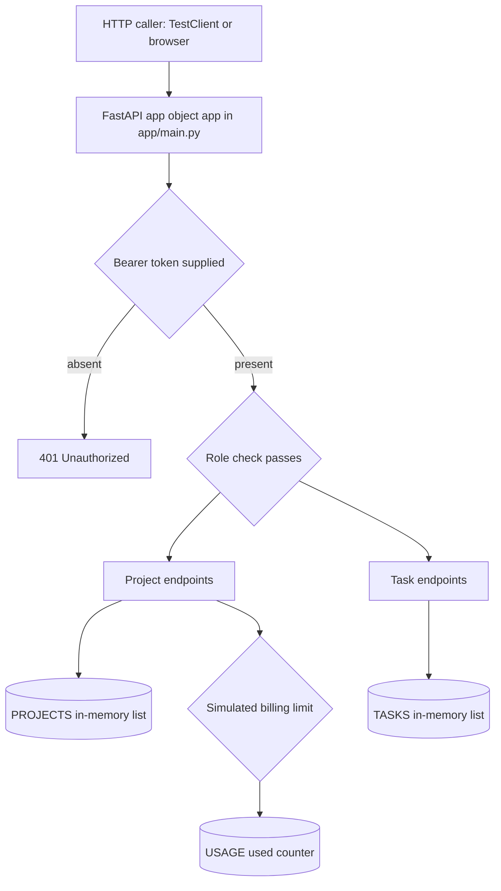

Every node in the diagram above is declared by `README.md` lines 6-9 or by the imports and assertions in `test_api.py`; none is backed by a file in the repository, with the exception of the caller side, which the test module instantiates.

### 1.2.3 Success Criteria

**Measurable objectives.** Each objective is observable from the repository's own artefacts, and each states whether HEAD satisfies it.

| # | Objective | Measurement | Status at HEAD |
| --- | --- | --- | --- |
| 1 | Health endpoint answers with a fixed body | `client.get("/health").json() == {"status": "ok"}` (`test_api.py` line 15) | Not satisfiable: `app.main` is absent |
| 2 | An owner-token client can create a project | `POST /projects` with `{"name": "Release QA"}` returns 200 and echoes the name (`test_api.py` lines 19-21) | Not satisfiable: `app.main` is absent |
| 3 | Listing returns the created project | `GET /projects[0]["id"]` equals the created `id` (`test_api.py` line 22) | Not satisfiable: `app.main` is absent |
| 4 | Anonymous access is refused | `GET /projects` without headers returns exactly 401 (`test_api.py` line 26) | Not satisfiable: `app.main` is absent |
| 5 | The suite runs from a clean checkout | `pytest -q` collects and passes after `pip install -r requirements.txt` (`README.md` lines 20-23) | Fails: collection stops because `app.main` is missing |
| 6 | The service starts and serves docs | `uvicorn app.main:app --reload` then open `http://127.0.0.1:8000/docs` (`README.md` lines 16-18) | Fails: the run target does not exist |

A verification run of `pytest -q` in a Python 3.12.3 environment without the pinned dependencies stopped at collection with `ModuleNotFoundError: No module named 'fastapi'`, preceded by the configuration warning "No files were found in testpaths"; independently of the uninstalled dependencies, `app.main` is absent from the tree, so no objective above can pass from HEAD.

**Critical success factors.**

- **Exact object names.** `app/main.py` must expose `app`, `PROJECTS`, `TASKS` and `USAGE` under those names, because `test_api.py` line 2 imports them directly; renaming any one breaks collection before a single assertion runs.
- **Import-time safety.** `TestClient(app)` is constructed at module import (`test_api.py` line 4), so importing the test module must not require a running server or external configuration.
- **Response-shape discipline.** Project creation must answer with HTTP 200, not 201, and the response must carry both `name` and `id` (`test_api.py` lines 20-21).
- **Deterministic listing order.** The assertion on `[0]["id"]` (`test_api.py` line 22) requires listing to return the newest project first, an ordering the README never states.
- **Resettable process state.** `setup_function` (`test_api.py` lines 8-11) can only clear containers it can reach, so state must stay in the module-level `PROJECTS`, `TASKS` and `USAGE["used"]` structures rather than in caches or classes.
- **Discoverable tests.** Placing a real `tests` directory, or amending `pytest.ini` line 2, is required for the configured discovery path to match the shipped module layout.
- **Installable pins.** The four exact pins in `requirements.txt` must resolve together; `httpx` is needed by `TestClient` and would otherwise be an implicit dependency.

**Key performance indicators.** The repository defines none: no latency budget, throughput target, coverage threshold, availability objective, or numeric acceptance figure appears in any of the six tracked files. The only quantitative facts are fixture-level — three test functions in `test_api.py`, four pinned dependencies, and a single usage counter whose expected post-setup value is `0`.


## 1.3 Scope

### 1.3.1 In-Scope

**Core features and functionalities.** In scope is everything the fixture declares it will exercise, whether or not HEAD contains an implementation for it.

| Must-have capability | Declared scope | State at HEAD |
| --- | --- | --- |
| Health probe | `GET /health` returns `{"status": "ok"}` and requires no token | Contract only (`test_api.py` lines 14-15) |
| Project creation and listing | `POST /projects` and `GET /projects`, bearer-authenticated, newest project first | Contract only (`test_api.py` lines 18-22) |
| Bearer token enforcement | Requests without an `Authorization` header are refused with 401 | Contract only (`test_api.py` lines 25-26) |
| Role checks | "authentication-like bearer tokens and role checks" | Declared only (`README.md` line 6) |
| Task workflows | Project and task workflows are listed as included | Declared only (`README.md` line 7; `TASKS` imported at `test_api.py` line 2) |
| Team membership | Team membership is listed as included | Declared only (`README.md` line 7) |
| Simulated billing limit | A usage ceiling is enforced from a tracked `used` figure | Declared only (`README.md` line 7; `test_api.py` line 11) |
| In-memory persistence model | All state lives in the process, with no database | Declared (`README.md` line 9) |
| Interactive API docs | FastAPI's `/docs` page served by uvicorn | Declared only (`README.md` lines 16-18) |

**Primary user workflows.**

1. **Health probe.** An unauthenticated caller requests `GET /health` and receives `{"status": "ok"}`, which the suite treats as an exact-equality response (`test_api.py` lines 14-15).
2. **Create a project as owner.** A caller sends `POST /projects` with `Authorization: Bearer owner-token` and body `{"name": "Release QA"}`, and receives HTTP 200 whose body echoes `name` and includes an `id` (`test_api.py` lines 5, 19-21).
3. **List projects as owner.** The same caller sends `GET /projects` with the same header and finds the project it just created at index `0` (`test_api.py` line 22).
4. **Reject anonymous access.** A caller sending `GET /projects` with no `Authorization` header receives 401 (`test_api.py` lines 25-26).
5. **Task lifecycle inside a project.** Declared as an included workflow; no path, payload, or role constraint is named in any file (`README.md` line 7).
6. **Team membership change.** Declared as an included workflow; no path or payload is named in any file (`README.md` line 7).
7. **Billing-limit enforcement.** Declared as an included behaviour backed by the usage counter; no threshold value or response code appears in any file (`README.md` line 7; `test_api.py` line 11).

**Essential integrations.** There are no external integrations. The complete set of in-scope interfaces is the HTTP surface itself, the in-process `TestClient` transport used by the suite, and the generated OpenAPI documentation page.

| Integration point | Mechanism | Evidence |
| --- | --- | --- |
| Client to service | HTTP over the ASGI application object | `README.md` lines 16-18 |
| Test harness to service | In-process `TestClient`; no network listener | `test_api.py` lines 1, 4 |
| State access for tests | Direct import of module-level containers | `test_api.py` lines 2, 9-11 |
| API description | Framework-generated OpenAPI schema rendered at `/docs` | `README.md` line 18 |

**Key technical requirements.**

| Requirement | Value | Evidence |
| --- | --- | --- |
| Language runtime | Python; no version is pinned in the repository (the verification environment used 3.12.3) | `requirements.txt`; `README.md` lines 12-15 |
| Framework and server | `fastapi==0.115.12`, `uvicorn==0.34.0` | `requirements.txt` lines 1-2 |
| Test stack | `pytest==8.3.5`, `httpx==0.28.1` | `requirements.txt` lines 3-4; `test_api.py` line 1 |
| Application entry point | ASGI object `app` importable from `app.main` | `README.md` line 16; `test_api.py` line 2 |
| Documented bind address | `http://127.0.0.1:8000/docs`, uvicorn's default; no host or port configuration exists | `README.md` line 18 |
| Storage model | In-memory, process-local, no external database or service | `README.md` line 9 |
| Test discovery | `testpaths = tests`, `python_files = test_*.py` | `pytest.ini` lines 1-3 |

**Implementation boundaries.**

- **System boundary.** One ASGI process with in-process state; no persistence layer, no outbound network dependency, no separate identity service. `README.md` line 9 and the four-entry dependency manifest together bound the system.
- **User groups covered.** A single demonstrated principal, the owner, represented by the literal header `Bearer owner-token` (`test_api.py` line 5). Additional roles are implied by the phrase "role checks" (`README.md` line 6) but no role name other than owner appears anywhere; there is no user directory, registration flow, or token issuer.
- **Geographic and market coverage.** None declared. No locale, currency, time zone, or regional logic appears in any of the six files, and the only platform variation is the shell activation hint for Windows in the run instructions (`README.md` line 14).
- **Data domains included.** Projects, tasks, a usage/billing counter, and team membership — the complete set of entity names appearing in `README.md` lines 6-7 and `test_api.py` lines 2 and 11. No other domain entity is named in the repository.

### 1.3.2 Out-of-Scope

| Excluded element | Why it is out of scope | Evidence |
| --- | --- | --- |
| Production deployment, hardening, and operational support | The README instructs readers not to deploy the fixture | `README.md` line 31 |
| Real credential handling and secret management | Credentials are demo literals and real credentials are prohibited | `README.md` line 31; `test_api.py` line 5 |
| Persistent storage, external databases, and migrations | Storage is explicitly in memory, with no external service required | `README.md` line 9 |
| Environment configuration, deployment manifests, and infrastructure as code | The fixture must run without a configured environment | `README.md` line 28; no such file exists in the tree |
| Exhaustive functional coverage and non-functional testing | The suite is defined as deliberately small, leaving workflows and non-functional behaviour untested | `README.md` line 8 |
| Authentication or authorization as a security guarantee | The scheme is described as "authentication-like" and the tokens as demo tokens | `README.md` lines 6, 31 |
| Real billing, payments, or metering accuracy | The limit is described as simulated | `README.md` line 7 |
| Multi-tenant operation, high availability, horizontal scaling, and geographic replication | No such concern appears in any of the six tracked files; in-memory state in a single process precludes them | `README.md` line 9; `test_api.py` lines 2, 11 |
| Licensing and redistribution terms | The repository contains no `LICENSE` file and no licensing statement | Repository tree at HEAD |

**Future phase considerations.** The repository records no roadmap, backlog, TODO, or issue list: no such file exists in the tree and `README.md` contains no future-work section. Commit history shows only the fixture's own delivery (uploading `proactie_insight_testing-main.zip`, deleting that archive, then uploading the six scaffolding files), so it names no planned phase. The only forward-looking statement the evidence supports is the implied prerequisite of committing an `app` package and a `tests` directory, without which objectives 1-6 of Section 1.2.3 cannot be met.

**Integration points not covered.**

| Integration category | Status | Evidence |
| --- | --- | --- |
| Identity provider or SSO | Absent; no client library or endpoint in the manifest | `requirements.txt`; `README.md` line 6 |
| Database or cache | Absent by design | `README.md` line 9 |
| Message broker or event bus | Absent; no client library in the manifest | `requirements.txt` |
| Observability, metrics, or tracing backend | Absent; no exporter or instrumentation library | `requirements.txt` |
| Payment or invoicing provider | Absent; billing is simulated | `README.md` line 7 |
| Third-party HTTP APIs | Absent; no outbound client beyond the test transport | `README.md` line 9; `requirements.txt` |

**Unsupported use cases.**

- Starting the service from HEAD — the `uvicorn app.main:app` target does not exist (`README.md` line 16).
- Collecting or passing the shipped suite from HEAD — the import of `app.main` fails before any assertion executes (`test_api.py` line 2).
- Browsing `/docs` or exercising any endpoint interactively, since the application object cannot be created.
- Any multi-role or multi-principal scenario beyond the single `owner-token` literal (`test_api.py` line 5).
- Any request whose correctness depends on state surviving a restart or being shared across processes (`README.md` line 9).
- Any use of the code with real user data, real credentials, or as a system of record (`README.md` lines 30-31).


## 1.4 References

- `README.md` - Declared project purpose and positioning as a repository-level insight test fixture; the included feature list (bearer tokens and role checks, project and task workflows, team membership, simulated billing limit, in-memory storage); the run, test and scan-setup instructions; the explicit non-production, no-real-credentials warning.
- `test_api.py` - The executable contract: import of `app`, `PROJECTS`, `TASKS`, `USAGE` from `app.main`; `TestClient` construction; the `owner-token` bearer header; the `setup_function` state reset; and the three assertions covering `/health`, project create-and-list, and the 401 rejection.
- `requirements.txt` - The four exact dependency pins: `fastapi==0.115.12`, `uvicorn==0.34.0`, `pytest==8.3.5`, `httpx==0.28.1`; establishes the stack and that no external service client is present.
- `pytest.ini` - Test discovery configuration (`testpaths = tests`, `python_files = test_*.py`), which conflicts with the root-level location of `test_api.py`.
- `__init__.py` - Empty (0 bytes) module at the repository root, which makes the root an importable package.
- `.DS_Store` - Committed macOS Finder artefact (8196 bytes) present in the tracked tree.
- Repository root (`""`) - Complete inventory of the six tracked files at HEAD `b8903e9` on branch `main`, establishing that no `app` package, `tests` directory, LICENSE, CI configuration, Dockerfile, or documentation tree exists.
- Git history of branch `main` - Three commits showing the fixture's delivery sequence (archive uploaded, archive deleted, six scaffolding files added); establishes provenance and that no earlier implementation exists.

No external web sources were consulted for this section.


# 2. Product Requirements

## 2.1 Feature Catalog

### 2.1.1 Evidence Basis, Priority Rule and Conventions

Every feature in this section is traceable to one of three evidence tiers, and each is named in the feature's own metadata.

| Tier | Source | Repository state |
| --- | --- | --- |
| 1 — Executable contract | `test_api.py` (26 lines): imports, bearer header, state reset, three assertions | Present at HEAD `b8903e9` |
| 2 — Declaration | `README.md` lines 3, 5-9, 16-18, 20-23, 31: positioning, included feature list, run and test commands | Present at HEAD `b8903e9` |
| 3 — Reference implementation | `app/main.py` (110 lines, 3 459 bytes) inside `proactie_insight_testing-main.zip`, added at commit `4e4368f`, deleted at commit `b37e7e5` | Absent at HEAD |

No application code exists in the working tree at HEAD: the only Python files are the empty root `__init__.py` and `test_api.py`. Tier 3 is therefore the only place in the repository's history where routes, validation constraints and status codes are defined, and every statement drawn from it is marked **(archive)**. The archive's `tests/test_api.py` is byte-identical to HEAD `test_api.py`, and its `README.md` is byte-identical to HEAD `README.md`, so tiers 1 and 2 are unaffected by the archive's deletion — the loss is limited to `app/main.py` and the `app/__init__.py` and `tests/` layout.

**Identifier and version conventions.** Features are numbered `F-001` to `F-011`; requirements nest as `F-XXX-RQ-YYY`, numbered from `RQ-001` within each feature. All entries carry version `1.0`, established against HEAD `b8903e9` and archive commit `4e4368f`; the version register is in Section 2.5.2.

**Feature priority rule.** Priority follows the strength of the obligation the repository itself imposes, not an assessment of product value:

| Priority | Test that assigns it |
| --- | --- |
| Critical | Needed for `from app.main import app, PROJECTS, TASKS, USAGE` to succeed, or for one of the three shipped tests (`test_api.py` lines 14-26) to pass |
| High | Named as included in `README.md` lines 6-7 (bearer tokens and role checks; project and task workflows; team membership; simulated billing limit; in-memory storage) |
| Medium | Present in the archived implementation and required to serve a declared workflow, but not advertised in the README |
| Low | Auxiliary operational surface that neither the README nor the test contract references |

**Status vocabulary.**

| Status | Meaning |
| --- | --- |
| Completed (archive) | Implemented in `app/main.py` of commit `4e4368f`; no implementation survives at HEAD, so the capability is documented, not runnable |
| In Development | Configuration or test scaffolding present at HEAD, but the capability cannot execute because `app.main` is missing |

**Requirement priority vocabulary.** `Must-Have` — asserted by a shipped test or required for the import to resolve; `Should-Have` — defined in the archived implementation and needed by a declared README workflow; `Could-Have` — implemented but demanded by neither the README nor the tests.

### 2.1.2 Feature Summary

| Feature ID | Feature | Priority | Status |
| --- | --- | --- | --- |
| F-001 | Health Probe | Critical | Completed (archive) |
| F-002 | Readiness and Metrics Introspection | Low | Completed (archive) |
| F-003 | Bearer Token Authentication | Critical | Completed (archive) |
| F-004 | Role-Based Authorization | High | Completed (archive) |
| F-005 | Project Creation and Listing | Critical | Completed (archive) |
| F-006 | Task Creation and Status Workflow | High | Completed (archive) |
| F-007 | Team Role Administration | High | Completed (archive) |
| F-008 | Simulated Billing Limit | High | Completed (archive) |
| F-009 | In-Memory State and Test Reset Contract | Critical | Completed (archive) |
| F-010 | Interactive API Documentation | Medium | Completed (archive) |
| F-011 | Fixture Test Harness and Discovery Configuration | Medium | In Development |

| Feature ID | Category | Evidence anchor |
| --- | --- | --- |
| F-001 | Operational | `test_api.py` lines 14-15; `app/main.py` lines 35-37 (archive) |
| F-002 | Operational | `app/main.py` lines 40-42, 108-110 (archive) |
| F-003 | Security | `test_api.py` lines 5, 25-26; `app/main.py` lines 25-32 (archive) |
| F-004 | Security | `app/main.py` lines 58, 89-90 (archive); `README.md` line 6 |
| F-005 | Core domain | `test_api.py` lines 18-22; `app/main.py` lines 45-58 (archive) |
| F-006 | Core domain | `app/main.py` lines 61-83 (archive); `README.md` line 7 |
| F-007 | Administration | `app/main.py` lines 86-94 (archive); `README.md` line 7 |
| F-008 | Simulated commercial | `test_api.py` line 11; `app/main.py` lines 97-105 (archive) |
| F-009 | Data / test contract | `test_api.py` lines 2, 8-11; `app/main.py` lines 7-13 (archive) |
| F-010 | Developer experience | `README.md` lines 16-18; `app/main.py` line 5 (archive) |
| F-011 | Quality engineering | `README.md` lines 8, 20-23; `pytest.ini` lines 1-3; `requirements.txt` lines 1-4 |

The catalogue holds eleven features and thirty-eight requirements; Section 2.2 specifies them and Section 2.5.1 records what the shipped suite actually verifies.

### 2.1.3 F-001 Health Probe

| Field | Value |
| --- | --- |
| Feature ID | F-001 |
| Feature name | Health Probe |
| Category | Operational |
| Priority / status | Critical / Completed (archive) |
| HTTP surface | `GET /health`, no authentication |
| Evidence | `test_api.py` lines 14-15 (tier 1); `app/main.py` lines 35-37 (tier 3, archive) |

**Overview.** A parameterless, unauthenticated endpoint that returns the constant JSON object `{"status": "ok"}`, asserted by exact equality in the shipped suite.

**Business value.** It is the only capability the repository verifies end to end with a fixed oracle, so a scan or smoke run can prove that the ASGI application object is wired and routable before any stateful workflow is exercised.

**User benefits.** A caller confirms process liveness without credentials, a body, or prior state, and the constant body makes the result unambiguous.

**Technical context.** The handler at `app/main.py` lines 35-37 takes no arguments, reads no store, and returns a plain dictionary that FastAPI serialises as JSON with the framework's default `200` status. The assertion in `test_api.py` line 15 compares the parsed body against the literal `{"status": "ok"}`, so the response may carry no additional keys.

**Dependencies.**

- **Prerequisite features:** none; the route touches no store and no header.
- **System dependencies:** the `app` ASGI object exposed by `app.main`; FastAPI routing and JSON serialisation (`fastapi==0.115.12`, `requirements.txt` line 1); `httpx==0.28.1` (`requirements.txt` line 4) beneath the in-process `TestClient` used by the suite.
- **External dependencies:** none — no database, identity provider, or outbound client (`README.md` line 9; `requirements.txt`).
- **Integration requirements:** none; the endpoint accepts no request model and declares no header parameter.

### 2.1.4 F-002 Readiness and Metrics Introspection

| Field | Value |
| --- | --- |
| Feature ID | F-002 |
| Feature name | Readiness and Metrics Introspection |
| Category | Operational |
| Priority / status | Low / Completed (archive) |
| HTTP surface | `GET /ready`, `GET /metrics`, neither authenticated |
| Evidence | `app/main.py` lines 40-42, 108-110 (tier 3, archive) |

**Overview.** Two unauthenticated read endpoints beyond the liveness probe: `/ready` returns `{"ready": true, "checks": {"storage": "ok"}}`, and `/metrics` returns `{"requests_total": 0, "uptime_seconds": <rounded float>}`.

**Business value.** The pair supplies the "non-functional behaviours" surface that `README.md` line 8 says the suite deliberately leaves untested, so the fixture offers observable readiness and uptime signals for an evaluator without imposing any test obligation.

**User benefits.** A caller distinguishes readiness from liveness and reads an uptime figure, both without credentials.

**Technical context.** Both handlers are synchronous and constant except for the uptime value, which is `round(monotonic(), 2)` — the origin of `time.monotonic` is unspecified, so on most platforms the figure measures time since boot rather than since process start. `requests_total` is the literal `0`; no request counter is incremented anywhere in the module, so the field does not reflect traffic. Neither endpoint is referenced by `README.md` or `test_api.py`.

**Dependencies.**

- **Prerequisite features:** F-009 for the `"storage": "ok"` claim, which is a literal rather than a check of `PROJECTS` or `TASKS`.
- **System dependencies:** `app` ASGI object; the `time.monotonic` clock from the standard library (`app/main.py` line 3, archive).
- **External dependencies:** none.
- **Integration requirements:** none; both endpoints are unauthenticated and parameterless.

### 2.1.5 F-003 Bearer Token Authentication

| Field | Value |
| --- | --- |
| Feature ID | F-003 |
| Feature name | Bearer Token Authentication |
| Category | Security |
| Priority / status | Critical / Completed (archive) |
| HTTP surface | Every route except `/health`, `/ready` and `/metrics` |
| Evidence | `test_api.py` lines 5, 25-26 (tier 1); `app/main.py` lines 7, 25-32 (tier 3, archive) |

**Overview.** A shared helper, `current_user`, parses an `Authorization` header of the form `Bearer <token>`, looks the token up in a two-entry demo map, and returns the matching principal record or raises `HTTPException(401)`.

**Business value.** It is the mechanism `README.md` line 6 calls "authentication-like bearer tokens", and the only rejection path the suite asserts: `GET /projects` without a header must return `401` (`test_api.py` lines 25-26). It gives the fixture a working authorization boundary to scan without requiring an identity provider.

**User benefits.** Callers receive an unambiguous `401` with a describing message for a missing, malformed, or unrecognised credential, and successful callers obtain the principal identity used to stamp project and task records.

**Technical context.** Each protected handler declares `authorization: str | None = Header(default=None)` (`app/main.py` lines 46, 56, 62, 75, 87, 98, archive), so FastAPI exposes the header as an optional `authorization` parameter in the OpenAPI schema rather than as a security scheme. The helper rejects a missing header and any value not prefixed `Bearer ` with `401 "Missing bearer token"` (lines 26-27), strips the prefix with `removeprefix`, and rejects an unknown token with `401 "Invalid token"` (lines 31-32). Principals are literals: `owner-token` maps to `{"id": 1, "role": "owner"}` and `member-token` to `{"id": 2, "role": "member"}` (line 7). The syntax `str | None` requires Python 3.10 or newer; no version is pinned anywhere in the repository.

**Dependencies.**

- **Prerequisite features:** none.
- **System dependencies:** FastAPI `Header` binding (`fastapi==0.115.12`); the `USERS` map as the sole credential store (`app/main.py` line 7, archive).
- **External dependencies:** none — no token issuer, signature verification, expiry handling, or key material exists (`requirements.txt` has no identity or cryptography library).
- **Integration requirements:** consumed by F-004, F-005, F-006, F-007 and F-008, which all resolve the caller through this helper before doing work.

### 2.1.6 F-004 Role-Based Authorization

| Field | Value |
| --- | --- |
| Feature ID | F-004 |
| Feature name | Role-Based Authorization |
| Category | Security |
| Priority / status | High / Completed (archive) |
| HTTP surface | `GET /projects` visibility filter; owner gate on `POST /teams/{user_id}/role` |
| Evidence | `README.md` line 6; `app/main.py` lines 7, 58, 89-90 (tier 3, archive) |

**Overview.** Two decisions depend on the caller's role from the token map: project listing returns every project to a principal whose role is `owner` and only its own projects to any other principal, and team role administration is refused with `403 "Owner role required"` when the caller is not an owner.

**Business value.** This is the "role checks" half of the declaration in `README.md` line 6, and it creates two distinguishable principals for scanning: a privileged owner and a restricted member.

**User benefits.** A member sees a scoped project list instead of the whole tenant, and an unauthorised attempt to change a role fails loudly with `403` rather than silently.

**Technical context.** The role is read from the principal record resolved in F-003, so authorization is derived from the token map only. The listing filter is the expression `p["owner_id"] == user["id"] or user["role"] == "owner"` (`app/main.py` line 58, archive). The only other role-gated path is the team route's `if user["role"] != "owner"` guard (lines 89-90). The role vocabulary is exactly `{"owner", "member"}` (lines 7, 91). No endpoint restricts project creation or task mutation by role, and the role recorded in the `TEAM` map is never consulted for authorization — the disconnect is specified as F-007-RQ-003 and analysed in Section 2.4.

**Dependencies.**

- **Prerequisite features:** F-003, which supplies the principal record carrying the `role` field.
- **System dependencies:** the `USERS` map (`app/main.py` line 7, archive) as the single source of roles at request time.
- **External dependencies:** none.
- **Integration requirements:** applies to F-005 (list scoping) and F-007 (owner gate); it does not apply to F-006, whose handlers call the helper for authentication only.

### 2.1.7 F-005 Project Creation and Listing

| Field | Value |
| --- | --- |
| Feature ID | F-005 |
| Feature name | Project Creation and Listing |
| Category | Core domain |
| Priority / status | Critical / Completed (archive) |
| HTTP surface | `POST /projects`, `GET /projects` |
| Evidence | `test_api.py` lines 18-22 (tier 1); `app/main.py` lines 8, 12, 16-17, 45-58 (tier 3, archive) |

**Overview.** Authenticated creation and listing of projects. Creation accepts a JSON body whose single field is the project name, stamps the record with a sequential integer id and the caller's principal id, stores it in the process-wide `PROJECTS` map, and returns the record. Listing returns the projects the caller is entitled to see.

**Business value.** This is the highest-value workflow in the fixture: it is the only multi-route flow the shipped suite covers, and it produces the state that tasks, team membership and billing are declared to depend on (`README.md` lines 6-7).

**User benefits.** A caller creates a named project in one request and immediately sees it in its own listing, with a server-assigned identifier it can use for dependent work.

**Technical context.** The request model `ProjectIn` declares `name: str = Field(min_length=2, max_length=80)` (`app/main.py` lines 16-17, archive), so names outside two to eighty characters are rejected by FastAPI's own validation with `422` before the handler runs. The handler allocates `NEXT_PROJECT` as the id, stores `{"id", "name", "owner_id"}`, increments the counter, and returns the dictionary with the framework default `200` — not `201` (`test_api.py` line 20 asserts `200`). `PROJECTS` is a module-level dictionary keyed by integer id (line 8) and `NEXT_PROJECT` a module-level integer starting at `1` (line 12), so ids are unique within a process but restart from `1` after a restart. Listing iterates `PROJECTS.values()` in insertion order, filtered per F-004, and returns a JSON array; the shipped test clears state first and therefore asserts on the index-`0` element of a single-element list (`test_api.py` lines 8-11, 22).

**Dependencies.**

- **Prerequisite features:** F-003 for both routes; F-004 for the visibility filter on listing.
- **System dependencies:** FastAPI request-model validation for `ProjectIn`; the `PROJECTS` store and `NEXT_PROJECT` counter (F-009).
- **External dependencies:** none.
- **Integration requirements:** downstream consumers are F-006, whose creation path rejects an unknown `project_id`, and F-007/F-008, whose workflows the README describes in the same breath as project work.

### 2.1.8 F-006 Task Creation and Status Workflow

| Field | Value |
| --- | --- |
| Feature ID | F-006 |
| Feature name | Task Creation and Status Workflow |
| Category | Core domain |
| Priority / status | High / Completed (archive) |
| HTTP surface | `POST /tasks`, `PATCH /tasks/{task_id}` |
| Evidence | `README.md` line 7; `app/main.py` lines 9, 13, 20-22, 61-83 (tier 3, archive) |

**Overview.** Task creation inside an existing project, plus a status transition endpoint. Creation stores a task with a server-assigned id, the owning project id, the creating principal, and the status `open`. The patch endpoint moves a task among `open`, `in_progress` and `done`.

**Business value.** Tasks are the second of the two workflows named in `README.md` line 7 and the only state machine in the fixture, which makes the transition rules the main behavioural surface an evaluator can exercise beyond projects.

**User benefits.** A caller records work against a project and advances its status with a query-parameter update, using the same bearer credential as the rest of the API.

**Technical context.** `TaskIn` requires `title: str = Field(min_length=2, max_length=120)` and `project_id: int` (`app/main.py` lines 20-22, archive). The creation handler returns `404 "Project not found"` when `project_id` is absent from `PROJECTS` (lines 65-66) and otherwise writes `{"id", "title", "project_id", "created_by", "status": "open"}` into `TASKS`, keyed by `NEXT_TASK` (lines 67-71). The patch handler reads `status` as a **query parameter** — not a body field — and applies three checks in order: unknown task id yields `404 "Task not found"` (lines 77-79), a value outside `{"open", "in_progress", "done"}` yields `422 "Unsupported status"` (lines 80-81), and the mutation assigns the new status and returns the task (lines 82-83). Neither handler checks whether the caller owns the project or has the owner role; any valid token can create a task in any existing project and transition any task. No route lists or reads tasks back, so a task is observable only through these two responses.

**Dependencies.**

- **Prerequisite features:** F-003 for authentication on both routes; F-005, because creation validates the referenced project against the `PROJECTS` store.
- **System dependencies:** FastAPI request-model validation for `TaskIn` and query-parameter binding for `status`; the `TASKS` store and `NEXT_TASK` counter (F-009); integer path validation for `task_id`.
- **External dependencies:** none.
- **Integration requirements:** consumes F-005 state; shares the principal identity produced by F-003 for the `created_by` field.

### 2.1.9 F-007 Team Role Administration

| Field | Value |
| --- | --- |
| Feature ID | F-007 |
| Feature name | Team Role Administration |
| Category | Administration |
| Priority / status | High / Completed (archive) |
| HTTP surface | `POST /teams/{user_id}/role` |
| Evidence | `README.md` line 7; `app/main.py` lines 10, 86-94 (tier 3, archive) |

**Overview.** An owner-only endpoint that records a role for a user id. It validates the caller's role, validates the target user and the requested role, writes the assignment to the module-level `TEAM` map, and returns the pair.

**Business value.** This is the "team membership" capability of `README.md` line 7 — the fixture's only administrative operation and the only route that both requires a privileged caller and mutates identity data.

**User benefits.** An owner can promote or demote the two seeded users with a single query-parameter call and receives confirmation of the resulting assignment.

**Technical context.** The handler takes `user_id: int` from the path and `role: str` from the query string, resolves the caller through F-003, rejects a non-owner caller with `403 "Owner role required"` (lines 89-90), then rejects a `user_id` missing from `TEAM` or a role outside `{"owner", "member"}` with `404 "User or role not found"` (lines 91-92) — a single status for two distinct failures. On success it sets `TEAM[user_id] = role` and returns `{"user_id", "role"}` (lines 93-94). `TEAM` is seeded `{1: "owner", 2: "member"}` (line 10) and is never read by `current_user` or by any authorization decision, so a recorded change alters the returned confirmation and the `TEAM` map only. The member counter-example is specified as F-007-RQ-003.

**Dependencies.**

- **Prerequisite features:** F-003 for authentication; F-004 for the owner gate; F-009 for the `TEAM` container.
- **System dependencies:** FastAPI path and query-parameter binding; the `TEAM` map (`app/main.py` line 10, archive).
- **External dependencies:** none — there is no directory service or user registry; the two ids are literals.
- **Integration requirements:** conceptually bound to F-003's `USERS` map, which supplies the roles actually used at request time; the implementation keeps the two stores separate.

### 2.1.10 F-008 Simulated Billing Limit

| Field | Value |
| --- | --- |
| Feature ID | F-008 |
| Feature name | Simulated Billing Limit |
| Category | Simulated commercial |
| Priority / status | High / Completed (archive) |
| HTTP surface | `POST /billing/consume` |
| Evidence | `README.md` line 7; `test_api.py` line 11; `app/main.py` lines 11, 97-105 (tier 3, archive) |

**Overview.** A usage counter with a hard ceiling. Each authenticated call adds a requested number of units to `USAGE["used"]`, refusing requests that are non-positive or that would take the total past `USAGE["limit"]`, which is fixed at `5`.

**Business value.** This is the "simulated billing limit" of `README.md` line 7 — the fixture's example of a quota rule that produces a distinct failure mode (`429`) rather than a validation error, and the reason the test suite resets a usage figure before each test (`test_api.py` line 11).

**User benefits.** A caller can meter consumption explicitly, receives the current `{used, limit}` pair on every success so it can back off before the ceiling, and gets an unambiguous `429 "Usage limit reached"` when the ceiling is reached.

**Technical context.** The route declares `units: int = 1` as a query parameter with a default (`app/main.py` line 98, archive), rejects `units < 1` with `422 "Units must be positive"` (lines 100-101), rejects `USAGE["used"] + units > USAGE["limit"]` with `429 "Usage limit reached"` **before** any increment (lines 102-103), and otherwise increments and returns the whole `USAGE` dictionary (lines 104-105). The counter and ceiling are the literal `{"used": 0, "limit": 5}` (line 11): the limit is not configurable, there is no reset endpoint, no per-project or per-user attribution, and no clock or billing period. Because the value is process-local, a restart restores the allowance.

**Dependencies.**

- **Prerequisite features:** F-003 for authentication; F-009, because the counter's reset contract lives in the shared `USAGE` container the suite mutates directly.
- **System dependencies:** FastAPI query-parameter binding and integer coercion for `units`; the `USAGE` dictionary (`app/main.py` line 11, archive).
- **External dependencies:** none — billing is simulated, with no payment, invoicing or metering provider (`requirements.txt`).
- **Integration requirements:** none at the data level; the feature shares no entity with projects or tasks and does not attribute usage to them.

### 2.1.11 F-009 In-Memory State and Test Reset Contract

| Field | Value |
| --- | --- |
| Feature ID | F-009 |
| Feature name | In-Memory State and Test Reset Contract |
| Category | Data / test contract |
| Priority / status | Critical / Completed (archive) |
| HTTP surface | None directly; underpins F-004, F-005, F-006, F-007 and F-008 |
| Evidence | `test_api.py` lines 2, 8-11 (tier 1); `app/main.py` lines 7-13 (tier 3, archive); `README.md` line 9 |

**Overview.** All application state lives in six module-level names — `USERS`, `PROJECTS`, `TASKS`, `TEAM`, `USAGE`, plus the id counters `NEXT_PROJECT` and `NEXT_TASK` — which the test suite imports and mutates directly. `PROJECTS`, `TASKS` and `USAGE` are part of the executable contract because `test_api.py` line 2 imports them by name and lines 8-11 clear them before every test.

**Business value.** It is what makes the fixture self-contained: `README.md` line 9 promises that no external database or service is required, and the reset hook is what allows a tiny suite to run without fixtures, migrations, or teardown.

**User benefits.** Anyone running the fixture needs no provisioning step, and a test author can restore a clean slate with three statements instead of a database transaction.

**Technical context.** `test_api.py` line 2 binds `app`, `PROJECTS`, `TASKS` and `USAGE` at import, so those four names must exist with those exact spellings or collection fails. `setup_function` (lines 8-11) calls `PROJECTS.clear()`, `TASKS.clear()` and sets `USAGE["used"] = 0`. Because `PROJECTS` and `TASKS` are dictionaries (not lists), `clear()` is valid and preserves object identity for the handlers; because `USAGE` is mutated through its `used` key, the `limit` stays at `5`. The id counters `NEXT_PROJECT` and `NEXT_TASK` (`app/main.py` lines 12-13, archive) are rebound with `global` inside the handlers and are **not** touched by the reset hook, so ids keep increasing across tests within one process — the suite still passes because it asserts the id it received back rather than a fixed value (`test_api.py` lines 21-22). State is process-local: nothing is persisted, shared between workers, or protected by a lock.

**Dependencies.**

- **Prerequisite features:** none; this feature is a precondition for most others.
- **System dependencies:** Python module-level objects and dictionary insertion order; the `TestClient` sharing the process with the application object (`test_api.py` line 4), which is what makes direct mutation visible to handlers.
- **External dependencies:** none — this is the explicit replacement for a database (`README.md` line 9).
- **Integration requirements:** F-005, F-006, F-007 and F-008 read and write these containers; F-011's reset hook mutates them.

### 2.1.12 F-010 Interactive API Documentation

| Field | Value |
| --- | --- |
| Feature ID | F-010 |
| Feature name | Interactive API Documentation |
| Category | Developer experience |
| Priority / status | Medium / Completed (archive) |
| HTTP surface | `/docs` and the generated OpenAPI schema |
| Evidence | `README.md` lines 16-18; `app/main.py` line 5 (tier 3, archive) |

**Overview.** FastAPI's generated documentation, reached at `http://127.0.0.1:8000/docs` after `uvicorn app.main:app --reload`, describing the nine operations with application metadata `title="Proactive Insights Demo API"`, `version="1.0.0"`.

**Business value.** `README.md` line 18 makes the docs page the documented way to inspect the API by hand, so it is the fixture's discovery surface for evaluators who do not read the tests.

**User benefits.** A reviewer can see every route, its query parameters and request body schema, and issue calls from the browser without writing a client.

**Technical context.** The schema is derived from the route decorators and the two Pydantic models. Because authentication is a manually declared `authorization` header rather than a FastAPI security scheme, the docs show an `authorization` text field per protected operation and offer no **Authorize** button; the bearer value must be typed, including the `Bearer ` prefix. The `200`-only responses and the `403`, `404`, `422` and `429` raises appear as documented default and exception responses rather than as per-route response models. Host and port in the README are uvicorn's defaults; no configuration file in the repository sets either.

**Dependencies.**

- **Prerequisite features:** every route-bearing feature (F-001 to F-008), because the schema describes their operations.
- **System dependencies:** `fastapi==0.115.12` for schema generation and the bundled docs page; `uvicorn==0.34.0` (`requirements.txt` line 2) as the server named in the run instructions.
- **External dependencies:** none; the documentation assets ship with FastAPI.
- **Integration requirements:** the run command `uvicorn app.main:app` requires the archived `app/main.py` module, which is absent at HEAD, so the page cannot be served from the current checkout.

### 2.1.13 F-011 Fixture Test Harness and Discovery Configuration

| Field | Value |
| --- | --- |
| Feature ID | F-011 |
| Feature name | Fixture Test Harness and Discovery Configuration |
| Category | Quality engineering |
| Priority / status | Medium / In Development |
| HTTP surface | None; drives the API in-process |
| Evidence | `README.md` lines 8, 20-23; `test_api.py` lines 1-26; `pytest.ini` lines 1-3; `requirements.txt` lines 1-4 |

**Overview.** The deliberately small verification harness: a 26-line module with three tests that constructs a `TestClient` against the application object, resets the stores before each test, and asserts a health response, a project create-and-list round trip, and a `401` for an anonymous request — plus the pytest configuration and exact dependency pins that make the run reproducible.

**Business value.** `README.md` line 8 states the suite "covers a few happy paths while leaving important workflows and non-functional behaviours untested". That gap is the artefact under evaluation, so the harness is a product surface in its own right: it defines which behaviours are pinned and which are open for a scanner to report.

**User benefits.** An evaluator re-runs the same three assertions against any candidate implementation, and the pinned dependency set removes version drift from the comparison.

**Technical context.** `test_api.py` line 4 builds `TestClient(app)` at import time, so importing the module requires the application object to be constructible without a running server or environment configuration. `pytest.ini` declares `testpaths = tests` and `python_files = test_*.py`, while the shipped module sits at the repository root and no `tests` directory exists at HEAD, so a bare `pytest -q` matches the configured path against nothing and falls back to root-level collection under pytest's default behaviour, reporting "No files were found in testpaths". `requirements.txt` pins `fastapi==0.115.12`, `uvicorn==0.34.0`, `pytest==8.3.5` and `httpx==0.28.1` with no separation between runtime and test groups and no internal package. Status is *In Development* because the harness cannot run at HEAD: `from app.main import app, PROJECTS, TASKS, USAGE` fails, so collection stops before any assertion.

**Dependencies.**

- **Prerequisite features:** F-001, F-003, F-005 and F-009, whose names and behaviours the three tests exercise.
- **System dependencies:** `pytest==8.3.5` for collection and the `setup_function` hook; `httpx==0.28.1` as the transport under `TestClient` (`test_api.py` line 1); a Python interpreter providing `str | None` unions for the archived source.
- **External dependencies:** none; the suite talks to the application in process and needs no listener, network, or configuration (`README.md` line 28).
- **Integration requirements:** the suite imports the application module directly and mutates the same module-level containers the handlers use, which requires the application to be imported once and shared with the client.


## 2.2 Functional Requirements Table

### 2.2.1 Conventions for the Requirement Tables

Section 2.2 specifies the thirty-eight requirements of the eleven catalogue features: twenty-five `Must-Have`, eight `Should-Have`, five `Could-Have`. Each feature carries three tables — requirement details, acceptance with performance and data expectations, and inputs, outputs and validation rules — so that every field the requirement format calls for is present without exceeding four columns. Acceptance criteria are stated as HTTP-observable assertions so they can be executed against a candidate implementation without reading its code.

Two conventions apply throughout. First, no latency, throughput, availability or coverage target exists anywhere in `README.md`, `test_api.py`, `pytest.ini`, `requirements.txt` or the archived `app/main.py`; the performance column therefore states the algorithmic shape of the handler and says explicitly that no numeric budget is defined, rather than inventing one. Second, request-model violations produce FastAPI's standard validation response (HTTP `422` with a `detail` array) as framework behaviour of `fastapi==0.115.12`, driven by the `Field` constraints at `app/main.py` lines 17 and 21 (archive); the handlers themselves raise only the nine `HTTPException` paths listed in Section 2.2.

### 2.2.2 F-001 Health Probe Requirements

| Requirement ID | Requirement | Priority | Complexity |
| --- | --- | --- | --- |
| F-001-RQ-001 | `GET /health` answers `200` with the JSON body exactly `{"status": "ok"}` | Must-Have | Low |
| F-001-RQ-002 | The health route answers without an `Authorization` header and reads no application state | Must-Have | Low |

| Requirement ID | Acceptance criteria | Performance criteria | Data requirements |
| --- | --- | --- | --- |
| F-001-RQ-001 | Parsed body equals `{"status": "ok"}` with no additional keys, and the status code is `200` (`test_api.py` lines 14-15) | No target defined; the handler performs constant work with no I/O (`app/main.py` lines 35-37, archive) | Response is a two-key object; the request carries no data |
| F-001-RQ-002 | An unauthenticated `GET /health` returns `200`, never `401` (`test_api.py` line 14 sends no headers) | No target defined; no store or header is touched | None; nothing is read from `PROJECTS`, `TASKS`, `USAGE` or `USERS` |

| Requirement ID | Input parameters | Output / response | Validation rules |
| --- | --- | --- | --- |
| F-001-RQ-001 | None | `200`, JSON `{"status": "ok"}` | Business: the body is constant for every caller. Data: no field validation applies. Security: none required. Compliance: none defined |
| F-001-RQ-002 | None | `200` for anonymous callers | Business: liveness must be reachable before authentication is configured. Security: no credential is inspected; the route must stay free of side effects. Compliance: none defined |

### 2.2.3 F-002 Readiness and Metrics Introspection Requirements

| Requirement ID | Requirement | Priority | Complexity |
| --- | --- | --- | --- |
| F-002-RQ-001 | `GET /ready` answers `200` with `{"ready": true, "checks": {"storage": "ok"}}` | Should-Have | Low |
| F-002-RQ-002 | `GET /metrics` answers `200` with an integer `requests_total` and a float `uptime_seconds` rounded to two decimals | Could-Have | Low |
| F-002-RQ-003 | Both endpoints answer without an `Authorization` header | Could-Have | Low |

| Requirement ID | Acceptance criteria | Performance criteria | Data requirements |
| --- | --- | --- | --- |
| F-002-RQ-001 | Body equals `{"ready": true, "checks": {"storage": "ok"}}` exactly, including the nested `checks` object (`app/main.py` lines 40-42, archive) | No target defined; constant work | Two keys, one of them a nested object; no state is consulted |
| F-002-RQ-002 | Response contains `requests_total` as an integer and `uptime_seconds` as a number with at most two decimal places (`app/main.py` lines 108-110, archive) | No target defined; reads one monotonic clock value | `requests_total` is the literal `0`; `uptime_seconds` derives from `time.monotonic()` |
| F-002-RQ-003 | Anonymous requests to both paths return `200` | No target defined | None |

| Requirement ID | Input parameters | Output / response | Validation rules |
| --- | --- | --- | --- |
| F-002-RQ-001 | None | `200`, `{"ready": true, "checks": {"storage": "ok"}}` | Business: readiness is reported as a literal, not probed. Data: no validation. Security: unauthenticated by design. Compliance: none defined |
| F-002-RQ-002 | None | `200`, `{"requests_total": 0, "uptime_seconds": <float>}` | Business: `requests_total` does not track traffic. Data: numeric types required. Security: unauthenticated exposure of uptime. Compliance: none defined |
| F-002-RQ-003 | None | `200` for anonymous callers | Business: operational probes are open. Security: no credential check on either path. Compliance: none defined |

### 2.2.4 F-003 Bearer Token Authentication Requirements

| Requirement ID | Requirement | Priority | Complexity |
| --- | --- | --- | --- |
| F-003-RQ-001 | A request to a protected route without an `Authorization` header is refused with `401` and the message `Missing bearer token` | Must-Have | Low |
| F-003-RQ-002 | A request whose `Authorization` value does not start with `Bearer ` is refused with `401` and the message `Missing bearer token` | Must-Have | Low |
| F-003-RQ-003 | A `Bearer` value not present in the token map is refused with `401` and the message `Invalid token` | Must-Have | Low |
| F-003-RQ-004 | A recognised token resolves to a principal record exposing `id` and `role` to the handler | Must-Have | Medium |

| Requirement ID | Acceptance criteria | Performance criteria | Data requirements |
| --- | --- | --- | --- |
| F-003-RQ-001 | `GET /projects` with no headers returns exactly `401` (`test_api.py` line 26); the response detail is `Missing bearer token` (`app/main.py` lines 26-27, archive) | No target defined; one dictionary lookup at most | No input data; error body carries a `detail` string |
| F-003-RQ-002 | `Authorization: Basic abc` and `Authorization: bearertoken` both return `401` with `Missing bearer token` | No target defined; a single string prefix test | Header value is compared case-sensitively against `Bearer ` |
| F-003-RQ-003 | `Authorization: Bearer unknown` returns `401` with `Invalid token` (`app/main.py` lines 29-32, archive) | No target defined; one map lookup | `USERS` holds exactly two entries: `owner-token` (id `1`, role `owner`) and `member-token` (id `2`, role `member`) |
| F-003-RQ-004 | With `Authorization: Bearer owner-token`, a handler receives `{"id": 1, "role": "owner"}`, and with `member-token`, `{"id": 2, "role": "member"}` (`test_api.py` line 5; `app/main.py` line 7, archive) | No target defined | The record is the value stored in `USERS`; no expiry, scope or refresh field exists |

| Requirement ID | Input parameters | Output / response | Validation rules |
| --- | --- | --- | --- |
| F-003-RQ-001 | Optional `authorization` header, absent | `401`, `detail: "Missing bearer token"` | Business: absence of a credential is an authentication failure, not a validation failure. Data: header is treated as optional at bind time. Security: no credential is logged or echoed. Compliance: no framework applies; demo tokens only (`README.md` line 31) |
| F-003-RQ-002 | `authorization` header with a non-`Bearer` scheme | `401`, `detail: "Missing bearer token"` | Business: the scheme prefix is mandatory. Data: prefix comparison is exact and case-sensitive. Security: wrong-scheme credentials are treated as absent. Compliance: none defined |
| F-003-RQ-003 | `authorization` header with an unrecognised token | `401`, `detail: "Invalid token"` | Business: only the two seeded tokens authenticate. Data: lookup is an exact key match, no trimming beyond the prefix. Security: the token map is a source literal, not a secret store. Compliance: real credentials are prohibited (`README.md` line 31) |
| F-003-RQ-004 | `authorization` header with a recognised token | Handler-side principal `{"id": int, "role": "owner" or "member"}` | Business: identity flows to `owner_id` and `created_by` fields. Data: `id` is an integer, `role` a string. Security: role is trusted from the token map with no further verification. Compliance: none defined |

### 2.2.5 F-004 Role-Based Authorization Requirements

| Requirement ID | Requirement | Priority | Complexity |
| --- | --- | --- | --- |
| F-004-RQ-001 | `GET /projects` returns every stored project to a principal whose role is `owner` | Must-Have | Low |
| F-004-RQ-002 | `GET /projects` returns only projects whose `owner_id` equals the caller's id to a non-owner principal | Should-Have | Medium |
| F-004-RQ-003 | `POST /teams/{user_id}/role` invoked by a non-owner returns `403` with the message `Owner role required` | Must-Have | Low |
| F-004-RQ-004 | The role vocabulary is exactly `owner` and `member`; no other role value is accepted or produced | Should-Have | Low |

| Requirement ID | Acceptance criteria | Performance criteria | Data requirements |
| --- | --- | --- | --- |
| F-004-RQ-001 | After the owner creates a project and a member creates another, `GET /projects` as owner returns both (`app/main.py` line 58, archive) | No target defined; one pass over `PROJECTS`, so O(n) in stored projects | Response is a JSON array of project objects, insertion-ordered |
| F-004-RQ-002 | `GET /projects` as `Bearer member-token` returns only projects with `owner_id == 2`, and never the owner's projects (`app/main.py` line 58, archive) | No target defined; one filtered pass, O(n) | Same array shape as the owner view, with a narrower row set |
| F-004-RQ-003 | `POST /teams/2/role?role=owner` with `Bearer member-token` returns `403`, `detail: "Owner role required"` (`app/main.py` lines 89-90, archive) | No target defined; one role comparison | No state changes |
| F-004-RQ-004 | `role` values other than `owner` and `member` are rejected (`404` on the team route); no response body anywhere carries a third role value (`app/main.py` lines 7, 91, archive) | No target defined | Role is a string enumerated in two literals |

| Requirement ID | Input parameters | Output / response | Validation rules |
| --- | --- | --- | --- |
| F-004-RQ-001 | `authorization` header resolving to role `owner` | `200`, array of all projects | Business: the owner role sees the whole store. Data: no filter applied. Security: role read from the token map only. Compliance: none defined |
| F-004-RQ-002 | `authorization` header resolving to role `member` | `200`, array filtered to the caller's own projects | Business: members are scoped to their own records. Data: filter key is `owner_id` against the principal `id`. Security: scoping is by principal id, not by membership table. Compliance: none defined |
| F-004-RQ-003 | Path `user_id`, query `role`, caller's `authorization` header | `403`, `detail: "Owner role required"` | Business: role administration is owner-only. Data: none validated before the role check. Security: refuses before touching `TEAM`. Compliance: none defined |
| F-004-RQ-004 | Any role value supplied on the team route | `404` for values outside the pair | Business: two roles only. Data: exact string match against `{owner, member}`. Security: prevents escalation to an undefined role. Compliance: none defined |

### 2.2.6 F-005 Project Creation and Listing Requirements

| Requirement ID | Requirement | Priority | Complexity |
| --- | --- | --- | --- |
| F-005-RQ-001 | `POST /projects` with a valid name and a valid token answers `200` with a body carrying `id`, `name` and `owner_id` | Must-Have | Low |
| F-005-RQ-002 | The project name is accepted only when its length is between 2 and 80 characters; other lengths are rejected with `422` | Must-Have | Medium |
| F-005-RQ-003 | Project identifiers are integers allocated sequentially from `1`, unique within the process and never reused after deletion of state | Should-Have | Low |
| F-005-RQ-004 | `GET /projects` with the same token returns an array containing the project just created | Must-Have | Low |

| Requirement ID | Acceptance criteria | Performance criteria | Data requirements |
| --- | --- | --- | --- |
| F-005-RQ-001 | `POST /projects` with `{"name": "Release QA"}` returns `200`, `json()["name"] == "Release QA"`, and the body's `owner_id` equals the caller's principal id (`test_api.py` lines 19-21; `app/main.py` lines 49-52, archive) | No target defined; constant work plus one dictionary insertion | Project record: `id` integer, `name` string, `owner_id` integer |
| F-005-RQ-002 | Names of 1 character and of 81 characters return `422`; names of 2 and 80 characters are accepted (`app/main.py` lines 16-17, archive) | No target defined; validation runs before the handler | Name is a string of length 2 to 80 |
| F-005-RQ-003 | Two successive creations return consecutive ids starting at `1` in a fresh process, and the second never reuses the first (`app/main.py` lines 12, 47-51, archive) | No target defined; counter increment is constant work | `NEXT_PROJECT` is a module-level integer, not reset by the test hook |
| F-005-RQ-004 | After creation, `GET /projects` returns an array whose element at index `0` carries the returned `id` (`test_api.py` line 22) — the assertion holds because `setup_function` clears `PROJECTS`, leaving a single element | No target defined; one filtered pass over `PROJECTS` | Project appears in the caller's scoped list because `owner_id` equals the caller's id |

| Requirement ID | Input parameters | Output / response | Validation rules |
| --- | --- | --- | --- |
| F-005-RQ-001 | JSON body `{"name": str}`; `authorization` header | `200`, `{"id": int, "name": str, "owner_id": int}` | Business: creation requires authentication but no specific role. Data: `name` mandatory, no trimming or uniqueness rule. Security: `owner_id` is taken from the token, never from the body. Compliance: none defined |
| F-005-RQ-002 | JSON body `{"name": str}` | `422` with framework validation detail | Business: names shorter than 2 or longer than 80 characters are refused. Data: `min_length=2`, `max_length=80`. Security: none specific. Compliance: none defined |
| F-005-RQ-003 | None beyond the body | `id` integer in the response | Business: ids are process-scoped and monotonic. Data: no gap-filling, no reuse, no persistence. Security: no client-supplied id is accepted. Compliance: none defined |
| F-005-RQ-004 | `authorization` header only | `200`, JSON array of project objects | Business: listing is scoped per F-004. Data: ordering is dictionary insertion order, oldest first. Security: an unauthenticated call returns `401` (`test_api.py` line 26). Compliance: none defined |

### 2.2.7 F-006 Task Creation and Status Workflow Requirements

| Requirement ID | Requirement | Priority | Complexity |
| --- | --- | --- | --- |
| F-006-RQ-001 | `POST /tasks` with a title and an existing `project_id` answers `200` with `id`, `title`, `project_id`, `created_by` and `status` set to `open` | Must-Have | Medium |
| F-006-RQ-002 | `POST /tasks` whose `project_id` is not in the project store returns `404` with the message `Project not found` | Must-Have | Low |
| F-006-RQ-003 | The task title is accepted only when its length is between 2 and 120 characters; other lengths are rejected with `422` | Should-Have | Medium |
| F-006-RQ-004 | `PATCH /tasks/{task_id}` with `status` equal to `open`, `in_progress` or `done` updates and returns the task; any other value returns `422` with `Unsupported status` | Must-Have | Medium |
| F-006-RQ-005 | `PATCH /tasks/{task_id}` for an unknown id returns `404` with the message `Task not found` | Must-Have | Low |

| Requirement ID | Acceptance criteria | Performance criteria | Data requirements |
| --- | --- | --- | --- |
| F-006-RQ-001 | Response carries the five fields with `status == "open"`, `project_id` equal to the submitted id, and `created_by` equal to the caller's principal id (`app/main.py` lines 67-71, archive) | No target defined; constant work plus one insertion | Task record: `id` integer, `title` string, `project_id` integer, `created_by` integer, `status` string |
| F-006-RQ-002 | `POST /tasks` with `project_id: 999` returns `404`, `detail: "Project not found"` (`app/main.py` lines 65-66, archive) | No target defined; one membership test on `PROJECTS` | No record is written on failure |
| F-006-RQ-003 | Titles of 1 and 121 characters return `422`; 2 and 120 characters are accepted (`app/main.py` lines 20-21, archive) | No target defined; validation precedes the handler | `title` string of length 2 to 120; `project_id` integer |
| F-006-RQ-004 | `PATCH /tasks/1?status=done` returns the task with `status == "done"`; `?status=closed` returns `422`, `detail: "Unsupported status"` (`app/main.py` lines 74-83, archive) | No target defined; constant work plus one write | Status is a string enumerated as `open`, `in_progress`, `done`; initial value is `open` |
| F-006-RQ-005 | `PATCH /tasks/999?status=done` returns `404`, `detail: "Task not found"` | No target defined; one lookup | None |

| Requirement ID | Input parameters | Output / response | Validation rules |
| --- | --- | --- | --- |
| F-006-RQ-001 | JSON body `{"title": str, "project_id": int}`; `authorization` header | `200`, task object with five fields | Business: a task belongs to exactly one existing project. Data: title 2 to 120 characters. Security: no ownership or role check — any valid token may create a task in any project. Compliance: none defined |
| F-006-RQ-002 | JSON body with an unknown `project_id` | `404`, `detail: "Project not found"` | Business: referential integrity is enforced at creation only. Data: `project_id` must be a key of `PROJECTS`. Security: existence of foreign projects is disclosed to any authenticated caller. Compliance: none defined |
| F-006-RQ-003 | JSON body with an out-of-range title | `422` with framework validation detail | Business: title bounds are enforced. Data: `min_length=2`, `max_length=120`. Security: none specific. Compliance: none defined |
| F-006-RQ-004 | Path `task_id`; query `status`; `authorization` header | `200`, updated task object | Business: three statuses only, no transition graph beyond membership in the set. Data: `status` is a required query parameter; omission yields framework `422`. Security: any authenticated caller may change any task's status. Compliance: none defined |
| F-006-RQ-005 | Path `task_id` not present in `TASKS` | `404`, `detail: "Task not found"` | Business: unknown identifiers are reported distinctly from invalid status. Data: `task_id` must coerce to an integer. Security: none specific. Compliance: none defined |

### 2.2.8 F-007 Team Role Administration Requirements

| Requirement ID | Requirement | Priority | Complexity |
| --- | --- | --- | --- |
| F-007-RQ-001 | `POST /teams/{user_id}/role` by an owner records the role for the user and answers `200` with `{"user_id": int, "role": str}` | Must-Have | Low |
| F-007-RQ-002 | A `user_id` absent from the team map, or a role outside `owner` and `member`, returns `404` with the message `User or role not found` | Must-Have | Low |
| F-007-RQ-003 | A recorded role change is visible in the team map and in the response, but does not alter which roles are honoured at request time | Could-Have | Medium |

| Requirement ID | Acceptance criteria | Performance criteria | Data requirements |
| --- | --- | --- | --- |
| F-007-RQ-001 | Owner token, `user_id` `2`, `role=owner` returns `200`, `{"user_id": 2, "role": "owner"}` and `TEAM[2] == "owner"` afterwards (`app/main.py` lines 86-94, archive) | No target defined; constant work plus one write | `TEAM` maps integer user ids to a role string; seeded `{1: "owner", 2: "member"}` |
| F-007-RQ-002 | `user_id` `7` and `role=admin` both return `404`, `detail: "User or role not found"` (`app/main.py` lines 91-92, archive) | No target defined; two membership tests | No write on failure; the two failure kinds share one status |
| F-007-RQ-003 | After setting `TEAM[2] = "owner"`, a `member-token` call to an owner-gated route still returns `403`, because the gate reads the token map (`app/main.py` lines 29-32, 89-90, archive) | No target defined | `TEAM` and `USERS` are separate module-level dictionaries that share no field or key derivation |

| Requirement ID | Input parameters | Output / response | Validation rules |
| --- | --- | --- | --- |
| F-007-RQ-001 | Path `user_id: int`; query `role: str`; `authorization` header resolving to `owner` | `200`, `{"user_id": int, "role": str}` | Business: only an owner may assign roles. Data: assignment replaces the previous value. Security: the caller's role is read from the token map. Compliance: none defined |
| F-007-RQ-002 | Path `user_id`; query `role` | `404`, `detail: "User or role not found"` | Business: both unknown-target and invalid-role cases collapse into one status. Data: `user_id` must exist in `TEAM`; `role` must be in the two-value set. Security: validation occurs after the owner gate. Compliance: none defined |
| F-007-RQ-003 | Same as F-007-RQ-001 | `200` confirmation, with no effect on later authorization | Business: the intended role change never reaches the credential path. Data: `TEAM` is written, `USERS` is not. Security: a promoted user remains unprivileged; a demoted user retains privileges. Compliance: none defined |

### 2.2.9 F-008 Simulated Billing Limit Requirements

| Requirement ID | Requirement | Priority | Complexity |
| --- | --- | --- | --- |
| F-008-RQ-001 | `POST /billing/consume?units=N` adds `N` to the used counter and answers `200` with `{"used": int, "limit": int}` | Must-Have | Low |
| F-008-RQ-002 | `units` defaults to `1` when the query parameter is omitted | Should-Have | Low |
| F-008-RQ-003 | `units` of `0` or below returns `422` with the message `Units must be positive` | Must-Have | Low |
| F-008-RQ-004 | A request that would take the used total above the limit returns `429` with the message `Usage limit reached` and leaves the counter unchanged | Must-Have | Low |

| Requirement ID | Acceptance criteria | Performance criteria | Data requirements |
| --- | --- | --- | --- |
| F-008-RQ-001 | `POST /billing/consume?units=2` from `used == 0` returns `{"used": 2, "limit": 5}` and the store reflects `used == 2` (`app/main.py` lines 104-105, archive) | No target defined; constant work plus one write | `USAGE` holds `used` and `limit` as integers; seeded `{used: 0, limit: 5}` |
| F-008-RQ-002 | Omitting `units` produces the same result as `units=1` (`app/main.py` line 98, archive) | No target defined | Default value is bound by the framework from the function signature |
| F-008-RQ-003 | `units=0` and `units=-3` both return `422`, `detail: "Units must be positive"` (`app/main.py` lines 100-101, archive) | No target defined | No write on failure |
| F-008-RQ-004 | With `used == 4`, `units=2` returns `429`, `detail: "Usage limit reached"`, and `used` stays `4` (`app/main.py` lines 102-103, archive) | No target defined; the ceiling test precedes the increment | Ceiling is the literal `5`; no window, period, or per-caller attribution exists |

| Requirement ID | Input parameters | Output / response | Validation rules |
| --- | --- | --- | --- |
| F-008-RQ-001 | Query `units: int`; `authorization` header | `200`, `{"used": int, "limit": int}` | Business: usage accumulates across all callers in one process. Data: integers only; `units` is coerced by the framework. Security: authenticated, but not scoped to the caller. Compliance: billing is simulated (`README.md` line 7) |
| F-008-RQ-002 | Query `units` omitted | `200`, counter advanced by one | Business: a default unit of one. Data: default binding `units: int = 1`. Security: none specific. Compliance: none defined |
| F-008-RQ-003 | Query `units` of `0` or negative | `422`, `detail: "Units must be positive"` | Business: non-positive consumption is a business-rule failure, not a validation failure, so the handler raises `422` itself. Data: integer comparison. Security: none specific. Compliance: none defined |
| F-008-RQ-004 | Query `units` that would exceed the ceiling | `429`, `detail: "Usage limit reached"` | Business: the ceiling is enforced atomically before mutation, so a refused request never partially consumes units. Data: comparison `used + units > limit`. Security: the ceiling is global, so one caller can exhaust the allowance for all others. Compliance: none defined |

### 2.2.10 F-009 In-Memory State and Test Reset Contract Requirements

| Requirement ID | Requirement | Priority | Complexity |
| --- | --- | --- | --- |
| F-009-RQ-001 | `app.main` exposes the names `app`, `PROJECTS`, `TASKS` and `USAGE` at module level, importable exactly as `test_api.py` line 2 imports them | Must-Have | Low |
| F-009-RQ-002 | Clearing `PROJECTS` and `TASKS` and setting `USAGE["used"] = 0` restores an empty, zero-usage state before each test | Must-Have | Medium |
| F-009-RQ-003 | The identifier counters continue across tests within one process because the reset hook does not touch them | Could-Have | Medium |
| F-009-RQ-004 | All state is process-local: nothing is persisted, shared across processes, or restored after a restart | Must-Have | Low |

| Requirement ID | Acceptance criteria | Performance criteria | Data requirements |
| --- | --- | --- | --- |
| F-009-RQ-001 | `from app.main import app, PROJECTS, TASKS, USAGE` succeeds and the four objects are of type application, dict, dict, dict (`test_api.py` line 2) | Import is constant work; no I/O, no environment read | `PROJECTS` and `TASKS` are dictionaries keyed by integer id; `USAGE` is a dictionary with integer `used` and `limit` |
| F-009-RQ-002 | After `setup_function` runs, a project listing returns `[]`, a task lookup misses, and an immediate `POST /billing/consume?units=5` succeeds (`test_api.py` lines 8-11) | No target defined; `clear()` is O(size of store) | Reset operates by mutation, so handler-side references remain valid |
| F-009-RQ-003 | Creating a project in one test and in the next yields increasing ids rather than restarting at `1`; the suite still passes because it asserts the id it received (`test_api.py` lines 21-22) | No target defined | `NEXT_PROJECT` and `NEXT_TASK` are module-level integers rebound with `global` |
| F-009-RQ-004 | A restart resets projects, tasks, usage and roles to the module literals (`USERS`, `TEAM`, `USAGE` seeds at `app/main.py` lines 7-13, archive) | No target defined | No serialisation format, file, database, or cache exists |

| Requirement ID | Input parameters | Output / response | Validation rules |
| --- | --- | --- | --- |
| F-009-RQ-001 | None; module import | Module attributes | Business: the four names are a public contract, not internals. Data: container types are fixed as dictionaries. Security: importing the module executes no privileged action. Compliance: none defined |
| F-009-RQ-002 | Direct mutation from the test process | Clean state observable through the API | Business: the fixture is self-contained and needs no fixture framework. Data: clearing must not replace the objects, only empty them. Security: the test process has write access to application state by design. Compliance: none defined |
| F-009-RQ-003 | None | Later ids in later tests | Business: ids are unique per process, not per test. Data: counters are not part of the import contract, so a rename would not break collection but would break the assertion on the id it received if any. Security: none specific. Compliance: none defined |
| F-009-RQ-004 | None | Seed values on every fresh process | Business: the fixture is single-process by construction. Data: `USERS` two entries, `TEAM` two entries, `USAGE` `{0, 5}`. Security: demo tokens are reintroduced at each start. Compliance: not a system of record (`README.md` lines 30-31) |

### 2.2.11 F-010 Interactive API Documentation Requirements

| Requirement ID | Requirement | Priority | Complexity |
| --- | --- | --- | --- |
| F-010-RQ-001 | The running service serves `/docs` and an OpenAPI schema describing all nine operations with their parameters and request bodies | Should-Have | Low |
| F-010-RQ-002 | The application metadata exposes the title `Proactive Insights Demo API` and the version `1.0.0` | Could-Have | Low |

| Requirement ID | Acceptance criteria | Performance criteria | Data requirements |
| --- | --- | --- | --- |
| F-010-RQ-001 | Browsing `http://127.0.0.1:8000/docs` after `uvicorn app.main:app --reload` lists `GET /health`, `GET /ready`, `POST /projects`, `GET /projects`, `POST /tasks`, `PATCH /tasks/{task_id}`, `POST /teams/{user_id}/role`, `POST /billing/consume` and `GET /metrics` (`README.md` lines 16-18) | No target defined; the schema is generated once at start-up | Schema derives from nine route decorators (`app/main.py` lines 35-108, archive) and the two request models |
| F-010-RQ-002 | Schema info object reports title `Proactive Insights Demo API` and version `1.0.0` (`app/main.py` line 5, archive) | No target defined | Two literal strings |

| Requirement ID | Input parameters | Output / response | Validation rules |
| --- | --- | --- | --- |
| F-010-RQ-001 | HTTP `GET` to `/docs` or the schema path | HTML documentation page; JSON schema | Business: the docs are the declared manual entry point. Data: protected operations show an `authorization` header field instead of a security scheme, so the `Bearer ` prefix must be typed manually. Security: `/docs` is unauthenticated and discloses the two seeded user ids (`1`, `2`) through the team route path. Compliance: none defined |
| F-010-RQ-002 | None | `200` schema with the `info` object | Business: the fixture advertises a version it does not pin elsewhere. Data: version string `1.0.0`. Security: none specific. Compliance: none defined |

### 2.2.12 F-011 Fixture Test Harness and Discovery Configuration Requirements

| Requirement ID | Requirement | Priority | Complexity |
| --- | --- | --- | --- |
| F-011-RQ-001 | After `pip install -r requirements.txt`, `pytest -q` collects the three shipped tests and reports them passing | Must-Have | Medium |
| F-011-RQ-002 | Test discovery follows `pytest.ini`: only the `tests` directory is searched and only `test_*.py` modules are collected | Must-Have | Low |
| F-011-RQ-003 | The suite verifies exactly three behaviours — health body, project create-and-list, and rejection of an anonymous request — leaving tasks, team roles, billing and non-functional behaviour unverified | Should-Have | Low |

| Requirement ID | Acceptance criteria | Performance criteria | Data requirements |
| --- | --- | --- | --- |
| F-011-RQ-001 | `pytest -q` reports three passing tests and no collection error once `app.main` exists (`README.md` lines 20-23) | No target defined; the suite runs in process with no listener | Dependencies: `fastapi==0.115.12`, `uvicorn==0.34.0`, `pytest==8.3.5`, `httpx==0.28.1` |
| F-011-RQ-002 | A module outside `test_*.py`, or outside `tests`, is not collected; adding `tests/test_*.py` makes the configured path match (`pytest.ini` lines 1-3) | No target defined | `testpaths` and `python_files` are the only settings; no plugin, marker, or option is configured |
| F-011-RQ-003 | The collected test names are exactly `test_health_endpoint`, `test_owner_can_create_and_list_project`, `test_missing_token_is_rejected` (`test_api.py` lines 14, 18, 25) | No target defined | Each test relies on `setup_function` clearing `PROJECTS`, `TASKS` and `USAGE["used"]` |

| Requirement ID | Input parameters | Output / response | Validation rules |
| --- | --- | --- | --- |
| F-011-RQ-001 | The command `pytest -q` from the repository root | Exit status `0` with three passes | Business: the fixture must run from a clean checkout with no environment configuration (`README.md` line 28). Data: pins are exact `==` versions, no extras or markers. Security: demo tokens are committed as literals. Compliance: none defined |
| F-011-RQ-002 | Layout of test modules under the repository root | Collection set chosen by pytest | Business: the configuration path is authoritative over file placement. Data: relative `tests` path resolves against rootdir fixed at the repository root. Security: none specific. Compliance: none defined |
| F-011-RQ-003 | None | Three test results | Business: coverage is deliberately partial (`README.md` line 8), which is the artefact under evaluation. Data: no coverage tool, threshold, or report is configured. Security: authorization is asserted only for a missing header, not for an invalid token or insufficient role. Compliance: none defined |


## 2.3 Feature Relationships

### 2.3.1 Feature Dependency Map

Only dependencies stated in the repository are drawn: prerequisites recorded in Section 2.1, the imports and reset hook in `test_api.py`, and the cross-references between handlers and stores in `app/main.py` (archive). Every edge below is derivable from a specific line range, listed in the table that follows the diagram.

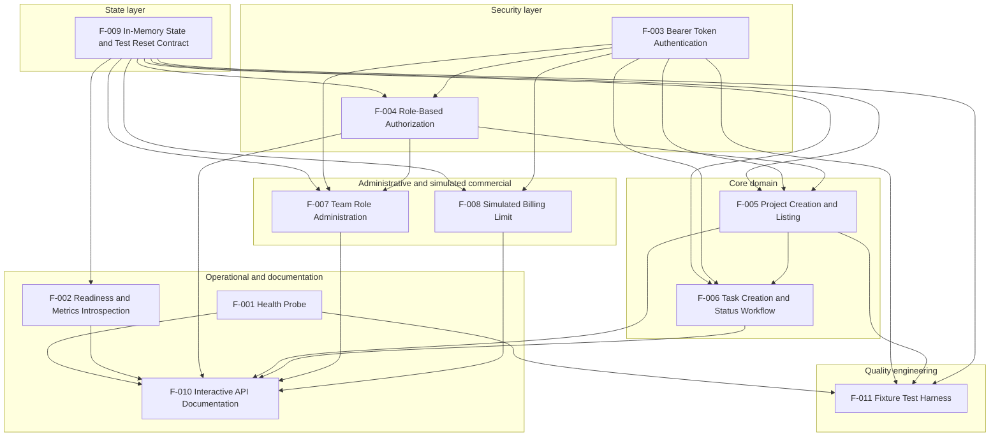

| Source | Relationship | Target | Evidence |
| --- | --- | --- | --- |
| F-009 | supplies the stores every stateful handler mutates | F-004, F-005, F-006, F-007, F-008 | `app/main.py` lines 7-13, 50, 58, 69, 82, 93, 104 (archive); `test_api.py` lines 2, 8-11 |
| F-009 | supplies the literal reported by the readiness check | F-002 | `app/main.py` lines 40-42 (archive) |
| F-003 | produces the principal record every protected handler consumes | F-004, F-005, F-006, F-007, F-008 | `app/main.py` lines 25-32, 46, 56, 62, 75, 87, 98 (archive) |
| F-004 | scopes the listing response | F-005 | `app/main.py` line 58 (archive) |
| F-004 | gates the administrative route | F-007 | `app/main.py` lines 89-90 (archive) |
| F-005 | supplies the project store that task creation validates against | F-006 | `app/main.py` lines 65-66 (archive) |
| F-001, F-002, F-004, F-005, F-006, F-007, F-008 | contribute the operations the generated schema describes | F-010 | `app/main.py` lines 35-110 (archive); `README.md` line 18 |
| F-001, F-003, F-005, F-009 | supply the names and behaviours the three shipped tests exercise | F-011 | `test_api.py` lines 2, 14-26 |

Two absences are as important as the edges. F-007 records roles in `TEAM` (`app/main.py` line 10, archive) but no arrow reaches F-003 or F-004 from it, because no authorization decision reads that map. F-008 shares no entity with F-005 or F-006, so usage is never attributed to a project or a task.

### 2.3.2 Integration Points

The fixture has no outbound integration. Its complete integration surface is the HTTP app, one in-process client, direct module access from tests, and the generated documentation page.

| Integration point | Mechanism | Direction | Evidence |
| --- | --- | --- | --- |
| External client to service | HTTP over the ASGI application object served by uvicorn on the default bind, documented as `http://127.0.0.1:8000/docs` | Inbound | `README.md` lines 16-18 |
| Test harness to service | `fastapi.testclient.TestClient(app)` constructed at import, no network listener | In-process | `test_api.py` lines 1, 4 |
| Test harness to application state | Direct import and mutation of `PROJECTS`, `TASKS`, `USAGE` | In-process, bypassing the API | `test_api.py` lines 2, 8-11 |
| API description | FastAPI-generated OpenAPI schema rendered at `/docs` | Inbound, read-only | `README.md` line 18; `app/main.py` line 5 (archive) |
| Identity provider, database, message broker, telemetry backend, payment provider | None — no such dependency appears in `requirements.txt` or any handler | Not applicable | `README.md` line 9; `requirements.txt` lines 1-4 |

The lifecycle of a protected request crosses three of these points in one path, which is the only cross-component flow in the fixture.

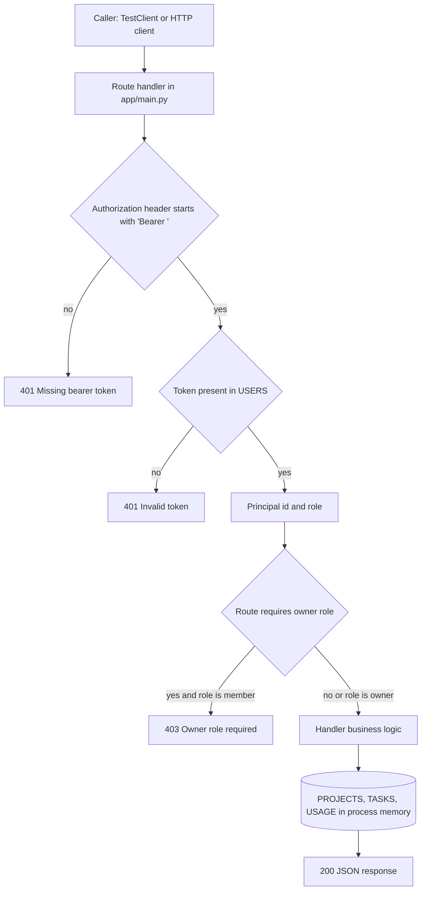

The two role-gated branches in this diagram correspond to `app/main.py` lines 58 (visibility filter) and 89-90 (owner gate, archive); the `403` is reachable only on the team route, and no other handler inspects the role.

### 2.3.3 Shared Components and Common Services

| Shared component | Consumed by | Contract it imposes | Evidence |
| --- | --- | --- | --- |
| `current_user(authorization)` helper | F-004, F-005, F-006, F-007, F-008 | Every protected handler resolves identity through one function; a change to the `401` messages or the `Bearer ` test changes all six routes at once | `app/main.py` lines 25-32 (archive) |
| `USERS` token map | F-003, F-004 | The only source of principal id and role at request time; two literal entries | `app/main.py` line 7 (archive) |
| `authorization: str \| None = Header(default=None)` declaration | Six protected handlers | The header is bound as an optional parameter on each handler, so OpenAPI exposes a per-operation header field rather than a reusable security scheme | `app/main.py` lines 46, 56, 62, 75, 87, 98 (archive) |
| `app` ASGI object with title and version metadata | F-001 to F-010 | Single import target for the server command and the test client | `app/main.py` line 5 (archive); `README.md` line 16; `test_api.py` line 2 |
| Module-level stores `PROJECTS`, `TASKS`, `USAGE`, `TEAM` | F-002, F-004 to F-009 | State lives in module attributes so the test hook can clear it in place; no handler may hold state elsewhere | `app/main.py` lines 8-11 (archive); `test_api.py` lines 8-11 |
| Identifier counters `NEXT_PROJECT`, `NEXT_TASK` | F-005, F-006 | Sequential integer keys allocated with `global` rebinding; deliberately outside the reset hook | `app/main.py` lines 12-13, 47-51, 63-70 (archive) |
| Error convention `HTTPException(status, detail)` | Every non-`200` path | Fixed `status` code plus a short human-readable `detail` string; nine distinct raises across the surface | `app/main.py` lines 27, 31, 66, 79, 81, 90, 92, 101, 103 (archive) |
| FastAPI request models `ProjectIn`, `TaskIn` | F-005, F-006 | Input validation is declarative; handlers receive already-validated payloads and perform no field checks themselves | `app/main.py` lines 16-22 (archive) |
| pytest `setup_function` hook | F-009, F-011 | One reset point runs before every test in the module; it reaches state only through the three module attributes it clears | `test_api.py` lines 8-11 |


## 2.4 Implementation Considerations

### 2.4.1 Technical Constraints, Performance and Scalability

No numeric performance requirement exists to inherit: `README.md`, `test_api.py`, `pytest.ini`, `requirements.txt` and the archived `app/main.py` state no latency, throughput, availability or memory budget. The performance column therefore records the algorithmic shape of each handler and the absence of a budget, and the scalability column records what the design precludes.

| Feature | Technical constraints | Performance requirements | Scalability considerations |
| --- | --- | --- | --- |
| F-001 | Body must stay exactly `{"status": "ok"}` (exact-equality assertion); must remain unauthenticated | No budget defined; constant work, no I/O | Stateless and independent of store size, so it remains valid under any deployment shape |
| F-002 | `requests_total` is a literal `0`; `uptime_seconds` is `round(monotonic(), 2)` and on most platforms measures time since boot, not process start | No budget defined; one clock read | Reports per-process values only; behind several workers each reports its own uptime and the same constant counter |
| F-003 | Credentials are two literals in source (`owner-token`, `member-token`); prefix test is an exact, case-sensitive `Bearer ` match; `str \| None` unions require Python 3.10 or newer, and no interpreter version is pinned | No budget defined; one dictionary lookup per protected request | Adding a principal means editing source and redeploying; no revocation, expiry, or scope, and no shared session store to scale out |
| F-004 | Role is read only from the token map; vocabulary is exactly `owner` and `member`; the listing filter runs in Python, not in storage | No budget defined; listing is O(n) in stored projects | No pagination or filtering parameters, so a large project store is returned in full on every call |
| F-005 | Creation returns `200`, not `201` (`test_api.py` line 20); project names are not unique; ids restart at `1` per process | No budget defined; creation is constant work plus one insertion | `PROJECTS` grows without bound and has no delete or update route, so memory and listing cost grow monotonically for the process lifetime |
| F-006 | `status` is a **query parameter**, not a body field; the only transition rule is membership in `{open, in_progress, done}`; no ownership or role check applies; no route lists or reads tasks back | No budget defined; both handlers are constant work | `TASKS` grows without bound; tasks reference projects by integer id with no cascade on project removal (and no project removal route exists) |
| F-007 | `TEAM` is a separate dictionary from `USERS` and is never consulted for authorization; an unknown user and an invalid role share one `404` | No budget defined; two membership tests | Two-literals map, so the administrative surface cannot describe users the credential store does not know |
| F-008 | Ceiling is the literal `5`; no reset endpoint, no period or window, no per-caller attribution; the increment is a read-modify-write on a shared dictionary | No budget defined; constant work | One global counter for all callers, so one caller can exhaust the allowance for everyone; no locking, so concurrent requests can interleave the check and the increment |
| F-009 | Six module-level names are public contract (`USERS`, `PROJECTS`, `TASKS`, `TEAM`, `USAGE`, plus `NEXT_PROJECT` and `NEXT_TASK`); stores must be emptied in place, not replaced; counters are excluded from the reset hook | No budget defined; `clear()` is linear in store size | State cannot be shared across processes or restarts, so any deployment with more than one worker gives divergent views; `README.md` line 9 states the in-memory model as a requirement, not a limitation to be optimised |
| F-010 | Authentication is a declared header parameter, so the schema carries no security scheme and offers no authorisation control in the UI; the docs page and schema are unauthenticated | No budget defined; schema generated once at start-up | Describes nine operations from a single module; nothing to scale |
| F-011 | `pytest.ini` sets `testpaths = tests` while the only test module sits at the repository root; `TestClient(app)` is built at import, so import must not require a server or configuration; the suite is defined as deliberately partial | No budget defined; the suite runs in process with no listener | Runs in a single process against module state, so it cannot exercise multi-process behaviour |

### 2.4.2 Security Implications and Maintenance Requirements

| Feature | Security implications | Maintenance requirements |
| --- | --- | --- |
| F-001 | Unauthenticated by design; discloses only liveness | Must keep the response body free of extra keys, or `test_api.py` line 15 fails |
| F-002 | `/ready` and `/metrics` are unauthenticated and expose uptime and a storage claim to any caller; the claim is a literal, so it cannot detect a real storage failure | Any real metrics work must replace the literal `0`, and any real uptime must capture a start timestamp rather than relying on `monotonic()` |
| F-003 | Tokens are committed literals, so anyone with repository access is an owner; comparison is a plain dictionary lookup with no constant-time property; no expiry, rotation, revocation, or transport security is configured; `README.md` line 31 prohibits real credentials | Any change to the `401` messages or the `Bearer ` prefix affects all six protected routes through one helper; the `USERS` map must stay aligned with any role change recorded in `TEAM` |
| F-004 | Project scoping is by principal id, not by a membership table, so role and ownership can drift apart; no route additionally restricts project creation to owners | The role vocabulary is duplicated across `USERS` (line 7) and the team-route validation (line 91), so the two must change together |
| F-005 | Any authenticated principal, including a member, can create projects; `owner_id` is taken from the token and never from the body, which prevents owner spoofing | Status code `200` and the presence of `name` and `id` are pinned by the suite; the id counter must remain a module global for the `global` rebinding to work |
| F-006 | No ownership or role check on either handler, so any valid token can create tasks in any project and move any task to any status; `404` on an unknown project id discloses which project ids exist | Status transitions are unvalidated as a graph, so future states must be added to the set literal in one place; the absence of a read route makes tasks unobservable except at write time |
| F-007 | The recorded role has no effect on authorization, because `current_user` reads `USERS` only — a promotion grants nothing and a demotion removes nothing, which is a privilege-management defect rather than a hardening gap; the owner gate correctly refuses before any write | Two identity maps must be kept consistent by hand; a correct fix requires the authorization path to read the assignment made here |
| F-008 | The ceiling is global and unauthenticated-by-caller in scope: the second seeded principal can consume the first's allowance; no rate limiting accompanies the `429`, so refusal is not protection against repeated attempts | Limit `5` and the `{used, limit}` response shape are literal; the test hook resets `used` directly, so any move to a richer usage model must keep the `used` key mutable at module level |
| F-009 | State is readable and writable by any code in the same process, including tests; nothing is persisted, so a restart silently discards records and restores the demo tokens | The four imported names must never be renamed or replaced by instances; the counters are outside the reset hook, which must be understood before adding tests that assert fixed ids |
| F-010 | The docs page is unauthenticated and reveals the two seeded user ids and the full route surface; no security scheme is declared, so credentials are typed by hand with the `Bearer ` prefix | Documentation accuracy depends entirely on keeping the decorators and models as the single description source |
| F-011 | The suite asserts authorization only for a missing header; an invalid token returning `200`, or a member reaching an owner-only path, would not be caught; demo tokens are committed as literals | `pytest.ini` line 2 must match the real layout (a `tests` directory) or discovery silently yields nothing; `README.md` line 8 records the coverage gap as intentional, so closing it changes the artefact under evaluation |

### 2.4.3 Cross-Cutting Constraints and Observed Gaps

**Implementation provenance.** The only committed implementation of the nine routes is `app/main.py` inside `proactie_insight_testing-main.zip`, added at commit `4e4368f` and deleted at `b37e7e5`. At HEAD `b8903e9` there is no `app` package, so `uvicorn app.main:app` (`README.md` line 16) and `from app.main import app, PROJECTS, TASKS, USAGE` (`test_api.py` line 2) both fail. Every feature in this catalogue is therefore documented against archived source and cannot be exercised from the current checkout. Restoring the fixture requires committing that module and a `tests` directory.

**Concurrency and process model.** The handlers are synchronous functions that mutate shared module dictionaries (`app/main.py` lines 50, 69, 82, 93, 104, archive) with no lock, queue, or transactional boundary. The check-then-increment in the billing handler (lines 102-104) is not atomic, so two concurrent requests can both pass the ceiling test. The run command in `README.md` line 16 passes `--reload` and no worker count, and no configuration file sets one, so the documented deployment is a single process; any multi-worker configuration would give each worker its own projects, tasks, usage and roles.

**Runtime and dependency constraints.** `requirements.txt` pins `fastapi==0.115.12`, `uvicorn==0.34.0`, `pytest==8.3.5` and `httpx==0.28.1` exactly, with test dependencies in the same list as runtime ones and no interpreter version declared anywhere. The archived source uses `str | None` annotations and `str.removeprefix`, which require Python 3.10 and 3.9 respectively, so the effective floor is Python 3.10. `httpx` is an explicit pin even though it is only needed beneath `TestClient`, which is why the import-time client can be constructed without an implicit dependency.

**Configuration and environment.** No settings object, environment variable read, `.env` file, container definition, CI workflow, or infrastructure manifest exists in the repository, consistent with `README.md` line 28 ("Do not configure an environment; this fixture is self-contained"). The bind address in the README is uvicorn's default, and the billing ceiling of `5` is a source literal rather than configuration.

**Security posture as implemented.** Five constraints bound what the fixture may claim: credentials are two committed literals (`app/main.py` line 7, archive) that `README.md` line 31 forbids replacing with real ones; authorization is limited to a listing filter and one owner gate; task mutation carries no ownership check; role administration writes to a map that authorization never reads; and `/ready` and `/metrics` are unauthenticated. These are properties of the declared contract, not defects introduced by this document, and Section 2.5.1 records which of them any shipped test would detect.

**Observability and maintenance.** No request counter is incremented anywhere, so `requests_total` stays `0` (`app/main.py` line 110, archive); uptime derives from an unspecified clock origin; no logging call appears in the module. Two repository-level maintenance hazards are visible: `pytest.ini` points discovery at a `tests` directory that does not exist at HEAD, and the implementation survives only inside a binary archive in git history, where it is neither importable nor covered by any review or tooling that reads the working tree.


## 2.5 Traceability Matrix

### 2.5.1 Requirement-to-Evidence and Test Traceability

Line references in the second column point to `app/main.py` inside the archive at commit `4e4368f`, since no implementation exists at HEAD; references in the third column point to `test_api.py`, which is identical at HEAD and in the archive.

| Requirement ID | Implementation evidence | Verified by | Verification status |
| --- | --- | --- | --- |
| F-001-RQ-001 | lines 35-37 | `test_api.py` lines 14-15 | Verified by shipped test |
| F-001-RQ-002 | lines 35-37 (no header parameter) | `test_api.py` line 14 (no headers sent) | Verified by shipped test |
| F-002-RQ-001 | lines 40-42 | none | Unverified |
| F-002-RQ-002 | lines 108-110 | none | Unverified |
| F-002-RQ-003 | lines 40-42, 108-110 | none | Unverified |
| F-003-RQ-001 | lines 26-27 | `test_api.py` lines 25-26 | Verified by shipped test |
| F-003-RQ-002 | lines 26-27 | none | Unverified |
| F-003-RQ-003 | lines 29-32 | none | Unverified |
| F-003-RQ-004 | line 7; lines 29-32; line 49 | `test_api.py` lines 5, 19-21 (owner token only) | Partially verified — member token never exercised |
| F-004-RQ-001 | line 58 | `test_api.py` line 22 (single project, owner caller) | Partially verified — multi-project visibility unproven |
| F-004-RQ-002 | line 58 | none | Unverified |
| F-004-RQ-003 | lines 89-90 | none | Unverified |
| F-004-RQ-004 | line 7; line 91 | none | Unverified |
| F-005-RQ-001 | lines 45-52 | `test_api.py` lines 19-21 | Verified by shipped test |
| F-005-RQ-002 | lines 16-17 | none | Unverified |
| F-005-RQ-003 | lines 12, 47-51 | `test_api.py` lines 19-22 (one creation per test) | Partially verified — sequence across creations unproven |
| F-005-RQ-004 | lines 55-58 | `test_api.py` line 22 | Verified by shipped test |
| F-006-RQ-001 | lines 67-71 | none | Unverified |
| F-006-RQ-002 | lines 65-66 | none | Unverified |
| F-006-RQ-003 | lines 20-21 | none | Unverified |
| F-006-RQ-004 | lines 74-83 | none | Unverified |
| F-006-RQ-005 | lines 77-79 | none | Unverified |
| F-007-RQ-001 | lines 86-94 | none | Unverified |
| F-007-RQ-002 | lines 91-92 | none | Unverified |
| F-007-RQ-003 | line 10 against lines 29-32 | none | Unverified |
| F-008-RQ-001 | lines 104-105 | none | Unverified |
| F-008-RQ-002 | line 98 | none | Unverified |
| F-008-RQ-003 | lines 100-101 | none | Unverified |
| F-008-RQ-004 | lines 102-103 | none | Unverified |
| F-009-RQ-001 | lines 7-11 | `test_api.py` line 2 (import at collection) | Verified by shipped test |
| F-009-RQ-002 | lines 8-11 | `test_api.py` lines 8-11 | Verified by shipped test |
| F-009-RQ-003 | lines 12-13, 51, 70 | `test_api.py` lines 19-22 (indirect) | Partially verified — cross-test id continuity unproven |
| F-009-RQ-004 | lines 7-13 | none | Unverified |
| F-010-RQ-001 | lines 35-108 (nine route decorators) | none | Unverified |
| F-010-RQ-002 | line 5 | none | Unverified |
| F-011-RQ-001 | `pytest.ini` lines 1-3; `requirements.txt` lines 1-4; `test_api.py` lines 1-26 | `README.md` lines 20-23 (instruction only) | Not executable at HEAD — `app.main` absent, so collection fails |
| F-011-RQ-002 | `pytest.ini` lines 1-3 | none | Unverified |
| F-011-RQ-003 | `test_api.py` lines 14, 18, 25 (three test names) | the shipped suite itself | Verified by inspection of the suite |

**Coverage reading.** Seven of thirty-eight requirements are asserted by a shipped test, four are partially touched by the suite, twenty-five have no test at all, and one cannot execute at HEAD. The untested set is exactly the surface `README.md` line 8 calls "important workflows and non-functional behaviours": tasks, team membership, the billing ceiling, role enforcement beyond a missing header, readiness, metrics, documentation, and the discovery configuration. A candidate implementation could fail every one of the twenty-five and still report three passing tests.

### 2.5.2 Assumptions, Constraints and Requirement Versions

**Assumptions.**

| ID | Assumption | Basis |
| --- | --- | --- |
| A-1 | The archived `app/main.py` is the intended implementation of the fixture, not an unrelated upload | The archive's `tests/test_api.py` and `README.md` are byte-identical to the files at HEAD, and its nine routes cover every capability `README.md` lines 6-7 declares |
| A-2 | HEAD `b8903e9` is the authoritative checkout, so every feature is documented as a declared contract rather than a runnable capability | Six tracked files, none of them application code |
| A-3 | The documented bind address is uvicorn's default `127.0.0.1:8000` | `README.md` line 18; no host or port configuration exists in the repository |
| A-4 | The documented deployment is a single process | `README.md` line 16 passes `--reload` and no worker count; no configuration file sets one |
| A-5 | The effective interpreter floor is Python 3.10 | `str \| None` annotations at `app/main.py` lines 25, 46, 56, 62, 75, 87, 98 (archive); nothing in the repository pins a version |
| A-6 | The separation between `TEAM` and `USERS` is described as it is implemented, not as it was intended | `app/main.py` lines 7, 10, 29-32, 93 (archive); no test or README statement asserts that a recorded role should take effect |

**Constraints.** C-1: no external database, service, or environment configuration is permitted (`README.md` lines 9, 28). C-2: dependencies are exactly the four `==` pins in `requirements.txt`; introducing anything else breaks the stated reproducibility. C-3: credentials must remain demo literals and the fixture must not be deployed or used with real credentials (`README.md` line 31). C-4: state must stay in module-level containers reachable by the test hook (`test_api.py` lines 2, 8-11). C-5: creation must answer `200` with both `name` and `id` (`test_api.py` lines 20-21). C-6: the coverage gap is intentional, so closing it changes the artefact being evaluated (`README.md` line 8).

**Requirement version register.**

| Requirement set | Version | Basis | Change note |
| --- | --- | --- | --- |
| F-001 to F-011, all 38 requirements | 1.0 | HEAD `b8903e9` on `main`; archive commit `4e4368f` | Initial issue; no prior version exists |

**Related specifications and diagrams.**

| Reference | What it supplies |
| --- | --- |
| Section 1.1 | Repository provenance, delivered-versus-declared framing, stakeholder list |
| Section 1.2.2 and its flowchart | System overview, capability table, component inventory |
| Section 1.2.3 | Success criteria and critical success factors that Section 2.2 refines into testable requirements |
| Section 1.3 | In-scope workflows, out-of-scope elements, essential integrations |
| Section 2.3.1 | Feature dependency flowchart for the eleven features |
| Section 2.3.2 | Request-lifecycle flowchart for authentication, optional owner gate, stores and response |
| Section 2.4.3 | Cross-cutting constraints and observed gaps behind the security and maintenance columns of Section 2.4.2 |


## 2.6 References

- `README.md` — Declared product positioning (line 3), the included feature list for authentication, role checks, project and task workflows, team membership, the simulated billing limit and in-memory storage (lines 5-9), the run command naming `app.main:app` and the `/docs` address (lines 16-18), the test command (lines 20-23), the scan setup requiring no environment (lines 25-28), and the non-production, no-real-credentials warning (line 31).
- `test_api.py` — The executable contract: import of `app`, `PROJECTS`, `TASKS` and `USAGE` (line 2), `TestClient` construction at import (line 4), the `Bearer owner-token` header (line 5), the `setup_function` state reset (lines 8-11), and the three assertions covering the health body, project creation with listing, and the `401` for an anonymous request (lines 14-26).
- `requirements.txt` — The four exact pins establishing the stack and that no database, identity, messaging, telemetry or payment client is present: `fastapi==0.115.12`, `uvicorn==0.34.0`, `pytest==8.3.5`, `httpx==0.28.1`.
- `pytest.ini` — Discovery settings `testpaths = tests` and `python_files = test_*.py` (lines 1-3), which conflict with the root-level location of the only test module.
- `__init__.py` — Empty module marking the repository root as a Python package, which shapes how pytest resolves the shipped test module.
- Repository root (`""`) — Complete inventory at HEAD `b8903e9`: six tracked files, no `app` package, no `tests` directory, no configuration, container, CI or licence file.
- `proactie_insight_testing-main.zip` at commit `4e4368f` — The only committed implementation, added at `4e4368f` and deleted at `b37e7e5`; its deletion is why no feature can execute at HEAD.
- `proactie_insight_testing-main/app/main.py` (archive) — All route definitions: `GET /health` (35-37), `GET /ready` (40-42), `POST /projects` (45-52), `GET /projects` (55-58), `POST /tasks` (61-71), `PATCH /tasks/{task_id}` (74-83), `POST /teams/{user_id}/role` (86-94), `POST /billing/consume` (97-105), `GET /metrics` (108-110); the `current_user` helper (25-32); the state literals (7-13); the `ProjectIn` and `TaskIn` models (16-22); and the nine `HTTPException` calls that fix the `401`, `403`, `404`, `422` and `429` behaviours.
- `proactie_insight_testing-main/tests/test_api.py` (archive) — Byte-identical to HEAD `test_api.py`, confirming the archive is the same fixture with a `tests` layout.
- `proactie_insight_testing-main/README.md` (archive) — Byte-identical to HEAD `README.md` (md5 `c0216005c76bc18f654f64c9b87a982e`), confirming the archive and HEAD share one declared contract.
- Git history of `main` — Three commits (`4e4368f` archive upload, `b37e7e5` archive deletion, `b8903e9` scaffolding upload) that establish the implementation's provenance and its absence at HEAD.
- Sections 1.1, 1.2, 1.3 and 1.4 of this specification — Reused for terminology, status vocabulary and cross-references to provenance, system overview, success criteria and scope.

No external web sources were consulted for this section.


# 3. Technology Stack

## 3.1 Programming Languages

The repository declares and uses exactly one programming language. Every executable file in the tracked tree is Python, and the only implementation of the service — the archived `app/main.py` added at commit `4e4368f` and absent from HEAD — is Python too. The remaining tracked files are configuration and documentation formats rather than code.

| Component | Language and version evidence | Evidence |
| --- | --- | --- |
| ASGI service module `app/main.py` (archived, not at HEAD) | Python 3.10+ — PEP 604 unions (`str \| None`) and `str.removeprefix` | Archive of commit `4e4368f`: imports at lines 1-3, union annotations at lines 25, 46, 56, 62, 75, 87, 98, `removeprefix` at line 28 |
| Test module `test_api.py` (repository root) | Python, no syntax above the service module's floor | `test_api.py` lines 1-26 |
| Root package marker `__init__.py` | Python package marker, 0 bytes, no statements | `__init__.py` |
| Test runner configuration `pytest.ini` | INI (`[pytest]` section, two settings) | `pytest.ini` lines 1-3 |
| Dependency manifest `requirements.txt` | pip requirement specifiers (PEP 508) with four exact `==` pins | `requirements.txt` lines 1-4 |
| `README.md` | Markdown with two `bash` fenced blocks | `README.md` lines 12-17, 21-23 |

**Selection criteria.** Python is the only language the fixture can be written in without adding a second toolchain, because both consumers of the code are Python: the application is defined by FastAPI's Python API (`@app.get`, `@app.post` decorators in the archived module, lines 35-108), and the shipped suite is a pytest module that imports the application objects directly (`from app.main import app, PROJECTS, TASKS, USAGE`, `test_api.py` line 2). Sharing one interpreter and one process is what lets the suite drive the application through the in-process `TestClient` (`test_api.py` line 4) instead of a network call, which is why no second language, script, or shell-test harness appears anywhere. The tree has no front-end source — no HTML templates, no static directory, no JavaScript build — so the documented `/docs` page (`README.md` line 18) is generated entirely by the framework rather than by repository code.

**Constraint — the interpreter version is implied, never declared.** No `requires-python`, `.python-version`, `runtime.txt`, `pyproject.toml`, or CI matrix exists in the tree, and `README.md` lines 13-14 create the virtual environment from whichever `python` the shell resolves. Three independent facts bound the usable interpreter:

| Evidence tier | Floor | Source |
| --- | --- | --- |
| The four pins themselves | Python 3.9 (fastapi, pytest and httpx declare `>=3.8`; uvicorn 0.34.0 declares `>=3.9`) | PyPI metadata for each pinned release |
| The archived source syntax | Python 3.10 (`str \| None`), 3.9 for `str.removeprefix` | Archive of `4e4368f`, lines 25 and 28 |
| A fresh resolution of `requirements.txt` today | Python 3.10 — eight transitive packages require it: annotated-types, anyio, click, iniconfig, pluggy, pydantic, pydantic_core, typing-inspection | `pip install --dry-run --report` over `requirements.txt` |

The effective floor is therefore **Python 3.10**. On 3.9 the install can succeed while the archived module fails at import, and on 3.8 the resolved transitive set no longer installs at all.

**Other language-level constraints.**

- The service module's only standard-library import is `from time import monotonic` (archive line 3, used at line 110 for `uptime_seconds`), so no OS-specific or platform-conditional code path exists.
- Handlers are synchronous `def` functions, not `async def`, so the application imposes no coroutine or async-library requirement beyond what uvicorn and Starlette bring.
- Type annotations are used but never enforced: no mypy, pyright, or `py.typed` marker exists, and no linting configuration is committed.

**Languages in the reference default stack that are absent.** None of the shipped components is written in any language other than Python, and the whole-tree keyword scan for `react`, `typescript`, `tailwind`, `electron`, `swift`, `kotlin` and `objective-c` produced no hit outside the prose words in `README.md` lines 7-8.

| Default-stack language | Status here | Basis |
| --- | --- | --- |
| TypeScript (React, React-Native, ElectronJS) | Not present | No `package.json`, `tsconfig.json`, `.ts`, `.tsx`, `.js` or `.jsx` file in the tree or in git history |
| Swift (iOS) | Not present | No `.swift` file; no mobile target of any kind |
| Kotlin (Android) | Not present | No `.kt`, `.kts` or Gradle file |
| Objective-C (macOS) | Not present | No `.m` or `.mm` file |

The only JavaScript a user ever executes is the Swagger UI bundle that FastAPI's generated `/docs` page loads from a CDN at browse time; it is framework-supplied, not repository code, and is documented as an external dependency in Section 3.4.


## 3.2 Frameworks &amp; Libraries

The repository pins four packages and depends transitively on two more frameworks that do real work: Starlette (the ASGI toolkit under FastAPI) and Pydantic (the validation layer behind every request model). Everything else in the resolved closure is supporting infrastructure.

**Core frameworks**

| Layer | Package | Version | Pin status | Role in this service |
| --- | --- | --- | --- | --- |
| API framework | `fastapi` | 0.115.12 | Exact pin (`requirements.txt` line 1) | Declares the HTTP surface — nine route operations in the archived module (lines 35-110) — plus request validation, the OpenAPI schema, and the `/docs` page named in `README.md` line 18 |
| ASGI server | `uvicorn` | 0.34.0 | Exact pin (`requirements.txt` line 2) | Runs `app.main:app` as the documented entry point (`README.md` line 16); `--reload` provides the edit-and-retry loop |
| Validation and serialisation | `pydantic` | Not declared; resolves to 2.14.4 | Implicit — FastAPI requires `>=1.7.4,<3.0.0` (excluding 1.8, 1.8.1, 2.0.0, 2.0.1, 2.1.0) | Supplies `BaseModel` and `Field` for the two request models `ProjectIn` and `TaskIn` (archive lines 2, 16-22) |
| ASGI toolkit and test client | `starlette` | Not declared; resolves to 0.46.2 | Implicit — FastAPI requires `>=0.40.0,<0.47.0` | Provides routing and the ASGI primitives beneath FastAPI, and defines the `TestClient` that `fastapi.testclient` re-exports as a one-line import |

**Supporting libraries**

| Package | Version | Pin status | Why it is present |
| --- | --- | --- | --- |
| `httpx` | 0.28.1 | Exact pin (`requirements.txt` line 4) | The transport `starlette.testclient` imports at module load; without it the client raises "The starlette.testclient module requires the httpx package to be installed" |
| `pytest` | 8.3.5 | Exact pin (`requirements.txt` line 3) | The runner invoked as `pytest -q` (`README.md` line 22) and configured by `pytest.ini` |
| `time` (standard library) | CPython 3.10+ | n/a | The archived module's only stdlib import, used for `monotonic()` in the `/metrics` payload (archive lines 3, 110) |
| `click`, `h11`, `anyio`, `httpcore`, `certifi`, `idna`, `pluggy`, `iniconfig`, `packaging`, `typing_extensions`, `pydantic_core`, `annotated-types`, `typing-inspection` | Resolved per install | Transitive only | Server CLI and HTTP protocol, async I/O, pytest plugin and config plumbing, and Pydantic's compiled core; enumerated in Section 3.3 |

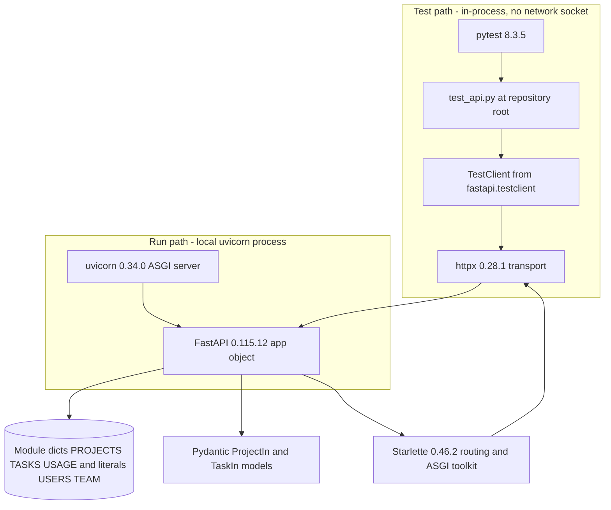

**Justification for each major choice**

- **FastAPI** is the whole reason the fixture needs almost no code: decorators declare the routes, annotated function signatures become the request schema, and the OpenAPI document plus the interactive `/docs` page are generated without a single repository-side template or asset (`README.md` line 18). It also ships the in-process `TestClient`, so the three shipped tests need no listening server (`test_api.py` line 4).
- **Uvicorn** is the server named by the repository's own run instructions (`README.md` line 16). The pin is the plain distribution, not `uvicorn[standard]`, so the optional performance and file-watching extras (`uvloop`, `httptools`, `watchfiles`, `websockets`, `python-dotenv`, `pyyaml`) are not installed. The consequence is explicit in the shipped wheel: `uvicorn/supervisors/__init__.py` imports `WatchFilesReload` and, on `ImportError`, falls back to `StatReload`, so `--reload` still works but watches the tree by polling rather than by filesystem events.
- **httpx** is pinned even though no repository file imports it directly, because the suite cannot be collected without it — `fastapi.testclient` is a one-line re-export of `starlette.testclient`, which imports `httpx` at module scope. Pinning it converts an implicit, resolution-dependent dependency into a declared one (`requirements.txt` line 4).
- **pytest** is pinned because `README.md` lines 20-23 make `pytest -q` the project's only verification command, and because `pytest.ini` encodes the collection contract: `testpaths = tests` and `python_files = test_*.py`.
- **Pydantic** is not a deliberate choice but a FastAPI requirement, and it is the one framework whose version the manifest leaves open. The archived models (`Field(min_length=2, max_length=80)`, `Field(min_length=2, max_length=120)`, `project_id: int`) are written in syntax both major versions accept, but a Pydantic 1.x resolution and a 2.x resolution differ in validation-error structure and serialisation behaviour. This is the stack's largest reproducibility gap and is carried into Section 3.3.

**Compatibility requirements**

| Constraint | Range that must hold | Status of the shipped pins |
| --- | --- | --- |
| Interpreter | Python 3.10 or newer in effect (Section 3.1) | Satisfied only by convention; no declaration exists |
| `fastapi` 0.115.12 → `starlette` | `>=0.40.0,<0.47.0` | Resolution selects 0.46.2; any future FastAPI upgrade must be checked against this ceiling |
| `fastapi` 0.115.12 → `pydantic` | `>=1.7.4,<3.0.0`, excluding four bad releases | Unconstrained by the manifest; v1 and v2 both installable |
| `starlette` → `httpx` (test client) | Starlette's `full` extra declares `httpx<0.29.0,>=0.27.0`; the `app=` keyword argument removed in httpx 0.28 has not been passed since Starlette 0.37.2 | `httpx==0.28.1` conforms, and FastAPI's `>=0.40.0` floor keeps the pair safe |
| `uvicorn` 0.34.0 → `click`, `h11` | `click>=7.0`, `h11>=0.8`; `typing-extensions>=4.0` below Python 3.11 | Installed automatically; no conflict with the pinned set |
| `pytest` 8.3.5 → `pluggy` | `pluggy<2,>=1.5` | Installed automatically; pins no plugin, so no plugin-compatibility surface exists |

**Integration requirements between components.** Five couplings describe how the stack joins up, and each is a precondition for the documented commands to work:

1. Uvicorn resolves its target by import string, `app.main:app`, so a package directory `app` containing `__init__.py` and `main.py` must sit beside the working directory — the arrangement the README assumes (line 16) and the archive contains, but which is absent from HEAD.
2. Both the server and the tests depend on the same object identity: `app` must be a `FastAPI` instance for uvicorn to serve it and for `TestClient(app)` to wrap it (`test_api.py` line 4).
3. The test module imports four module-level names — `app`, `PROJECTS`, `TASKS`, `USAGE` (`test_api.py` line 2) — so those must remain attributes of `app.main` rather than state hidden inside classes or closures.
4. `httpx` must be importable wherever `test_api.py` is collected, because the `TestClient` construction happens at import time, before any fixture runs.
5. The root `__init__.py` makes the repository root an importable package; pytest's rootdir is fixed at the repository root by `pytest.ini`, so the import path for `app.main` is resolved from there, and a relocated test module would change what "`tests`" means in `testpaths`.

**Frameworks in the reference default stack that are absent.** No Flask, LangChain, React, React-Native, TailwindCSS or ElectronJS dependency appears in the manifest or anywhere in the tree.

| Default-stack framework | Status here | Basis |
| --- | --- | --- |
| Flask | Not present | `requirements.txt` lists only FastAPI; no `flask` import in any file or in the archive |
| Langchain | Not present | No AI/LLM client, SDK or prompt code exists; no network egress is configured |
| React, React-Native, TailwindCSS, ElectronJS | Not present | No `package.json`, lockfile, bundler config or style file exists in the tree or in git history |


## 3.3 Open Source Dependencies

All third-party code in this repository comes from one public registry, PyPI, through `pip`. Four packages are declared at exact versions in `requirements.txt`; fifteen more are pulled in as their transitive dependencies; nothing is vendored, forked, or referenced by VCS URL or local path.

**Declared dependencies**

| Package | Pin | Role | Installed into the same environment as |
| --- | --- | --- | --- |
| `fastapi` | 0.115.12 | Runtime — HTTP framework defining every route | Server and tests |
| `uvicorn` | 0.34.0 | Runtime — ASGI server named in `README.md` line 16 | Server and tests |
| `pytest` | 8.3.5 | Test — runner invoked by `pytest -q` (`README.md` line 22) | Server and tests |
| `httpx` | 0.28.1 | Test — transport beneath `TestClient`, imported by Starlette at module load | Server and tests |

The manifest has exactly four lines and no other package metadata: no extras (`pkg[standard]`), no environment markers, no hashes (`--require-hashes`), no alternate index (`--index-url`/`--extra-index-url`), no editable or VCS reference, no `-r` inclusion, and no separated development file. Runtime and test dependencies are therefore indistinguishable to `pip`: the single documented command, `pip install -r requirements.txt` (`README.md` line 15), installs the test runner and the HTTP client into whatever environment also runs the server.

**Resolved transitive closure**

Resolving the manifest in a Python 3.12 environment yields nineteen packages in total. The versions below are what resolution selects; only the four declared packages are reproducible from the repository itself.

| Package | Resolved version | Pulled in by | Declared `Requires-Python` |
| --- | --- | --- | --- |
| `starlette` | 0.46.2 | fastapi | >=3.9 |
| `pydantic` | 2.14.4 | fastapi | >=3.10 |
| `pydantic_core` | 2.50.5 | pydantic | >=3.10 |
| `annotated-types` | 0.8.0 | pydantic | >=3.10 |
| `typing-inspection` | 0.4.5 | pydantic | >=3.10 |
| `typing_extensions` | 4.16.0 | fastapi, pydantic | >=3.9 |
| `anyio` | 4.16.0 | starlette, httpx | >=3.10 |
| `httpcore` | 1.0.9 | httpx | >=3.8 |
| `h11` | 0.16.0 | uvicorn, httpcore | >=3.8 |
| `idna` | 3.20 | httpx | >=3.9 |
| `certifi` | 2026.11.20 | httpx | >=3.7 |
| `click` | 8.5.1 | uvicorn | >=3.10 |
| `pluggy` | 1.7.0 | pytest | >=3.10 |
| `iniconfig` | 2.3.1 | pytest | >=3.10 |
| `packaging` | 26.3 | pytest | >=3.9 |

**Reproducibility characteristics.** Only the four direct pins are fixed. The remaining fifteen versions float inside the ranges their parents declare — FastAPI allows any `starlette` in `[0.40.0, 0.47.0)` and any `pydantic` in `[1.7.4, 3.0.0)`, so today's install and next month's install can be different programs from identical repository content. Two consequences are observable rather than hypothetical: resolution selects `starlette` 0.46.2, the top of FastAPI's window, and `pydantic` 2.14.4, a 2.x release the manifest never names; and eight of the fifteen transitive packages now require Python 3.10 or newer, which is precisely how the manifest's 3.9-permitting pins end up uninstallable on 3.9. No lock file, constraints file, hash list, or package-manager manifest (`poetry.lock`, `Pipfile.lock`, `uv.lock`, `pyproject.toml`) exists to freeze the closure.

**Security and licence implications**

| Concern | Observation |
| --- | --- |
| Artifact integrity | No hashes are pinned, so every install trusts whatever the index serves for each version; a compromised or typosquatted release would be undetectable from the repository |
| Vulnerability management | No `.github` directory, Dependabot/Renovate configuration, `pip-audit`/`safety` invocation, or SBOM generator exists, so nothing scans these packages for advisories |
| Blast radius of test tooling | `pytest` and `httpx` are installed by the only documented install command, so a deployment that follows the README carries tooling it never needs |
| Silent behavioural change | The unpinned `pydantic` dependency decides request-validation error format and serialisation; a v1-to-v2 resolution changes framework behaviour without a repository change |
| Platform build prerequisite | `pydantic_core` is a compiled extension; a platform without a matching wheel needs a Rust toolchain to complete the install |
| Licensing | Every resolved package carries an OSI-approved permissive or file-level copyleft licence (MIT, BSD-3-Clause, Apache-2.0 OR BSD-2-Clause, PSF-2.0, MPL-2.0 for `certifi`). The repository itself contains no `LICENSE` file, so its own content is offered under no stated terms |

**Integration requirements.** The dependency set imposes three concrete conditions on any environment that runs the fixture: `httpx` must be present wherever the tests are collected, because `TestClient` is built at import time (`test_api.py` line 4); `starlette` must resolve within FastAPI's window, or the test client and the app diverge; and a `pydantic_core` wheel must exist for the interpreter and platform, or the install needs a compiler toolchain.

**Dependency categories deliberately absent.** A whole-tree search of `requirements.txt`, `test_api.py`, `README.md` and the archived `app/main.py` finds no database driver or ORM (no SQLAlchemy, no `psycopg`, no `pymongo`), no cloud SDK (`boto3`), no identity library (`PyJWT`, `python-jose`, `Authlib`), no telemetry exporter (`sentry-sdk`, `prometheus-client`), no task queue, no linter or formatter (`ruff`, `black`, `flake8`), no type checker (`mypy`), and no coverage tool (`pytest-cov`). The dependency set is exhausted by one web framework, one server, one test runner, and one HTTP client.


## 3.4 Third-Party Services

The service integrates with no third-party service of any kind. The dependency manifest contains no provider SDK, the archived implementation reads no configuration or environment variable, and a whole-tree search for cloud, identity, database, telemetry and SaaS provider names returned no match outside the prose in `README.md`. `README.md` line 9 states the position directly: "No external database or service is required; data is held in memory."

| Integration category | What a product service would carry | What this repository actually has |
| --- | --- | --- |
| External APIs | Outbound HTTP calls to business systems | None. No outbound client call exists in the archived module; `httpx` is pinned for the test client only and is never imported by application code |
| Authentication provider | Auth0, Okta, Cognito, or an OIDC/OAuth flow with JWT verification | None. Identity is a literal dictionary: `USERS = {"owner-token": {...}, "member-token": {...}}` (archive line 7) keyed by the raw `Authorization` header value after `str.removeprefix("Bearer ")` (line 28). No JWT library, token endpoint, key set, or session store is referenced |
| Monitoring and telemetry | APM agent, log shipper, metrics exporter | None. `/metrics` returns literals computed in-process — `requests_total` hard-coded to `0`, `uptime_seconds` from `time.monotonic()` (archive lines 108-110) — and no logging call appears in the module |
| Cloud services | Compute/queue/storage SDK, managed identity, secret manager | None. No IaC file, cloud SDK, credential read, or `os.environ`/`getenv` call exists in the tree or the archive |
| Notifications, payments, messaging | Email/SMS gateways, payment processor, broker client | None. No such dependency, configuration key, or route |
| Transport security | TLS termination, reverse proxy, certificate management | None configured. The documented bind is uvicorn's default `127.0.0.1:8000` (`README.md` line 18), plain HTTP, on the loopback interface |

**The one third-party endpoint the shipped stack references.** FastAPI's generated `/docs` page — the URL the README tells the reader to open (line 18) — is HTML that loads its assets from outside the process. In FastAPI 0.115.12 the defaults are `https://cdn.jsdelivr.net/npm/swagger-ui-dist@5/swagger-ui-bundle.js`, `https://cdn.jsdelivr.net/npm/swagger-ui-dist@5/swagger-ui.css` and `https://fastapi.tiangolo.com/img/favicon.png` (`fastapi/openapi/docs.py`), and the auto-generated `/redoc` page additionally pulls `https://cdn.jsdelivr.net/npm/redoc@next/bundles/redoc.standalone.js` and a Google Fonts stylesheet. These are browser-side fetches: the browser rendering the docs page contacts jsDelivr and `fastapi.tiangolo.com`, while the Python process itself makes no outbound connection. The practical consequence is that the documented documentation page requires internet access from the reader's browser and discloses the reader's IP and referrer to those hosts, even though the service is otherwise self-contained.

**Security implications of having no integrations.**

- There is no auditable authentication path, so the bearer header is a convention rather than a control; `README.md` line 31 forbids using real credentials with it.
- Because the process never leaves the host, there is no credential store to leak and no outbound channel for data exfiltration — and equally no external audit trail, rate limiter, or abuse control for the `429` billing refusal.
- The unauthenticated `/metrics` and `/ready` endpoints expose process-internal values to any caller that can reach the socket; with no monitoring service attached, nothing else records access to them.

**Integration requirements if a real service is adopted.** Three preconditions are missing rather than merely unconfigured: an HTTP client available to runtime code (`httpx` is present but declared as test tooling), a configuration mechanism (no settings object, `.env` reader, or environment lookup exists), and an outbound network policy (nothing in the repository describes one). The reference default stack's Auth0, AWS and monitoring choices therefore have no foothold in the current architecture — they would be additions, not substitutions.

**Default-stack services that are absent**

| Default-stack service | Status here | Basis |
| --- | --- | --- |
| Auth0 | Not present | No `auth0` reference, SDK, tenant configuration, or JWT validation anywhere; identity is two literal tokens in source |
| AWS (any service) | Not present | No `boto3`, no Terraform, no credentials, no endpoint configuration |
| Monitoring tool of any kind | Not present | No Sentry/Datadog/Prometheus/OpenTelemetry dependency; the only metrics surface is a hand-written JSON literal |


## 3.5 Databases &amp; Storage

There is no database, no cache, and no storage service. All state lives in module-level Python containers inside the serving process, which `README.md` line 9 declares as the design: "No external database or service is required; data is held in memory." No driver, ORM, connection string, schema file, migration, or data directory exists anywhere in the tree, and the archived module performs no file I/O.

**State inventory** (archived `app/main.py`, absent at HEAD)

| Structure | Shape and initial value | Written by | Lifetime and reset |
| --- | --- | --- | --- |
| `USERS` | `{"owner-token": {"id": 1, "role": "owner"}, "member-token": {"id": 2, "role": "member"}}` (line 7) | Never — read-only lookup | Recreated on import; holds the only credentials in the system |
| `PROJECTS` | dict from integer id to `{"id", "name", "owner_id"}` (line 8) | `create_project` inserts (line 50) | Process lifetime; emptied in place by `setup_function` before each test (`test_api.py` line 9) |
| `TASKS` | dict from integer id to `{"id", "title", "project_id", "created_by", "status"}` (line 9) | `create_task` inserts (line 69); `update_task` mutates `status` (line 82) | Process lifetime; emptied in place before each test (`test_api.py` line 10) |
| `TEAM` | `{1: "owner", 2: "member"}` (line 10) | `change_role` reassigns (line 93) | Process lifetime; **never reset by the suite**, so a role change survives into later tests |
| `USAGE` | `{"used": 0, "limit": 5}` (line 11) | `consume_usage` increments `used` (line 104) | Process lifetime; only the `used` key is reset before each test (`test_api.py` line 11), the `limit` is a source literal |
| `NEXT_PROJECT`, `NEXT_TASK` | integers starting at `1` (lines 12-13), rebound through `global` (lines 47, 63) | Incremented on each creation (lines 51, 70) | Process lifetime; **never reset by the suite**, so ids keep climbing across tests |

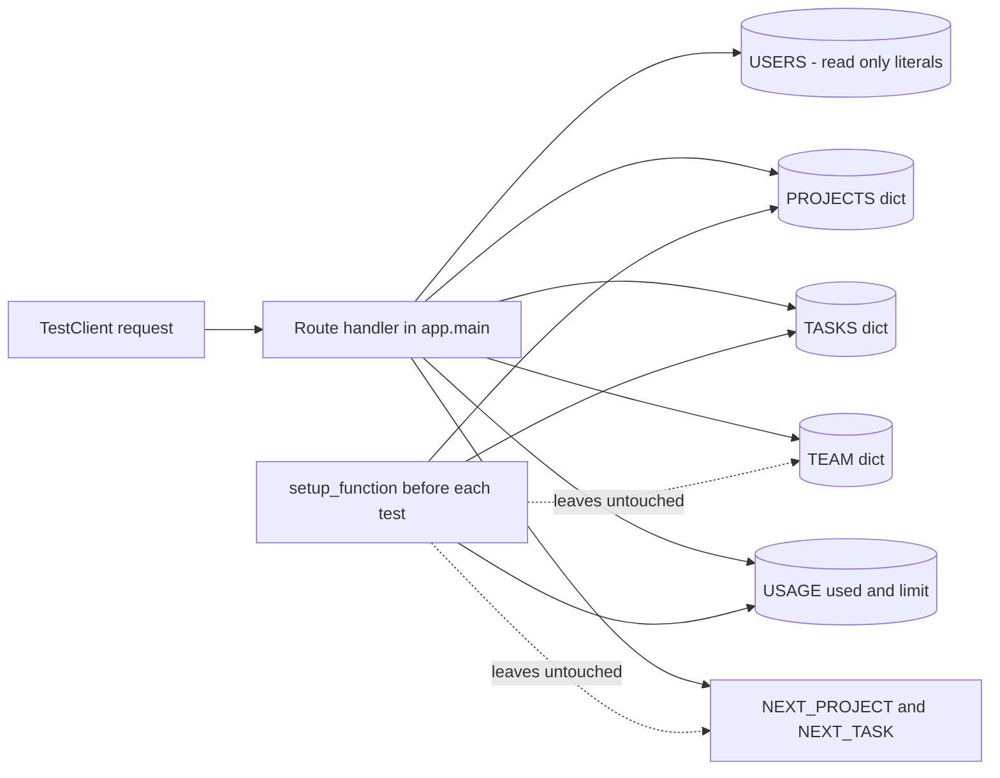

**Persistence strategy.** There is none. Nothing is serialised, flushed, snapshotted, or replicated: a restart discards every project, task, role change and usage count, and reinstates the two literal demo tokens. The state is per process, so two uvicorn workers would hold two divergent worlds; the documented run command starts a single process with no worker count (`README.md` line 16). The check-then-increment in `consume_usage` (lines 102-104) is not atomic, so concurrent requests can both pass the ceiling test — a consequence of using a shared dictionary as the system of record.

**Caching.** None. No Redis, Memcached, or in-process cache library is present, and no cache invalidation logic exists; the dictionaries are the primary store rather than a cache in front of one.

**Storage services.** None. No object store, no file persistence, no data directory, and no `open()` call in the archived module. The readiness endpoint reports `{"ready": true, "checks": {"storage": "ok"}}` (line 42) as a hard-coded literal, so the health surface cannot detect a storage fault — there is no storage it could interrogate.

**Security and integrity implications.**

- State is readable and writable by any code in the same interpreter, which is how the test suite mutates it directly (`test_api.py` lines 9-11); there is no boundary between application data and test data.
- Per-caller scoping is done in Python after the fact — `list_projects` filters `PROJECTS.values()` against the caller's id and role (line 58) — so every read loads the whole collection into the authorization path, and no query layer exists to scope it earlier.
- Nothing is encrypted, retained, or audited, because nothing persists; there is no backup, restore, or point-in-time recovery to configure.
- Because `TEAM` and the id counters are outside the reset hook, tests share them: a role change made by one test is visible to the next, and project ids asserted by a test depend on how many creations preceded it in the same process.

**Data-layer choices in the reference default stack that are absent**

| Default-stack storage | Status here | Basis |
| --- | --- | --- |
| MongoDB (primary database) | Not present | No `pymongo`, `motor`, `beanie`, Atlas URI, or MongoDB reference in any file or in the archive |
| Cache tier (Redis/Memcached) | Not present | No cache client, no cache configuration, no invalidation logic |
| Object/file storage | Not present | No storage SDK, no filesystem writes, no data directory |

Adopting any of them would not be a configuration change: it would require a driver, a configuration mechanism the repository does not have, and a redesign of the test hook that currently clears dictionaries in place.


## 3.6 Development & Deployment

The repository supports exactly one way to develop and run the fixture: a local virtual environment, `pip install -r requirements.txt`, `uvicorn app.main:app --reload`, and `pytest -q`. There is no build step, no container image, and no automation of any kind.

**Development tools**

| Capability | Present | Detail |
| --- | --- | --- |
| Virtual environment | Yes, documented | `python -m venv .venv`, then `source .venv/bin/activate` with a Windows variant noted in a trailing comment (`README.md` lines 13-14) |
| Dependency installation | Yes | `pip install -r requirements.txt` (`README.md` line 15) — the only package mechanism; no lock or constraints step |
| Live-reload server | Yes | `uvicorn app.main:app --reload` (`README.md` line 16); the reload watcher polls the tree because `watchfiles` is not installed (Section 3.2) |
| Manual API exploration | Yes | `http://127.0.0.1:8000/docs` (`README.md` line 18), generated by FastAPI and rendered from CDN assets (Section 3.4) |
| Test runner | Yes | `pytest -q` (`README.md` line 22) with `testpaths = tests` and `python_files = test_*.py` (`pytest.ini` lines 2-3) |
| Linter, formatter, import sorter | No | No `ruff`, `black`, `flake8` or `isort` dependency or configuration file exists |
| Type checker | No | No `mypy`, `pyright`, or `py.typed` marker |
| Coverage measurement | No | No `pytest-cov`, `.coveragerc`, or coverage threshold |
| Pre-commit hook, `Makefile`, task runner | No | No `.pre-commit-config.yaml`, `Makefile`, `justfile`, or npm scripts |
| Repository hygiene files | No | No `.gitignore` and no `.editorconfig`; a macOS `.DS_Store` (8196 bytes) is committed |

**Build system.** There is none, and nothing is built. No `pyproject.toml`, `setup.py`, `setup.cfg`, wheel, or sdist configuration exists, so the application carries no package metadata, entry point, or version declaration of its own — the only version string in the codebase is the decorative `version="1.0.0"` passed to the `FastAPI` constructor (archive line 5). Uvicorn imports the module by path (`app.main:app`) straight from the working tree, and the suite imports it the same way. The empty `__init__.py` at the repository root marks the root itself as a Python package; it declares no exports and no distribution, and its practical effect is on pytest's import resolution rather than on packaging.

**Containerization.** None. No `Dockerfile`, `.dockerignore`, Compose file, Kubernetes manifest, or image build exists in the tree or in git history. The deployment model the repository actually describes is a single foreground process bound to uvicorn's default loopback address, and `README.md` line 31 explicitly prohibits deploying it: "This is a synthetic QA fixture, not a production application... Do not deploy it or use real credentials."

**CI/CD.** None. There is no `.github` directory, no workflow file, no other CI configuration, and no deployment pipeline; nothing runs on push, on pull request, or on a schedule. Verification is manual, and even the manual path does not currently exercise the suite: `pytest.ini` points discovery at a `tests` directory that does not exist at HEAD while the only test module sits at the repository root, so a bare `pytest` reports "No files were found in testpaths" and collects nothing; and the module itself cannot import `app.main`, which is absent. There is also no environment configuration to reproduce — no `.env` file, no settings object, no environment variable read — in line with `README.md` line 28: "Do not configure an environment; this fixture is self-contained."

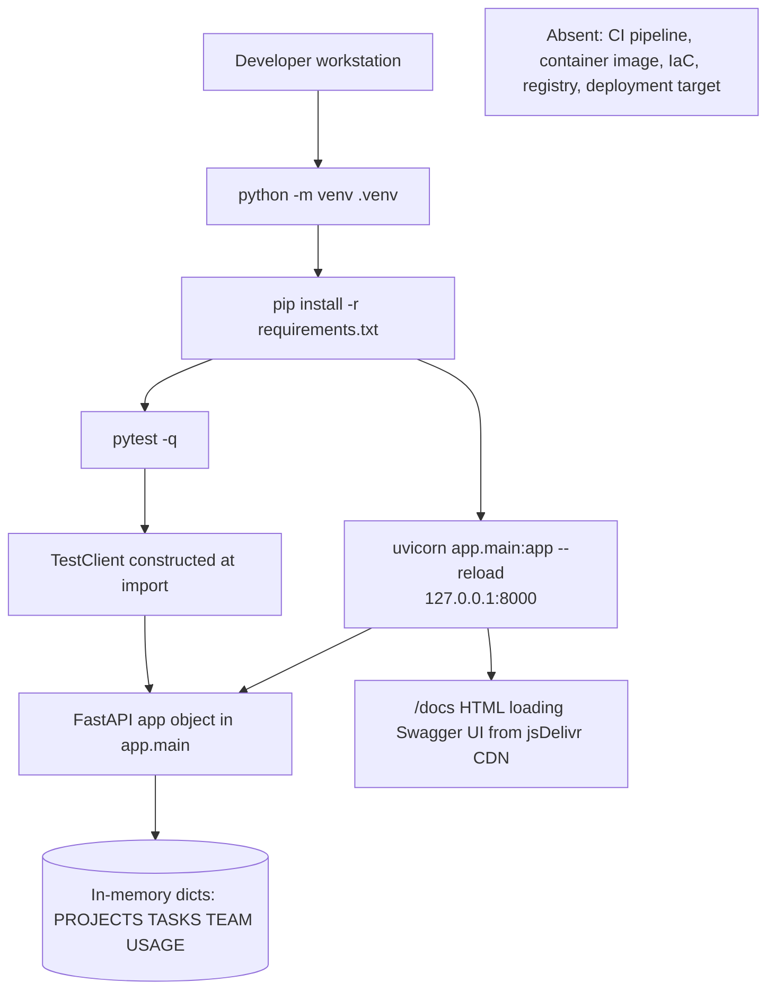

**Default-stack development and deployment choices that are absent**

| Default-stack item | Status here | Basis |
| --- | --- | --- |
| Docker / containerization | Not present | No `Dockerfile`, `.dockerignore`, or Compose file anywhere |
| Terraform / infrastructure as code | Not present | No `*.tf`, module, state, or variable file |
| GitHub Actions / CI-CD | Not present | No `.github` directory or workflow definition; no other CI service configuration |
| AWS deployment target | Not present | No cloud configuration, credential, or deploy script |

**Security implications of the shipped dev/deploy path.** `--reload` is a development-only flag with a filesystem watcher, the bind address is plain HTTP on the loopback interface with no TLS or reverse proxy, and there is no secret-management mechanism because there are no secrets beyond the two demo tokens committed in source. The committed `.DS_Store` and the missing `.gitignore` mean development-environment artefacts are part of the tracked tree. None of these are hardening gaps to be closed in place: they follow from a fixture that `README.md` line 31 declares must not be deployed.

**What productizing this stack would require**, derived from the gaps above rather than from any stated roadmap: a declared interpreter floor and lock file, runtime and test dependency separation, a `tests` directory that matches `pytest.ini` (or a corrected discovery path), a CI workflow that runs `pytest`, a container image with a pinned base, TLS termination, a real credential store in place of the literal token map, and a persistence layer in place of the module-level dictionaries.


## 3.7 References

**Repository files**

- `README.md` — declared purpose as a test fixture (line 3), feature list (lines 6-9), run instructions and the `uvicorn app.main:app --reload` entry point (lines 12-17), the `/docs` URL (line 18), the `pytest -q` verification command (lines 20-23), the "no environment" setup (lines 25-28), and the non-production prohibition (line 31).
- `requirements.txt` — the four exact pins (`fastapi==0.115.12`, `uvicorn==0.34.0`, `pytest==8.3.5`, `httpx==0.28.1`) and the absence of extras, markers, hashes, alternate indexes, and development-dependency separation.
- `pytest.ini` — the discovery contract `testpaths = tests` and `python_files = test_*.py`.
- `test_api.py` — module-level `TestClient` construction (line 4), the `Bearer owner-token` header (line 5), the per-test reset of `PROJECTS`, `TASKS` and `USAGE["used"]` (lines 8-11), and the three asserted behaviours (lines 14-26) that pin the test-side half of the stack.
- `__init__.py` — 0-byte root package marker with no exports.
- `.DS_Store` — committed macOS Finder artefact (8196 bytes) cited in the repository-hygiene row of Section 3.6.
- Repository root (`""`) — the six-file, folder-free layout whose absence of `Dockerfile`, `pyproject.toml`, `setup.py`, lock file, `.github`, Terraform, and `package.json` establishes every negative claim in Sections 3.1, 3.2, 3.3 and 3.6.
- `proactie_insight_testing-main.zip` at commit `4e4368f`, deleted at `b37e7e5` — the only source for the service implementation: imports and stdlib use (lines 1-3), FastAPI version string (line 5), state literals `USERS`/`PROJECTS`/`TASKS`/`TEAM`/`USAGE` (lines 7-13), the Pydantic models (lines 16-22), the readiness literal (line 42), the nine route operations (lines 35-110), and the `monotonic()` metrics payload (line 110).

**Dependency distributions inspected**

- `fastapi/openapi/docs.py` in the 0.115.12 wheel — default Swagger UI and ReDoc asset URLs on `cdn.jsdelivr.net`, the `fastapi.tiangolo.com` favicon, and the Google Fonts stylesheet in the ReDoc template.
- `fastapi/testclient.py` in the 0.115.12 wheel — the one-line re-export of `starlette.testclient.TestClient` that makes `httpx` a hidden transitive requirement.
- `uvicorn/supervisors/__init__.py` in the 0.34.0 wheel — the `WatchFilesReload` import that falls back to `StatReload` when `watchfiles` is absent, establishing how `--reload` behaves without the `[standard]` extra.
- `starlette/testclient.py` in the 0.46.2 wheel — the module-scope `httpx` import and the "requires the httpx package" error that motivate the explicit `httpx` pin.

**Web sources**

- [web] PyPI JSON metadata for `fastapi` 0.115.12 — `requires_python >=3.8`; `starlette>=0.40.0,<0.47.0`; `pydantic>=1.7.4,<3.0.0` (excluding 1.8, 1.8.1, 2.0.0, 2.0.1, 2.1.0); `typing-extensions>=4.8.0`; MIT licence classifier.
- [web] PyPI JSON metadata for `uvicorn` 0.34.0 — `requires_python >=3.9`; `click>=7.0`, `h11>=0.8`; the `[standard]` extra's `watchfiles`, `uvloop`, `httptools`, `websockets`, `python-dotenv` and `pyyaml` members.
- [web] PyPI JSON metadata for `pytest` 8.3.5 — `requires_python >=3.8`; `pluggy<2,>=1.5`, `iniconfig`, `packaging`.
- [web] PyPI JSON metadata for `httpx` 0.28.1 — `requires_python >=3.8`; `httpcore==1.*`, `anyio`, `certifi`, `idna`.
- [web] PyPI JSON metadata for `starlette` 0.46.2 — `requires_python >=3.9`; `anyio<5,>=3.6.2`; `full` extra pins `httpx>=0.27.0,<0.29.0`.
- [web] Starlette release notes for 0.37.2 and the httpx 0.28.0 changelog — Starlette stopped passing the deprecated `app=` argument to `httpx.Client` in 0.37.2, before httpx 0.28 removed it, so every Starlette release FastAPI 0.115.12 permits (0.40.0 and above) is safe with `httpx==0.28.1`.

**Command-derived evidence**

- `pip install --dry-run --report` over `requirements.txt` — the 19-package resolution, the floating `starlette` 0.46.2 and `pydantic` 2.14.4, each package's `Requires-Python`, and the licence metadata cited in Section 3.3.


# 4. Process Flowchart

## 4.1 Documentation Conventions and Evidence Basis

This section maps every runtime path the Proactive Insights Demo API can take: the request lifecycle from caller to response, the per-feature flows behind each of its nine operations, the validation and authorization checkpoints inside them, the state transitions of its in-memory records, and the failure paths it returns. Each flow is tied back to the feature identifiers of Section 2.1 (`F-001` to `F-011`) and the requirement identifiers of Section 2.2 (`F-XXX-RQ-YYY`) so that a diagram can be read against a written requirement without re-deriving it.

One fact governs how every flow here must be read: **the application module is not present in the checked-out tree.** `README.md` line 16 starts the service with `uvicorn app.main:app`, and `test_api.py` line 2 imports `app.main`, but HEAD `b8903e9` contains six files and no `app/` directory. The only source of route behaviour in the repository's history is `app/main.py` (110 lines, 3 459 bytes) inside the archive `proactie_insight_testing-main.zip`, added at commit `4e4368f` and deleted at commit `b37e7e5`. Every statement taken from that file is marked **(archive)** and every flowchart step it supplies is a static reading of that source, not an observed runtime trace.

### 4.1.1 Evidence Tiers for Flow Claims

| Tier | Artifact | What it establishes about flows | State at HEAD |
| --- | --- | --- | --- |
| T1 — Executable contract | `test_api.py` (26 lines) | Three concrete flows with assertions: health probe, project create-then-list, anonymous rejection; plus the pre-test state reset | Present |
| T2 — Declaration | `README.md` lines 3-9, 16-18, 20-23, 31 | Which workflows exist (bearer tokens and role checks, project and task workflows, team membership, simulated billing limit), the run and test commands, and the non-production disclaimer | Present |
| T3 — Reference implementation | `app/main.py` in `proactie_insight_testing-main.zip` at `4e4368f` | Route paths, methods, parameter kinds, validation constraints, decision order, status codes and every state write | Absent (deleted at `b37e7e5`) |

The archive's `README.md`, `test_api.py`, `pytest.ini` and `requirements.txt` are byte-identical to the HEAD copies (matching MD5 digests), so the deleted archive changed no evidence outside `app/main.py` and the `app/`/`tests/` layout.

Reading rules that follow from the tiers:

- A flow step with no marker is traceable to a file present at HEAD — `README.md`, `test_api.py`, `pytest.ini` or `requirements.txt`.
- A flow step marked **(archive)** is traceable to `app/main.py` at commit `4e4368f` and is not executable from the current checkout.
- Where a flow depends on framework behaviour rather than repository code — parameter validation, integer coercion of path segments, JSON serialisation, default `200` status — that dependency is named with the pinned version from `requirements.txt` (`fastapi==0.115.12`), because the framework supplies the behaviour the repository does not implement.
- No flow in this section has been observed running. The suite cannot execute at HEAD: `from app.main import app, PROJECTS, TASKS, USAGE` fails before the first assertion, and the environment used to write this section could not reach a package index to install `fastapi`.

### 4.1.2 Diagram Notation and Reading Guide

All diagrams are Mermaid. Swim-lane subgraphs name an actor or system boundary; the shapes inside a lane carry the following meaning:

| Shape | Mermaid form | Meaning in these flows |
| --- | --- | --- |
| Rounded terminal | `A(["Start"])` | Entry or exit point of the flow |
| Process rectangle | `B["Step"]` | A handler step, framework step, or client action |
| Decision diamond | `C{"Condition?"}` | A branch that selects between a success path and a failure exit |
| Store | `D[("PROJECTS")]` | A module-level Python container holding state |
| Response terminal | `E(["401 Missing bearer token"])` | A flow ends with this HTTP status and `detail` string |
| Dotted edge | `-.->` | A write performed by the test harness directly on application state, bypassing the API |

Two conventions keep the diagrams faithful to the code. First, decisions are drawn in the order the handler evaluates them, because the order determines which status a request receives when more than one rule fails. Second, a lane boundary is also an authorization or trust boundary: nothing inside the handler lane re-validates data that the parameter-binding lane has already accepted.

### 4.1.3 Status Code and Failure Vocabulary

Nine failure exits are raised explicitly by handlers **(archive)**; the remaining failures are produced by the framework and are named as such because no repository file defines them.

| Status | `detail` message | Raised at **(archive)** | Trigger |
| --- | --- | --- | --- |
| `401` | `Missing bearer token` | `app/main.py` line 27 | No `Authorization` header, or a value that does not begin with `Bearer ` |
| `401` | `Invalid token` | line 31 | `Bearer` prefix present but the token is not a key of `USERS` |
| `403` | `Owner role required` | line 90 | `POST /teams/{user_id}/role` called by a principal whose role is not `owner` |
| `404` | `Project not found` | line 66 | `POST /tasks` naming a `project_id` absent from `PROJECTS` |
| `404` | `Task not found` | line 79 | `PATCH /tasks/{task_id}` on an id absent from `TASKS` |
| `404` | `User or role not found` | line 92 | Team route with a `user_id` absent from `TEAM`, or a role outside `owner`/`member` |
| `422` | `Unsupported status` | line 81 | `PATCH` with a `status` outside `open`/`in_progress`/`done` |
| `422` | `Units must be positive` | line 101 | `POST /billing/consume` with `units < 1` |
| `429` | `Usage limit reached` | line 103 | `used + units` would exceed the fixed limit of `5` |

Framework-produced failures, by contrast, are generic: a body that violates a `Field` constraint, a missing required query parameter, or a path segment that cannot be coerced to `int` returns `422` with FastAPI's `detail` array; an unknown path returns `404 {"detail": "Not Found"}` and a wrong method returns `405`. Successful operations return the framework default `200` — including both creations, which are not given `201` **(archive)**; `test_api.py` line 20 asserts `200` for project creation.

### 4.1.4 Cross-Reference Conventions

Flow diagrams label steps with the identifiers they implement, so Section 2.2 can be read as the acceptance criteria for a diagram and Section 3.5 as the definition of the stores a diagram touches.

| Flow group (this section) | Features (Section 2.1) | Requirements (Section 2.2) |
| --- | --- | --- |
| Operational probes | `F-001`, `F-002` | `F-001-RQ-001`…`002`, `F-002-RQ-001`…`003` |
| Authentication and authorization | `F-003`, `F-004` | `F-003-RQ-001`…`004`, `F-004-RQ-001`…`004` |
| Project workflow | `F-005` | `F-005-RQ-001`…`004` |
| Task workflow | `F-006` | `F-006-RQ-001`…`005` |
| Team administration | `F-007` | `F-007-RQ-001`…`003` |
| Usage metering | `F-008` | `F-008-RQ-001`…`004` |
| Shared state and reset | `F-009` | `F-009-RQ-001`…`004` |
| Documentation surface | `F-010` | `F-010-RQ-001`…`002` |
| Test harness flow | `F-011` | `F-011-RQ-001`…`003` |

Section 3.5 owns the store-by-store inventory; this section describes how each store is reached and mutated during a flow, and Section 4.7.1 restates the inventory only to the depth a diagram needs.


## 4.2 High-Level System Workflow

The service has a single entry surface and a single state boundary. One ASGI application object exposes nine operations **(archive)**; every request, whether it arrives over a socket from `uvicorn` or in process through `TestClient`, crosses the same three boundaries: the framework's parameter binding, the handler lane, and the in-process state containers. Nothing leaves the process.

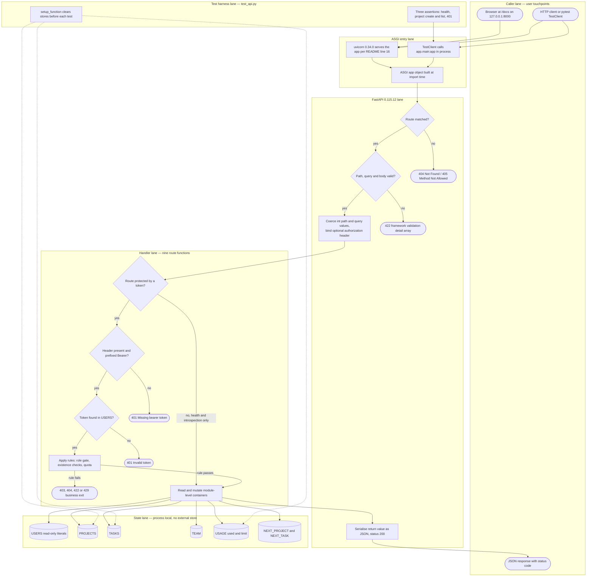

Read from top to bottom, the diagram fixes several properties of the fixture that the rest of this section relies on:

- **One entry point, two transports.** `uvicorn app.main:app` (`README.md` line 16) and `TestClient(app)` (`test_api.py` line 4) both resolve to the same application object, so a test exercises the identical routing, validation and handler code as a live call — only the transport differs.
- **Validation precedes authentication.** Because each handler declares `authorization: str | None = Header(default=None)` and calls `current_user` inside its own body **(archive: lines 46, 56, 62, 75, 87, 98 and 25-32)**, the framework settles path, query and body parameters first. A malformed body therefore returns `422` even when no token is supplied.
- **Three routes never authenticate.** `GET /health` (line 36), `GET /ready` (line 41) and `GET /metrics` (line 109) take no header parameter at all, so they bypass the authentication lane entirely and go straight to a constant response.
- **The state lane has no exit.** No container is serialised, flushed or written to disk, and no outbound client exists anywhere in the dependency set (`requirements.txt`): the flows in this section have no downstream system to wait on, retry against, or fail over to.
- **The harness lane writes state directly.** `setup_function` (`test_api.py` lines 8-11) mutates `PROJECTS`, `TASKS` and `USAGE` in place rather than through the API, which is why later flows treat the reset as a state transition of its own (Section 4.7.2).

| Boundary crossing | From → to | Mechanism | Failure modes observed at the crossing |
| --- | --- | --- | --- |
| Transport | Caller → ASGI app | HTTP over `uvicorn`, or in-process ASGI call via `TestClient` | None handled in the repository; no timeout, retry or error middleware exists |
| Routing | ASGI app → framework router | Path and method match on nine routes **(archive)** | Framework `404` for an unknown path, `405` for a wrong method |
| Binding | Framework → handler arguments | JSON body to `ProjectIn`/`TaskIn`, int coercion of `task_id`, `user_id`, `units`, query string to `status`, `role` **(archive)** | Framework `422` with a `detail` array |
| Authentication | Handler → `current_user` | `Authorization` header string **(archive: lines 25-32)** | `401 Missing bearer token`, `401 Invalid token` |
| Authorization | Handler → role check | Comparison of `user["role"]` with `owner` **(archive: lines 58, 89)** | `403 Owner role required`; silent narrowing of the project list for members |
| Persistence | Handler → state containers | Direct dictionary read and write **(archive: lines 50, 51, 69, 70, 82, 93, 104)** | None — no key error, write failure or contention path exists |

The high-level flow has no start-up sequence beyond module import: the containers are seeded from literals **(archive: lines 7-13)**, and there is no lifespan hook, start-up event handler or connection pool to initialise — no `@app.on_event`, `lifespan` or middleware declaration appears in the archived module. Shutdown is equally bare: process exit discards all state, so every flow in this section ends in the same way — an HTTP response, and possibly a mutation that survives only until the process stops.


## 4.3 Core Business Processes

Four journeys cover the whole of the fixture's behaviour: an operator bringing the service up, an owner exercising the full workflow across features, a member meeting the authorization boundary, and an evaluator running the shipped suite. Each is described with its touchpoints, decisions and terminal states; the shared request lifecycle that all of them pass through is then set out once in Section 4.3.2.

### 4.3.1 End-to-End User Journeys

| Journey | Actor and goal | Steps in order | Terminal states | Evidence |
| --- | --- | --- | --- | --- |
| `J-1` Bootstrap and discover | Operator brings the fixture up and inspects the API | Create venv, activate it, `pip install -r requirements.txt`, `uvicorn app.main:app --reload`, open `http://127.0.0.1:8000/docs` | Docs page listing nine operations; or import failure at start-up if `app.main` is absent | `README.md` lines 12-18; `requirements.txt` lines 1-4 |
| `J-2` Owner full workflow | Owner principal creates a project, adds work, promotes a user, consumes quota | `POST /projects` → `GET /projects` → `POST /tasks` → `PATCH /tasks/{id}` → `POST /teams/2/role` → `POST /billing/consume` | Project stored with `owner_id` 1; task stored as `open` then moved; `TEAM[2]` written; `USAGE.used` advanced or `429` | **(archive)** `app/main.py` lines 45-105 |
| `J-3` Member boundary | Member principal reads its own scope and attempts an owner action | `GET /projects` → `POST /teams/2/role?role=owner` | Narrowed project list, then `403 Owner role required` | **(archive)** lines 58, 89-90; `test_api.py` line 5 for the header form |
| `J-4` Evaluator run | Reviewer reproduces the intended behaviour from a clean checkout | `pip install -r requirements.txt` → `pytest -q` | At HEAD: collection error, because `app.main` is absent; with the archived module restored: three passing tests | `README.md` lines 20-23; `test_api.py` lines 1-26; `pytest.ini` lines 1-3 |

**`J-1` in detail.** The only configured transport is `uvicorn`'s default host and port; no file in the repository sets a host, port, worker count, log level or reload directory, so `127.0.0.1:8000` in `README.md` line 18 is the framework default rather than a project setting. `--reload` is requested without the `watchfiles` extra being installed (`requirements.txt` line 2 pins plain `uvicorn==0.34.0`), so the reload supervisor falls back to stat polling — a developer-experience consequence that also means any file change restarts the process and discards all state. The journey ends at the documentation surface, which is unauthenticated and renders an `authorization` text field per protected operation because authentication is a plain header parameter, not a security scheme **(archive: line 46 and siblings)**.

**`J-2` in detail.** This is the only journey that spans features, and the only one whose steps depend on each other's state:

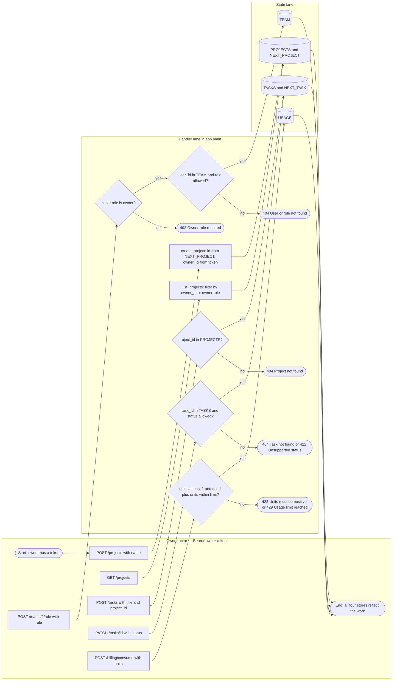

The dependency graph inside `J-2` is what makes it a workflow rather than six independent calls: step 3 needs the `id` returned by step 1, and step 4 needs the `id` returned by step 3. No other ordering constraint exists — role administration and usage metering read and write stores that no other step touches.

**`J-3` in detail.** A member token authenticates successfully at `current_user` and then meets a narrower rule: the listing expression at line 58 returns only projects whose `owner_id` equals the caller's id, so a member sees an empty array until it creates its own project. There is no way for a member to discover another principal's project through the API, and no role check on project or task creation, so the boundary is a read filter plus one administrative gate.

| Journey | User touchpoints | Decision points met | Error states reachable |
| --- | --- | --- | --- |
| `J-1` | Shell, browser | Route match only | Import failure at start-up; framework `404`/`405` on a mistyped path |
| `J-2` | HTTP client or `/docs` | Token validity, body validity, project existence, task existence, status enumeration, owner role, user and role validation, unit positivity, quota ceiling | `401`, `403`, `404`, `422`, `429` |
| `J-3` | HTTP client or `/docs` | Token validity, owner role | `401`, `403`; empty array instead of `403` on listing |
| `J-4` | Shell | Collection path, module import | Collection error at HEAD; no runtime failure otherwise |

### 4.3.2 System Interactions and Request Lifecycle

Every request follows the same seven-step lifecycle. The steps are ordered, and the order is observable: which failure a request receives depends on where it stops.

1. **Route match.** The framework selects one of nine route decorators **(archive: lines 35, 40, 45, 55, 61, 74, 86, 97, 108)**; an unmatched path exits with framework `404`, a wrong method with framework `405`.
2. **Parameter binding and coercion.** Path segments `task_id` and `user_id` are coerced to `int`, query parameters `status`, `role` and `units` are bound (`units` defaulting to `1`), and a JSON body is validated against `ProjectIn` or `TaskIn`; a violation exits with framework `422` before any handler code runs **(archive: lines 16-22, 46, 62, 75, 87, 98)**.
3. **Handler entry.** The handler runs with all parameters already resolved; the optional `authorization` string is present as a plain value, which is why the header itself can never produce a binding error.
4. **Authentication.** Protected handlers call `current_user`, which rejects an absent or unprefixed header with `401 Missing bearer token` and an unknown token with `401 Invalid token` **(archive: lines 25-32)**.
5. **Business rules in code order.** Each handler applies its own checks — project existence, task existence, status enumeration, owner role, user and role validity, unit positivity, quota ceiling — in the sequence written in the source.
6. **State mutation or projection.** A passing request writes to one container or projects a filtered view of one **(archive: lines 50-51, 58, 69-70, 82, 93, 104)**.
7. **Response.** The handler's return value is serialised as JSON with the framework default `200`; no handler sets a status code, because no `status_code` argument appears in any decorator.

| Route | Decisions in evaluation order **(archive)** | Failure statuses | State effect on success |
| --- | --- | --- | --- |
| `GET /health` | None (line 36) | None | None |
| `GET /ready` | None (line 41) | None | None |
| `GET /metrics` | None (lines 109-110) | None | None |
| `POST /projects` | body valid → token valid (line 48) | `422`, then `401` | inserts `PROJECTS[id]`, increments `NEXT_PROJECT` |
| `GET /projects` | token valid (line 57) → visibility filter (line 58) | `401` | None; returns a filtered projection |
| `POST /tasks` | body valid → token valid (line 64) → `project_id` in `PROJECTS` (line 65) | `422`, `401`, `404` | inserts `TASKS[id]`, increments `NEXT_TASK` |
| `PATCH /tasks/{task_id}` | path and `status` bound → token valid (line 76) → task exists (line 78) → status allowed (line 80) | `422`, `401`, `404`, `422` | rewrites `task["status"]` |
| `POST /teams/{user_id}/role` | path and `role` bound → token valid (line 88) → caller is owner (line 89) → user and role valid (line 91) | `422`, `401`, `403`, `404` | rewrites `TEAM[user_id]` |
| `POST /billing/consume` | `units` bound → token valid (line 99) → `units >= 1` (line 100) → `used + units <= limit` (line 102) | `422`, `401`, `422`, `429` | increments `USAGE["used"]` |

Three consequences of this ordering deserve emphasis because they are easy to get wrong when reading a diagram:

- **A malformed request is refused before credentials are examined.** `POST /projects` with `{"name": "x"}` and no header returns `422` on the name length, not `401`; `PATCH /tasks/1` with no `status` query parameter returns `422` before the task is even looked up.
- **Authentication always precedes existence.** `PATCH /tasks/999?status=done` without a token returns `401`, and only returns `404 Task not found` once a valid token is presented.
- **Business-rule order decides which status wins.** At `POST /teams/{user_id}/role`, a non-owner calling with an invalid `user_id` receives `403`, not `404`, because the role gate at line 89 runs before the target validation at line 91. At `POST /tasks`, an authenticated caller naming a non-existent project receives `404 Project not found` before the title constraint could matter, because the body is validated in step 2 and would have stopped the request earlier had it been invalid.

### 4.3.3 Decision Points

Eleven decision points exist in the whole fixture. Each is listed with its location, the condition it tests, and both branches.

| # | Decision | Location **(archive)** | True branch | False branch |
| --- | --- | --- | --- | --- |
| `D-1` | Route matched by path and method | Framework router, nine decorators | Continue to binding | `404`/`405` framework response |
| `D-2` | Request body satisfies `ProjectIn` / `TaskIn` | `Field` constraints at lines 17, 21 | Continue to handler | `422` framework `detail` array |
| `D-3` | Path and query parameters coerce to their declared types | Signatures at lines 75, 87, 98 | Continue | `422` framework `detail` array |
| `D-4` | `Authorization` header present and starting with `Bearer ` | line 26 | Strip prefix, continue | `401 Missing bearer token` (line 27) |
| `D-5` | Token is a key of `USERS` | lines 29-30 | Return principal record | `401 Invalid token` (line 31) |
| `D-6` | Caller's role is `owner`, or project is the caller's own | line 58 | Project included in the listing | Project omitted from the listing |
| `D-7` | `project_id` exists in `PROJECTS` | line 65 | Create the task | `404 Project not found` (line 66) |
| `D-8` | `task_id` exists in `TASKS` | lines 77-78 | Continue to status check | `404 Task not found` (line 79) |
| `D-9` | `status` is one of `open`, `in_progress`, `done` | line 80 | Write the new status | `422 Unsupported status` (line 81) |
| `D-10` | Caller's role is `owner` and target user and role are valid | lines 89, 91 | Write `TEAM[user_id]` | `403 Owner role required` or `404 User or role not found` |
| `D-11` | `units >= 1` and `used + units <= limit` | lines 100, 102 | Increment `USED` | `422 Units must be positive` or `429 Usage limit reached` |

Decisions that a reader might expect and that are deliberately absent are as significant as the ones present: no decision tests whether the caller owns the project a task is created in, no decision tests the role of a caller creating a project or changing a task, no decision tests name uniqueness, no decision tests whether `TEAM` agrees with `USERS`, and no decision limits request rate, body size or list length **(archive: complete handler bodies, lines 35-110)**.

### 4.3.4 Error Handling Paths

Every failure exit is terminal for its request, and every one is reached before the corresponding write, so a rejected request leaves all seven state containers unchanged.

| Failure path | Precondition | Exit | Store state after the path | Recovery available in the fixture |
| --- | --- | --- | --- | --- |
| Unauthenticated or malformed scheme | No `Bearer ` prefix | `401 Missing bearer token` | Unchanged | Repeat with a seeded token |
| Unknown token | Prefix present, token unknown | `401 Invalid token` | Unchanged | Repeat with `owner-token` or `member-token` |
| Body or parameter violation | Constraint or coercion fails | `422` framework detail | Unchanged | Correct the body or query string |
| Non-owner role administration | Caller role is `member` | `403 Owner role required` | Unchanged | Retry as `owner-token` |
| Unknown project on task creation | `project_id` not stored | `404 Project not found` | Unchanged | Create the project first |
| Unknown task on status change | `task_id` not stored | `404 Task not found` | Unchanged | Create a task first |
| Unknown user or invalid role | `user_id` not in `TEAM`, or role outside the pair | `404 User or role not found` | Unchanged | Choose ids `1` or `2` and a permitted role |
| Invalid status value | `status` outside the enumeration | `422 Unsupported status` | Unchanged | Resend with a permitted status |
| Non-positive consumption | `units < 1` | `422 Units must be positive` | Unchanged | Resend with `units >= 1` |
| Quota exhausted | `used + units > limit` | `429 Usage limit reached` | Unchanged; the increment at line 104 is skipped | Wait for a process restart, or reset through the test hook |

Two structural properties of these paths follow from the source and shape the error section later in this chapter. First, all nine explicit raises are `HTTPException` instances carrying only a status code and a message; there is no `try`/`except`, no `exception_handler`, and no middleware in the module, so an unexpected Python error would surface as the framework's generic `500` with no repository-defined body. Second, recovery is entirely caller-driven: the service offers no compensating operation, no reset endpoint and no idempotency key, so the only ways back to a clean state are to repeat the request correctly or to restart the process.


## 4.4 Detailed Process Flows for Core Features

Each core feature is drawn as its own flow, in the order the handler evaluates its checks **(archive: `app/main.py`, absent at HEAD)**. A shared table before the diagrams fixes the vocabulary; each diagram is followed by the step detail, the boundary and touchpoint, the error exits and the timing note for that feature.

| Flow | Entry point | Terminal states | Requirement mapping |
| --- | --- | --- | --- |
| `P-1` Project creation and listing | `POST /projects`, `GET /projects` | `200` project object; `200` filtered array; `401`, `422`, `404` framework | `F-005-RQ-001`…`004` |
| `P-2` Task creation and status change | `POST /tasks`, `PATCH /tasks/{task_id}` | `200` task object; `404`, `422`, `401` | `F-006-RQ-001`…`005` |
| `P-3` Team role administration | `POST /teams/{user_id}/role` | `200` confirmation; `403`, `404`, `401`, `422` | `F-007-RQ-001`…`003` |
| `P-4` Usage consumption | `POST /billing/consume` | `200` usage pair; `422`, `429`, `401` | `F-008-RQ-001`…`004` |
| `P-5` Operational probes | `GET /health`, `GET /ready`, `GET /metrics` | `200` constant bodies | `F-001-RQ-001`…`002`, `F-002-RQ-001`…`003` |
| `P-6` Test harness run | `pytest -q` | three passes, or a collection error at HEAD | `F-011-RQ-001`…`003` |

### 4.4.1 `P-1` Project Creation and Listing (F-005)

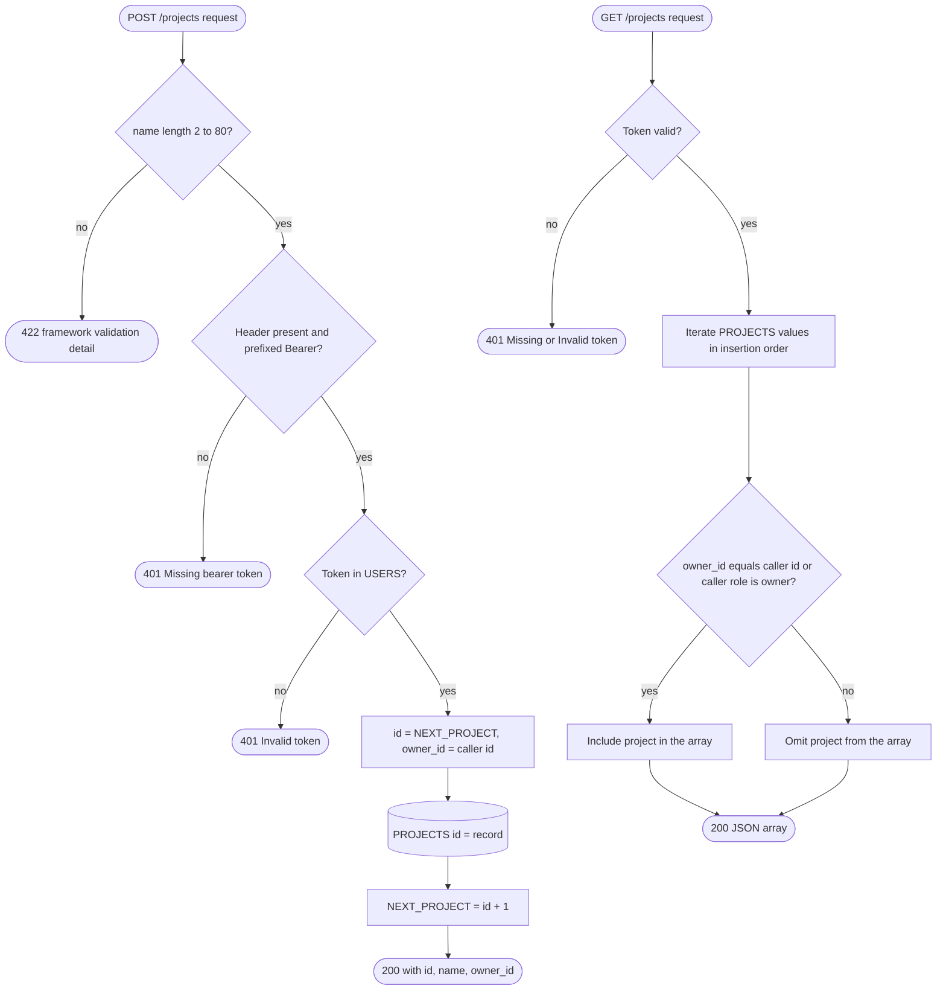

| Step | Actor or component | Action | Evidence |
| --- | --- | --- | --- |
| 1 | Caller | Submits `{"name": "..."}` with `Authorization: Bearer <token>` | `test_api.py` lines 19-21 |
| 2 | Framework | Validates `ProjectIn` against `min_length=2`, `max_length=80`; rejects with `422` | **(archive)** lines 16-17 |
| 3 | Handler | Calls `current_user`; raises `401` on a missing, unprefixed or unknown credential | **(archive)** lines 48, 25-32 |
| 4 | Handler | Builds `{"id", "name", "owner_id"}` using `NEXT_PROJECT` and the principal id, never a client-supplied id | **(archive)** lines 49-52 |
| 5 | State | Inserts into `PROJECTS`, then increments `NEXT_PROJECT` through `global` | **(archive)** lines 50-51 |
| 6 | Framework | Serialises the record with status `200` (not `201`) | `test_api.py` line 20 asserts `200` |
| 7 | Caller | Lists projects; the handler authenticates and projects a filtered array | `test_api.py` line 22; **(archive)** lines 56-58 |

- **System boundary and touchpoints.** One caller touchpoint (the request), one trust boundary (`current_user`), one persistence boundary (`PROJECTS`). No notification, no downstream call, no response header beyond the framework defaults.
- **Error states.** `422` on the name bounds; `401` for either credential failure; framework `422` for a non-JSON or wrongly typed body. Neither route has a `404`: an empty store yields `200 []`.
- **Timing.** Creation is constant work plus one dictionary insertion. Listing is O(n) over every stored project, because the visibility filter runs in Python after the whole collection is read; no pagination parameter exists, so response size grows with the number of projects in the process.
- **Ordering note.** The shipped test clears `PROJECTS` before running, so its assertion on element `0` of the listing (`test_api.py` line 22) sees a one-element array; without that reset the assertion would depend on collection order.

### 4.4.2 `P-2` Task Creation and Status Change (F-006)

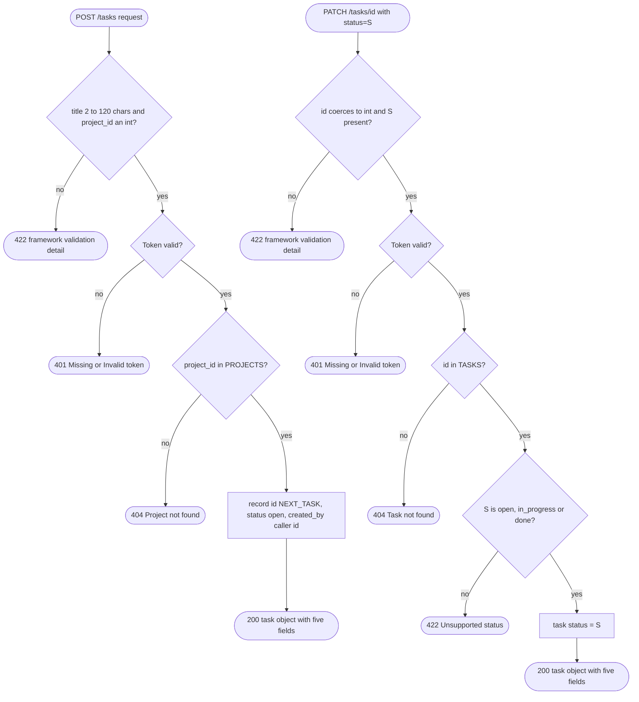

| Step | Actor or component | Action | Evidence |
| --- | --- | --- | --- |
| 1 | Caller | Posts `{"title": "...", "project_id": N}` | **(archive)** lines 20-22 |
| 2 | Framework | Validates the title bounds and the integer `project_id` | **(archive)** lines 20-22 |
| 3 | Handler | Authenticates, then tests `project_id in PROJECTS` — referential integrity is checked only here | **(archive)** lines 64-66 |
| 4 | State | Inserts the five-field record into `TASKS`, incrementing `NEXT_TASK` | **(archive)** lines 67-70 |
| 5 | Caller | Patches status with `status` supplied as a **query parameter**, not a body field | **(archive)** line 75 |
| 6 | Handler | Authenticates, looks the task up, validates the status against the three-value set, writes and returns it | **(archive)** lines 76-83 |

- **System boundary and touchpoints.** The task flow is the only one with a cross-store dependency: creation reads `PROJECTS` written by `P-1`. It has no list or read route, so a task is observable only through the two responses that create and mutate it.
- **Error states.** `404 Project not found` discloses the absence of a project to any authenticated caller; `404 Task not found` and `422 Unsupported status` are distinct exits on the patch route. No route reports insufficient privilege, because none checks ownership: any valid token may create a task in any project and change any task's status.
- **Timing.** Both handlers are constant work plus one write; there is no transition table, timestamp, history or audit record, so the status field is overwritten in place with no record of its prior value.
- **Ordering note.** `status` being a required query parameter means `PATCH /tasks/1` with no query string fails at binding (`422`) before the task is looked up, while `PATCH /tasks/999?status=done` with no token fails at authentication (`401`) before existence is checked.

### 4.4.3 `P-3` Team Role Administration (F-007)

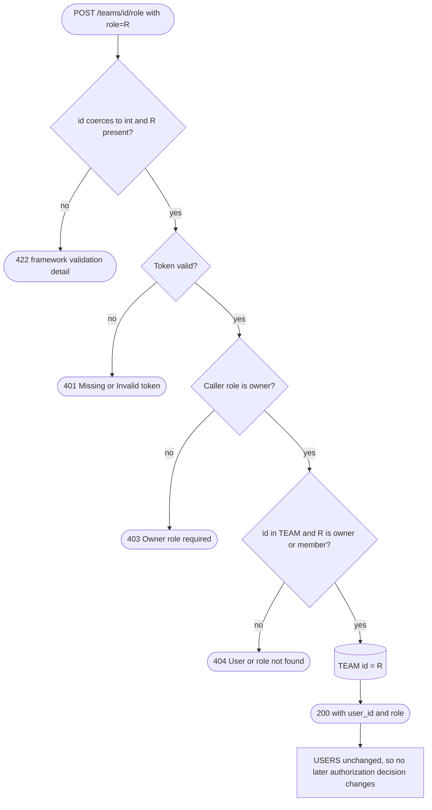

| Step | Actor or component | Action | Evidence |
| --- | --- | --- | --- |
| 1 | Caller | Sends the target user id in the path and the role in the query string | **(archive)** line 87 |
| 2 | Handler | Authenticates; the principal record carries the caller's own role | **(archive)** lines 88, 7 |
| 3 | Handler | Owner gate before any target validation | **(archive)** lines 89-90 |
| 4 | Handler | Combined target validation: unknown `user_id` and invalid `role` share one status | **(archive)** lines 91-92 |
| 5 | State | Overwrites `TEAM[user_id]` | **(archive)** line 93 |
| 6 | Handler | Returns `{"user_id", "role"}`, echoing the assignment rather than the stored map | **(archive)** line 94 |

- **System boundary and touchpoints.** The only administrative touchpoint in the fixture and the only route that mutates identity data. It is the sole place where a caller's role changes a decision other than list visibility.
- **Error states.** `403 Owner role required` for a member caller, then one `404 User or role not found` for either of two distinct validation failures — a caller cannot distinguish an unknown user from an unsupported role.
- **Timing and effect.** Constant work plus one dictionary write. The write is terminal for its own flow but has no effect on any other: `current_user` resolves roles from `USERS` **(archive: lines 29-32)**, which this route never touches, so a promotion recorded in `TEAM` does not grant owner privileges and a demotion does not remove them. Section 2.2 records this as `F-007-RQ-003`.

### 4.4.4 `P-4` Usage Consumption (F-008)

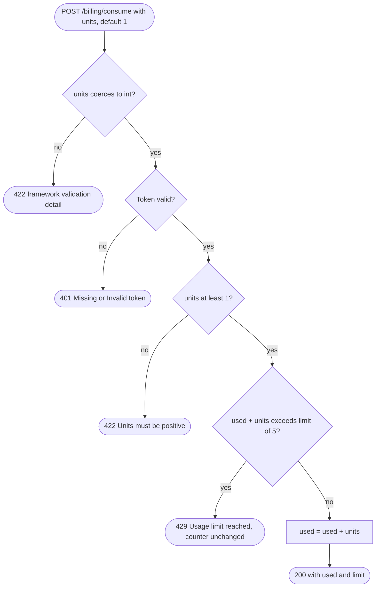

| Step | Actor or component | Action | Evidence |
| --- | --- | --- | --- |
| 1 | Caller | Omits `units` or supplies an integer query value | **(archive)** line 98 |
| 2 | Framework | Coerces `units` to `int`, applying the default of `1` when absent | **(archive)** line 98 |
| 3 | Handler | Authenticates; usage is global, not attributed to the caller | **(archive)** line 99 |
| 4 | Handler | Rejects non-positive units as a business rule rather than a validation rule, raising `422` itself | **(archive)** lines 100-101 |
| 5 | Handler | Tests the ceiling **before** incrementing, so a refused request consumes nothing | **(archive)** lines 102-103 |
| 6 | State | Adds `units` to `USAGE["used"]` and returns the whole pair | **(archive)** lines 104-105 |

- **System boundary and touchpoints.** The ceiling of `5` is a source literal **(archive: line 11)** with no configuration path, no period, no per-caller attribution and no reset endpoint; the only reset is the test hook that sets `used` back to `0` (`test_api.py` line 11).
- **Error states.** `422 Units must be positive` and `429 Usage limit reached` are distinct: the first is caller error, the second is quota exhaustion. Because the limit is process-global, one caller can exhaust the allowance for every other caller.
- **Timing.** Constant work, one comparison followed by one in-place addition. The check and the increment are separate statements with no lock, so two concurrent requests can both pass the ceiling test — the concurrency consequence is set out in Section 4.7.5.

### 4.4.5 `P-5` Operational Probes (F-001, F-002)

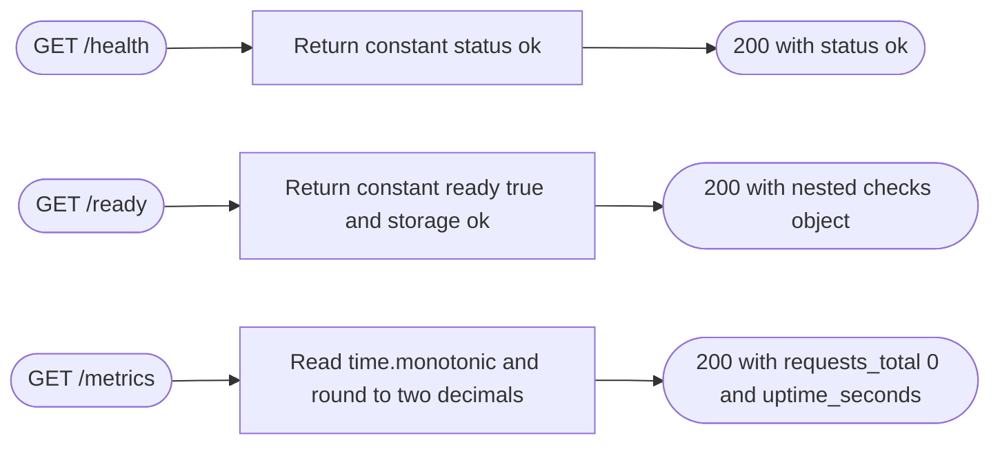

| Probe | Parameters | Body | Evidence | Notes |
| --- | --- | --- | --- | --- |
| `GET /health` | None; no `authorization` parameter declared | `{"status": "ok"}` | `test_api.py` lines 14-15; **(archive)** lines 35-37 | The only response the suite compares for exact equality |
| `GET /ready` | None | `{"ready": true, "checks": {"storage": "ok"}}` | **(archive)** lines 40-42 | `storage` is a literal, so readiness cannot detect a fault in any store |
| `GET /metrics` | None | `{"requests_total": 0, "uptime_seconds": <float>}` | **(archive)** lines 108-110 | `requests_total` is never incremented; `uptime_seconds` is `round(monotonic(), 2)`, whose origin is platform-defined |

- **System boundary and touchpoints.** Three unauthenticated touchpoints exist so that liveness, readiness and uptime can be observed without credentials. None reads a state container, so a probe never reflects the health of `PROJECTS`, `TASKS` or `USAGE`.
- **Error states.** None are defined; the handlers cannot raise, and there is no dependency to fail. A probe can therefore report healthy while both the store and the counter are in any condition.
- **Timing.** All three are constant-time; `GET /metrics` is the only route that reads a clock.

### 4.4.6 `P-6` Test Harness Run (F-011)

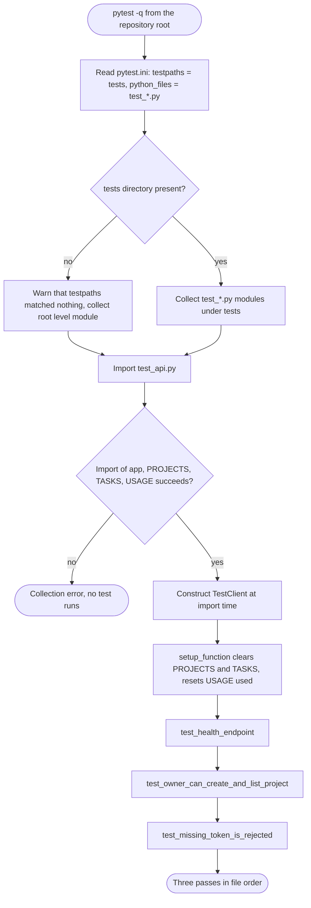

| Step | Component | Action | Evidence |
| --- | --- | --- | --- |
| 1 | pytest | Resolves rootdir from `pytest.ini` and searches `testpaths = tests` | `pytest.ini` lines 2-3 |
| 2 | pytest | At HEAD the `tests` directory is absent, so the configured path matches nothing and the root-level `test_api.py` is collected instead | `pytest.ini` line 2; repository tree at `b8903e9` |
| 3 | Module import | `from app.main import app, PROJECTS, TASKS, USAGE` — fails at HEAD, succeeds when the archived module is present | `test_api.py` line 2 |
| 4 | Module import | `TestClient(app)` is built once, outside any fixture | `test_api.py` line 4 |
| 5 | Hook | `setup_function` empties `PROJECTS` and `TASKS` and sets `USAGE["used"] = 0` before each test; `TEAM` and both id counters are left alone | `test_api.py` lines 8-11 |
| 6 | Tests | Health body equality, project create-then-list, anonymous `401`, in declaration order | `test_api.py` lines 14, 18, 25 |

- **System boundary and touchpoints.** The harness crosses the same handler lane as a live caller through an in-process ASGI transport, and additionally crosses the state boundary directly at step 5 — the only place in the repository where application state is written without an HTTP request.
- **Error states.** A collection error is the harness's only failure at HEAD, and it occurs before any assertion; with the module present, a failing assertion is the only failure mode, since no test exercises an error path beyond the anonymous `401`.
- **Timing.** In-process, no listener, no network and no external service: the run time is the interpreter start-up plus three request/response cycles, and nothing in the repository defines a timeout for them.


## 4.5 Integration Workflows

The fixture has no external integration. There are no outbound HTTP clients, no message brokers, no identity provider, no payment or metering provider and no database — `requirements.txt` declares only `fastapi`, `uvicorn`, `pytest` and `httpx`, and the keyword sweep for client, cache and configuration constructs across every file found no hits. Integration therefore means two things here: the flow of data across the process boundary with a caller, and the flow of identifiers between the in-process stores. Both are described below, followed by the event and batch flows the prompt asks for, which do not exist and are recorded as absent.

### 4.5.1 Data Flow Between Systems

| Boundary | Direction | Payload | Transformation applied | Evidence |
| --- | --- | --- | --- | --- |
| Caller → service | Inbound | JSON body (`name`, `title` + `project_id`), path ids, query values (`status`, `role`, `units`), `Authorization` header | `Field` constraint check, type coercion, `Bearer ` prefix strip, `USERS` lookup | **(archive)** lines 16-32, 46, 62, 75, 87, 98 |
| Service → caller | Outbound | Project record, task record, project array, usage pair, constant probe bodies, `detail` message | Dictionary serialisation as JSON, default status `200` | **(archive)** lines 37, 42, 52, 58, 71, 83, 94, 105, 110 |
| Service → any downstream system | Outbound | None | None | No client library, no socket, no file write anywhere in the repository or archive |
| Test process → application state | In place | Dictionary clears and one key assignment | Direct mutation, bypassing HTTP | `test_api.py` lines 8-11 |

The identifier flow inside the process is the only place where data crosses between features:

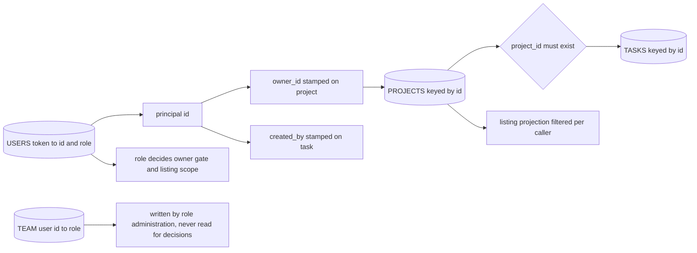

- **No entity leaves the process and none is shared with another process.** Two `uvicorn` workers would each hold a complete, divergent copy of `PROJECTS`, `TASKS`, `TEAM`, `USAGE` and the counters, and the documented run command starts a single process with no worker count (`README.md` line 16).
- **Every stamped identifier originates in `USERS`.** `owner_id` and `created_by` are taken from the principal record, never from the request body, so a caller cannot impersonate another principal's ownership **(archive: lines 49, 68)**.
- **One cross-feature referential link exists:** `TASKS[].project_id` must name a key of `PROJECTS` at creation time. Nothing revalidates it afterwards, and no delete route exists that could orphan it — deletion happens only through the test hook, which clears both stores together.

### 4.5.2 API Interaction Sequences

The project-and-task sequence is the fixture's only multi-call workflow, and the only one the shipped suite drives end to end for its first two calls.

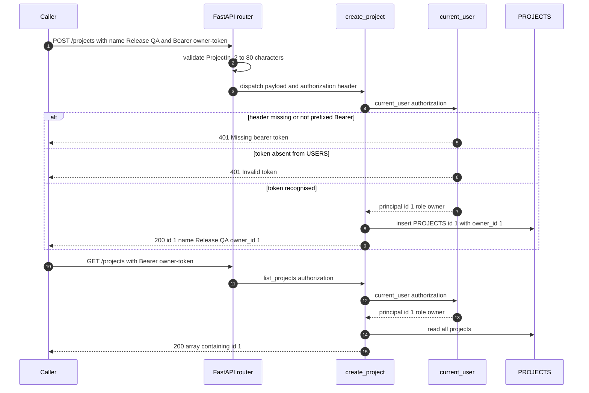

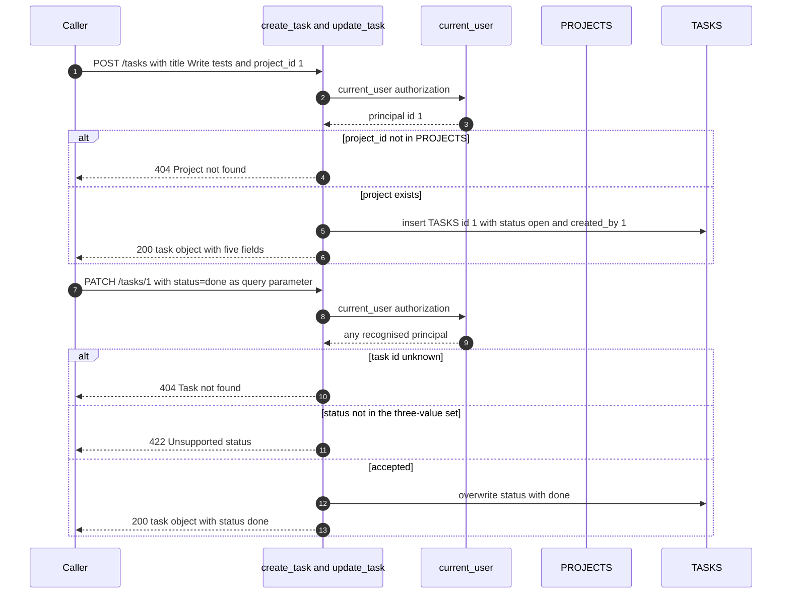

Role administration and usage metering involve no cross-feature state, so their sequences are short and their failure branches are the substance:

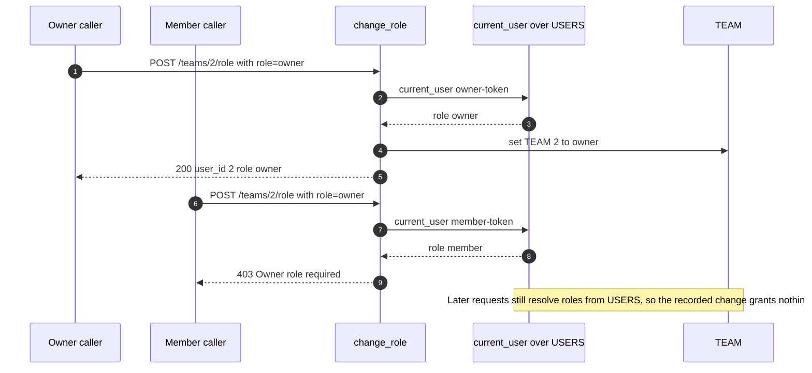

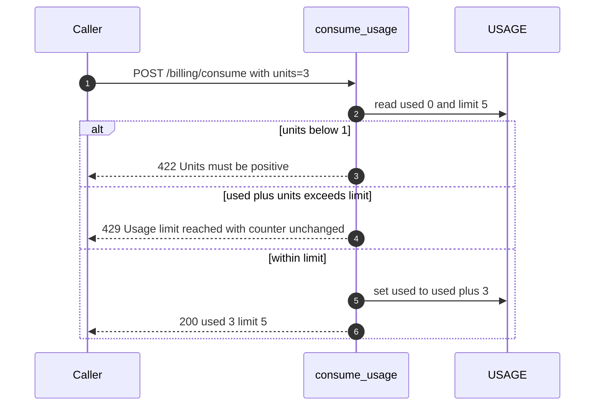

| Sequence property | Observed behaviour | Basis |
| --- | --- | --- |
| Calls per workflow | One call per state change; no route composes two features in a single request | **(archive)** nine decorators, lines 35-110 |
| Callback or continuation | None; every response is terminal and the client decides the next call | No webhook, callback URL or async routing anywhere |
| Correlation identifier | None beyond the integer record ids; no request id is generated or returned | No middleware, no response headers set by handlers |
| Idempotency | None; repeating a creation produces a second record with a new id, and repeating a consumption adds units again | **(archive)** lines 47-51, 104 |
| Failure atomicity | A failed call leaves all stores unchanged, because every raise precedes its write | **(archive)** raise sites 27-103 versus writes 50-104 |

### 4.5.3 Event Processing Flows

No event processing exists anywhere in the repository. There is no message broker, queue, topic, webhook, subscription, background task or scheduler: the keyword sweep over all 200 lines of repository and archive text returned zero hits for `async`, `await`, `BackgroundTasks`, `thread`, `Lock` and `websocket`, and neither `README.md` nor the archived module names an event, message or consumer.

What exists instead are two framework-level callback points, neither of which is an application event:

| Hook | Kind | Trigger | Effect |
| --- | --- | --- | --- |
| `setup_function` | pytest lifecycle hook | Before each collected test | Clears `PROJECTS` and `TASKS`, resets `USAGE["used"]` (`test_api.py` lines 8-11) |
| Request lifecycle | Framework dispatch | Every request | Route match, binding, handler call, serialisation — synchronous, no queue, no retry stage |

The absence has a concrete consequence for flows: nothing in the system reacts to a state change. Creating a project notifies nothing, a status change emits nothing, and reaching the usage ceiling raises nothing — `requests_total` in `/metrics` stays at the literal `0` **(archive: line 110)**, so not even request volume is emitted. Any monitoring, audit or downstream reaction would have to be added, not configured.

### 4.5.4 Batch Processing Sequences

There is no batch processing: no scheduled job, no cron entry, no bulk or import endpoint, no migration step and no seed script. Seeding happens as module-level literal assignment at import **(archive: lines 7-13)**, which runs once per process rather than on a schedule.

| Batch-like concern | Present in this repository | Detail |
| --- | --- | --- |
| Scheduled or periodic job | No | No scheduler, no cron, no `@app.on_event` start-up hook |
| Bulk create or import | No | Single-record creation only, one POST per project or task |
| Whole-collection read | Yes | `GET /projects` returns every visible project in one array, unfiltered by size |
| Pagination or streaming | No | No `offset`, `limit` or page parameter; the entire array is materialised and serialised |
| Data migration or backfill | No | No schema, no migrations, no persistence to migrate |
| Repeating test sequence | Yes | Three tests run in declaration order, each preceded by the shared reset hook |

The only operation whose cost scales with stored data is therefore the listing in `P-1`, and it scales without a bound: an unbounded number of projects is read into memory and filtered per request **(archive: line 58)**. Section 4.9 records the timing consequence.


## 4.6 Validation Rules

Validation in this service is split across two enforcement layers that must be distinguished when tracing a flow: the framework validates shapes and types before the handler is entered, and the handler validates business meaning after authentication. Nothing validates after a write, and no layer performs schema, referential or uniqueness validation beyond the checks listed here.

### 4.6.1 Business Rules by Process Step

| # | Business rule | Process step | Enforced at | Result on violation |
| --- | --- | --- | --- | --- |
| `V-1` | A credential must be presented with the `Bearer ` scheme | Every protected route | `current_user` **(archive: line 26)** | `401 Missing bearer token` |
| `V-2` | The token must be one of the two seeded principals | Every protected route | `current_user` **(archive: lines 29-31)** | `401 Invalid token` |
| `V-3` | A project name is 2 to 80 characters | `POST /projects` | `ProjectIn` field constraint **(archive: line 17)** | `422` framework detail |
| `V-4` | A task title is 2 to 120 characters | `POST /tasks` | `TaskIn` field constraint **(archive: line 21)** | `422` framework detail |
| `V-5` | A task must reference an existing project | `POST /tasks` | Handler membership test **(archive: line 65)** | `404 Project not found` |
| `V-6` | A status change must target an existing task | `PATCH /tasks/{task_id}` | Handler lookup **(archive: lines 77-79)** | `404 Task not found` |
| `V-7` | A task status is one of `open`, `in_progress`, `done` | `PATCH /tasks/{task_id}` | Handler set membership **(archive: line 80)** | `422 Unsupported status` |
| `V-8` | Only an owner may assign roles | `POST /teams/{user_id}/role` | Handler role comparison **(archive: line 89)** | `403 Owner role required` |
| `V-9` | The target user must exist and the role must be `owner` or `member` | `POST /teams/{user_id}/role` | Combined handler test **(archive: line 91)** | `404 User or role not found` |
| `V-10` | Consumption must be positive | `POST /billing/consume` | Handler comparison **(archive: line 100)** | `422 Units must be positive` |
| `V-11` | Consumption must stay within the fixed ceiling of 5 | `POST /billing/consume` | Pre-increment comparison **(archive: line 102)** | `429 Usage limit reached` |
| `V-12` | A caller sees only its own projects unless its role is `owner` | `GET /projects` | Post-query filter **(archive: line 58)** | Silent omission, never an error |

Rules that a reader might assume and that do not exist **(archive: full module, lines 1-110)**:

- **No ownership rule.** Nothing checks that a caller owns the project a task belongs to, or the task being changed; any of the two tokens may mutate any record.
- **No consistency rule between `TEAM` and `USERS`.** A recorded role change is never consulted, so `V-9` writes a value that no later rule reads.
- **No uniqueness or normalisation rule.** Two projects may share a name; `"  "` (two spaces) satisfies `V-3` because only length is measured, with no trimming or character-set check.
- **No state-machine rule.** `V-7` accepts any of the three statuses from any current status, so `done` may follow `open` directly and `open` may follow `done`.
- **No volume rule.** No request-rate, payload-size or list-length limit exists.

### 4.6.2 Data Validation Requirements

| Input | Declared type and constraint | Layer | Violation response |
| --- | --- | --- | --- |
| `ProjectIn.name` | `str`, `min_length=2`, `max_length=80` | Framework body validation **(archive: line 17)** | `422` with a `detail` array |
| `TaskIn.title` | `str`, `min_length=2`, `max_length=120` | Framework body validation **(archive: line 21)** | `422` with a `detail` array |
| `TaskIn.project_id` | `int` | Framework body validation **(archive: line 22)** | `422` with a `detail` array; existence is checked later |
| `task_id` (path) | `int` | Framework path coercion **(archive: line 75)** | `422` for a non-numeric segment, before authentication |
| `user_id` (path) | `int` | Framework path coercion **(archive: line 87)** | `422` for a non-numeric segment, before authentication |
| `status` (query) | `str`, no default, so required | Framework query binding **(archive: line 75)** | `422` when omitted; value checked by `V-7` |
| `role` (query) | `str`, no default, so required | Framework query binding **(archive: line 87)** | `422` when omitted; value checked by `V-9` |
| `units` (query) | `int`, default `1` | Framework query binding **(archive: line 98)** | `422` for a non-integer; range checked by `V-10` |
| `Authorization` (header) | `str | None`, optional | Framework header binding | Never fails binding; `V-1` and `V-2` decide afterwards |

| Validation property | Behaviour | Basis |
| --- | --- | --- |
| Validation order | Body and parameter validation precede everything; authentication follows; business rules last | Step order in Section 4.3.2 |
| Unrecognised body fields | Ignored, not rejected — no `model_config` or `extra` policy is declared, so Pydantic's default applies | **(archive)** models at lines 16-22 |
| Missing body | `422`; both body models are required parameters | **(archive)** signatures at lines 46, 62 |
| Non-JSON body | `422` from the framework parser | `fastapi==0.115.12`, `requirements.txt` line 1 |
| Integer ranges | Unbounded: negative `task_id`, `user_id` or `project_id` pass binding and fail later as `404` | **(archive)** lines 65-66, 77-79, 91-92 |
| String encoding | No character class, encoding or control-character check on `name`, `title` or `role` | **(archive)** lines 16-22 |
| Cross-field validation | Only one: `USAGE["used"] + units` against the literal limit | **(archive)** line 102 |
| Response validation | No response model is declared, so responses are the raw dictionaries the handlers return | Nine decorators, none with `response_model` |

### 4.6.3 Authorization Checkpoints

| Route | Checkpoint | Enforcement | Evidence |
| --- | --- | --- | --- |
| `POST /projects` | Authentication only — any principal may create | `current_user` | **(archive)** line 48 |
| `GET /projects` | Authentication plus role-scoped projection | `current_user`, then filter | **(archive)** lines 57-58 |
| `POST /tasks` | Authentication only — no ownership or role check | `current_user` | **(archive)** line 64 |
| `PATCH /tasks/{task_id}` | Authentication only — any principal may change any task | `current_user` | **(archive)** line 76 |
| `POST /teams/{user_id}/role` | Authentication plus owner gate | `current_user`, then `role != owner` test | **(archive)** lines 88-90 |
| `POST /billing/consume` | Authentication only — the counter is global | `current_user` | **(archive)** line 99 |
| `GET /health`, `GET /ready`, `GET /metrics` | None — deliberately open | No header parameter declared | **(archive)** lines 36, 41, 109 |
| `/docs` and the OpenAPI schema | None — served unauthenticated by the framework | No security scheme is registered | **(archive)** line 5; `README.md` line 18 |

| Authorization property | Behaviour |
| --- | --- |
| Credential form | A shared static token in the `Authorization` header, matched by exact dictionary key after a case-sensitive `Bearer ` prefix strip **(archive: line 26)** |
| Credential store | Literals in the module: `owner-token` (id 1, role `owner`) and `member-token` (id 2, role `member`) **(archive: line 7)** — no database, hash, signature, issuer or key material |
| Credential lifetime | Infinite within a process; no expiry, refresh, revocation or logout path exists |
| Session state | None; every request is independently authenticated from the header |
| Role source | `USERS` only. `TEAM`, written by the role route, is never consulted for any decision **(archive: lines 29-32, 58, 89)** |
| Privilege escalation path | A caller holding `owner-token` has full access; no route elevates a token's role, and no route lets a member obtain one |
| Disclosure on failure | `401` distinguishes a missing/malformed scheme from an unknown token, and `404 Project not found` confirms whether a project id exists to any authenticated caller |

### 4.6.4 Regulatory and Compliance Checks

No regulatory or compliance control exists in the repository, and none is claimed. The design is explicitly non-production: `README.md` lines 30-31 state that the fixture is synthetic, that its in-memory storage, demo tokens and incomplete test coverage are for scanner evaluation only, and that it must not be deployed or used with real credentials.

| Compliance concern | State in this repository | Basis |
| --- | --- | --- |
| Personal data handling | None; the only identities are two literal integer ids with a role string, with no name, email or other personal attribute | **(archive)** lines 7, 10 |
| Consent, retention or deletion rights | None; nothing persists beyond the process, so no retention period or erasure path exists | No storage layer; Section 3.5 |
| Audit trail | None; no write is logged, no status history is kept, and `requests_total` is a literal `0` | No logging construct in any file; **(archive)** line 110 |
| Access control evidence | Authentication exists, authorization is partial, and no record of either is retained | **(archive)** lines 25-32, 58, 89 |
| Secret handling | Two demo tokens are committed as source literals and described as such; no secret store, environment read or rotation mechanism exists | **(archive)** line 7; `README.md` line 31; zero `os.environ`/`getenv` hits |
| Encryption in transit or at rest | Not configured; the documented run command serves plain HTTP on the loopback interface with uvicorn defaults | `README.md` lines 16-18 |
| Licence and attribution obligations | No `LICENSE` file, notice or attribution file exists in the tree | Repository tree at `b8903e9` |
| Data residency or jurisdiction | Not applicable; no data leaves the process | No outbound client in `requirements.txt` |

The practical reading for a flow review is that the compliance checkpoint column is empty at every step: no step in any flow of this section performs a regulatory check, records an audit entry, or consults a policy. Any deployment context would have to supply them, and `README.md` line 31 forbids the deployment that would require them.


## 4.7 State Management

All application state is held by six module-level names in one interpreter **(archive: `app/main.py` lines 7-13)**. Section 3.5 inventories those containers field by field; this sub-section describes how flows reach, mutate and lose them.

### 4.7.1 State Containers and Ownership

| Container | Shape **(archive)** | Written by | Read by | Reset by |
| --- | --- | --- | --- | --- |
| `USERS` | `{"owner-token": {"id": 1, "role": "owner"}, "member-token": {"id": 2, "role": "member"}}` (line 7) | Nothing — immutable literal | `current_user` (line 29) | Process restart only |
| `PROJECTS` | dict from int id to `{"id", "name", "owner_id"}` (line 8) | `create_project` (line 50) | `list_projects` (line 58), `create_task` membership test (line 65) | `setup_function` (line 9 of `test_api.py`) and restart |
| `TASKS` | dict from int id to `{"id", "title", "project_id", "created_by", "status"}` (line 9) | `create_task` (line 69), `update_task` (line 82) | `update_task` lookup (line 77) | `setup_function` (`test_api.py` line 10) and restart |
| `TEAM` | `{1: "owner", 2: "member"}` (line 10) | `change_role` (line 93) | No reader anywhere | Restart only — the test hook does not touch it |
| `USAGE` | `{"used": 0, "limit": 5}` (line 11) | `consume_usage` (line 104) | `consume_usage` ceiling test (line 102) | Only the `used` key, by `setup_function` (`test_api.py` line 11); `limit` is a literal |
| `NEXT_PROJECT`, `NEXT_TASK` | integers starting at `1`, rebound through `global` (lines 12-13, 47, 63) | Incremented on each creation (lines 51, 70) | Id allocation (lines 49, 67) | Restart only — never reset by the hook |

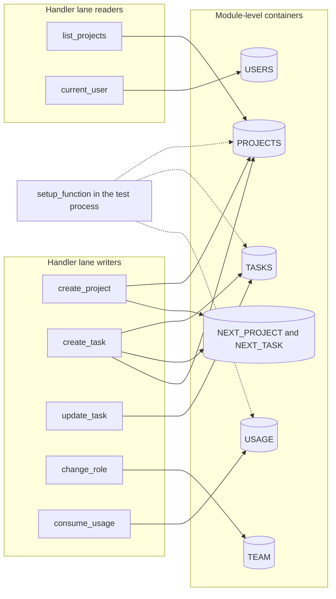

Three ownership facts shape every state diagram that follows: `USERS` has no writer, so credentials cannot change during a run; `TEAM` has a writer but no reader, so its state cannot influence any flow; and the two counters have no reset path, so identifiers are monotonic for the life of the process, independent of how often the stores are cleared.

### 4.7.2 State Transition Diagrams

**Task status (`F-006`).** The only state machine in the fixture, and it is a flat set rather than a graph: the handler validates membership in `{open, in_progress, done}` and then assigns, with no test of the current value **(archive: lines 80-82)**.

```mermaid
stateDiagram-v2
    [*] --> open : POST /tasks accepted
    open --> open : PATCH status=open
    open --> in_progress : PATCH status=in_progress
    open --> done : PATCH status=done
    in_progress --> open : PATCH status=open
    in_progress --> in_progress : PATCH status=in_progress
    in_progress --> done : PATCH status=done
    done --> open : PATCH status=open
    done --> in_progress : PATCH status=in_progress
    done --> done : PATCH status=done
    open --> [*] : process restart or store cleared
    in_progress --> [*] : process restart or store cleared
    done --> [*] : process restart or store cleared
    note right of in_progress
        Every transition is permitted, including reopening a done task
    end note
```

**Record lifecycle (`F-005`, `F-006`, `F-009`).** Projects and tasks have no delete, archive or completion endpoint, so their only exits are the test reset and process exit; the counter and `TEAM` survive the reset, which is why the reset state is partial rather than initial.

```mermaid
stateDiagram-v2
    [*] --> Seeded : module import executes the literals
    Seeded --> Populated : first successful POST
    Populated --> Populated : further successful writes
    Populated --> PartiallyCleared : setup_function clears PROJECTS and TASKS and resets used
    PartiallyCleared --> Populated : next test writes again
    PartiallyCleared --> Seeded : process restart
    Populated --> Seeded : process restart
    note right of PartiallyCleared
        TEAM assignments and both id counters survive the reset
    end note
```

**Usage counter (`F-008`).** A single integer with one ceiling; it has no period, no decay and no per-caller dimension.

```mermaid
stateDiagram-v2
    [*] --> WithinLimit : import sets used 0 limit 5
    WithinLimit --> WithinLimit : consume units that fit, used increases
    WithinLimit --> AtLimit : consume brings used to 5
    AtLimit --> AtLimit : request refused with 429 and used unchanged
    AtLimit --> WithinLimit : process restart or reset of used
    WithinLimit --> WithinLimit : request refused with 422 for units below 1
    note right of AtLimit
        The only exit from the exhausted state is a restart or the test hook
    end note
```

**Authorization state has no diagram because it has no transitions.** The principal record returned by `current_user` is derived from the token on every request **(archive: lines 29-32)**; nothing stores a session, so there is no login, logout, expiry or refresh state to model, and a role written to `TEAM` produces no state change in any later flow.

### 4.7.3 Data Persistence Points

| Write | Location **(archive)** | Durability | Survives test reset | Survives restart |
| --- | --- | --- | --- | --- |
| Insert project record | line 50 | Process memory only | No | No |
| Increment project id | line 51 | Process memory only | Yes | No |
| Insert task record | line 69 | Process memory only | No | No |
| Increment task id | line 70 | Process memory only | Yes | No |
| Overwrite task status | line 82 | Process memory only | No | No |
| Overwrite team role | line 93 | Process memory only | Yes | No |
| Increment usage | line 104 | Process memory only | No (`used` reset) | No |

There is no persistence point in the ordinary sense: no serialisation, no file write, no flush, no snapshot, no replication, and no connection to anything outside the interpreter. `README.md` line 9 declares this deliberately — "No external database or service is required; data is held in memory" — and no `open()`, storage SDK or driver appears in any file. A restart reinstates exactly the import-time literals: two tokens, two team entries, zero usage and counters at `1`, with every project and task gone.

### 4.7.4 Caching Requirements

There is nothing to cache and nothing that caches. The dictionaries are the system of record, not a layer in front of one, so no cache-aside logic, TTL, eviction policy or invalidation hook exists anywhere in the module or the dependency set (the keyword sweep found zero hits for `cache`, `redis`, `Cache`).

| Caching concern | State in this repository | Consequence for flows |
| --- | --- | --- |
| Cache tier | None | Reads always hit the live in-process containers |
| Invalidation | Not applicable | A write is immediately visible to the next read in the same process, which is exactly what `test_api.py` line 22 relies on |
| TTL or expiry | None | Projects, tasks and usage never age out |
| Read amplification | The whole `PROJECTS` collection is read on every listing and filtered in Python **(archive: line 58)** | Listing cost grows with total projects rather than with the caller's visible subset |
| Warm-up | None required | State is present from the moment of import |
| Coherence across processes | Impossible | Two workers would each hold an independent copy with no mechanism to reconcile |

The absence of a cache also removes a class of failure the flows never have to handle: there is no stale read, no miss path, no thundering herd and no cache invalidation ordering to get wrong.

### 4.7.5 Transaction Boundaries and Concurrency

No transaction boundary exists. There is no session, no commit, no rollback and no isolation level — the keyword sweep returned zero hits for `transaction`, `commit(`, `rollback`, `Session` and `sqlalchemy` — so each flow consists of independent in-place dictionary operations with no unit of atomicity beyond a single Python statement.

| Operation | Steps that together form the write | Atomic? | Failure mode if interleaved |
| --- | --- | --- | --- |
| Create project **(archive: lines 49-51)** | Build record, insert at `NEXT_PROJECT`, increment counter | No | Two requests can read the same `NEXT_PROJECT`, so the second insert overwrites the first record and one creation is silently lost |
| Create task **(archive: lines 65-70)** | Membership test on `PROJECTS`, build record, insert, increment | No | A project cleared between the test and the insert would yield a task referencing a missing project; concurrent creates can collide on `NEXT_TASK` |
| Update task **(archive: lines 77-82)** | Lookup, status validation, assignment | Single assignment, but check and write are separate | Two callers can both pass validation; the last write wins with no version check |
| Change role **(archive: lines 89-94)** | Role gate, target validation, assignment | No | The owner gate reads the immutable `USERS` map, so the gate itself cannot be raced; only the write competes |
| Consume usage **(archive: lines 102-104)** | Ceiling comparison, then increment | No | Two requests can both pass the ceiling and drive `used` past `limit`, breaking `V-11` |

The concurrency exposure is real rather than theoretical because synchronous handlers are dispatched by the framework to a worker thread pool, so two requests may execute at the same time inside the one process. No `Lock`, `threading` primitive or atomic counter exists to serialise them, and no request-queue depth, connection limit or worker count is configured in the repository. The documented single-process run (`README.md` line 16) keeps the exposure internal to one interpreter; running more than one worker would additionally split state, because each process would seed and mutate its own containers.


## 4.8 Error Handling and Recovery

Error handling in this service is deliberately thin: nine explicit `HTTPException` raises, no exception handling of any other kind, and no recovery machinery. The sweep of all 200 lines of repository and archive text found zero occurrences of `try:`, `except`, `finally`, `exception_handler`, `middleware`, `logging`, `logger`, `retry` or `timeout` — so what follows describes a design in which errors are returned to the caller and then forgotten.

### 4.8.1 Error Taxonomy and Handling Flowchart

| Class | Failures | Raised by | Status and message | Retryable by the caller |
| --- | --- | --- | --- | --- |
| Routing | Unknown path, wrong method | Framework | `404 Not Found`, `405 Method Not Allowed` | No, unless the path is corrected |
| Shape and type | Body constraint, missing required query, non-integer path | Framework | `422` with a `detail` array | Yes, after correction |
| Authentication | Absent or unprefixed header | `current_user` **(archive: line 27)** | `401 Missing bearer token` | Yes, with a credential |
| Authentication | Unknown token | `current_user` **(archive: line 31)** | `401 Invalid token` | Yes, with a seeded token |
| Authorization | Caller is not an owner on the team route | Handler **(archive: line 90)** | `403 Owner role required` | Not without `owner-token` |
| Referential | Unknown `project_id` on task creation | Handler **(archive: line 66)** | `404 Project not found` | Yes, after creating the project |
| Referential | Unknown `task_id` on status change | Handler **(archive: line 79)** | `404 Task not found` | Yes, with a valid id |
| Referential | Unknown user or invalid role | Handler **(archive: line 92)** | `404 User or role not found` | Yes, for ids `1`/`2` and a permitted role |
| Business | Status outside the enumeration | Handler **(archive: line 81)** | `422 Unsupported status` | Yes, with a permitted value |
| Business | Non-positive consumption | Handler **(archive: line 101)** | `422 Units must be positive` | Yes, with `units >= 1` |
| Quota | Ceiling of 5 would be exceeded | Handler **(archive: line 103)** | `429 Usage limit reached` | Only after a restart or the test reset |
| Unhandled | Any other Python exception | Nothing — there is no handler | Framework default `500`, body not defined in the repository | Undefined |

```mermaid
flowchart TD
    START(["Incoming request"]) --> R1
    subgraph FW["Framework lane"]
        R1{"Path and method match a route?"}
        R2{"Body, path and query valid?"}
        T1(["404 Not Found or 405 Method Not Allowed"])
        T2(["422 framework detail array"])
    end
    subgraph HL["Handler lane in app.main"]
        H1{"Route declares an authorization header?"}
        H2{"Header present and Bearer prefixed?"}
        H3{"Token found in USERS?"}
        H4{"Route business rules evaluated in code order"}
        T3(["401 Missing bearer token"])
        T4(["401 Invalid token"])
        T5(["403 Owner role required"])
        T6(["404 Project, task or user not found"])
        T7(["422 Unsupported status or Units must be positive"])
        T8(["429 Usage limit reached"])
        H5["Mutate state or project a view"]
        T9(["500 framework default, no repository-defined body"])
    end
    subgraph SUC["Success terminal"]
        OK(["200 JSON body"])
    end
    R1 -- "no" --> T1
    R1 -- "yes" --> R2
    R2 -- "no" --> T2
    R2 -- "yes" --> H1
    H1 -- "no, probe routes only" --> OK
    H1 -- "yes" --> H2
    H2 -- "no" --> T3
    H2 -- "yes" --> H3
    H3 -- "no" --> T4
    H3 -- "yes" --> H4
    H4 -- "role not owner" --> T5
    H4 -- "target missing" --> T6
    H4 -- "value unsupported" --> T7
    H4 -- "quota exhausted" --> T8
    H4 -- "all rules pass" --> H5
    H5 -- "unhandled exception" --> T9
    H5 --> OK
```

The flowchart's most important property is a missing edge: no failure terminal returns to the request that produced it. Every error terminates the flow at the point of decision, and because each raise precedes its write **(archive: lines 27-103 against writes at 50-104)**, none of them leaves a partially updated record behind.

### 4.8.2 Retry Mechanisms

No retry mechanism exists at any layer.

| Retry layer | Present | Evidence |
| --- | --- | --- |
| Outbound client retry | No, and no outbound client exists | `requirements.txt` declares no HTTP client for application use; no client call appears in the archive |
| Server-side retry of a failed rule | No | Nine raises are terminal; no loop, `sleep` or backoff construct exists |
| Framework-level retry middleware | No | No middleware is registered **(archive: full module)** |
| Idempotency key or request token | No | No header beyond `Authorization` is read; repeating a creation yields a second record with a new id |
| Caller-driven retry guidance | None published | No `Retry-After` header is set; `429` carries only the `detail` string |

Because nothing is idempotent, retry safety is per-route rather than per-system: repeating a `GET` is harmless, repeating a `PATCH` with the same status is harmless because it overwrites with the same value, but repeating `POST /projects`, `POST /tasks` or `POST /billing/consume` consumes another id or another unit of quota. The shipped suite never retries: it calls once per assertion and asserts the immediate result.

### 4.8.3 Fallback Processes

No application-level fallback exists. There is no secondary store, no default-value path, no degraded mode, no circuit breaker, and no cached response to serve when the primary is unavailable — the primary is the only store, so there is nothing to fall back to.

| Fallback concern | State | Consequence |
| --- | --- | --- |
| Degraded readiness signal | None | `/ready` returns a hard-coded `{"ready": true, "checks": {"storage": "ok"}}` **(archive: line 42)**, so an unhealthy store cannot be detected or reported |
| Static or cached response on failure | None | No cache exists (Section 4.7.4) |
| Default values on missing configuration | Not applicable | The module reads no configuration at all; the only defaults are the `units = 1` parameter and the `USAGE` literals |
| Tool-level fallbacks that do exist | Two, both outside application logic | `pytest` falls back to root-level collection when `testpaths = tests` matches nothing; `uvicorn --reload` falls back to stat polling when `watchfiles` is absent, because `requirements.txt` pins plain `uvicorn==0.34.0` without the `[standard]` extra |

The absence of fallback is consistent with the fixture's purpose but leaves one operational gap worth naming: `/ready` will report ready while `PROJECTS`, `TASKS` and `USAGE` are in any state, including after a reset that emptied them mid-run, because the readiness body never consults them.

### 4.8.4 Error Notification Flows

Errors are communicated to the caller and to nobody else. No log line, metric, event or alert is produced for any failure.

| Notification channel | Present | Evidence |
| --- | --- | --- |
| HTTP response body | Yes — the only channel | Every raise carries a `detail` string; framework failures carry a `detail` array |
| Application logging | No | Zero hits for `logging` or `logger`; no `print` in the archived module |
| Metrics counters | No | `requests_total` is the literal `0` **(archive: line 110)** and is never incremented, on success or failure |
| Error tracking or alerting | No | No SDK, endpoint or configuration in any file |
| Correlation or request id | No | No response header is set by a handler and no middleware exists to add one |
| Operator notification (email, webhook, chat) | No | No outbound client of any kind |

For a flow reviewer this means a failing request is invisible from outside the connection that made it: the sole record of a `429`, a `403` or a `401` is the response the caller received, and once the response is read there is no trace to correlate it with anything else.

### 4.8.5 Recovery Procedures

Recovery is manual and procedural, because the service exposes no compensating operation, no reset endpoint and no idempotency mechanism.

| Failure | Recovery available in the fixture | What is lost or retained |
| --- | --- | --- |
| `401` on any protected route | Resend with `Bearer owner-token` or `Bearer member-token` | Nothing; the failed request changed no state |
| `403` on role administration | Resend with the owner token | Nothing |
| `404` on task creation | Create the project first, then resend the task | Nothing; no orphan task was written |
| `404` on status change | Resend with an existing task id | Nothing |
| `422` on body, path, query or status | Correct the request and resend | Nothing |
| `429` on consumption | Wait for a process restart; the `used` counter has no administrative reset | The allowance is restored only by restarting, which also discards projects, tasks and role changes |
| Unhandled `500` | Restart the process | All state; the seeds return |
| Suspected interleaving damage (duplicate or lost id, usage past the ceiling) | Restart the process | All state |
| Test contamination between tests | `setup_function` restores an empty `PROJECTS` and `TASKS` and zero usage; `TEAM` and the id counters stay as they are | The reset is partial by design (`test_api.py` lines 8-11) |

Two consequences complete the picture. First, the cheapest reliable recovery in every case is a restart, which is also the only way to clear a `TEAM` assignment or reset an id counter. Second, because no request writes before it fails, there is no repair procedure for a half-applied change; the only corruption a flow can leave behind is the concurrency damage described in Section 4.7.5, and that too is cleared by restarting.


## 4.9 Timing and SLA Considerations

No timing guarantee is made anywhere in this repository. There is no latency target, throughput figure, availability percentage, timeout value, retry budget or quota window in `README.md`, `test_api.py`, `pytest.ini`, `requirements.txt` or the archived `app/main.py`, and no configuration file exists in which such a value could be set. Section 2.2 already states this convention for its acceptance criteria; this sub-section records what timing behaviour the flows do have.

| Timing dimension | Observed behaviour | Evidence |
| --- | --- | --- |
| Declared SLA or KPI | None | No target in any of the five text files; Section 2.2 states the same for requirement acceptance |
| Request execution model | Synchronous handler functions, dispatched by the framework to a worker thread pool | Nine `def` handlers, no `async def` **(archive: lines 36-109)**; zero hits for `async`/`await` |
| Per-request cost | Constant work for eight routes; O(n) over stored projects for `GET /projects` | **(archive)** lines 36-110; filter at line 58 |
| Inbound timeout | None configured | No timeout parameter in any file; uvicorn started with defaults only (`README.md` line 16) |
| Outbound timeout | Not applicable | No outbound call exists |
| Keep-alive, connection limits, worker count | Not configured; server defaults apply | `README.md` line 16 supplies only `--reload` |
| Rate limiting or throttling | None | No middleware, no counter, no per-caller accounting |
| Retry or backoff timing | None | Section 4.8.2 |
| Quota window | None — the ceiling of `5` is permanent for the process lifetime | **(archive)** line 11; no clock, period or reset in `consume_usage` |
| Availability measurement | `uptime_seconds` is `round(monotonic(), 2)`, whose origin is platform-defined, so it measures time since an unspecified epoch rather than since start-up | **(archive)** line 110 |
| Request counting | None; `requests_total` is a literal `0` | **(archive)** line 110 |
| Reload latency in development | Stat polling rather than filesystem events, because `watchfiles` is not installed with plain `uvicorn==0.34.0` | `requirements.txt` line 2 |
| Start-up time | Module import plus three literal containers; no connection, migration or warm-up | **(archive)** lines 5-13 |
| Restart cost | Total state loss, so a restart is immediate but destructive | Section 4.7.3 |
| Suite run time | Interpreter start-up plus three in-process request/response cycles; no listener, no network | `test_api.py` lines 4-26 |

Three timing statements can be made with confidence about the flows in this section:

- **No flow waits on anything external.** With no database, cache, queue or outbound client, a request's duration is determined only by JSON parsing, constraint checks, dictionary operations and serialisation, so the fixture has no tail-latency source of the kind a networked system would have.
- **The one flow whose cost grows is project listing.** `GET /projects` reads every stored project and filters in Python **(archive: line 58)**, with no pagination parameter and no upper bound on the number of projects, so response size and handler cost both grow with total state.
- **The quota is not time-based.** `USAGE` carries `used` and `limit` only **(archive: line 11)**: there is no period start, no window boundary and no decay, so "when does the allowance reset" has exactly one answer — at process restart or through the test hook.

Consequently no service-level objective can be derived from this repository. A deployment would have to supply latency, availability and error-budget targets, plus the timeouts, rate limits and metric instrumentation that would enforce them; the fixture itself contributes none of these, and `README.md` line 31 forbids the deployment that would need them.


## 4.10 References

- `README.md` — declared the nine-operation service, the run command `uvicorn app.main:app --reload` (line 16), the docs URL (line 18), the `pytest -q` test command (line 22), the in-memory storage promise (line 9), and the non-production prohibition used in Section 4.6.4 (lines 30-31).
- `test_api.py` — the executable contract for flows `J-4` and `P-6`: the `app.main` import and module-level stores (line 2), the `TestClient` construction (line 4), the `Bearer owner-token` header (line 5), the `setup_function` reset (lines 8-11), and the three asserted flows (lines 14-15, 18-22, 25-26).
- `pytest.ini` — `testpaths = tests` and `python_files = test_*.py`, the discovery contract whose mismatch with the root-level test module drives the collection-fallback step of `P-6`.
- `requirements.txt` — the four exact pins (`fastapi==0.115.12`, `uvicorn==0.34.0`, `pytest==8.3.5`, `httpx==0.28.1`) that fix the framework behaviour every flow depends on, and the absence of any client, database, cache or identity library.
- `__init__.py` — empty package marker at the repository root; established that the root is a package and contributes no flow behaviour.
- `.DS_Store` — macOS Finder metadata; inspected and established to contain no source, configuration or file inventory relevant to any flow.
- Repository root `""` — the flat six-file checkout at HEAD `b8903e9` that established the absence of `app/`, `tests/`, CI configuration, container files and documentation beyond `README.md`.
- `proactie_insight_testing-main.zip` — the archive added at commit `4e4368f` and deleted at commit `b37e7e5`; the only location in the repository's history of the application module behind `app.main`, and therefore the source of every flow step marked **(archive)**.
- `app/main.py` (inside the archive) — 110 lines holding the nine route decorators (lines 35, 40, 45, 55, 61, 74, 86, 97, 108), `current_user` (lines 25-32), the two request models (lines 16-22), the seven state containers (lines 7-13), the nine `HTTPException` raises (lines 27, 31, 66, 79, 81, 90, 92, 101, 103) and the seven state writes (lines 50, 51, 69, 70, 82, 93, 104).
- `app/__init__.py` (inside the archive) — empty file that made `app` a package, confirming the import path required by `test_api.py` line 2.
- `tests/test_api.py` (inside the archive) — byte-identical to the root `test_api.py`, confirming that the archive's deletion removed only the application module and the `tests/` layout, not the test contract.
- Git commits `b8903e9` (HEAD, six-file checkout), `4e4368f` (archive upload) and `b37e7e5` (archive deletion) — the history that establishes evidence tiers T1, T2 and T3 in Section 4.1.1.

Related specification sections used as cross-references rather than as evidence: Section 2.1 (`F-001`…`F-011` feature catalogue and the `(archive)` convention), Section 2.2 (requirement identifiers `F-XXX-RQ-YYY` and the no-numeric-target convention) and Section 3.5 (store-by-store state inventory).

No web sources were used for this section: every statement rests on repository files, on the archived `app/main.py`, or on the documented behaviour of the pinned framework versions where the repository itself implements nothing.


# 5. System Architecture

## 5.1 High-Level Architecture

### 5.1.1 System Overview

**Evidence basis.** Everything in this section describes `app/main.py`, the 110-line reference implementation. That file is not in the working tree at HEAD — the checkout holds only `README.md`, `requirements.txt`, `pytest.ini`, `__init__.py`, `test_api.py` and a committed `.DS_Store` — and is recovered from the deleted archive `proactie_insight_testing-main.zip` at commit `4e4368f`. The archive's layout (`app/__init__.py`, `app/main.py`, `tests/test_api.py`) is the one `pytest.ini` line 2 (`testpaths = tests`) and `README.md` line 16 (`uvicorn app.main:app --reload`) assume, and with it installed the shipped suite passes (three tests). Citations marked **(archive)** give line numbers in that file; unmarked citations name files present at HEAD.

**Architecture style.** A single-process, single-module layered monolith. One `FastAPI` object is instantiated at import **(archive: line 5)**, nine route operations are declared on it as decorators **(archive: lines 35-110)**, two Pydantic models describe the only two request bodies **(archive: lines 16-22)**, one plain function performs authentication **(archive: lines 25-32)**, and six module-level names hold all state **(archive: lines 7-13)**. There is no router module, no service or repository layer, no dependency-injection graph (`Depends` occurs zero times), no middleware, no lifespan handler, no background task, no configuration object and no outbound client. The layers exist only as call order: uvicorn → Starlette route matching → Pydantic binding → handler function → `current_user` → dictionary read or write → framework serialisation.

**Rationale for that style.** The repository is a scanner-evaluation fixture, not a product: `README.md` line 3 calls it "a test fixture for repository-level proactive insights", line 9 states that "No external database or service is required; data is held in memory", and lines 31-32 forbid deployment. A single importable module satisfies every constraint at once — it starts with one command, the whole surface is legible in 110 lines, the test suite reaches the application's state by importing it (`test_api.py` line 2), and nothing has to be provisioned, configured or torn down. The cost is recorded in Section 1.2.1 and carried through this section: there is no seam at which a database, a cache or an identity provider could be attached.

**Key architectural principles.**

- **One application object per process.** State and routes share a single interpreter; nothing is replicated, so nothing has to be coordinated.
- **State as module attributes, not objects.** `PROJECTS`, `TASKS`, `TEAM`, `USAGE`, `NEXT_PROJECT` and `NEXT_TASK` are module globals **(archive: lines 7-13)** because the test hook resets them by direct assignment and `.clear()` (`test_api.py` lines 8-11); any encapsulation would break the suite.
- **Authentication as a per-handler convention.** Each protected handler declares `authorization: str | None = Header(default=None)` and calls `current_user` explicitly **(archive: lines 46, 56, 62, 75, 87, 98)**. It is neither a dependency nor a declared security scheme: the generated `components.securitySchemes` is empty, and the `authorization` header appears in the OpenAPI document as an optional nullable string parameter on each protected operation.
- **The framework owns the edges.** Request validation, error envelope, JSON serialisation, the OpenAPI document, `/docs` and `/redoc` are all generated; the repository supplies no schema file, template or response class (verified: `/docs`, `/redoc` and `/openapi.json` all return `200`).
- **Errors are caller-visible and nothing more.** Failures are raised as `HTTPException` with a short `detail` string **(archive: lines 27, 31, 66, 79, 81, 90, 92, 101, 103)**; no handler, log sink, metric or alert observes them afterwards (Section 5.4).
- **No egress.** No code path opens a socket, reads a file or reads an environment variable; a keyword sweep of the archive and of every HEAD file returned zero hits for `open(`, `os.environ`, `getenv`, `subprocess`, `socket`, `requests` as a client, `sqlalchemy`, `psycopg`, `pymongo`, `redis` and `threading`.

**System boundaries.**

| Boundary | What crosses it | How it is enforced |
| --- | --- | --- |
| HTTP request boundary | JSON bodies, path and query parameters, the `Authorization` header | Nine route declarations **(archive: lines 35-110)**; field constraints **(archive: lines 16-22)**; framework `404`, `405` and `422` |
| Trust boundary | A token string becoming a principal id and role | `current_user` **(archive: lines 25-32)** — `401 Missing bearer token`, `401 Invalid token` |
| Authorization boundary | A principal becoming a permitted operation | Per-handler checks: list visibility **(archive: line 58)** and the owner gate **(archive: lines 89-90)**; there is no central policy component |
| Persistence boundary | Record dictionaries entering and leaving the containers | Direct subscript access from handlers **(archive: lines 49-104)**; no repository interface, query layer or transaction |
| Test-state boundary | Test process writing application state | `setup_function` clears `PROJECTS`, `TASKS` and `USAGE["used"]` in place (`test_api.py` lines 8-11) — the only write path that bypasses HTTP |
| Process boundary | Everything outside the interpreter | Nothing crosses: no database, broker, identity provider, telemetry exporter or outbound HTTP client exists |

**Major interface: the HTTP surface.** Nine operations across eight paths, all returning `200` on success (verified against the generated OpenAPI document).

| Operation | Handler | Credential and role rule | State touched |
| --- | --- | --- | --- |
| `GET /health` | `health` **(archive: 36)** | None | None |
| `GET /ready` | `readiness` **(archive: 41)** | None | None |
| `GET /metrics` | `metrics` **(archive: 109)** | None | None; reads `time.monotonic()` |
| `POST /projects` | `create_project` **(archive: 46)** | Valid bearer token | `PROJECTS` insert, `NEXT_PROJECT` increment |
| `GET /projects` | `list_projects` **(archive: 56)** | Valid bearer token | `PROJECTS` read, filtered per caller |
| `POST /tasks` | `create_task` **(archive: 62)** | Valid bearer token | `PROJECTS` read, `TASKS` insert, `NEXT_TASK` increment |
| `PATCH /tasks/{task_id}` | `update_task` **(archive: 75)** | Valid bearer token; **no** ownership check | `TASKS` read and status write |
| `POST /teams/{user_id}/role` | `change_role` **(archive: 87)** | Valid bearer token whose role is `owner` | `TEAM` write |
| `POST /billing/consume` | `consume_usage` **(archive: 98)** | Valid bearer token; usage is global, not per caller | `USAGE` read and write |

**Request execution model.** All nine handlers are synchronous `def` functions, so FastAPI dispatches each one off the event loop through `run_in_threadpool` onto an AnyIO worker thread with a default limiter of 40 concurrent slots per process (verified by observing the handler thread name and the limiter's token count). The consequence is architectural rather than incidental: two requests can be inside the shared dictionaries at the same time and nothing serialises them (Section 5.4.5).

### 5.1.2 Core Components

| Component | Primary responsibility | Key dependencies and integration points | Critical considerations |
| --- | --- | --- | --- |
| `app` — the ASGI application object | Instantiate the framework, own routing, expose the ASGI callable **(archive: line 5)** | `fastapi.FastAPI`; consumed by uvicorn (`README.md` line 16) and by `TestClient` (`test_api.py` line 4) | Absent at HEAD, so both the documented run command and test collection fail |
| Route layer — nine decorated handlers | Bind paths, methods and parameters to handler functions **(archive: lines 35-110)** | Starlette routing beneath FastAPI; every route is registered on the single `app` object | No router, prefix, tag or versioning; two routes share the `/projects` path |
| Request validation — `ProjectIn`, `TaskIn` | Constrain request bodies: `name` 2-80 chars, `title` 2-120 chars, integer `project_id` **(archive: lines 16-22)** | `pydantic.BaseModel` and `Field`; invoked by the framework before the handler | The only validation layer; query parameters `status`, `role` and `units` are validated in handler code instead |
| Authentication helper — `current_user` | Turn an `Authorization` header into a principal record **(archive: lines 25-32)** | Reads the immutable `USERS` map; called explicitly by six handlers | Not a dependency, not a security scheme, no session, no expiry, no revocation |
| Project handlers | Create a project owned by the caller; list projects visible to the caller **(archive: lines 45-58)** | `PROJECTS`, `NEXT_PROJECT`, `current_user` | Success returns `200`, not `201`; listing filters in Python after reading the whole collection |
| Task handlers | Create a task inside an existing project; overwrite its status **(archive: lines 61-83)** | `TASKS`, `NEXT_TASK`, `PROJECTS` (referential check), `current_user` | The only cross-container dependency; no ownership check on either route; no list or read route |
| Team role handler | Let an owner assign `owner` or `member` to a team member **(archive: lines 86-94)** | `TEAM`, `USERS` for the caller's role | Writes a map no other code reads, so role changes never alter a later authorization decision |
| Usage handler — simulated billing | Enforce a global ceiling of five units **(archive: lines 97-105)** | `USAGE`, `current_user` | Ceiling is a source literal; check and increment are separate statements with no lock |
| Operational probes | Answer liveness, readiness and uptime without credentials **(archive: lines 35-42, 108-110)** | None — no container is consulted | Bodies are constants; `requests_total` is never incremented and `uptime_seconds` is a monotonic clock reading |
| In-memory state | Hold every record the system knows **(archive: lines 7-13)** | Written and read by handlers; cleared by the test hook | Process-local, non-durable, unsynchronised, partially reset by the suite |
| ASGI server — uvicorn | Serve the application object over HTTP/1.1 | `app.main:app` resolved by import string (`README.md` line 16) | Pinned without `[standard]` extras, so `--reload` polls the tree; worker count is not configured |
| Test harness and configuration | Execute three contract tests against the real application object | `test_api.py`, `pytest.ini`, `httpx` transport, `TestClient` | Imports `app`, `PROJECTS`, `TASKS` and `USAGE` by name (`test_api.py` line 2), so those names are part of the architecture |
| Dependency manifest | Pin the four packages the two paths need | `requirements.txt` lines 1-4; PyPI at install time | Exact pins, no lockfile, no hashes, no separation of runtime and test dependencies |

Only the last three rows exist at HEAD; the application-object, routing, validation, helper, domain-handler, probe and state components are recovered from the archive. Section 5.2 details each component.

### 5.1.3 Data Flow Description

**Primary flow.** A request enters through one of two transports — a uvicorn HTTP/1.1 connection (`README.md` line 16) or the in-process ASGI transport of `fastapi.testclient.TestClient` (`test_api.py` line 4) — and converges on the same ASGI callable. Starlette matches the path and method, Pydantic binds and validates the body where a model is declared, and the handler then runs in a worker thread. Inside the handler the order is fixed: authenticate through `current_user`, evaluate business rules in source order, mutate or read the containers, and return a plain dictionary or list that the framework serialises as JSON. Probe routes (`/health`, `/ready`, `/metrics`) skip authentication and touch no container, which is why they can report healthy while the stores are in any condition.

A third, non-HTTP path exists and matters architecturally: the test hook reaches into `PROJECTS`, `TASKS` and `USAGE` directly before each test (`test_api.py` lines 8-11). Application state therefore has two independent write paths — one mediated by the trust boundary and one that bypasses it entirely.

```mermaid
flowchart TD
    subgraph Ingress["Ingress paths"]
        NetClient["HTTP client over network"]
        TestClient["TestClient in-process ASGI transport"]
        TestHook["setup_function direct attribute access"]
    end
    subgraph Serve["uvicorn 0.34.0 process"]
        Callable["ASGI callable app"]
    end
    subgraph Fw["FastAPI 0.115.12 and Starlette 0.46.2"]
        Match["Route match"]
        Bind["Pydantic body binding"]
        Serial["JSON serialisation"]
    end
    subgraph Handlers["Handler lane in app.main"]
        Principal["current_user token to principal"]
        Rules["Business rules in source order"]
    end
    subgraph Store["Module-level containers"]
        Users[("USERS literal")]
        Records[("PROJECTS TASKS TEAM")]
        Counters[("USAGE and id counters")]
    end
    NetClient --> Callable
    TestClient --> Callable
    Callable --> Match
    Match --> Bind
    Bind --> Principal
    Principal --> Rules
    Rules --> Users
    Rules --> Records
    Rules --> Counters
    Rules --> Serial
    Serial --> Callable
    TestHook -.-> Records
    TestHook -.-> Counters
```

**Data transformation points.** Each row is a place where the shape or meaning of data changes.

| Stage | Transformation | Evidence |
| --- | --- | --- |
| Body to model | JSON validated against `ProjectIn` (`name` 2-80) or `TaskIn` (`title` 2-120, `project_id` int); failure returns `422` with a framework `detail` array | **(archive: lines 16-22)**; observed body `{"detail": [{"type": "string_too_short", "loc": ["body", "name"], ...}]}` |
| Header to principal | `"Bearer "` prefix stripped, token looked up in `USERS`; absent or unprefixed → `401 Missing bearer token`, unknown → `401 Invalid token` | **(archive: lines 26-31)** |
| Model plus counters to record | `id` taken from `NEXT_PROJECT` or `NEXT_TASK`, `owner_id` or `created_by` from the principal id, `status` defaulted to `"open"` | **(archive: lines 49, 67-68)** |
| Collection to view | `list_projects` keeps records whose `owner_id` equals the caller's id or whose caller role is `owner`, preserving insertion order | **(archive: line 58)**; observed owner sees two projects, member sees one |
| Status string to stored value | Membership test against `{open, in_progress, done}`; otherwise `422 Unsupported status` | **(archive: lines 80-82)** |
| Units to quota decision | `units < 1` → `422 Units must be positive`; `used + units > limit` → `429 Usage limit reached`; otherwise `used += units` | **(archive: lines 100-104)** |
| Clock to payload | `round(monotonic(), 2)` — a monotonic reading whose origin is platform-defined, not time since start-up | **(archive: line 110)**; observed `6002.7` on a freshly started process |

**Protocols and integration patterns.** Synchronous HTTP request/response over HTTP/1.1 (uvicorn's `h11` implementation) or over the in-process ASGI call in tests; JSON bodies, request-scoped `Authorization` headers, and query parameters for `status`, `role` and `units`. There is no pagination, filtering, batching, streaming, event emission, webhook, queue, or callback of any kind, and no idempotency key: repeating a creation allocates a new id.

**Data stores and caches.** The six module-level names are the system of record, not a cache in front of one; no cache, TTL, eviction or invalidation logic exists anywhere, and no cache library is declared.

| Store | Role | Durability and reset |
| --- | --- | --- |
| `USERS` **(archive: 7)** | The only credential and role map, read by `current_user` | Immutable literal for the process lifetime; no writer exists, so it survives every reset |
| `PROJECTS` **(archive: 8)** | Project records keyed by integer id | Process memory; emptied by the test hook and lost on restart |
| `TASKS` **(archive: 9)** | Task records keyed by integer id | Process memory; emptied by the test hook and lost on restart |
| `TEAM` **(archive: 10)** | User id to role map written by the owner-gated route | Process memory; **not** reset by the hook, lost on restart |
| `USAGE` **(archive: 11)** | `used` counter and the literal `limit` of 5 | Process memory; only `used` is reset by the hook |
| `NEXT_PROJECT`, `NEXT_TASK` **(archive: 12-13)** | Id allocators, rebound through `global` | Process memory; never reset, so ids keep climbing across tests |

### 5.1.4 External Integration Points

The application itself integrates with nothing: no database, cache, message broker, identity provider, object store, telemetry collector or third-party API appears in the manifest, in the code, or in any configuration. The four rows below are the only points where this system meets something outside its own process, and none carries a service-level commitment.

| System Name | Integration Type | Data Exchange Pattern (Protocol/Format) | SLA Requirements |
| --- | --- | --- | --- |
| PyPI package index | Build and install time, one direction | `pip install -r requirements.txt` fetches four exactly pinned wheels over HTTPS; no lockfile, hashes, extras or private index | None stated; no pin beyond the four `==` versions and no supply-chain verification |
| uvicorn listener (`127.0.0.1:8000`) | Runtime process boundary, inbound only | HTTP/1.1 with JSON bodies and headers, served on the host and port that `uvicorn app.main:app --reload` defaults to (`README.md` line 16) | None: no timeout, connection limit, worker count, TLS or rate limit is configured |
| pytest and `TestClient` | Test time, in process | ASGI calls through the `httpx` 0.28.1 transport, no socket, no listener (`test_api.py` line 4) | None: no test timeout, retry or fixture budget is defined |
| Swagger UI assets for `/docs` | Runtime, browser to third party | The generated `/docs` HTML references `cdn.jsdelivr.net/npm/swagger-ui-dist@5/swagger-ui-bundle.js`, the matching stylesheet and a `fastapi.tiangolo.com` favicon, so rendering the docs page requires public internet access | None; the page is a developer convenience named in `README.md` line 18, and an offline browser falls back to `/openapi.json` |

Everything a reader might expect on this list — an authentication provider, a billing system, a notification channel, a metrics backend, a database — is absent by design. The "simulated billing limit" is five integers in a module-level dictionary **(archive: line 11)**, and the bearer tokens are two literal strings **(archive: line 7)**, so no credential or quota ever leaves the process.


## 5.2 Component Details

### 5.2.1 ASGI Application Object and Routing Layer

| Aspect | Detail |
| --- | --- |
| Purpose and responsibilities | Instantiate the framework, hold the nine route registrations, and act as the single ASGI callable for both serving paths. `app = FastAPI(title="Proactive Insights Demo API", version="1.0.0")` **(archive: line 5)** is the only configuration in the system; the title and version are the only values that reach the generated schema. |
| Technologies and frameworks | `fastapi==0.115.12` over `starlette==0.46.2`; `uvicorn==0.34.0` as the server (`requirements.txt` lines 1-2). No `APIRouter`, `include_router`, middleware, `lifespan`, `Depends`, `Response` subclass or `exception_handler` appears anywhere in the module. |
| Key interfaces and APIs | Eight paths, nine operations, all `200` on success: `/health`, `/ready`, `/projects` (`GET`, `POST`), `/tasks`, `/tasks/{task_id}`, `/teams/{user_id}/role`, `/billing/consume`, `/metrics`. Generated surfaces `/docs`, `/redoc` and `/openapi.json` return `200`; the document's `info` block reads `Proactive Insights Demo API` / `1.0.0`, and `components.securitySchemes` is absent. |
| Data persistence requirements | None. The object holds no state beyond its route table; every record lives in the module-level containers described in 5.2.9. |
| Scaling considerations | The object is process-local, so horizontal scaling multiplies independent worlds rather than sharing one; uvicorn's worker count is not configured (`README.md` line 16 passes only `--reload`), and `--reload` itself is a development-only supervisor. The absence of a `lifespan` handler means start-up work is confined to module import. |

### 5.2.2 Request Validation Models

| Aspect | Detail |
| --- | --- |
| Purpose and responsibilities | Define the only two request bodies and their constraints: `ProjectIn.name` with `Field(min_length=2, max_length=80)` and `TaskIn.title` with `Field(min_length=2, max_length=120)` plus an integer `project_id` **(archive: lines 16-22)**. They are the sole declarative validation in the system. |
| Technologies and frameworks | `pydantic` — resolved transitively, not pinned (`requirements.txt` declares no Pydantic entry); the pinned FastAPI 0.115.12 accepts Pydantic 1.7.4 or newer below 3.0.0, and the observed resolution under the shipped pins is 2.14.4. |
| Key interfaces and APIs | Bound by the framework from the JSON body before the handler runs. A violation returns `422` with a `detail` array, for example `{"type": "string_too_short", "loc": ["body", "name"], "msg": "String should have at least 2 characters"}`. Query parameters are outside their reach: `status`, `role` and `units` are plain function parameters validated in handler code. |
| Data persistence requirements | None; models are transient per request. They are also the schema source for the generated OpenAPI document, so their field names are part of the public contract. |
| Scaling considerations | Pure computation with no I/O, so cost is bounded by body size. Unbounded body size is a real exposure: no request-size limit is configured anywhere, and `max_length` truncates the stored value only after the body has been read and parsed. |

### 5.2.3 Authentication Helper — `current_user`

| Aspect | Detail |
| --- | --- |
| Purpose and responsibilities | Convert the `Authorization` header into a principal record, or refuse the request: rejects a missing header and one without the `Bearer ` prefix with `401 Missing bearer token`, and an unknown token with `401 Invalid token` **(archive: lines 25-32)**. It is called explicitly by the six protected handlers and by nothing else. |
| Technologies and frameworks | A plain Python function using `fastapi.HTTPException`; no security dependency, no `OAuth2PasswordBearer`, no `APIKeyHeader`, no JWT library, no password hashing library, no cryptography package in the manifest. |
| Key interfaces and APIs | Signature `current_user(authorization: str | None)` returning `{"id": int, "role": str}` from `USERS` **(archive: line 7)**: `owner-token` → id 1, role `owner`; `member-token` → id 2, role `member`. Because the header is declared as a per-handler `Header(default=None)` parameter, the OpenAPI document shows it as an optional nullable string on each protected operation and no security scheme, so generated clients receive no authentication metadata. |
| Data persistence requirements | Reads the immutable `USERS` literal only; it has no writer, so credentials cannot be added, rotated or revoked for the life of the process. No session, token record, expiry or refresh state is stored. |
| Scaling considerations | Constant-time membership lookup, no I/O, so the helper never becomes a bottleneck and never fails for an infrastructure reason. Its trust model does not scale: the same two literal tokens are shared by every caller of every deployment, which `README.md` lines 31-32 addresses by forbidding deployment and real credentials. |

### 5.2.4 Project Handlers

| Aspect | Detail |
| --- | --- |
| Purpose and responsibilities | `create_project` **(archive: lines 45-52)** builds `{"id", "name", "owner_id"}` from the counter and the caller's id, inserts it, increments `NEXT_PROJECT` and returns `200`. `list_projects` **(archive: lines 55-58)** returns every record whose `owner_id` equals the caller's id, or every record when the caller's role is `owner`, preserving insertion order. |
| Technologies and frameworks | Plain `def` handlers on the shared `app`; no service class, repository or transaction; `global NEXT_PROJECT` for the allocator. |
| Key interfaces and APIs | `POST /projects` with a `ProjectIn` body and a bearer token; `GET /projects` with a bearer token. There is no `GET /projects/{id}`, no update and no delete, so a project cannot be inspected individually, renamed or removed. |
| Data persistence requirements | Writes `PROJECTS` **(archive: line 50)** and `NEXT_PROJECT` **(archive: line 51)** into process memory. Nothing is flushed or snapshotted; both are lost on restart, and `PROJECTS` is emptied by the test hook (`test_api.py` line 9). |
| Scaling considerations | Creation is constant work. Listing is O(n) over the whole collection because the visibility filter runs in Python after every record is read **(archive: line 58)**, with no pagination, so response size and handler cost grow with total state rather than with the caller's visible subset. The record and counter writes are separate statements, so two concurrent creations can read the same id. |

### 5.2.5 Task Handlers

| Aspect | Detail |
| --- | --- |
| Purpose and responsibilities | `create_task` **(archive: lines 61-71)** requires the referenced project to exist, then stores `{"id", "title", "project_id", "created_by", "status": "open"}`. `update_task` **(archive: lines 74-83)** looks the task up and overwrites `status` with one of `open`, `in_progress`, `done`, with no check of the current value and no transition history. |
| Technologies and frameworks | Plain `def` handlers; `global NEXT_TASK`; the status value arrives as a **query parameter**, not a body field **(archive: line 75)**, so the PATCH route has no request model at all. |
| Key interfaces and APIs | `POST /tasks` (body `TaskIn`, bearer token) and `PATCH /tasks/{task_id}?status=<value>` (path integer, query string, bearer token). Failures: `404 Project not found`, `404 Task not found`, `422 Unsupported status`. There is no task list or read route, so a task is observable only through the responses that create and mutate it. |
| Data persistence requirements | Writes `TASKS` and `NEXT_TASK`; reads `PROJECTS` for the referential check **(archive: line 65)**. This is the only cross-container dependency in the system. Status updates overwrite in place with no audit trail, and nothing survives a restart. |
| Scaling considerations | Constant work per request, but two correctness exposures grow with concurrency and volume: the referential check and the insert are separate statements, and no route checks ownership, so any valid token can create a task in any project or change any task's status. With no list route, growth in task count is invisible through the API. |

### 5.2.6 Team Role Handler

| Aspect | Detail |
| --- | --- |
| Purpose and responsibilities | `change_role` **(archive: lines 86-94)** authenticates the caller, refuses non-owners with `403 Owner role required`, validates the target and the role together under one `404 User or role not found`, then overwrites `TEAM[user_id]` and echoes `{"user_id", "role"}`. |
| Technologies and frameworks | Plain `def` handler; role and target arrive as path and query parameters; the owner gate compares against the caller's role as resolved from `USERS`. |
| Key interfaces and APIs | `POST /teams/{user_id}/role?role=owner|member` with a bearer token. The single `404` conflates an unknown user with an unsupported role, so a caller cannot distinguish the two. |
| Data persistence requirements | Writes `TEAM` **(archive: line 93)**, which no other code reads — `current_user` resolves roles from `USERS` **(archive: lines 29-32)** — so an assignment is durable only for its own response and never changes a later authorization decision. `TEAM` is also the one container the test hook does not reset (`test_api.py` lines 8-11). |
| Scaling considerations | Constant work plus one dictionary write. The write is the only administrative mutation in the system and there is no read path to verify it, so an operator cannot audit team membership through the API; Section 4.4.3 records the same consequence for the flow. |

### 5.2.7 Usage Handler — Simulated Billing Limit

| Aspect | Detail |
| --- | --- |
| Purpose and responsibilities | `consume_usage` **(archive: lines 97-105)** authenticates the caller, rejects `units < 1` with `422 Units must be positive`, refuses a consumption that would exceed the ceiling with `429 Usage limit reached`, and otherwise increments `USAGE["used"]` and returns the pair. |
| Technologies and frameworks | Plain `def` handler; `units` is a query parameter with the default `1`; the ceiling of `5` is a source literal **(archive: line 11)** with no configuration path. |
| Key interfaces and APIs | `POST /billing/consume?units=<int>` with a bearer token. There is no reset, no balance enquiry, no period window and no per-caller attribution: one caller can exhaust the allowance for every other caller in the process. |
| Data persistence requirements | Reads and writes `USAGE`; only the `used` key is mutable and only the `used` key is reset by the test hook (`test_api.py` line 11). A restart restores the allowance because it restores the literal. |
| Scaling considerations | The check-then-increment **(archive: lines 102-104)** is not atomic and takes no lock, so the ceiling is enforced only if requests do not interleave. In an observed run of 20 simultaneous `units=1` requests the ceiling held exactly (5 accepted, 15 refused, `used` = 5); the exposure is structural rather than reproduced, since the critical section is short enough that CPython's GIL usually serialises it. A restart or a second worker would each restore or duplicate the allowance. |

### 5.2.8 Operational Probe Surface

| Aspect | Detail |
| --- | --- |
| Purpose and responsibilities | Provide unauthenticated liveness, readiness and uptime answers: `{"status": "ok"}` **(archive: lines 35-37)**, `{"ready": true, "checks": {"storage": "ok"}}` **(archive: lines 40-42)** and `{"requests_total": 0, "uptime_seconds": <float>}` **(archive: lines 108-110)**. |
| Technologies and frameworks | Plain `def` handlers; `GET /metrics` is the only route that reads a clock (`time.monotonic`), and it is the module's only standard-library import **(archive: line 3)**. |
| Key interfaces and APIs | `GET /health`, `GET /ready`, `GET /metrics`, all credential-free and parameter-free. `/health` is the only body the shipped suite compares for exact equality (`test_api.py` lines 14-15). |
| Data persistence requirements | None; no probe reads `PROJECTS`, `TASKS`, `TEAM` or `USAGE`, so readiness reports `storage: ok` regardless of container condition. |
| Scaling considerations | Constant time and trivially cacheable by any proxy, which is also their weakness: the answers are constants, so they cannot distinguish a healthy process from a degraded one. `uptime_seconds` cannot serve as a start-time gauge because `monotonic()` has a platform-defined origin — an observed value was `6002.7` immediately after start-up — and `requests_total` is never incremented. |

### 5.2.9 In-Memory State Subsystem

| Aspect | Detail |
| --- | --- |
| Purpose and responsibilities | Hold every fact the system knows in six module-level names **(archive: lines 7-13)**: `USERS` (immutable credentials), `PROJECTS` and `TASKS` (dicts keyed by integer id), `TEAM` (user id to role), `USAGE` (`used` and the literal `limit`), and the `NEXT_PROJECT` / `NEXT_TASK` allocators. |
| Technologies and frameworks | CPython built-in `dict` and `int` only — no ORM, driver, serialisation format, schema migration or file I/O. Module globals are rebound through `global` **(archive: lines 47, 63)**, which is why handlers mutate the module namespace rather than an object. |
| Key interfaces and APIs | Direct subscript access from handlers **(archive: lines 29, 50, 58, 65, 69, 77, 82, 93, 102-104)** and from the test hook (`test_api.py` lines 8-11). `app.main` exposes `PROJECTS`, `TASKS` and `USAGE` as importable names, making them part of the component contract — renaming any of them breaks collection. |
| Data persistence requirements | No durability: no serialisation, flush, snapshot or replication, and a restart reinstates exactly the import-time literals. Reset is partial even in tests — `TEAM` and both id counters survive `setup_function`, so ids climb across tests and a role change leaks into later tests. |
| Scaling considerations | State is per process and unsynchronised. Two uvicorn workers would each seed and mutate their own containers, giving divergent worlds; within one process the containers are shared by up to 40 concurrent worker threads with no lock, no version field and no transaction boundary. Read cost is O(n) for listing **(archive: line 58)** and O(1) for every keyed lookup. |

### 5.2.10 Test Harness and Configuration Components

| Aspect | Detail |
| --- | --- |
| Purpose and responsibilities | Execute the three shipped contract tests and pin the collection rules: `test_api.py` imports `app`, `PROJECTS`, `TASKS` and `USAGE` **(line 2)**, builds `TestClient(app)` at import **(line 4)**, resets state per test **(lines 8-11)** and asserts health equality, project create-then-list, and the anonymous `401` **(lines 14-26)**. `pytest.ini` sets `testpaths = tests` and `python_files = test_*.py`; the root `__init__.py` (0 bytes) makes the repository root an importable package. |
| Technologies and frameworks | `pytest==8.3.5` as the runner, `httpx==0.28.1` as the transport beneath `fastapi.testclient.TestClient`, both exactly pinned next to the runtime packages in one flat `requirements.txt`. |
| Key interfaces and APIs | The command `pytest -q` (`README.md` line 22); the import path `app.main`; the assertion contract that project creation answers `200` (not `201`) and that listing returns the newest project first. |
| Data persistence requirements | The harness writes application state directly rather than through HTTP — the only such path in the repository — and cannot reach state it cannot import, which is why the containers must stay module-level. |
| Scaling considerations | The suite is in-process with no listener and no network, so it costs interpreter start-up plus three request/response cycles (observed: `3 passed` in 0.10 s with the archive present). Coverage is deliberately partial (`README.md` line 8): tasks, team roles, billing and all non-functional behaviour are untested, so the harness cannot detect a regression in two thirds of the surface. At HEAD, `testpaths = tests` matches nothing and the import of `app.main` fails, so no test runs at all. |

### 5.2.11 Component Interaction Diagram

```mermaid
flowchart LR
    subgraph Callers["Callers"]
        NetClient["HTTP client over uvicorn"]
        TestModule["pytest module test_api.py"]
    end
    subgraph Process["Application process"]
        subgraph FrameworkLayer["Framework layer"]
            Router["Starlette route matching"]
            Binder["Pydantic body binding"]
            Serializer["JSON response"]
        end
        subgraph HandlerLayer["Handler layer"]
            AuthHelper["current_user"]
            ProjectAPI["Project handlers"]
            TaskAPI["Task handlers"]
            TeamAPI["Team role handler"]
            BillingAPI["Usage handler"]
            ProbeAPI["Health ready metrics"]
        end
        subgraph StateLayer["State layer"]
            UsersMap[("USERS")]
            ProjectMap[("PROJECTS")]
            TaskMap[("TASKS")]
            TeamMap[("TEAM")]
            UsageMap[("USAGE")]
            IdCounters[("NEXT_PROJECT NEXT_TASK")]
        end
    end
    NetClient --> Router
    TestModule --> Router
    Router --> Binder
    Binder --> AuthHelper
    Binder --> ProbeAPI
    AuthHelper --> UsersMap
    AuthHelper --> ProjectAPI
    AuthHelper --> TaskAPI
    AuthHelper --> TeamAPI
    AuthHelper --> BillingAPI
    ProjectAPI --> ProjectMap
    ProjectAPI --> IdCounters
    TaskAPI --> ProjectMap
    TaskAPI --> TaskMap
    TaskAPI --> IdCounters
    TeamAPI --> TeamMap
    BillingAPI --> UsageMap
    ProjectAPI --> Serializer
    TaskAPI --> Serializer
    TeamAPI --> Serializer
    BillingAPI --> Serializer
    ProbeAPI --> Serializer
    TestModule -.-> ProjectMap
    TestModule -.-> TaskMap
    TestModule -.-> UsageMap
```

The dotted edges are the architectural anomaly: the test module reaches `PROJECTS`, `TASKS` and `USAGE` without passing through the router, the binder or the authentication helper, so the state layer has two independent write paths.

### 5.2.12 State Transition Diagrams

**Process and component lifecycle.** The application has no state machine of its own; its lifecycle is module import, serving, optional in-place clearing by the test hook, and process exit. Everything not cleared by the hook survives until exit.

```mermaid
stateDiagram-v2
    [*] --> Imported : module import seeds USERS PROJECTS TASKS TEAM USAGE and both counters
    Imported --> Serving : uvicorn startup complete or TestClient constructed
    Serving --> Serving : request writes and reads containers
    Serving --> PartiallyCleared : setup_function clears PROJECTS TASKS and USAGE used
    PartiallyCleared --> Serving : next request in the same process
    Serving --> [*] : process exit discards all state
    PartiallyCleared --> [*] : process exit discards all state
    note right of PartiallyCleared
        TEAM and NEXT_PROJECT and NEXT_TASK survive the clear
    end note
```

**Task status.** The single domain state machine and it is a flat set, not a graph: membership in `{open, in_progress, done}` is validated **(archive: lines 80-82)** and the new value assigned without regard to the old one, so every transition is legal, including reopening a `done` task. Section 4.7.2 draws the full transition matrix.

```mermaid
stateDiagram-v2
    [*] --> open : POST /tasks succeeds
    open --> in_progress : PATCH status=in_progress
    open --> done : PATCH status=done
    in_progress --> open : PATCH status=open
    in_progress --> done : PATCH status=done
    done --> open : PATCH status=open
    done --> in_progress : PATCH status=in_progress
    open --> [*] : store cleared or process exit
    in_progress --> [*] : store cleared or process exit
    done --> [*] : store cleared or process exit
    note right of done
        No transition is refused for its source state and no history is retained
    end note
```

**Usage quota.** Two reachable conditions with one ceiling and one exit; the refused path leaves the counter untouched because the comparison precedes the increment **(archive: lines 102-104)**.

```mermaid
stateDiagram-v2
    [*] --> WithinLimit : import sets used 0 and limit 5
    WithinLimit --> WithinLimit : accepted consumption used increases
    WithinLimit --> AtLimit : accepted consumption reaches 5
    AtLimit --> AtLimit : 429 Usage limit reached counter unchanged
    WithinLimit --> WithinLimit : 422 Units must be positive counter unchanged
    AtLimit --> WithinLimit : process restart or reset of used
    note right of AtLimit
        No reset endpoint and no quota period exist
    end note
```

### 5.2.13 Sequence Diagrams for Key Flows

**Project creation and listing with a rejected anonymous read.** The diagram shows the two reasons a request can stop before touching state — binding and authentication — and the filter that makes listing caller-dependent. Each handler runs in a worker thread, so the framework, not the handler, serialises the response.

```mermaid
sequenceDiagram
    participant T as test_api.py
    participant C as TestClient transport
    participant R as Starlette router
    participant H as create_project
    participant A as current_user
    participant U as USERS
    participant P as PROJECTS
    T->>C: POST /projects json name Release QA with Bearer owner-token
    C->>R: ASGI request
    R->>R: bind ProjectIn and validate name length
    R->>H: invoke handler in worker thread
    H->>A: authorization header
    A->>U: USERS.get token
    U-->>A: id 1 role owner
    A-->>H: principal
    H->>P: PROJECTS[1] = record
    H->>H: NEXT_PROJECT = 2
    H-->>R: id name owner_id
    R-->>C: 200 application/json
    C-->>T: parsed body
    T->>C: GET /projects with no header
    C->>R: ASGI request
    R->>H: list_projects
    H->>A: authorization header is None
    A-->>H: raise 401 Missing bearer token
    H-->>R: HTTPException
    R-->>C: 401 detail Missing bearer token
    C-->>T: status 401
```

**Task creation and status change.** The only flow that reads one container to validate a write to another, and the only one whose input arrives partly in the query string.

```mermaid
sequenceDiagram
    participant Cl as Caller
    participant R as Starlette router
    participant H as create_task
    participant P as PROJECTS
    participant S as TASKS
    Cl->>R: POST /tasks title and project_id with bearer token
    R->>R: bind TaskIn
    R->>H: invoke handler
    H->>H: current_user
    H->>P: project_id in PROJECTS
    P-->>H: present
    H->>S: TASKS[1] = record with status open
    H-->>R: task object
    R-->>Cl: 200
    Cl->>R: PATCH /tasks/1?status=done with bearer token
    R->>H: update_task path 1 query done
    H->>H: current_user
    H->>S: TASKS.get 1
    S-->>H: record
    H->>H: status in open in_progress done
    H->>S: record status = done
    H-->>R: task object with status done
    R-->>Cl: 200
```

**Usage consumption refusal.** The quota path, showing that a refused request changes nothing and that the ceiling is process-global rather than per caller.

```mermaid
sequenceDiagram
    participant Cl as Caller
    participant H as consume_usage
    participant A as current_user
    participant G as USAGE
    Cl->>H: POST /billing/consume units 4 with bearer token
    H->>A: authorization header
    A-->>H: principal
    H->>G: read used and limit
    G-->>H: used 0 limit 5
    H->>H: 0 plus 4 does not exceed 5
    H->>G: used = 4
    H-->>Cl: 200 used 4 limit 5
    Cl->>H: POST /billing/consume units 4 again
    H->>A: authorization header
    A-->>H: principal
    H->>G: read used and limit
    G-->>H: used 4 limit 5
    H-->>Cl: 429 Usage limit reached with counter unchanged
```


## 5.3 Technical Decisions

### 5.3.1 Architecture Style Decisions

The style is a deliberate minimum: one importable module, one process, one object, global state. Each row names what was chosen, what the repository avoided, and what that costs.

| Decision | Alternatives not taken | Tradeoff accepted | Consequence in this architecture |
| --- | --- | --- | --- |
| One module (`app/main.py`) instead of `routers/`, `services/`, `models/`, `db/` packages | Layered package tree with dependency injection | No separation of transport, domain and persistence; handlers reach directly into containers | The whole surface fits in 110 lines and the suite imports the application's state by name **(archive: lines 7-13; `test_api.py` line 2)**; there is no seam at which a store or policy could be swapped |
| A single uvicorn process with no worker configuration | Multiple workers, gunicorn with uvicorn workers, container orchestration | No horizontal scale, no process isolation, no rolling restart | The documented command passes only `--reload` **(README.md line 16)**; a second worker would seed a second set of containers and answer from divergent state |
| State in module globals rather than an object, singleton or injected repository | `AppState` class, lifespan-managed store, ORM session | Global namespace mutation, no encapsulation, threads share the containers without a lock | The test hook can reset state with `.clear()` and assignment (`test_api.py` lines 8-11), which is the reason the containers are globals; the same fact makes `TEAM` leakage and id drift across tests unavoidable |
| Authentication as an explicit `current_user(...)` call inside each protected handler | `Depends(...)` dependency, ASGI middleware, a security scheme on the router | Every new protected handler must remember the call, or it is silently anonymous | The generated document has no `securitySchemes`; the `authorization` header is an optional nullable parameter per operation. The three probe routes are unauthenticated by omitting the parameter entirely |
| Framework default error handling plus `HTTPException` with a `detail` string | Custom exception hierarchy, `exception_handler` registrations, RFC 7807 problem documents | Errors carry a prose string for handler failures and a structured array for validation failures; there is no stable machine-readable error code | Two shapes share status `422` — framework `detail` arrays **(archive: lines 16-22)** and handler strings such as `"Units must be positive"` **(archive: line 101)** — and an unhandled exception produces a plain-text `500` (Section 5.4.3) |

### 5.3.2 Communication Pattern Choices

| Decision | Alternatives not taken | Tradeoff accepted | Consequence in this architecture |
| --- | --- | --- | --- |
| Synchronous HTTP request/response with JSON | Asynchronous handlers, streaming, webhooks, message queues | Every handler blocks a worker thread; no push, no event, no callback | All nine handlers are `def`, dispatched through `run_in_threadpool` to an AnyIO worker pool capped at 40 concurrent slots; the repository declares no broker client and emits no event |
| Body parameters as Pydantic models, operational parameters as query strings | All inputs in the body, or all inputs as constrained models | `PATCH /tasks/{task_id}` and `POST /teams/{user_id}/role` take `status` and `role` as unconstrained query strings with no request model, so their validation is handler code | Two distinct `422` origins coexist (Section 5.4.3); a status value is checked against a literal set **(archive: line 80)** rather than declared as an enum, so the OpenAPI document cannot describe the permitted values |
| A request-scoped `Authorization` header on each protected operation | Cookie session, OAuth2 bearer scheme declared in the schema, signed tokens | The contract does not advertise how to authenticate; there is no `WWW-Authenticate` header on a `401` and no cookie, so no browser session exists | Verified response headers on `401` are only `content-length` and `content-type`; the pinned `httpx` transport and any generated client must be told the header convention out of band |
| No response models | `response_model` declarations, typed return schemas | Responses are serialised from raw dictionaries, so the document cannot constrain or describe their fields | In the generated document every `200` response schema is the empty object `{}`, so the response contract is prose plus the test assertions rather than schema |
| No pagination, filtering, sorting or idempotency keys | Query-driven paging, cursor tokens, `Idempotency-Key` | Listing returns the whole visible collection, and repeating a creation allocates a new id | `GET /projects` cost and payload grow with total projects **(archive: line 58)**; retry safety is per route rather than per system (Section 4.8.2) |
| In-process test transport instead of a live server | Server fixture on a port, docker-compose, recorded fixtures | Tests exercise the real application object but never the network stack | `TestClient(app)` is built at import **(test_api.py line 4)**, so the suite needs no listener, no port and no teardown |

### 5.3.3 Data Storage Solution Rationale

| Decision | Alternatives not taken | Tradeoff accepted | Consequence in this architecture |
| --- | --- | --- | --- |
| Process-memory dictionaries as the system of record | SQLite file, embedded key-value store, PostgreSQL, MongoDB | No durability, no query language, no indexes, no transactions, no schema | `README.md` line 9 makes this the stated design; every project, task, role change and usage count disappears at restart and nothing needs provisioning |
| Integer ids from module counters | UUIDs, database sequences, client-supplied ids | Ids are process-scoped and collide across restarts and processes | Ids stay small and predictable for tests, but `NEXT_PROJECT` and `NEXT_TASK` are never reset, so ids climb through a test session **(archive: lines 12-13, 51, 70)** |
| Explicit referential check in the handler for tasks | Foreign keys, cascade rules, validation at insert time | Integrity is enforced at exactly one point and only for task creation; nothing enforces it later | `create_task` tests `project_id in PROJECTS` **(archive: line 65)**; once a project record is cleared, existing tasks keep a dangling reference and no route can detect it |
| No transaction boundary | Session per request, optimistic versioning, locks | Multi-statement writes are not atomic | Project creation, task creation and usage consumption each read and write in separate statements **(archive: lines 49-51, 65-70, 102-104)**; interleaved requests can lose a record or exceed the ceiling |
| State reachable by tests without a repository interface | Seeded fixtures, HTTP-only setup, snapshot restore | Application state and test state share one namespace | The reset hook mutates `PROJECTS`, `TASKS` and `USAGE` directly and cannot touch what it cannot import (`test_api.py` lines 8-11) |

### 5.3.4 Caching Strategy Justification

There is no cache, and adding one would break the shipped contract.

| Caching concern | Decision | Rationale | Consequence |
| --- | --- | --- | --- |
| Cache tier | None | The dictionaries are the system of record, so a cache would sit in front of state that is already in memory; no Redis, Memcached or cache library appears in `requirements.txt` or the code | Reads always see live state, which is what `test_api.py` line 22 depends on immediately after a write |
| Invalidation | Not applicable | A cache would need an invalidation hook that the reset path (`test_api.py` lines 8-11) could not reach, because it clears dictionaries in place rather than calling application code | Any cache added later would go stale exactly when the test hook runs, and tests would fail in a way that looks like a handler bug |
| TTL and eviction | None | Records never age out and no eviction policy exists | A project created once remains visible for the process lifetime, and memory grows without bound |
| Read amplification | Accepted, uncached | `list_projects` reads the entire collection and filters in Python **(archive: line 58)** | Listing cost is O(n) in total projects rather than in the caller's visible subset; there is no index, no projection and no pagination |
| Coherence across processes | Impossible | Each process would hold an independent copy with no reconciliation mechanism | Horizontal scaling cannot be added without a shared store; the cache question is moot until then |

### 5.3.5 Security Mechanism Selection

| Decision | Chosen mechanism | Alternative not taken | Residual risk |
| --- | --- | --- | --- |
| Credential | Two static tokens in source: `owner-token` and `member-token` **(archive: line 7)** | Signed JWTs, OAuth2 client credentials, API keys in configuration | Credentials are public in the repository, cannot be rotated without a code change, and are shared by every caller of every deployment (`README.md` lines 31-32) |
| Transport security | None configured; the listener is plain HTTP on `127.0.0.1:8000` **(README.md line 16)** | TLS termination, mTLS | Credentials and payloads are cleartext; acceptable only because the documented deployment target does not exist |
| Authentication | Prefix check plus dictionary lookup **(archive: lines 26-32)** | Password hashing, constant-time comparison, token expiry | Lookup is a plain `dict` get, so the comparison is not constant time; there is no expiry, revocation, lockout or audit trail |
| Authorization | Per-handler rule evaluation: ownership-or-owner on listing **(archive: line 58)**, owner role gate on team administration **(archive: lines 89-90)** | Central policy engine, role decorators, route dependency | Two of the four mutating routes (`POST /tasks`, `PATCH /tasks/{task_id}`) perform no ownership check at all, so any valid token may act on any project's tasks |
| Role changes | Written to `TEAM`, never read **(archive: line 93)** | Roles resolved from the mutable map | An owner's promotion of another user has no effect on any later authorization decision, because `current_user` reads `USERS` |
| Abuse control | None | Rate limiting, request-size limits, timeouts, quotas per caller | The only quota is a global five-unit counter **(archive: line 11)** that one caller can exhaust; no request-size or rate limit is configured anywhere |

### 5.3.6 Decision Trees

**State substrate.** The path the repository actually follows explains why durability, transactions and concurrency control are all absent: each was excluded by an earlier answer, not overlooked.

```mermaid
flowchart TD
    Q1{State must survive a restart?}
    Q1 -- yes --> A1["Embedded database plus migration layer<br/>rejected: breaks the self-contained fixture"]
    Q1 -- no --> Q2{Tests must reset state without HTTP?}
    Q2 -- no --> A2["Repository object behind an interface<br/>rejected: no seam is needed and none exists"]
    Q2 -- yes --> Q3{More than one process will serve traffic?}
    Q3 -- yes --> A3["Shared store with locking<br/>rejected: worker count is not configured"]
    Q3 -- no --> D1["Module-level dicts and scalars<br/>chosen: importable, clearable, zero setup"]
    D1 --> C1["Consequence: no durability, no transactions, no isolation"]
```

**Authentication placement.** The tree shows why the probe routes are anonymous and why the schema carries no security scheme.

```mermaid
flowchart TD
    R1{Does the route expose or mutate tenant data?}
    R1 -- no --> P1["Omit the authorization parameter<br/>health ready metrics are anonymous"]
    R1 -- yes --> R2{Is a dependency graph wanted?}
    R2 -- yes --> X1["Depends with OAuth2 bearer scheme<br/>rejected: adds a scheme and a layer the fixture does not need"]
    R2 -- no --> R3{Must the generated document show the scheme?}
    R3 -- yes --> X2["APIKeyHeader or OAuth2PasswordBearer<br/>rejected: no security scheme appears in the document"]
    R3 -- no --> D2["Explicit Header parameter and a current_user call<br/>chosen: one line per handler, visible in the signature"]
    D2 --> C2["Consequence: protection is a per-handler convention and the header is optional in the schema"]
```

### 5.3.7 Architecture Decision Records

| ADR | Decision | Rationale | Accepted consequence |
| --- | --- | --- | --- |
| ADR-001 | FastAPI as the sole application framework **(archive: line 5)** | Routing, validation, OpenAPI, `/docs` and an in-process test client arrive without repository-side code | The framework's dispatch and error defaults define the architecture; version upgrades are behaviour changes |
| ADR-002 | Single module, no routers or service layer | The fixture must stay legible and importable as a whole | No seam for storage, policy or transport substitution; handlers mix transport, rules and state |
| ADR-003 | All state in module-level containers **(archive: lines 7-13)** | Zero provisioning, instant start-up, direct test reset | No durability, no concurrency control, no multi-process coherence |
| ADR-004 | Static bearer tokens in source **(archive: line 7)** | Keeps the auth path to nine lines and makes every test case expressible with a literal header | Credentials are public, unrotatable and shared; unsuitable for any real deployment |
| ADR-005 | Authentication as an explicit helper call, not a dependency | Avoids a DI graph and keeps the signature self-describing | Protection can be omitted silently on a new route, and the OpenAPI document advertises no security scheme |
| ADR-006 | Handler-raised `HTTPException` with a `detail` string | One-line failures with no error-handling infrastructure | No error codes, no logging, no metrics; `422` has two different body shapes |
| ADR-007 | Global `USAGE` ceiling of five units **(archive: line 11)** | Makes quota behaviour observable in a handful of requests | No per-caller attribution, no window, no reset endpoint, no atomic enforcement |
| ADR-008 | In-process `TestClient` harness with a direct-state reset hook **(test_api.py lines 4-11)** | The suite runs with one command and no listener, and each test starts from a known state | Coverage is partial by design, `TEAM` and id counters leak between tests, and the hook couples the tests to the module namespace |
| ADR-009 | Exact pins for four packages in one flat manifest **(requirements.txt)** | Reproducible installs for both the runtime and the suite | Pydantic and Starlette resolve transitively and are unpinned, so behaviour can shift within the pinned FastAPI range |


## 5.4 Cross-Cutting Concerns

### 5.4.1 Monitoring and Observability

The system exposes three unauthenticated probe routes and instruments nothing. No metrics library, exporter, agent, dashboard definition or alert rule exists in the repository; `/metrics` is a JSON body assembled from one literal and one clock reading, not a scrapeable Prometheus endpoint.

| Signal | Implementation | Limitation | Evidence |
| --- | --- | --- | --- |
| Liveness | `GET /health` → `{"status": "ok"}` | Constant; cannot fail, so it reports a dead dependency as healthy | **(archive: lines 35-37)**; `test_api.py` lines 14-15 |
| Readiness | `GET /ready` → `{"ready": true, "checks": {"storage": "ok"}}` | `storage` is a literal; the handler never consults `PROJECTS`, `TASKS` or `USAGE` | **(archive: lines 40-42)** |
| Uptime | `GET /metrics` → `uptime_seconds: round(monotonic(), 2)` | Monotonic clock origin is platform-defined, so the value is not time since start-up; an observed reading was `6002.7` on a fresh process | **(archive: line 110)** |
| Request volume | `requests_total` in the same payload | Emitted as the literal `0` and never incremented on success or failure | **(archive: line 110)** |
| Error rates, latency, saturation | None | No counter, histogram, timer or middleware exists, and no middleware is registered at all | Keyword sweep of the archive and every HEAD file: zero hits for `middleware`, `logging`, `metrics`, `StatsD`, `otel` |
| Business visibility | Only through the API responses | Projects, tasks, roles and usage have no aggregate or inspection route; `TEAM` has no read route at all | **(archive: lines 45-105)** |

There is no separate operational plane: the same process that serves traffic answers every question about itself, and its answers are constants. A supervisor polling `/ready` would never learn that a reset emptied the stores mid-run.

### 5.4.2 Logging and Tracing

Application-level logging does not exist — the sweep of every repository file returned zero hits for `logging`, `logger` and `print` — so the only log stream is the one uvicorn itself writes to standard output and standard error. Verified in a default-configuration run: startup lines (`Started server process`, `Application startup complete`, `Uvicorn running on http://…`), one access line per request such as `INFO: 127.0.0.1:57536 - "GET /probe-boom HTTP/1.1" 500 Internal Server Error`, and, for an unhandled exception, `ERROR: Exception in ASGI application` followed by a full traceback.

| Layer | Source of records | Content | Gap |
| --- | --- | --- | --- |
| Transport and server | uvicorn 0.34.0 defaults | Start-up, shutdown, access line per request, traceback for unhandled errors | The documented command sets no `--log-config` and no `--log-level` **(README.md line 16)**, so output format and destination are the server's defaults |
| Application | Nothing | — | No business event, decision, credential failure or quota rejection is recorded; a `401` appears only as a status code in the access line |
| Correlation | Nothing | — | No request id, trace id or `X-Request-ID` header is generated or echoed; verified that responses carry no header whose name contains `request` or `trace` |
| Distributed tracing | Nothing | — | No OpenTelemetry, no span, no context propagation, and no downstream call that could be traced |
| Test path | Nothing | — | `TestClient` runs the application in process, so the suite produces no access log at all |

The practical consequence is that a `403 Owner role required` or a `429 Usage limit reached` leaves no record beyond the response the caller read and, on a network path, one uvicorn access line. Nothing can be reconstructed after the fact.

### 5.4.3 Error Handling Patterns

Errors follow one pattern: raise an `HTTPException` with a short `detail` string at the point of decision, let the framework render it, and keep no other record. There is no custom handler, no error middleware, no retry and no compensation, so the pattern is uniform but carries no error taxonomy beyond the status code.

| Status | Origin | Trigger | Body shape |
| --- | --- | --- | --- |
| `404`, `405` | Framework routing | Unknown path; wrong method on a known path | `{"detail": …}` with an `Allow` header on `405` (verified) |
| `422` | Framework validation | Body constraint, missing required query parameter, non-integer path value | `{"detail": [{"type", "loc", "msg", "input", "ctx"}]}` |
| `401` | `current_user` **(archive: lines 27, 31)** | Header absent or not `Bearer `-prefixed; token not in `USERS` | `{"detail": "Missing bearer token"}` or `{"detail": "Invalid token"}` |
| `403` | `change_role` **(archive: line 90)** | Caller role is not `owner` | `{"detail": "Owner role required"}` |
| `404` | Handlers **(archive: lines 66, 79, 92)** | Unknown `project_id`, `task_id`, `user_id`, or an unsupported role | `{"detail": "Project not found"}`, `"Task not found"`, `"User or role not found"` |
| `422` | Handlers **(archive: lines 81, 101)** | Status outside the allowed set; `units < 1` | `{"detail": "Unsupported status"}` or `{"detail": "Units must be positive"}` |
| `429` | `consume_usage` **(archive: line 103)** | Consumption would exceed the ceiling | `{"detail": "Usage limit reached"}`, no `Retry-After` header (verified) |
| `500` | Nothing — the default stack | Any unhandled Python exception | Plain text `Internal Server Error`, `content-type: text/plain; charset=utf-8` (verified) |

```mermaid
flowchart TD
    Req(["Incoming request"]) --> Route{"Path and method match?"}
    Route -- no --> T404["404 or 405 from the framework"]
    Route -- yes --> Bind{"Body and parameter binding valid?"}
    Bind -- no --> T422a["422 framework detail array"]
    Bind -- yes --> Prot{"Route declares an authorization parameter?"}
    Prot -- no --> Probe["Probe handler returns a constant body"]
    Prot -- yes --> Auth{"Bearer prefixed token in USERS?"}
    Auth -- no --> T401["401 Missing or Invalid token, no WWW-Authenticate header"]
    Auth -- yes --> Rule{"Handler business rule passes?"}
    Rule -- no --> T4xx["403 404 422 or 429 with a detail string"]
    Rule -- yes --> Mut["Mutate container or project a view"]
    Mut --> Ok["200 JSON body"]
    Mut -.->|"unhandled exception"| T500["500 plain text Internal Server Error, traceback logged by uvicorn"]
    Probe --> Ok
```

Three properties of this flow matter architecturally. First, every failure is terminal and final: no path returns to the request that produced it, and because each raise precedes the corresponding write **(archive: lines 27-103 against writes at 50, 69, 82, 93, 104)**, no failure leaves a partially updated record. Second, the check order is fixed by source order, which is observable from outside: `PATCH /tasks/999` with no token answers `401` rather than `404`, because authentication precedes the lookup. Third, an unhandled exception is rendered by Starlette's server-error middleware as plain text — not JSON — so a client parsing `detail` from every response will fail on the only failure the application does not control.

### 5.4.4 Authentication and Authorization Framework

| Header condition | Result | Evidence |
| --- | --- | --- |
| Header omitted, or value without the `Bearer ` prefix | `401 Missing bearer token` | **(archive: lines 26-27)**; verified for both `no header` and `owner-token` without the prefix |
| Prefix present, token absent from `USERS` | `401 Invalid token` | **(archive: lines 29-31)**; verified with `Bearer nope` |
| Token `owner-token` | Principal id `1`, role `owner` | **(archive: line 7)** |
| Token `member-token` | Principal id `2`, role `member` | **(archive: line 7)** |

The authorization model is evaluated per handler, in two rules and one gate, with no central policy component and no relationship between them.

| Operation | Authorization rule applied | Denial |
| --- | --- | --- |
| `POST /projects` | Any valid principal; the record is stamped with the caller's id as `owner_id` **(archive: line 49)** | `401` only |
| `GET /projects` | Record visible when `owner_id` equals the caller's id **or** the caller's role is `owner` **(archive: line 58)** | `401` only; invisible records are filtered out rather than refused |
| `POST /tasks` | Any valid principal; the project's owner is not consulted **(archive: lines 64-66)** | `401`, `404` for an unknown project |
| `PATCH /tasks/{task_id}` | Any valid principal; no ownership or project check **(archive: lines 76-82)** | `401`, `404`, `422` |
| `POST /teams/{user_id}/role` | Caller role must be `owner` **(archive: lines 89-90)** | `403` |
| `POST /billing/consume` | Any valid principal; the counter is global **(archive: lines 99-104)** | `401`, `422`, `429` |
| `GET /health`, `GET /ready`, `GET /metrics` | None | — |

Two structural properties follow. **Identity is frozen**: `current_user` resolves roles from the `USERS` literal **(archive: lines 29-32)**, which no route writes, while the owner-gated route writes `TEAM` **(archive: line 93)**, which nothing reads — so a promotion recorded by the fixture never changes a later authorization decision, and the administrative route exists without effect (Section 4.4.3 records the same outcome). **There is no session lifecycle**: no login, logout, refresh, expiry or revocation, and no state beyond the header on each request, which is why Section 4.7.2 draws no authentication state diagram. The framework's own machinery is not used either: no security scheme appears in the document, no `WWW-Authenticate` header accompanies a `401`, and the `authorization` parameter is declared optional on every protected operation.

### 5.4.5 Performance Requirements and SLAs

No latency, throughput, availability, error-budget or recovery objective appears in any file, and no configuration surface exists in which one could be set (Section 4.9 reaches the same conclusion for timing). What the architecture does impose can be stated precisely.

| Dimension | Observed behaviour | Architectural consequence |
| --- | --- | --- |
| Execution model | Nine synchronous handlers dispatched via `run_in_threadpool` to AnyIO worker threads; default limiter of 40 tokens per process (verified) | At most 40 handler bodies run concurrently; the 41st request waits in an unbounded queue with no timeout and no admission control |
| Per-request cost | Constant work for eight operations; project creation measured at 1.65 ms and `/health` at 1.52 ms in process | No I/O, so no tail-latency source of the networked kind; cost is JSON parsing, validation and dictionary work |
| Listing cost | `GET /projects` measured 1.55 ms with an empty store and 3.57 ms with 500 records | Linear in total projects because the filter runs in Python over the whole collection **(archive: line 58)**; no pagination or index exists |
| Server limits | Uvicorn defaults only; no worker count, keep-alive, connection limit, timeout or TLS setting in the repository | Production-grade limits would have to be supplied by a deployment that `README.md` lines 31-32 forbid |
| Start-up and test time | Import plus literal seeding; the shipped suite ran three tests in 0.10 s in process | Start-up has no dependency to wait on, so restart is the cheapest recovery path (Section 5.4.6) |
| Retry, backoff, rate limiting | None at any layer | A runaway caller is limited only by the five-unit global quota, which is not a rate limit |

The measured figures above come from in-process calls against the reference implementation on CPython 3.12 with the pinned stack; they indicate relative cost, not a service-level expectation, and no such expectation is defined by the repository.

### 5.4.6 Disaster Recovery Procedures

Recovery is a restart, and a restart is total data loss. There is no backup, snapshot, replica, failover, write-ahead log or point-in-time restore, because there is no durable store to protect; the only "backup" is the source literals that import re-seeds.

| Failure | Recovery action | Data outcome | Evidence |
| --- | --- | --- | --- |
| Process crash or host restart | Start the process again (`uvicorn app.main:app`) | All projects, tasks, role changes and usage lost; `USERS`, `TEAM`, `USAGE` and the counters return to their literals | **(archive: lines 7-13)**; `README.md` line 16 |
| Quota exhausted (`429`) | Restart, or the test hook setting `used` to `0` | Allowance restored, but every project and task is lost with the restart | **(archive: line 11)**; `test_api.py` line 11 |
| Suspected interleaving damage (lost record, duplicate id, usage past the ceiling) | Restart | All state discarded; no repair or reconciliation procedure exists | **(archive: lines 49-51, 102-104)** |
| Degraded or empty store | None detected — `/ready` reports `storage: ok` regardless | A supervisor watching readiness would not restart a process whose stores had been cleared | **(archive: lines 40-42)** |
| Test contamination | `setup_function` clears `PROJECTS` and `TASKS` and resets `used`; `TEAM` and both counters persist | Partial reset by design, so a role change or id drift carries into later tests | `test_api.py` lines 8-11 |
| Loss of a second process's state | Not recoverable or reconcilable — there is nothing to merge | Unreachable in the documented single-process run, which configures no worker count | `README.md` line 16 |

Two operational conclusions follow. The recovery point objective is total loss of business records and the recovery time objective is one process start, since the only data that survives is what is written in source. And because readiness is a constant, no automated recovery can be triggered by a state problem: recovery is entirely manual and is the same action for every failure.


## 5.5 Architectural Assumptions and Constraints

### 5.5.1 Architectural Assumptions

| ID | Assumption | Basis | Impact if it does not hold |
| --- | --- | --- | --- |
| A-1 | The application module exists at `app/main.py` and exposes `app`, `PROJECTS`, `TASKS` and `USAGE` under those exact names | `test_api.py` line 2 imports all four; `README.md` line 16 names `app.main:app`; the archive supplies the file | Nothing runs at HEAD: `pytest` stops at collection and `uvicorn app.main:app` cannot resolve its target. Renaming any of the four names breaks the suite before an assertion executes |
| A-2 | One process serves all traffic | `README.md` line 16 configures a single process with no worker count | A second worker seeds a second set of containers, so two callers see different projects and two quotas independent of each other |
| A-3 | The two literal tokens are the entire population of principals | `USERS` literal **(archive: line 7)**; no writer exists for it | Authorization semantics change: the ownership filter and the owner gate are calibrated to ids 1 and 2 only |
| A-4 | Test code may mutate application state directly | `setup_function` clears containers and resets the counter (`test_api.py` lines 8-11) | Any refactor that hides state behind an interface, a cache or a class breaks the harness, which is the only verification the repository ships |
| A-5 | Request bodies are validated only by `ProjectIn` and `TaskIn`; `status`, `role` and `units` are validated in handler code | **(archive: lines 16-22, 75, 80, 87, 98, 100)** | The contract has no declared enumerations or bounds for those parameters, so generated clients cannot know the permitted values and the document cannot describe them |
| A-6 | Concurrency safety is not a requirement | No lock, transaction, version field or concurrency test exists anywhere | Two behaviours become reachable that the design does not forbid: two creations can read the same id, and two consumptions can both pass the ceiling check |
| A-7 | Durability across restarts is not a requirement | `README.md` line 9 — "No external database or service is required; data is held in memory" | Adding durability is not configuration: it needs a driver, a configuration mechanism the repository lacks, and a redesign of the reset hook |
| A-8 | The process runs Python 3.10 or newer | `str \| None` annotations evaluated at definition time **(archive: lines 25, 46, 56, 62, 75, 87, 98)** with no `from __future__ import annotations`, and `str.removeprefix` **(archive: line 28)** | On 3.9 and earlier the module fails to import, which surfaces as a collection error rather than a version message; the manifest declares no `python_requires` |
| A-9 | The repository root is the working directory, the pytest rootdir and an importable package | `pytest.ini` fixes rootdir and `testpaths`; the root `__init__.py` (0 bytes) marks the package; `uvicorn app.main:app` is run from the root | Running from another directory, or importing the module under a different package name, breaks both the import string and the resolution of `app.main` |
| A-10 | The fixture is never deployed and holds no real credentials | `README.md` lines 31-32 explicitly forbid both | Every limitation in this section becomes a production defect: public static tokens, cleartext transport, no rate limiting, total data loss on restart |

### 5.5.2 Architectural Constraints

| Constraint | Value or range that must hold | Where it comes from |
| --- | --- | --- |
| Interpreter | CPython 3.10 or newer | `str \| None` annotations and `str.removeprefix` **(archive: lines 25-32)**; the observed verification environment was 3.12.3 |
| Framework pins | `fastapi==0.115.12`, `uvicorn==0.34.0`, `pytest==8.3.5`, `httpx==0.28.1`, all exact | `requirements.txt` lines 1-4 |
| Transitive ceilings | Starlette `>=0.40.0,<0.47.0` (resolved 0.46.2); Pydantic `>=1.7.4,<3.0.0` (resolved 2.14.4) | FastAPI 0.115.12's declared ranges; neither is pinned by the manifest |
| Test collection contract | `testpaths = tests`, `python_files = test_*.py`, rootdir at the repository root | `pytest.ini` lines 2-3, with no `tests` directory at HEAD |
| Server invocation | `uvicorn app.main:app --reload`; plain `uvicorn` without the `[standard]` extra, so reload uses stat polling | `README.md` line 16; `requirements.txt` line 2 |
| Process and state topology | One interpreter; six module-level containers; no shared external store | **(archive: lines 7-13)** |
| Concurrency ceiling | 40 concurrent synchronous handler executions per process, then an unbounded wait queue | FastAPI `run_in_threadpool` and the AnyIO default thread limiter (verified) |
| Interface stability | `app`, `PROJECTS`, `TASKS` and `USAGE` remain importable attributes of `app.main`; project creation answers `200` with `name` and `id`; listing returns the newest project first | `test_api.py` lines 2, 4, 20-22 |

### 5.5.3 Open Architectural Risks

- **The documented entry point is missing.** At HEAD the repository cannot start or be tested; the architecture above describes the recovered reference implementation, and the gap is the single largest risk to any automated assessment of this fixture (Section 1.2.1 records it as a limitation).
- **Protection is a convention, not a structure.** Because authentication is a per-handler call rather than a dependency or middleware, a new route is anonymous unless its author remembers `current_user`; nothing in the framework or the document would flag the omission.
- **Two write paths to state.** The test hook writes containers without passing the trust boundary, so no invariant checked at the HTTP edge can be relied on in the test process.
- **Administrative route without effect.** `POST /teams/{user_id}/role` mutates `TEAM`, which no code reads, so the fixture's team-membership feature has storage but no behaviour (Section 4.4.3).
- **Probes that cannot fail.** Liveness, readiness and uptime are constants or a platform-defined clock, so no automated recovery can be triggered by any state the system can reach.


## 5.6 References

- `app/main.py` **(archive, deleted blob `54157cb` at commit `4e4368f`)** — the 110-line reference implementation every architectural statement in this section describes: application object and route table (lines 35-110), request models (16-22), authentication helper (25-32), handlers (45-105), probe surface (35-42, 108-110) and the six module-level state names (7-13)
- `app/` **(archive)** — the package the import string `app.main:app` requires; it holds `__init__.py` (0 bytes) and `main.py`
- `tests/test_api.py` **(archive)** — the harness layout `pytest.ini` expects, byte-identical to the HEAD test module
- `test_api.py` — the three shipped contract tests, the import of `app`, `PROJECTS`, `TASKS` and `USAGE` (line 2), the import-time `TestClient` (line 4) and the direct-state reset hook (lines 8-11)
- `README.md` — declared design and operating envelope: fixture purpose (lines 3, 31-32), in-memory storage and no external service (line 9), run command and entry point (line 16), `/docs` URL (line 18), `pytest -q` (line 22), scan setup (lines 25-28)
- `requirements.txt` — the four exact pins (`fastapi==0.115.12`, `uvicorn==0.34.0`, `pytest==8.3.5`, `httpx==0.28.1`) and the absence of a locked, hashed or split manifest
- `pytest.ini` — the collection contract (`testpaths = tests`, `python_files = test_*.py`) that fixes rootdir at the repository root
- `__init__.py` — the empty root package marker that makes the repository root importable
- `.DS_Store` — tracked macOS artifact confirming the checkout shape and that no application, configuration or deployment file is hidden alongside it
- `proactie_insight_testing-main.zip` **(git object at commit `4e4368f`, deleted at `b37e7e5`)** — the archive from which `app/main.py` and the `tests` layout were recovered
- Local runtime verification of the reference implementation with the pinned stack (fastapi 0.115.12, starlette 0.46.2, pydantic 2.14.4, uvicorn 0.34.0, httpx 0.28.1 on CPython 3.12.3) — established the three passing tests, the nine-operation OpenAPI surface with no security scheme, the exact `401`/`403`/`404`/`422`/`429`/`500` bodies and headers, worker-thread dispatch with a 40-slot limiter, in-process latency figures, and the Swagger UI CDN references in `/docs`

No external web source was consulted for this section; every statement rests on repository files or on observation of the reference implementation running with the pinned dependencies.


# 6. SYSTEM COMPONENTS DESIGN

## 6.1 Core Services Architecture

### 6.1.1 Applicability Determination

**Verdict: Core Services Architecture is not applicable for this system.** The "Proactive Insights Demo API" is a single-process, single-module FastAPI application that holds all state in module-level Python dictionaries and communicates with nothing outside its own interpreter. There are no independently deployable services, no network calls between processes, no registry, no proxy or load-balancer tier, no replica sets and no orchestration artifacts. The required areas of this section are therefore documented as explicit, evidence-backed absences: for each dimension the prompt names (service components, scalability design, resilience patterns) the sub-sections below state what a distributed system would contain, what this repository contains instead, and the exact line that decides the matter.

**Evidence basis.** The application module is `app/main.py` (110 lines). It is not in the working tree at HEAD — the checkout holds only `README.md`, `requirements.txt`, `pytest.ini`, `__init__.py`, `test_api.py` and a committed `.DS_Store` — and is recovered from the deleted archive `proactie_insight_testing-main.zip` at commit `4e4368f` (deleted in `b37e7e5`), the same recovery basis Section 5.1.1 records. Citations marked **(archive)** give line numbers in that file; unmarked citations name files present at HEAD.

**Why the topology is a monolith rather than a service estate.**

| Criterion of a services architecture | Observed in this repository | Decisive evidence |
| --- | --- | --- |
| Two or more independently deployable units | One ASGI application object; one manifest; one start command | `app = FastAPI(...)` **(archive: line 5)**; `README.md` line 16 |
| Network calls between units | None; the module imports no HTTP client, database driver or broker client | Imports are only `fastapi`, `pydantic` and `time.monotonic` **(archive: lines 1-3)** |
| Service registry or discovery of peers | None; the only resolution step is uvicorn's import-string lookup of `app.main:app` at process start | `README.md` line 16; keyword sweep of every file returned zero hits for `consul`, `etcd`, `discovery`, `dns` |
| Load-balancer or proxy tier | None; the documented run binds one local listener and points a browser at it | `README.md` lines 16, 18; zero hits for `nginx`, `proxy`, `gunicorn` |
| Stateless replicas behind a shared store | State lives in six module globals inside the process, and no external store is declared | `USERS`, `PROJECTS`, `TASKS`, `TEAM`, `USAGE`, `NEXT_PROJECT`, `NEXT_TASK` **(archive: lines 7-13)**; `README.md` line 9 |
| Deployment or orchestration manifests | None; no Dockerfile, compose file, Helm chart, Kubernetes manifest or CI workflow exists in the checkout or the archive | `git ls-files` at HEAD lists six files; archive lists eight, all source or config |

**Why this is a deliberate design choice, not an omission.** `README.md` line 3 calls the project "a test fixture for repository-level proactive insights", line 9 states that "No external database or service is required; data is held in memory", and lines 31-32 forbid deployment and real credentials. A single importable module is the cheapest shape that satisfies those constraints: one command starts it, the whole surface is legible in 110 lines, the test suite reaches application state by importing it (`test_api.py` line 2 imports `app`, `PROJECTS`, `TASKS` and `USAGE` by name), and nothing has to be provisioned or torn down. Section 5.5 records the consequences as assumptions A-2 (one process serves all traffic), A-6 (concurrency safety is not a requirement) and A-7 (durability across restarts is not a requirement).

**What "component" means here.** The repository does contain distinct internal components — nine route handlers, a `current_user` authentication helper, two Pydantic request models, three operational probes and the state containers — but they are Python callables and dictionaries in one address space, not services. They share the interpreter's heap, are deployed as one artifact, fail together and are restarted together. Section 5.1.2 catalogues them as components; Section 6.1.2 fixes their boundaries in service terms and shows why none of them is independently deployable.

**How absence claims in this section were established.** Not by failing to find something by name, but by a text sweep across every file in both the checkout and the recovered archive, including the INI, INI-style and Markdown files, for the vocabulary of distributed operation: load balancing, circuit breaking, retry, backoff, failover, replica, redundancy, autoscaling, horizontal and vertical scaling, worker, thread pool, lock, semaphore, queue, broker, cache, timeout, graceful shutdown, lifespan, middleware, discovery, proxy and the names of the common orchestrators and registries. The sweep produced no hit that denotes an implemented mechanism; the only matches were the `/metrics` route name **(archive: lines 108-109)** and that handler's two literals. Runtime figures quoted in later sub-sections come from Section 5.4.5, where the pinned stack was exercised in process; no server, container or cloud configuration exists here to measure.


### 6.1.2 Service Boundaries and Responsibilities

**The unit of deployment is the whole application.** Everything the system does runs inside one CPython interpreter started by `uvicorn app.main:app --reload` (`README.md` line 16). That single unit owns every route, every record and every rule; there is no second artifact to deploy, version, scale or restart separately. The deployable inventory is therefore one row:

| Deployable unit | Responsibility | Interfaces it exposes | Evidence |
| --- | --- | --- | --- |
| `app.main:app` — one ASGI callable in one process | Serve all nine HTTP operations, authenticate callers, enforce the project/task/role/quota rules, hold all records in memory | HTTP/1.1 on the uvicorn listener; an in-process ASGI call for tests | `app = FastAPI(title="Proactive Insights Demo API", version="1.0.0")` **(archive: line 5)**; `README.md` line 16; `test_api.py` line 4 |

**Internal boundaries and what each owns.** The components inside that unit are separated by code organisation only, so the table below states the responsibility each one holds and the boundary it would become if the monolith were ever split. None of them has its own process, port, lifecycle or storage.

| Component in `app/main.py` | Single responsibility | State it may touch | Evidence |
| --- | --- | --- | --- |
| Route layer (nine handlers) | Match path and method to a handler and return a JSON body | All containers, transitively | **(archive: lines 35-110)** |
| `current_user` | Convert an `Authorization` header into a principal id and role, or refuse with `401` | Reads `USERS` only | **(archive: lines 25-32)** |
| `ProjectIn` / `TaskIn` | Constrain request bodies (`name` 2-80; `title` 2-120, integer `project_id`) | None | **(archive: lines 16-22)** |
| Project handlers | Create a project owned by the caller; list the projects visible to the caller | `PROJECTS`, `NEXT_PROJECT` | **(archive: lines 45-58)** |
| Task handlers | Create a task in an existing project; overwrite a task's status | `TASKS`, `NEXT_TASK`, reads `PROJECTS` | **(archive: lines 61-83)** |
| `change_role` | Let an owner assign `owner` or `member` to a team member | `TEAM`, reads `USERS` | **(archive: lines 86-94)** |
| `consume_usage` | Enforce a global five-unit ceiling and increment the counter | `USAGE` | **(archive: lines 97-105)** |
| Probes (`health`, `readiness`, `metrics`) | Answer liveness, readiness and uptime without credentials | None — no container is consulted | **(archive: lines 35-42, 108-110)** |

**Boundaries that actually exist.** Only one is a boundary between things that could fail independently: the process edge. Everything a caller can do crosses it as HTTP; everything else is an in-memory function call.

| Boundary | What crosses it | How it is enforced | Evidence |
| --- | --- | --- | --- |
| Process edge | JSON bodies, path and query parameters, the `Authorization` header | Uvicorn's listener; nine decorated routes; framework `404`, `405` and `422` | **(archive: lines 35-110)**; `README.md` line 16 |
| Trust boundary | A token string becoming a principal id and role | `current_user`: `401 Missing bearer token`, `401 Invalid token` | **(archive: lines 25-32)** |
| Authorization boundary | A principal becoming a permitted operation | Per-handler checks — the listing visibility filter and the owner gate; no central policy component | **(archive: lines 58, 89-90)** |
| Persistence boundary | Record dictionaries entering and leaving the containers | Direct subscript access from handlers; no repository, query layer or transaction | **(archive: lines 49-104)** |
| Test-state boundary | A test process writing application state | `setup_function` clears `PROJECTS`, `TASKS` and resets `USAGE["used"]` in place | `test_api.py` lines 8-11 |

**Consequences of the single-unit boundary.**

- **Shared fate.** A defect that terminates the interpreter removes every responsibility at once: there is no healthy subset of the system to keep serving, and nothing to fail over to (Section 6.1.6).
- **Shared memory as the integration contract.** Handlers integrate with each other by reading and writing the same global dictionaries rather than by calling an interface, which is why the components cannot be extracted without redesigning the test hook that mutates those dictionaries by name (Section 5.5, assumption A-4).
- **One release train and one version.** `app.main:app` carries the single version literal `version="1.0.0"` **(archive: line 5)**; no per-service version, tag, schema registry or compatibility policy exists.
- **Two entry paths, one surface.** The network listener and the in-process `TestClient` transport (`test_api.py` line 4) both resolve to the same callable, so the service surface is defined exactly once and the tests exercise the objects that run in production shape rather than a mock of them.


### 6.1.3 Inter-Service Communication, Discovery and Load Balancing

**Inter-service communication: none exists.** The application has no outbound network path of any kind. It imports no HTTP client, database driver, broker client or RPC library — the imports are `FastAPI`, `Header` and `HTTPException` from `fastapi`, `BaseModel` and `Field` from `pydantic`, and `monotonic` from `time` **(archive: lines 1-3)** — and a text sweep of every file in the checkout and the archive found no socket, subprocess, cache client, queue producer or telemetry exporter. Every interaction the system performs is either inbound HTTP or an in-memory function call.

| Interaction | Direction | Protocol and format | Evidence |
| --- | --- | --- | --- |
| Caller to application | Inbound, one request per call | HTTP/1.1 with JSON bodies plus an `Authorization` header and query parameters `status`, `role`, `units` | **(archive: lines 35-110)**; `README.md` line 16 |
| Test to application | Inbound, in process | ASGI call through the `httpx` 0.28.1 transport of `TestClient`; no socket, no listener | `test_api.py` line 4 |
| Handler to state containers | Internal function call | Dictionary and list subscript access on six module globals | **(archive: lines 7-13, 49-104)** |
| Handler to authentication helper | Internal function call | One positional argument, a dict returned or `HTTPException` raised | **(archive: lines 25-32, 48, 57, 64, 76, 88, 99)** |

The communication style is synchronous request/response with a plain JSON body. There is no publisher/subscriber channel, event stream, webhook, callback, batch endpoint, long poll or server push, and no message envelope, correlation id or idempotency key: repeating `POST /projects` allocates the next integer from `NEXT_PROJECT` and stores a second record **(archive: lines 49-51)**.

**Figure 6.1-1 — Service interaction diagram.** The dashed annotations mark the three places where a distributed design would put a registry, a broker or an outbound client; in this repository all three are empty.

```mermaid
flowchart LR
    subgraph Callers["Callers outside the process"]
        Browser["HTTP client or Swagger UI"]
        Suite["pytest suite via TestClient"]
    end
    subgraph Proc["Single uvicorn process serving app.main:app"]
        Server["ASGI listener and route dispatch"]
        subgraph Units["In-process units, no independent lifecycle"]
            Gate["current_user token to principal"]
            Probes["Probe handlers health ready metrics"]
            ProjH["Project handlers"]
            TaskH["Task handlers"]
            TeamH["change_role owner gate"]
            BillH["consume_usage global ceiling"]
        end
        subgraph State["Module-level containers in the same heap"]
            UsersMap[("USERS literal")]
            ProjMap[("PROJECTS and NEXT_PROJECT")]
            TaskMap[("TASKS and NEXT_TASK")]
            TeamMap[("TEAM")]
            UsageMap[("USAGE used and limit")]
        end
    end
    Browser -->|"HTTP/1.1 JSON"| Server
    Suite -->|"in-process ASGI call"| Server
    Server --> Probes
    Server --> Gate
    Gate --> UsersMap
    Gate --> ProjH
    Gate --> TaskH
    Gate --> TeamH
    Gate --> BillH
    ProjH --> ProjMap
    TaskH --> TaskMap
    TaskH --> ProjMap
    TeamH --> TeamMap
    BillH --> UsageMap
    Registry["No service registry<br/>no broker<br/>no outbound client"] -.-> Server
```

**Service discovery mechanism: a static import string.** The only addressing step in the system is uvicorn resolving `app.main:app` from the argument list at start-up (`README.md` line 16) — a filesystem and import-system lookup, not a registry query. No client queries a registry, no instance registers itself, no health-based directory exists, and the documented caller address is a fixed literal, `http://127.0.0.1:8000/docs` (`README.md` line 18). Because there is exactly one unit, no name has to be resolved at request time.

**Load balancing strategy: none.** One listener serves every request; no upstream pool, reverse proxy, connection-level balancer or even a second port exists, and the sweep found no `nginx`, `proxy` or `gunicorn` reference. The documented command passes no `--workers` flag, so uvicorn's default of a single server process applies, which Section 5.5 records as assumption A-2. Inserting a balancer in front of the current code would not make it scale horizontally: each additional process imports its own copies of `PROJECTS`, `TASKS`, `TEAM`, `USAGE` and the two id counters **(archive: lines 7-13)**, so two replicas behind a balancer would return different project lists to the same caller and enforce two independent five-unit quotas. Correct distribution would require moving that state out of the module first — a change the fixture does not contain.

**Circuit breaker patterns: none, and nothing to protect.** A breaker exists to stop calls into a failing dependency; this application has no dependency to call. Failures are decided locally and immediately by raising `HTTPException` **(archive: lines 27, 31, 66, 79, 81, 90, 92, 101, 103)**, so no call can hang, no failure threshold is counted, and there is no open, half-open or closed state machine, no failure-rate window and no probe request budget.

**Retry and fallback mechanisms: absent on both sides.** No server code retries, and no client contract provides a safe retry: there is no `Idempotency-Key` header, no request id and no deduplication check. The three mutating operations behave differently under a retry, which is the practical consequence a caller faces.

| Operation | Repeat-the-call outcome | Reason | Evidence |
| --- | --- | --- | --- |
| `POST /projects` | Duplicate project with a new `id` | The id is read from `NEXT_PROJECT`, then the counter is incremented | **(archive: lines 49-51)** |
| `POST /tasks` | Duplicate task with a new `id` | The id is read from `NEXT_TASK`, then the counter is incremented | **(archive: lines 67-70)** |
| `PATCH /tasks/{task_id}` | Same final status; the write is an overwrite | `task["status"] = status` replaces the stored value | **(archive: line 82)** |
| `POST /billing/consume` | Consumption counted again; eventually `429 Usage limit reached` | `used` is incremented on each accepted call against a global counter | **(archive: lines 102-104)** |
| `GET /projects`, `GET /health`, `GET /ready`, `GET /metrics` | Safe to repeat; no state changes | Read-only handlers | **(archive: lines 35-42, 55-58, 108-110)** |

There is likewise no fallback body, default value or degraded response path: a failure returns a single `detail` string and the caller has nothing else to read. Section 5.4.3 records the same error surface from the cross-cutting perspective.


### 6.1.4 Scalability Design

**Horizontal scaling approach: not available, because replicas would not share state.** The system has exactly one scaling dimension that preserves correctness — running the one process on a larger machine. Adding processes is technically possible (uvicorn accepts `--workers`), but each worker imports `app/main.py` independently and therefore constructs its own `USERS`, `PROJECTS`, `TASKS`, `TEAM`, `USAGE`, `NEXT_PROJECT` and `NEXT_TASK` objects at import time **(archive: lines 7-13)**. No request would ever see another worker's writes.

| Replica count | Caller-visible outcome | Basis |
| --- | --- | --- |
| One (the documented configuration) | Coherent: one project list, one id sequence, one usage counter | `README.md` line 16 passes no worker flag; Section 5.5 assumption A-2 |
| Two or more | Project lists differ per request depending on which worker answers; identical integer ids name different projects in different workers; the five-unit quota is enforced once per worker | Module-level containers created per import **(archive: lines 7-13)**; id allocation from process-local counters **(archive: lines 49-51, 67-70)** |
| External process supervisor restarting workers | Same fragmentation plus silent partial data loss; nothing reconciles the copies | No shared store, no replication, no migration path (Section 5.4.6) |

**Vertical scaling approach: effective and unconstrained.** All work is in-process CPU and memory: JSON parsing, Pydantic validation, dictionary and list operations, and JSON serialisation. Because no I/O exists, extra cores are only usable through the framework's thread pool rather than true parallelism, so a larger single process raises the ceiling on concurrent handler bodies while a faster core lowers per-request latency.

| Resource | What consumes it | Growth behaviour | Basis |
| --- | --- | --- | --- |
| CPU | Body validation and JSON serialisation per request; the `Python`-level filter in the project listing | Proportional to request rate; listing cost linear in total projects | **(archive: line 58)**; Section 5.4.5 measured 1.55 ms empty versus 3.57 ms with 500 records |
| Memory | `PROJECTS` and `TASKS` dictionaries, `TEAM`, `USAGE`, and the response copies built per call | Monotonic while the process lives; no delete route exists, so records are never reclaimed | **(archive: lines 8-10, 45-105)** |
| Threads | One AnyIO worker thread per in-flight synchronous handler, capped at 40 per process | Reaches the cap at 40 concurrent requests, then requests queue without a timeout | Section 5.4.5 (verified limiter) |
| Connections | Uvicorn defaults only; nothing in the repository sets keep-alive, connection limits, TLS or timeouts | Unbounded from the application's point of view | Sweep found no `timeout`, no `--limit-concurrency`, no server config file |

**Auto-scaling triggers and rules: none exist, and none could be driven by the signals present.** An autoscaler needs a metric, a threshold and an actuator configuration. This repository supplies a constant where the metric would be and has no orchestrator to act. The probe and metrics surface is described in Section 5.4.1; the table below records why each candidate signal is unusable.

| Candidate trigger | What the system reports | Why it cannot drive scaling |
| --- | --- | --- |
| CPU or memory utilisation | Nothing; no exporter, no agent, no cloud metadata access | No metrics pipeline exists in the repository; the sweep found no exporter or agent |
| Request latency or queue depth | Nothing; no timer, histogram or middleware | No middleware is registered at all |
| Request volume | `requests_total` returned as the literal `0` **(archive: line 110)** | The counter is never incremented, so the signal is constant |
| Liveness | `{"status": "ok"}` **(archive: lines 35-37)** | Constant; cannot fail, so it reports a dead store as healthy |
| Readiness | `{"ready": true, "checks": {"storage": "ok"}}` **(archive: lines 40-42)** | `storage` is a string literal; the handler never reads `PROJECTS`, `TASKS` or `USAGE` |
| Billing pressure | `429 Usage limit reached` once the global five units are spent **(archive: lines 102-103)** | A business quota, not a saturation signal, and it is per process |

**Resource allocation strategy.** None is declared: there is no container spec, no CPU or memory request, no limit, no worker count, no connection cap and no thread-pool sizing in any file. The only allocation decisions in the code are implicit in the framework's defaults — one process, one event loop, the AnyIO thread limiter of 40 tokens, and unbounded in-memory dictionaries. Anything a deployment would need (replicas, limits, probes, restart policy) has to be supplied outside the repository, which `README.md` lines 31-32 forbid.

**Performance optimization techniques actually present.**

| Technique | Where it appears | Effect |
| --- | --- | --- |
| Synchronous handlers off the event loop | All nine handlers are plain `def`, so FastAPI runs them via `run_in_threadpool` | A CPU-bound handler cannot block the event loop; concurrency is bounded by the 40-slot limiter |
| Per-request work independent of stored data | Eight of the nine operations cost constant work; only the listing scans the collection | Predictable per-request latency with no I/O waits (Section 5.4.5 measured roughly 1.5 ms in process) |
| Framework-supplied validation and serialisation | `ProjectIn` and `TaskIn` **(archive: lines 16-22)** | No hand-written parsing; the same models generate the OpenAPI schema |
| No caching layer | No cache, TTL, eviction or invalidation logic, and no cache library in `requirements.txt` | Every read hits the dictionaries directly; the stores are the system of record, not a cache in front of one |
| Deliberately minimal dependency footprint | Four exact pins in `requirements.txt` lines 1-4 | Small import and start-up cost; a restart is a cheap operation, which is what recovery relies on |

What is absent matters as much: no pagination or result limits (the listing returns the whole visible collection), no compression middleware, no connection pooling or keep-alive tuning, no asynchronous handlers, and no background workers. The documented `--reload` flag (`README.md` line 16) adds a file-watching supervisor and is a development convenience, not a scaling mechanism — the pinned `uvicorn==0.34.0` has no `[standard]` extras, so reload polls the tree.

**Capacity planning guidelines.** The following figures are the hard limits the code and framework impose on a single process. They are ceilings of the fixture, not service-level objectives; no latency, throughput or availability target is stated anywhere in the repository (Section 5.4.5 reaches the same conclusion).

| Dimension | Single-process ceiling | Basis |
| --- | --- | --- |
| Concurrent handler bodies | 40, then an unbounded wait queue with no timeout and no admission control | AnyIO default thread limiter under FastAPI's `run_in_threadpool` (Section 5.4.5) |
| Stored projects and tasks | Unbounded, limited only by process memory; no delete, eviction or archival route | `PROJECTS` and `TASKS` written and never removed **(archive: lines 50, 69)** |
| Billed operations | 5 units per process lifetime, then `429`; the test hook resets the counter, nothing else does | `USAGE = {"used": 0, "limit": 5}` **(archive: line 11, 102-104)** |
| Principals | Exactly 2 tokens, fixed at import | `USERS` literal **(archive: line 7)** |
| Id space | Integer counters starting at 1 per process; reset on restart, so ids are reused across restarts | `NEXT_PROJECT`, `NEXT_TASK` **(archive: lines 12-13)** |
| Durability window | Zero — every record is lost when the process exits | `README.md` line 9; Section 5.4.6 |


**Figure 6.1-2 — Scalability architecture.** The left column is the configuration the repository documents; the right column shows why duplicating it does not scale the service but splits its state.

```mermaid
flowchart TD
    Clients["HTTP clients"] --> LB["No load balancer in the repository"]
    LB --> P1
    subgraph ReplicaA["Documented configuration: one uvicorn process"]
        P1["Event loop, single server process"]
        Pool["AnyIO thread pool<br/>40 concurrent slots then unbounded queue"]
        P1 --> Pool
        H1["Nine synchronous handlers"]
        Pool --> H1
        subgraph MemA["Process-local state, sole copy"]
            A1[("USERS")]
            A2[("PROJECTS and NEXT_PROJECT")]
            A3[("TASKS and NEXT_TASK")]
            A4[("TEAM and USAGE")]
        end
        H1 --> MemA
    end
    subgraph ReplicaB["Hypothetical second worker: separate heap, no sharing"]
        P2["Second uvicorn process"]
        MemB["Its own USERS PROJECTS TASKS TEAM USAGE and id counters"]
        P2 --> MemB
    end
    LB -.->|"would fragment state"| P2
    Vert["Vertical scaling: faster CPU lowers per-request latency, more memory extends record capacity"] -.-> ReplicaA
```

No autoscaling rule, resource request, limit, replica count or capacity threshold exists in any file, so the guidelines above are the only quantitative basis a deployment decision could rest on.


### 6.1.5 Resilience Patterns

**Fault tolerance mechanisms.** Containment is per request and comes entirely from the framework; the repository adds no defensive layer of its own. Every deliberate failure is a raised `HTTPException` with a short `detail` string, rendered by FastAPI as JSON, and each raise precedes the corresponding container write, so a refused request leaves no partial record **(archive: lines 27, 31, 66, 79, 81, 90, 92, 101, 103 against writes at 50, 69, 82, 93, 104)**. An unhandled Python exception reaches Starlette's server-error middleware, which answers `500` as plain text rather than JSON; uvicorn logs the traceback and the process keeps serving.

| Fault | Containment | Caller sees | Evidence |
| --- | --- | --- | --- |
| Missing or unprefixed `Authorization` header | Raised before any state access | `401 {"detail": "Missing bearer token"}` | **(archive: lines 26-27)** |
| Unknown token | Raised before any state access | `401 {"detail": "Invalid token"}` | **(archive: lines 29-31)** |
| Body or parameter constraint violated | Framework validation before the handler runs | `422` with a `detail` array | **(archive: lines 16-22)** |
| Business rule violated (unknown project or task, non-owner role change, bad status, non-positive units, quota exceeded) | Raised before the write | `403`, `404`, `422` or `429` with a `detail` string | **(archive: lines 66, 79, 81, 90, 92, 101, 103)** |
| Any unhandled exception | Server-error middleware | `500` plain text `Internal Server Error` | Section 5.4.3 (verified) |

Nothing else protects the process. There is no timeout on handler execution, no request-size limit, no rate limiter, no bulkhead per route, no concurrency guard over the shared dictionaries (Section 5.5 assumption A-6), no graceful-shutdown hook or in-flight drain, and no restart or back-off policy in any file. Two failures are therefore reachable that no mechanism prevents: two concurrent creations can read the same id before either increments its counter **(archive: lines 49-51, 67-70)**, and two concurrent consumptions can both pass the ceiling check **(archive: lines 102-104)**.

**Disaster recovery procedures.** Recovery is a restart, and a restart is total loss of business data. There is no backup, snapshot, write-ahead log, point-in-time restore or replica to promote, because there is no durable store to protect. The only data that survives a restart is what is written in source: the `USERS` literal, the `TEAM` and `USAGE` initial values and the two id counters **(archive: lines 7-13)**.

| Failure | Recovery action | Data outcome | Evidence |
| --- | --- | --- | --- |
| Process crash or host restart | Run `uvicorn app.main:app` again | All projects, tasks, role changes and usage lost; literals re-seeded | **(archive: lines 7-13)**; `README.md` line 16 |
| Quota exhausted (`429`) | Restart the process, or reset `USAGE["used"]` through the test hook | Allowance restored, but every project and task is lost with the restart | **(archive: line 11)**; `test_api.py` line 11 |
| Suspected interleaving damage (lost record, duplicate id, usage past the ceiling) | Restart | All state discarded; no repair or reconciliation procedure exists | **(archive: lines 49-51, 102-104)** |
| Store emptied but process still running | Nothing detects it | `/ready` still reports `storage: ok`, so no automated action follows | **(archive: lines 40-42)** |
| Test contamination between cases | `setup_function` clears `PROJECTS` and `TASKS` and resets `used` | `TEAM` and both id counters persist by design, so role changes and id drift carry forward | `test_api.py` lines 8-11 |

In recovery-objective terms the recovery point objective is every business record created since start-up, and the recovery time objective is a single process start, which costs only an interpreter launch plus literal seeding because no dependency has to be reached (Section 5.4.5). Recovery is entirely manual and identical for every failure mode.

**Data redundancy approach: none.** Each record exists in exactly one place — a dictionary inside the running process **(archive: lines 8-10)** — and every operation reads and writes that copy directly. There is no replication, no standby, no cross-zone or cross-region copy, no periodic dump, and no export route that could be used to take one. The immutability of `USERS` and the fixed initial values of `TEAM`, `USAGE` and the counters are not redundancy: they are source literals that import recreates, which is why a restart returns the fixture to its seeded condition rather than to its last known good state.

**Failover configurations: none, and no automatic failover is possible.** There is no second instance, standby, virtual address, DNS failover record or health-checked backend pool in the repository, and no readiness signal that a supervisor could act on: `GET /ready` returns a constant body without consulting `PROJECTS`, `TASKS` or `USAGE` **(archive: lines 40-42)**, and even its `checks.storage` value is the string `"ok"`. A supervisor polling readiness would therefore never restart a process whose stores had been cleared, and one polling `/health` would never restart a process that had stopped answering correctly, because that route is also a constant **(archive: lines 35-37)**.

**Service degradation policies: there is no graceful degradation, only refusal.** The application has no partial-function mode, no read-only mode, no cached fallback response, no queue-and-resume path for writes, and no feature flag that could reduce work under load. Under pressure the only outcomes are success, a business refusal, or the thread-pool queue.

| Condition | Behaviour | Consequence |
| --- | --- | --- |
| Quota exhausted | `429 {"detail": "Usage limit reached"}`, no `Retry-After` header | Billing operations stop; project and task operations continue unaffected, because the ceiling is only consulted in `consume_usage` **(archive: lines 102-103)** |
| Thread pool saturated | The next request waits in an unbounded queue | One slow route degrades every route: the 40 slots are shared and there is no per-route bulkhead or timeout |
| Project collection large | `GET /projects` cost grows linearly and holds a slot longer | Section 5.4.5 measured 1.55 ms empty versus 3.57 ms with 500 records **(archive: line 58)** |
| Store cleared or corrupted | Probes keep reporting healthy; handlers keep answering from whatever is left | The degradation is invisible to any external observer (Section 5.4.6) |
| Process lost | Total outage; no failover target | Recovery is a manual restart with data loss |

**Figure 6.1-3 — Resilience pattern implementations.** The only implemented patterns are per-request containment and fail-fast refusal; the dashed paths mark recovery and detection steps that exist only as documentation.

```mermaid
flowchart TD
    Req(["Request enters the single process"]) --> Fault{"Deliberate HTTPException raised?"}
    Fault -- yes --> Refuse["Fail fast: 401 403 404 422 or 429 with detail string"]
    Fault -- no --> Crash{"Unhandled exception?"}
    Crash -- yes --> Error500["Starlette server-error middleware returns 500 plain text, uvicorn logs traceback"]
    Crash -- no --> Ok["200 with JSON body; write already applied to process memory"]
    Refuse --> Alive["Process keeps serving; no retry, no circuit breaker, no fallback body"]
    Error500 --> Alive
    Ok --> Alive
    Alive --> Queue["Shared 40 slot thread pool: queue waits without timeout or bulkhead"]
    Lost["Process crash or host restart"] -.-> Restart["Manual restart of uvicorn app.main:app"]
    Restart -.-> Seed["Re-seed literals: USERS TEAM USAGE limit id counters"]
    Seed -.-> Alerts["Readiness and health are constants, so no automated failover can trigger"]
```

**Resilience in one sentence.** The system tolerates a single bad request perfectly and a lost process not at all: containment is complete inside a request, and there is no redundancy, no failover, no backup and no degradation path outside it.


### 6.1.6 Required Diagrams and Coverage Summary

Every area the section prompt enumerates is addressed below with a cross-reference to the sub-section that decides it, so a reader can confirm coverage without re-reading the whole section.

**Diagram index.** All three required diagrams are Mermaid flowcharts, each labelled and placed beside the narrative it illustrates.

| Figure | Title | Location | What it establishes |
| --- | --- | --- | --- |
| 6.1-1 | Service interaction diagram | Section 6.1.3 | One process, inbound-only interactions, no registry, broker or outbound client |
| 6.1-2 | Scalability architecture | Section 6.1.4 | Single event loop with a 40-slot thread pool; a second worker would fork state rather than share it |
| 6.1-3 | Resilience pattern implementations | Section 6.1.5 | Per-request containment and fail-fast refusal; manual restart as the only recovery path |

**Requirement-to-finding map.**

| Required area | Sub-section | Finding in this system |
| --- | --- | --- |
| Service boundaries and responsibilities | 6.1.2 | One deployable unit, one ASGI callable; eight internal components share one heap and fail together |
| Inter-service communication patterns | 6.1.3 | None; the only paths are inbound HTTP or an in-process ASGI call, plus handler-to-dictionary calls |
| Service discovery mechanisms | 6.1.3 | A static import string, `app.main:app`, resolved once at start-up; no registry |
| Load balancing strategy | 6.1.3 | None; one listener; replicas would return divergent state and quotas |
| Circuit breaker patterns | 6.1.3 | None; there is no downstream dependency whose failure could be isolated |
| Retry and fallback mechanisms | 6.1.3 | None on either side; repeated creation duplicates records, repeated consumption double-charges |
| Horizontal and vertical scaling approach | 6.1.4 | Vertical only; horizontal scaling is incorrect because all state is process-local |
| Auto-scaling triggers and rules | 6.1.4 | None; every candidate signal is a constant or absent |
| Resource allocation strategy | 6.1.4 | Undeclared; framework defaults only — one process, 40 handler slots, unbounded dictionaries |
| Performance optimization techniques | 6.1.4 | Sync handlers off the event loop, constant-work operations, framework validation; no cache, pagination or compression |
| Capacity planning guidelines | 6.1.4 | Ceilings of 40 concurrent handlers, unbounded record growth, five billed units, two principals, zero durability |
| Fault tolerance mechanisms | 6.1.5 | Per-request exception containment and fail-fast refusal; no timeout, rate limit, bulkhead or concurrency guard |
| Disaster recovery procedures | 6.1.5 | Manual restart with total loss of business data; recovery time is one process start |
| Data redundancy approach | 6.1.5 | None; each record exists in one in-memory copy, with no backup or export route |
| Failover configurations | 6.1.5 | None; no standby or pool, and constant probes prevent automated detection |
| Service degradation policies | 6.1.5 | Only refusal (`429`) and queueing; no read-only mode, fallback body or partial function |

**Related sections.** Section 5.1.1 establishes the monolith's overall shape and execution model; Section 5.1.4 records that the application integrates with no external system; Section 5.4 supplies the verified observability, error-handling, performance and recovery detail this section refers to; Section 5.5 states the assumptions (A-2 one process, A-6 no concurrency safety, A-7 no durability) and constraints on which the conclusions above rest; Section 3.6 covers build, run and deployment mechanics.


### 6.1.7 References

- `app/main.py` **(archive, commit `4e4368f`)** — the entire application, 110 lines: the `FastAPI` object and version literal (line 5), the six module-level state containers (lines 7-13), `ProjectIn` and `TaskIn` (lines 16-22), `current_user` (lines 25-32), nine route handlers (lines 35-110), the global five-unit quota (lines 97-105) and the constant probes and metrics body (lines 35-42, 108-110). Not present at HEAD; recovered from the archive below, the same basis Section 5.1.1 uses.
- `app/__init__.py` **(archive)** — empty package marker that makes `app.main` importable, which is what `README.md` line 16 and `test_api.py` line 2 rely on.
- `proactie_insight_testing-main.zip` **(commit `4e4368f`, deleted in `b37e7e5`)** — the committed archive holding `app/main.py`, `app/__init__.py`, `tests/test_api.py` and copies of `README.md`, `pytest.ini` and `requirements.txt`; the only source of the application code in this report.
- `tests/` **(archive)** — the test package the archive ships, the directory `pytest.ini` line 2 names as `testpaths`.
- `README.md` — line 3 (fixture purpose), line 9 (no external database or service; data in memory), line 16 (`uvicorn app.main:app --reload`, no worker flag), line 18 (fixed docs URL `http://127.0.0.1:8000/docs`), lines 31-32 (synthetic QA fixture; do not deploy or use real credentials).
- `requirements.txt` — lines 1-4: `fastapi==0.115.12`, `uvicorn==0.34.0`, `pytest==8.3.5`, `httpx==0.28.1`, the four exact pins that fix the single-process runtime and the in-process test transport.
- `pytest.ini` — lines 2-3 (`testpaths = tests`, `python_files = test_*.py`), the collection contract that fixes pytest's rootdir at the repository root.
- `test_api.py` — line 2 (imports `app`, `PROJECTS`, `TASKS`, `USAGE` by name), line 4 (module-level `TestClient` over the in-process ASGI transport), lines 8-11 (`setup_function` clears state, the only write path that bypasses HTTP), lines 14-26 (the three shipped contract tests).
- `__init__.py` — 0-byte file at the repository root marking it as an importable package.
- `""` (repository root) — the flat six-file checkout at HEAD (`.DS_Store`, `README.md`, `__init__.py`, `pytest.ini`, `requirements.txt`, `test_api.py`); no Dockerfile, compose file, Kubernetes or Helm manifest, CI workflow, Procfile or configuration module exists, which is the structural basis for the "not applicable" verdict in Section 6.1.1.
- Git history (`4e4368f`, `b37e7e5`, `b8903e9`) — establishes that the application module was added inside the archive, then the archive was deleted, leaving the checkout with scaffolding and tests only.

No web sources were consulted for this section; every claim derives from the files above and from the runtime figures already verified in Sections 5.4 and 5.5.


## 6.2 Database Design

### 6.2.1 Applicability Determination

**Verdict: Database Design is not applicable to this system.** The "Proactive Insights Demo API" ships no database management system, no storage driver, no ORM or query builder, no schema definition language, no migration tool and no persistent volume. Its entire record set lives in seven module-level Python objects — five containers and two integer counters — created when `app/main.py` is imported and destroyed when the interpreter exits.

| What a database design needs | What this repository contains | Decisive evidence |
| --- | --- | --- |
| A database engine or file-backed store | Nothing; records are dictionary entries | `PROJECTS = {}` (line 8), `TASKS = {}` (line 9), `USERS`, `TEAM`, `USAGE`, two counters (lines 7-13) **(archive)** |
| A driver, ORM or query tool in the dependency set | Four pins, none storage-related: `fastapi`, `uvicorn`, `pytest`, `httpx` | `requirements.txt` lines 1-4 |
| Schema DDL, a migration runner, a version table | None; record shape is a dictionary literal inside a handler | project literal (line 49), task literal (lines 67-68) **(archive)** |
| Persistence across restarts | Explicitly absent by design | `README.md` line 9: "No external database or service is required; data is held in memory." |
| A connection, pool, session or transaction concept | No connection object of any kind; handlers subscript dictionaries directly | No `connect`, `session`, `cursor` or `commit` token in the file **(archive)** |

**Evidence basis.** The application module `app/main.py` is not in the working tree at HEAD: `git ls-tree -r HEAD` lists only `.DS_Store`, `README.md`, `__init__.py`, `pytest.ini`, `requirements.txt` and `test_api.py`. The module is recovered from the deleted archive `proactie_insight_testing-main.zip`, added at commit `4e4368f` and removed at `b37e7e5` — the same basis Sections 5.1.1 and 6.1.1 record. Citations marked **(archive)** give line numbers in that 110-line file; unmarked citations name files present at HEAD. The archive's `tests/test_api.py` (MD5 `539fbb0b…`) and `README.md` (MD5 `c0216005…`) are byte-identical to their HEAD copies, so facts drawn from either tier agree.

**How the verdict was established.** Not by failing to find a storage library by name. A text sweep of all eight text files in the checkout and the archive — Python, INI, requirements and Markdown alike — for `sqlalchemy`, `sqlite`, `postgres`, `mysql`, `mongo`, `redis`, `alembic`, `migrat`, `schema`, `index`, `partition`, `replica`, `backup`, `cache`, `pool`, `transaction`, `commit`, `rollback`, `session`, `orm`, `dump`, `seed`, `retention`, `insert into`, `create table`, `foreign key`, `persist`, `serializ`, `durability`, `vacuum` and `snapshot` returned zero hits. A structural check confirmed that no `app/`, `tests/`, `data/`, `db/` or `migrations/` directory, no `schema.sql`, no `*.db` or `*.sqlite*` file, no `alembic.ini`, no container build or compose file and no CI workflow exists at HEAD. Every absence claim in the sub-sections that follow rests on that sweep and those checks.

**What this section documents instead.** A system without a database still has a data design, and recording it precisely matters because these dictionaries *are* the system of record: they are what each API response is built from, what the test suite reaches into by name, and the only place a project, task or usage figure exists. Sections 6.2.2 to 6.2.5 therefore specify the model, keys, constraints, lifecycle, controls and access paths of that in-memory design, and state each conventional database concern as an evidence-backed absence.

| Required area | Sub-section | Finding in this system |
| --- | --- | --- |
| Schema design | 6.2.2 | Four keyed containers plus a singleton counter row; keys are Python hashes, integrity is checked in handler code |
| Data management | 6.2.3 | No migration, upgrade or archival path; data exists only for the life of the process and dies with it |
| Compliance | 6.2.4 | No retention rule, backup, encryption, audit trail or per-record authorization over writes |
| Performance | 6.2.5 | Constant-time key access, one linear scan, no cache, no pool, no batching |

Section 3.5 covers the same storage position from the technology-stack angle and carries the state inventory table; this section covers the data structures, their keys and constraints, and their lifecycle. Section 4.7 covers the state transitions of a task and the usage counter, and Section 6.1.5 covers redundancy and failover at the architecture level.


### 6.2.2 Schema Design

No schema is declared in any file: there is no DDL, no model package, no dataclass, no table definition. The schema is implicit in five initialising statements and in two dictionary literals built inside handlers, and it consists of four logical entities plus one singleton row.

| Container and key | Value shape | Cardinality at import | Evidence |
| --- | --- | --- | --- |
| `USERS` — bearer token (string) | `{"id": int, "role": str}` | 2 rows, fixed | line 7 **(archive)** |
| `PROJECTS` — integer id | `{"id": int, "name": str, "owner_id": int}` | 0 rows | lines 8, 49-50 **(archive)** |
| `TASKS` — integer id | `{"id": int, "title": str, "project_id": int, "created_by": int, "status": str}` | 0 rows | lines 9, 67-69 **(archive)** |
| `TEAM` — integer user id | `str` role, one of `owner` or `member` | 2 rows, fixed | lines 10, 93 **(archive)** |
| `USAGE` — none (single row) | `{"used": int, "limit": int}` | 1 row | lines 11, 102-104 **(archive)** |

#### 6.2.2.1 Entity Relationships

Five relationships exist in the data and none of them is declared to a data store; each is a convention held together by handler code.

| Relationship | How it is stored | Where it is enforced | Evidence |
| --- | --- | --- | --- |
| Principal owns Project (1:N) | `Project.owner_id` = the caller's `id` | Written at create time only; never re-checked or updated | line 49 **(archive)** |
| Project contains Task (1:N) | `Task.project_id` | Checked at task creation with a membership test, raising `404 Project not found` | lines 22, 65-66 **(archive)** |
| Principal creates Task (1:N) | `Task.created_by` = the caller's `id` | Recorded only; never validated against `USERS` and never used for authorization | line 68, line 76 **(archive)** |
| Principal holds Membership role (1:1) | `TEAM[user_id] = role` | Key must already exist in `TEAM`; the key is not validated against `USERS` | lines 91-93 **(archive)** |
| Usage is global (no owner) | Single `USAGE` row shared by every caller | Ceiling test compares the shared counter against the shared limit | lines 11, 102-104 **(archive)** |

**Figure 6.2-1 — Entity relationship diagram of the in-memory model.** Keys marked `PK` are the dictionary keys; `FK` marks values that reference another container's key without any declared constraint.

```mermaid
erDiagram
    PRINCIPAL ||--o{ PROJECT : "owns via owner_id"
    PRINCIPAL ||--o{ TASK : "creates via created_by"
    PROJECT ||--o{ TASK : "contains via project_id"
    PRINCIPAL ||--|| MEMBERSHIP : "role row in TEAM"
    PRINCIPAL {
        int id PK
        string token UK
        string role
    }
    PROJECT {
        int id PK
        string name
        int owner_id FK
    }
    TASK {
        int id PK
        string title
        int project_id FK
        int created_by FK
        string status
    }
    MEMBERSHIP {
        int user_id PK
        string role
    }
    USAGE_ROW {
        int used
        int limit
    }
```

**Three properties of this relationship set decide how the data behaves.**

- **Referential integrity is insert-time only.** `Task.project_id` is validated once, against the projects that exist at that moment (line 65). Because no route deletes a project or a task, no orphan can be created after the fact — but the guarantee comes from the absence of a delete path, not from a constraint.
- **One relationship is never traversed.** No route filters tasks by `project_id`; the field is written at line 67 and read only by the existence check at line 65. The Project-to-Task edge exists in the record and in Figure 6.2-1, but no operation follows it.
- **The principal is split across two containers.** `USERS` is keyed by a token string and `TEAM` by an integer id, with no join key stored in either. The link between them is the convention that user `1` in `TEAM` is the holder of `owner-token` and user `2` the holder of `member-token`. The two copies of the role can therefore disagree, and they do: see Section 6.2.4.5.

#### 6.2.2.2 Data Models and Structures

Each entity is an ordinary Python `dict`, so all field values are untyped at runtime and every field is mandatory by construction — a record literal always populates every key, which is why the model needs no null concept.

| Field | Type and constraint | Source of value | Evidence |
| --- | --- | --- | --- |
| `Project.id` | `int`; equals the dictionary key | `NEXT_PROJECT`, then incremented | lines 49-51 **(archive)** |
| `Project.name` | `str`, 2-80 characters | request body via `ProjectIn` | lines 17, 49 **(archive)** |
| `Project.owner_id` | `int` principal id | authenticated caller | line 49 **(archive)** |
| `Task.id` | `int`; equals the dictionary key | `NEXT_TASK`, then incremented | lines 67-70 **(archive)** |
| `Task.title` | `str`, 2-120 characters | request body via `TaskIn` | lines 21, 67 **(archive)** |
| `Task.project_id` | `int`, must already exist in `PROJECTS` | request body via `TaskIn` | lines 22, 65-67 **(archive)** |
| `Task.created_by` | `int` principal id | authenticated caller | line 68 **(archive)** |
| `Task.status` | `str`, one of `open`, `in_progress`, `done` | seeded `"open"`, later replaced by the `status` query parameter | lines 68, 80-82 **(archive)** |
| `USERS[token].id`, `.role` | `int`; `owner` or `member` | source literal, never written by any route | line 7 **(archive)** |
| `TEAM[user_id]` | `str` role in the same two-value domain | source literal, replaced by the role route | lines 10, 91-93 **(archive)** |
| `USAGE.used`, `.limit` | `int`; `used` starts at 0, `limit` is the fixed literal 5 | seeded, `used` incremented only | lines 11, 104 **(archive)** |

Two structural details are worth stating because they shape every later concern. First, the identifier is stored twice per project and per task — as the dictionary key (lines 50, 69) and as the record's own `id` field (lines 49, 67) — both taken from the same counter in adjacent statements, so they cannot diverge within a request, but a second writer that skipped the counter could break the invariant that they agree. Second, handlers return the stored dictionary itself (`return project` line 52, `return task` line 83, `return USAGE` line 105), so the storage shape *is* the JSON contract: renaming a key silently renames a response field.

**Constraints and enumerated domains.** Ten rules govern the data; three are declarative and seven are imperative checks that raise before any write.

| Constraint | Kind | Enforcement point | Evidence |
| --- | --- | --- | --- |
| Project name 2-80 characters | Declarative | `ProjectIn` field validator, before the handler runs | line 17 **(archive)** |
| Task title 2-120 characters | Declarative | `TaskIn` field validator, before the handler runs | line 21 **(archive)** |
| `project_id` must be an integer | Declarative | `TaskIn` type annotation and coercion | line 22 **(archive)** |
| `project_id` must reference a stored project | Imperative, referential | Membership test, `404 Project not found` | lines 65-66 **(archive)** |
| `task_id` must reference a stored task | Imperative, referential | `TASKS.get`, `404 Task not found` | lines 77-79 **(archive)** |
| `status` limited to three values | Imperative, domain | Set membership, `422 Unsupported status` | lines 80-81 **(archive)** |
| `user_id` must exist and `role` be valid | Imperative, domain | `TEAM` membership and set membership, `404 User or role not found` | lines 91-92 **(archive)** |
| `units` must be at least 1 | Imperative, range | Comparison, `422 Units must be positive` | lines 100-101 **(archive)** |
| Usage must not exceed the limit | Imperative, aggregate | Comparison against the shared counter, `429 Usage limit reached` | lines 102-103 **(archive)** |
| Caller must present a known bearer token | Imperative, authentication | `current_user` in every protected handler, `401` | lines 25-32 **(archive)** |

No constraint spans two records or two fields: nothing requires that a task's project belong to the caller, that a role change target be a real principal, or that `created_by` name a visible owner. The absence of cross-field rules is what makes the write-authorization gap in Section 6.2.4.5 possible.

#### 6.2.2.3 Indexing Strategy

There are no index objects, no index DDL and no index maintenance: the dictionary's own hash table is the only lookup structure, and it indexes exactly one thing per container — the key.

| Access path | Mechanism | Expected cost | Evidence |
| --- | --- | --- | --- |
| Project by `id` | Hash lookup on the integer key | Constant | lines 50, 65 **(archive)** |
| Task by `id` | Hash lookup on the integer key | Constant | lines 69, 77 **(archive)** |
| Principal by token | Hash lookup on the token key | Constant | line 29 **(archive)** |
| Membership by user id | Hash lookup on the integer key | Constant | lines 91, 93 **(archive)** |
| Projects visible to a caller | Full scan of `PROJECTS.values()` with a Python predicate | Linear in total projects | line 58 **(archive)** |
| Tasks by project | No access path exists | Not exercised | No route reads the field as a filter **(archive)** |

The only secondary access pattern in the system is the visibility filter at line 58, and it is unindexed: a member's `GET /projects` walks every project in the process and evaluates the owner-or-role predicate per element, so cost grows with the total stored by all owners rather than with the caller's own rows. Section 5.4.5 measured the effect — roughly 1.55 ms with an empty collection against 3.57 ms with 500 records. Because the store is a hash map, there is no unique index beyond key identity, no covering index, no composite key, no query plan to influence and no statistics to update.

#### 6.2.2.4 Partitioning Approach

No partitioning strategy exists. Each entity is one flat dictionary in one address space, with no shard key, no range or time-based split, no tenant key, no hot/cold separation and no archive table to move closed records into. Two consequences are visible in the data.

| Partitioning dimension | Observed | Evidence |
| --- | --- | --- |
| Key space | Single dictionary per entity, monotonic integer or token keys | lines 7-13 **(archive)** |
| Tenant or principal isolation | Only the project listing filters by principal; the usage row is shared | lines 11, 58, 102-104 **(archive)** |
| Time-based partitioning | None; no date field exists on any record | lines 49, 67-68 **(archive)** |
| Process-level partitioning | Each worker process holds an independent copy of every container | Section 6.1.4 |

The usage ceiling is the clearest case. `USAGE` is a single row for the whole process, so the five-unit allowance is consumed by whichever callers arrive first, regardless of principal — the deliberate absence of the per-principal partition a multi-tenant store would need (lines 11, 102-104). The only real partitioning that occurs is incidental: a second uvicorn worker imports its own copies of the containers and its own counters, splitting the data set by process with no routing rule and no reconciliation (Section 6.1.4).

#### 6.2.2.5 Replication Configuration

No replication is configured or possible. Every record exists as exactly one object in one process heap, and no mechanism exists to copy it elsewhere.

| Replication property | Observed in this repository | Evidence |
| --- | --- | --- |
| Copies per record | Exactly one | `PROJECTS` and `TASKS` written in place, never duplicated | lines 50, 69 **(archive)** |
| Primary or standby role | None; there is no second runtime to describe | No deployment artefact at HEAD |
| Read replicas / read-write split | None; reads and writes touch the same objects | line 58 reads what lines 50 and 82 write **(archive)** |
| Replication transport | None; no outbound client, driver or socket | Imports limited to `fastapi`, `pydantic`, `time.monotonic` | lines 1-3 **(archive)** |
| Conflict resolution | Not required; a single copy cannot conflict with itself | Single writer per process | lines 50, 69, 82 **(archive)** |
| Replica lag | Not applicable; a read after a write sees the write because it is the same object | line 58 versus line 50 **(archive)** |

The one signal an operator might mistake for replication health is `GET /ready`, which answers `{"ready": true, "checks": {"storage": "ok"}}` (lines 40-42). That `storage` value is a string literal; the handler never reads `PROJECTS`, `TASKS` or `USAGE`, so the probe would report healthy on a process whose stores had been cleared.

#### 6.2.2.6 Backup Architecture

No backup architecture exists: no dump or export route among the nine operations, no snapshot hook, no write-ahead log, no attached volume, no scheduled copy and no off-process retention of any kind. The only state that survives a restart is the state written in source — the `USERS` literal, the initial `TEAM` roles, the `USAGE` limit and the two id counters (lines 7-13).

| Failure | Data outcome | Recovery action | Evidence |
| --- | --- | --- | --- |
| Process crash or host restart | Every project, task, role change and usage unit lost; literals re-seeded | Restart with `uvicorn app.main:app` | `README.md` line 16 **(archive)** lines 7-13 |
| Store cleared while the process runs | Nothing detects it; `/ready` still reports `storage: ok` | None automatic; restart by hand | lines 40-42 **(archive)** |
| Quota exhausted (`429`) | Allowance stays spent until restart | Restart, or reset `used` through the test hook | line 11; `test_api.py` line 11 |
| Suspected duplicate id or lost record | No repair or reconciliation path exists | Restart discards everything | lines 50-51, 69-70 **(archive)** |

In recovery-objective terms the recovery point objective is every business record created since start-up, and the recovery time objective is a single interpreter start, which needs no dependency to be reachable. Section 6.2.4.2 states these as policy; Section 6.1.5 covers the equivalent conclusion for the architecture as a whole.


### 6.2.3 Data Management

There is no data-management tooling in this repository: no migration runner, no schema registry, no archival job, no import or export path and no cache tier. What exists instead is a set of dictionary operations executed inside request handlers, and the lifecycle of the data is the lifecycle of the process.

#### 6.2.3.1 Migration Procedures

No migration procedure exists. There is no `alembic.ini`, no SQL script, no bootstrap function, no `create_all` call and no version table — a sweep of all eight text files for `migrat` and `alembic` returned nothing, and the only imports are `fastapi`, `pydantic` and `time.monotonic` (lines 1-3).

Changing the record shape is therefore a code change plus a restart. If a field were added to the task literal at lines 67-68, the change would be effective on the next process start, because no stored record survives to be transformed: the dictionaries are rebuilt empty at import. That makes incompatible shape changes trivially "safe" in the forward direction and impossible to roll back, since there is no captured prior state — the recovery procedure for a bad release is `git revert` followed by a restart.

The only reset procedure anywhere in the repository is the test hook `setup_function` in `test_api.py`, which clears `PROJECTS`, `TASKS` and sets `USAGE["used"] = 0` before each case (lines 9-11). It is a fixture reset, not a migration, and it is deliberately partial: `TEAM` and both id counters are left untouched, so role changes and id drift carry across tests within a session.

| Migration concern | Observed in this repository | Evidence |
| --- | --- | --- |
| Tooling, scripts, version table | None | Zero sweep hits for `migrat`/`alembic`; imports at lines 1-3 **(archive)** |
| Existing data to transform | None; containers start empty except the literals | lines 7-13 **(archive)** |
| Procedure to change a record shape | Edit the literal, restart the process | lines 49, 67-68 **(archive)**; `README.md` line 16 |
| Reset or re-seed path | Test hook only, and only for three of the seven objects | `test_api.py` lines 9-11 |
| Rollback | `git revert` plus restart; no captured prior state | No export route among the nine operations **(archive)** |

#### 6.2.3.2 Versioning Strategy

No data-versioning strategy exists. No container carries a version stamp, no record carries a schema revision, and no response envelope reports a data format version. The single version literal in the codebase is the API surface version passed to the framework:

```python
app = FastAPI(title="Proactive Insights Demo API", version="1.0.0")   # line 5
```

| Versioned artefact | Version value | Where it is defined | Evidence |
| --- | --- | --- | --- |
| HTTP API surface | `1.0.0` | `FastAPI(...)` constructor argument | line 5 **(archive)** |
| Data model / record shape | Unversioned; implicit in literals | project line 49, task lines 67-68 **(archive)** |
| Direct dependencies | Exact pins for four packages | `requirements.txt` lines 1-4 |
| Transitive dependencies | Floating inside the pins' ranges | `requirements.txt` (no lock file) |

Two consequences follow. A stored record cannot be interpreted under two shapes at once, because there is only ever one shape — the one the running code declares. And because identifiers restart from `1` at every import (lines 12-13), the integer `1` may name a different project after a deployment than before, so identifiers are neither stable across restarts nor usable as an external reference.

#### 6.2.3.3 Archival Policies

No archival policy exists, and none could be executed: the nine route decorators define only `get`, `post` and `patch` operations (lines 35, 40, 45, 55, 61, 74, 86, 97, 108), so there is no delete or retirement path for any record. No record carries a timestamp or a closed flag; a task that reaches `done` remains an ordinary entry in `TASKS` with its status overwritten in place (line 82), indistinguishable in age from a task just created. There is no TTL, no eviction, no size cap and no cold-storage move.

| Archival concern | Observed in this repository | Evidence |
| --- | --- | --- |
| Deletion or retirement route | None; only get/post/patch are registered | lines 35-108 **(archive)** |
| Time-based lifecycle | None; no record holds a date or time | lines 49, 67-68 **(archive)** |
| Retention window or TTL | None | No TTL token anywhere in the sweep |
| Growth bound | Process memory only; every write is retained | lines 50, 69 **(archive)** |
| Archive destination | None exists | No directory, file or store outside the heap |

#### 6.2.3.4 Data Storage and Retrieval Mechanisms

Records are stored as CPython dictionaries in the interpreter heap, and every access is a direct container operation inside a handler. Nothing is ever encoded to bytes, flushed to a file descriptor or sent to another process, so the only serialisation in the system is the framework rendering a returned dictionary as JSON.

| Operation | Mechanism | Atomicity | Evidence |
| --- | --- | --- | --- |
| Insert project / task | Subscript assignment on the new id | Single statement; atomic per record | lines 50, 69 **(archive)** |
| Allocate next id | Module counter read, then augmented assignment in a separate statement | **Not** atomic across the two statements | lines 49-51, 67-70 **(archive)** |
| Update task status | In-place key replacement on the retrieved record | Single statement; previous value discarded | line 82 **(archive)** |
| Update membership role | Key assignment on `TEAM` | Single statement | line 93 **(archive)** |
| Consume usage | Read-then-compare-then-increment across three statements | **Not** atomic; two callers can both pass the ceiling | lines 102-104 **(archive)** |
| Read by identifier | `dict.get` or membership test | Constant-time hash lookup | lines 29, 65, 77, 91 **(archive)** |
| Read the visible collection | `PROJECTS.values()` with a Python predicate | Snapshot-free iteration over the live dictionary | line 58 **(archive)** |

Two properties are worth naming because they replace what a database would normally provide. First, there is no transaction boundary: a single dictionary statement is atomic, but a request that performs several of them has no unit of work around them, which is exactly how two concurrent creations can read the same counter value and how two concurrent consumptions can both pass the ceiling check. Second, handlers return the live stored object (`return project` line 52, `return task` line 83, `return USAGE` line 105), so the response is serialised from the very dictionary held in the store, and any in-process holder of that object — such as the test suite, which imports the containers by name at `test_api.py` line 2 — can mutate stored state without going through the API.

#### 6.2.3.5 Caching Policies

There is no cache. No cache client, TTL, eviction policy or invalidation hook exists in the code or in the dependency set, and no request path consults a second copy of anything. The containers are the system of record rather than a cache in front of one, which removes the stale-read class of defect entirely: a write at line 82 is visible to the next read at line 58 because both address the same object.

| Cache concern | Observed in this repository | Evidence |
| --- | --- | --- |
| Cache tier or client | None; four dependency pins, none a cache | `requirements.txt` lines 1-4 |
| Invalidation or TTL | Not applicable; no copy exists to invalidate | lines 58, 82 **(archive)** |
| Pre-warmed data | `USERS`, `TEAM` and the `USAGE` limit are literal constants available from import | lines 7, 10, 11 **(archive)** |
| Memoised values | The two id counters retain the next identifier; `/metrics` recomputes its uptime per call | lines 12-13, 110 **(archive)** |
| Read/write consistency | Immediate and total within a process; absent across processes | Section 6.2.5.4 |


### 6.2.4 Compliance Considerations

No compliance control is implemented in the data layer, and most of them are not implementable in the current design: retention, backup, auditability and erasure all require a store that outlives a request, and this one does not. The repository is explicit that it is not a system of record — `README.md` line 31 calls it "a synthetic QA fixture, not a production application" whose "in-memory storage, demo tokens, and intentionally incomplete test coverage are for scanner evaluation only".

#### 6.2.4.1 Data Retention Rules

No retention rule is defined or enforceable. Records live exactly as long as the process does, so the effective retention period is an operational fact rather than a policy: everything created since start-up is retained, and everything is destroyed at the next restart.

| Retention concern | Observed in this repository | Evidence |
| --- | --- | --- |
| Declared retention period | None in any file | Zero sweep hits for `retention` |
| Age of a record | Unknowable; no record carries a timestamp | lines 49, 67-68 **(archive)** |
| Scheduled purge or expiry | None; no job, no TTL, no scheduler | No `async`, `BackgroundTasks` or scheduler import **(archive)** |
| Shorter-retention request | Cannot be honoured without a full restart | No delete route among the nine decorators **(archive)** |
| Decommission as purge | Total and immediate, but unverifiable — no record survives to attest to it | lines 7-13 **(archive)** |

#### 6.2.4.2 Backup and Fault Tolerance Policies

The policy in force is "no backup, restart to recover", and fault tolerance exists only inside a single request. Every deliberate refusal raises `HTTPException` before the corresponding write (raises at lines 27, 31, 66, 79, 81, 90, 92, 101, 103 precede writes at 50-51, 69-70, 82, 93, 104), so a rejected request leaves no partial record; nothing protects the store between requests.

| Policy | State in this repository | Evidence |
| --- | --- | --- |
| Backup schedule and medium | None; no snapshot, dump, export or attached volume | no export route; `git ls-tree -r HEAD` shows no data file |
| Recovery point objective | Every business record created since start-up | lines 7-13 **(archive)** |
| Recovery time objective | One interpreter start; no dependency to reach | `README.md` line 16; Section 5.4.5 |
| Fault tolerance between requests | None; no lock, no atomic multi-statement unit | lines 49-51, 102-104 **(archive)** |
| Detection of store loss | None; `/ready` returns a literal `storage: ok` | lines 40-42 **(archive)** |

Section 6.2.2.6 enumerates the failure outcomes; Section 6.1.5 covers redundancy and failover at the architecture level.

#### 6.2.4.3 Privacy Controls

The only credential in the system is stored in the least protected form available: `USERS` is a module-level dictionary whose **keys are the plaintext bearer tokens themselves** (line 7). There is no hashing, salting, encryption or token expiry, no key rotation and no revocation path — an entry cannot be removed at runtime because no route mutates `USERS`, so revoking a leaked token requires a code change and a restart.

| Privacy control | Observed in this repository | Evidence |
| --- | --- | --- |
| Credential storage | Plaintext token used directly as the dictionary key; 2 fixed entries | line 7 **(archive)** |
| Encryption at rest / in transit | None; plain HTTP on a local listener, no TLS configuration in any file | `README.md` line 18; no `ssl`/`https` token in the sweep |
| Personal data held | Numeric principal id, role, and free-text `Project.name` / `Task.title` | lines 49, 67-68 **(archive)** |
| Token exposure in responses | Not exposed; `current_user` returns only `id` and `role` | line 32 **(archive)** |
| Token exposure in logs | No logging exists at all, so nothing is written | Zero hits for `logging`/`logger` |
| Erasure of a subject's data | No delete path; achievable only by restarting | nine decorators, none a delete **(archive)** |

Free-text fields are the residual privacy risk: a project name or task title is stored verbatim (up to 80 and 120 characters), returned verbatim, and subject to no classification, masking or redaction rule. `README.md` line 31 addresses the credential risk by declaring the tokens demo values and forbidding real credentials, which is a documentation control rather than a technical one.

#### 6.2.4.4 Audit Mechanisms

There is no audit trail. Nothing records when a record was created, by whom it was changed, or what its previous value was.

| Audit question | Answerable from the data | Evidence |
| --- | --- | --- |
| Who created this project or task? | Yes, by a stored id only (`owner_id`, `created_by`) | lines 49, 68 **(archive)** |
| When was any record created or changed? | No; no timestamp field exists on any record | lines 49, 67-68 **(archive)** |
| Who changed a task's status, and from what? | No; the value is overwritten in place and the prior value is discarded | line 82 **(archive)** |
| Who changed a role? | No; `TEAM` holds only the current role | line 93 **(archive)** |
| How many requests or writes occurred? | No; the counter is the literal `0` | line 110 **(archive)** |
| Was access denied to anyone? | No; refusals produce a response body and nothing else | lines 27-103 **(archive)** |

The metrics route compounds the gap: `{"requests_total": 0, "uptime_seconds": round(monotonic(), 2)}` (line 110) reports a counter that is never incremented and an uptime taken from the platform's monotonic clock origin rather than process start, so it cannot serve as an activity record either.

#### 6.2.4.5 Access Controls

Four data-level controls exist, and two of them do not control what their names suggest.

| Control | Enforced where | Gap | Evidence |
| --- | --- | --- | --- |
| Token to principal resolution | `current_user`, called in every protected handler | Static two-entry map; no provisioning, revocation or expiry | lines 25-32 **(archive)** |
| Project visibility on listing | Predicate keeps `owner_id == caller` unless the caller's role is `owner` | Applies only to the collection route; no single-project route exists to protect | line 58 **(archive)** |
| Owner-only role change | Caller's `USERS` role compared to `owner`, `403` otherwise | The gate reads the immutable map, so it cannot be exercised differently at runtime | lines 88-90 **(archive)** |
| Task status write | Authentication only; the principal is fetched and discarded | **No ownership or visibility check**: any authenticated caller can rewrite any task | lines 74-83 **(archive)** |

Two structural defects deserve to be stated plainly, because they decide whether this data model can be trusted as a permission store.

- **The role that authorizes and the role that is written are different fields.** `POST /teams/{user_id}/role` validates and writes `TEAM[user_id] = role` (lines 91-93) and returns `200`, but every authorization decision reads `USERS[...]["role"]` — the listing predicate at line 58 and the owner gate at line 89. A successful role change therefore returns a confirmation and changes nothing about what the target principal may do; the two containers holding the same fact can never be reconciled at runtime.
- **The single-record write path bypasses visibility.** `update_task` calls `current_user` at line 76 and discards the result, then looks the task up by id and overwrites its status (lines 77-82). A member who cannot list a project can still change the status of tasks inside it, and `Task.created_by` — the one attribution field that exists — is never consulted for authorization.

Principal identity itself is immutable at runtime: `USERS` is a source literal (line 7), so adding, removing or re-scoping a principal requires editing the file and restarting the process, which discards all business data.


### 6.2.5 Performance Optimization

Because there is no query engine, no network hop to a store and no serialisation to disk, the usual database performance levers have no counterpart here. What remains is the cost of dictionary operations inside a handler, and that cost is constant for every operation except one.

#### 6.2.5.1 Query Optimization Patterns

No query language exists, so there is no planner, no statistics, no execution plan to inspect and no join that could turn into an N+1. The optimization that *is* applied is structural: every record is addressed by the key that identifies it, so a lookup never scans.

| Operation | Work performed | Complexity | Evidence |
| --- | --- | --- | --- |
| `POST /projects` | One counter read, one dictionary insert, one increment | Constant | lines 49-51 **(archive)** |
| `GET /projects` | Full scan of `PROJECTS.values()` with a two-clause predicate | Linear in total projects | line 58 **(archive)** |
| `POST /tasks` | One membership test, one insert, one increment | Constant | lines 65-70 **(archive)** |
| `PATCH /tasks/{task_id}` | One hash lookup, one in-place write | Constant | lines 77-82 **(archive)** |
| `POST /teams/{user_id}/role` | One lookup, one set test, one write | Constant | lines 91-93 **(archive)** |
| `POST /billing/consume` | One comparison, one addition | Constant | lines 102-104 **(archive)** |
| `GET /health`, `/ready`, `/metrics` | Return a literal or a clock reading | Constant | lines 35-42, 108-110 **(archive)** |

The scan at line 58 is the only access path that grows with data, and it grows with the *global* project count rather than with the caller's own rows, because no secondary structure indexes `owner_id`. Three optimization opportunities that a database-backed implementation would have are absent rather than skipped: there is no pagination (`limit`/`offset` appear nowhere), no projection (the whole record is always returned) and no filtered retrieval of tasks by project. Section 5.4.5 measured the practical effect: roughly 1.55 ms per listing against an empty collection and 3.57 ms with 500 records.

#### 6.2.5.2 Caching Strategy

No caching strategy is applied, and Section 6.2.3.5 records why none is needed: the dictionaries are the system of record, so there is no second tier that could serve a stale copy. In performance terms the model trades a cache away for the shortest possible read path — a read is a hash lookup on the object that already holds the value, with no deserialisation, no network round trip and no cache-miss penalty.

| Caching mechanism | Observed | Performance consequence | Evidence |
| --- | --- | --- | --- |
| Application cache or TTL store | None | No miss path, no invalidation cost, no warm-up step | `requirements.txt` lines 1-4 |
| Pre-loaded constants | `USERS`, `TEAM`, the `USAGE` limit | Available from import with zero I/O | lines 7, 10, 11 **(archive)** |
| Repeated work avoided | Id counters retain the next value instead of rescanning keys | Id allocation is constant-time | lines 12-13, 51, 70 **(archive)** |

#### 6.2.5.3 Connection Pooling

There is nothing to pool: the application opens no database connection, no socket to another service and no client of any kind — the imports are limited to `fastapi`, `pydantic` and `time.monotonic` (lines 1-3). The only pool in the request path belongs to the framework.

| Pool | Configured by | Effective value | Evidence |
| --- | --- | --- | --- |
| Database or service connections | Nothing to configure | None exist | `requirements.txt` lines 1-4; imports at lines 1-3 **(archive)** |
| Handler thread pool | Framework default (AnyIO worker threads) | 40 concurrent slots, then an unbounded queue | Section 5.4.5 (verified); handlers are synchronous `def` | 
| HTTP keep-alive and limits | Server defaults only | Not set anywhere in the repository | `README.md` line 16 passes `--reload` only |
| Outbound client pool | Not applicable | No outbound call is made | lines 1-3 **(archive)** |

The thread-pool ceiling is the practical concurrency limit of the data layer, because every handler that touches a container occupies one slot. When 40 slots are busy, the next request waits with no timeout and no admission control, so a slow `GET /projects` scan delays every other route (Section 6.1.4).

#### 6.2.5.4 Read/Write Splitting

Read/write splitting is neither implemented nor possible. Requests, reads and writes all resolve to the same objects in the same heap, so no routing decision could be made and no replica exists to receive one.

| Splitting concern | Observed in this repository | Evidence |
| --- | --- | --- |
| Write endpoints and their targets | Five mutating operations write the four mutable containers | lines 50-51, 69-70, 82, 93, 104 **(archive)** |
| Read endpoints and their sources | Listing reads `PROJECTS` directly; probes read nothing | lines 58, 40-42 **(archive)** |
| Consistency within a process | Immediate: a read after a write sees the write | line 58 versus line 50 **(archive)** |
| Consistency across processes | None; each worker holds its own copy | Section 6.1.4 |

The single write-versus-read asymmetry in the design is durability rather than routing: writes are as cheap as reads and equally volatile, which is the property that makes restart the only recovery path.

#### 6.2.5.5 Batch Processing Approach

No batch processing exists at any layer. Each of the nine operations handles exactly one record per request; `POST /billing/consume` accepts a single integer quantity (`units: int = 1`, line 98) and `POST /projects` and `POST /tasks` each create one record. There is no bulk-create or bulk-update endpoint, no streaming or chunked upload, no server-side iteration and no pagination of results.

| Batch concern | Observed in this repository | Evidence |
| --- | --- | --- |
| Bulk insert or update route | None; create routes accept a single object | lines 45-52, 61-71 **(archive)** |
| Bulk quantity handling | A single `units` integer per call | lines 97-105 **(archive)** |
| Paged or streamed retrieval | None; the listing returns every visible project | line 58 **(archive)** |
| Work performed off the request | None; no background task, queue or worker | No `async`, `BackgroundTasks` or scheduler in the sweep |

The consequence for any caller needing volume is direct: N records require N requests, each occupying a handler thread, each allocating an id from a process counter, and — for billing consumption — each tested against a shared five-unit ceiling that is per process rather than per batch (lines 11, 102-104).


### 6.2.6 Required Diagrams and Coverage Summary

All three required diagrams are provided as Mermaid figures; the schema diagram is the ERD in Section 6.2.2.1 and the other two are below.

| Figure | Title | Location | What it establishes |
| --- | --- | --- | --- |
| 6.2-1 | Entity relationship diagram | Section 6.2.2.1 | Four entities plus a singleton counter row, their keys, and the four relations no store declares |
| 6.2-2 | Data flow through the in-memory store | Section 6.2.6 | Every read and write resolves to one container in one heap; the only bypass is the test hook |
| 6.2-3 | Replication architecture | Section 6.2.6 | One copy per record, no channel to a second copy, and a probe that cannot detect loss |

**Figure 6.2-2 — Data flow.** Solid arrows are request paths; dashed arrows are the two paths outside the API: the test hook that mutates containers directly, and the durable store that does not exist.

```mermaid
flowchart LR
    subgraph Callers["Outside the process"]
        Client["HTTP client or Swagger UI"]
        Tests["pytest via TestClient"]
    end
    subgraph Proc["Single uvicorn process"]
        Route["Route handler"]
        Model["ProjectIn / TaskIn validation"]
        Auth["current_user token lookup"]
        subgraph Heap["Module-level containers, sole copy"]
            U[("USERS: token to id and role")]
            P[("PROJECTS: id to record")]
            T[("TASKS: id to record")]
            M[("TEAM: user id to role")]
            C[("USAGE: used of limit 5")]
            N[("NEXT_PROJECT and NEXT_TASK")]
        end
        Reset["setup_function reset, test_api.py lines 9-11"]
    end
    Client -->|"JSON body, query params, Authorization header"| Route
    Tests -->|"in-process ASGI call"| Route
    Route --> Model
    Route --> Auth
    Auth --> U
    Route -->|"insert project"| P
    Route -->|"insert task, overwrite status"| T
    Route -->|"replace role"| M
    Route -->|"read, compare, increment"| C
    Route -->|"read and increment"| N
    Route -->|"stored dict rendered as the JSON body"| Client
    Reset -.->|"clear"| P
    Reset -.->|"clear"| T
    Reset -.->|"reset used"| C
    Durable["No durable store, file or external service"] -.-> P
```

**Figure 6.2-3 — Replication architecture.** The documented configuration holds the only copy of every record; the second worker shows what duplication would produce if a worker flag were added, since each process builds its own containers at import.

```mermaid
flowchart TD
    subgraph One["Documented configuration: one uvicorn process"]
        H1["Process heap"]
        subgraph Copy1["Sole copy of every record"]
            U1[("USERS: 2 rows")]
            P1[("PROJECTS: N rows")]
            T1[("TASKS: M rows")]
            M1[("TEAM: 2 rows")]
            C1[("USAGE: used of limit 5")]
        end
        H1 --> U1
        H1 --> P1
        H1 --> T1
        H1 --> M1
        H1 --> C1
    end
    subgraph Two["Hypothetical second worker"]
        H2["Second interpreter, separate heap"]
        C2["Own USERS PROJECTS TASKS TEAM USAGE and id counters built at import"]
        H2 --> C2
    end
    P1 -.->|"no channel: divergent partitions, not replicas"| C2
    Absent["No standby, read replica, snapshot or export route"] -.-> P1
    Probe["GET /ready checks.storage is the literal ok, line 42"] -.-> P1
```

**Coverage summary.** Every area the section prompt enumerates is answered below with the sub-section that decides it.

| Required area | Sub-section | Finding in this system |
| --- | --- | --- |
| Applicability | 6.2.1 | No database, driver, DDL, migration tool or persistent volume; verdict recorded as not applicable |
| Entity relationships | 6.2.2.1 | Five relations in the data, none declared; integrity enforced at insert only |
| Data models and structures | 6.2.2.2 | Four keyed containers plus a singleton row; ten constraints, three declarative and seven imperative |
| Indexing strategy | 6.2.2.3 | Hash keys only; one unindexed linear scan for project visibility |
| Partitioning approach | 6.2.2.4 | None; single global usage row; incidental split by worker process |
| Replication configuration | 6.2.2.5 | None; one copy per record; `/ready` reports a literal |
| Backup architecture | 6.2.2.6 | None; recovery is a restart that loses all business data |
| Migration procedures | 6.2.3.1 | Edit a literal and restart; the test hook is the only reset |
| Versioning strategy | 6.2.3.2 | Only the API version `1.0.0`; record shape unversioned; ids reused after restart |
| Archival policies | 6.2.3.3 | No delete route, timestamp, TTL or archive destination |
| Storage and retrieval | 6.2.3.4 | Dictionary operations per request; no transaction boundary; responses are the stored objects |
| Caching policies | 6.2.3.5 | No cache tier; the containers are the system of record |
| Data retention | 6.2.4.1 | Retention equals process lifetime; no age data, no purge |
| Backup and fault tolerance | 6.2.4.2 | Per-request containment only; recovery point is all data since start |
| Privacy controls | 6.2.4.3 | Plaintext tokens as dictionary keys; no encryption, masking or erasure path |
| Audit mechanisms | 6.2.4.4 | No timestamps, history, logging or request counter; creation attribution only |
| Access controls | 6.2.4.5 | Role changes write `TEAM` while authorization reads `USERS`; task writes unchecked |
| Query optimization | 6.2.5.1 | Key-addressable access everywhere except the global listing scan |
| Caching strategy | 6.2.5.2 | None; shortest possible read path replaces it |
| Connection pooling | 6.2.5.3 | No connections; the 40-slot handler thread pool is the real ceiling |
| Read/write splitting | 6.2.5.4 | Not possible; one heap serves readers and writers |
| Batch processing | 6.2.5.5 | None; one record per request, no bulk or paged route |

**What would have to change for this section to become applicable.** A store would have to be introduced in place of the dictionaries, and with it the things this design deliberately omits: a schema with declared keys and constraints, a migration path, durability and backup, an audit column set, a real erasure route, and a single authoritative copy of the role that authorization reads. Two of those changes are correctness fixes rather than features: the role written by `POST /teams/{user_id}/role` must be the role that authorization consults, and `PATCH /tasks/{task_id}` must check the caller against the record it writes.


### 6.2.7 References

- `app/main.py` **(archive, commit `4e4368f`, 110 lines)** — the entire application and therefore the entire data design: the state containers and counters (lines 7-13), `ProjectIn` and `TaskIn` constraints (lines 16-22), `current_user` (lines 25-32), the constant probes (lines 35-42), project create and list including the visibility predicate (lines 45-58), task create and status overwrite (lines 61-83), the owner-gated role change (lines 86-94), the global usage ceiling (lines 97-105) and the literal metrics body (lines 108-110). Absent from the working tree at HEAD.
- `app/__init__.py` **(archive, 0 bytes)** — package marker that makes `app.main` importable.
- `proactie_insight_testing-main.zip` **(commit `4e4368f`, deleted in `b37e7e5`)** — the committed archive holding `app/main.py`, `app/__init__.py`, `tests/test_api.py` and copies of `README.md`, `pytest.ini` and `requirements.txt`; the only source of application code, and the basis for every citation marked **(archive)**.
- `tests/` **(archive)** — the test package the archive ships, the directory `pytest.ini` line 2 names as `testpaths`.
- `README.md` — line 3 (fixture purpose), lines 6-9 (declared capabilities and the statement that no external database or service is required because data is held in memory), line 16 (`uvicorn app.main:app --reload`, no worker flag), line 18 (fixed docs URL over plain HTTP), lines 25-28 (self-contained fixture, no environment), lines 30-31 (synthetic QA fixture, in-memory storage and demo tokens, do not deploy or use real credentials).
- `test_api.py` — line 2 (imports `app`, `PROJECTS`, `TASKS`, `USAGE` by name, the only write path that bypasses HTTP), line 4 (module-level `TestClient`), lines 9-11 (`setup_function` clears `PROJECTS` and `TASKS` and resets `USAGE["used"]`, leaving `TEAM` and both counters), lines 14-26 (the three shipped tests).
- `requirements.txt` — lines 1-4: `fastapi==0.115.12`, `uvicorn==0.34.0`, `pytest==8.3.5`, `httpx==0.28.1`; no storage driver, ORM, cache client or migration tool among them.
- `pytest.ini` — lines 2-3 (`testpaths = tests`, `python_files = test_*.py`), the collection contract that makes the shipped suite the only test harness.
- `__init__.py` — 0-byte file at the repository root marking it as an importable package.
- `""` (repository root) — the flat six-file checkout at HEAD (`.DS_Store`, `README.md`, `__init__.py`, `pytest.ini`, `requirements.txt`, `test_api.py`); no `app/`, `tests/`, `data/`, `db/` or `migrations/` directory, no `schema.sql`, no `*.db` or `*.sqlite*`, no `alembic.ini` and no container or CI artefact, which is the structural half of the not-applicable verdict in Section 6.2.1.
- Git history (`4e4368f`, `b37e7e5`, `b8903e9`) — establishes that the application module arrived inside the archive, the archive was deleted, and the checkout was left with tests and scaffolding only.
- Related specification sections consulted for consistency: 3.5 Databases & Storage (state inventory from the stack perspective), 4.7 State Management (task and usage transitions), 5.1.1 and 5.4.5 (monolith shape, per-request cost, the 40-slot thread limiter), 5.5 (assumptions A-2 one process, A-6 no concurrency safety, A-7 no durability), 6.1 (service boundaries, scalability, resilience).

No web sources were consulted for this section; every claim derives from the files and commits listed above.


## 6.3 Integration Architecture

### 6.3.1 Applicability Determination

**Verdict.** The system integrates with no external system, service, message broker or data store, so for the external-systems dimension this section must record the determination plainly: **Integration Architecture is not applicable for this system.** Nothing in the repository calls outward, and nothing outside it is provisioned to call inward on the system's behalf. What does exist — and what the rest of this section therefore specifies in full — is the inward direction of integration: a caller-facing HTTP API that is the repository's entire published contract. Nine operations on eight paths (`app/main.py` lines 35-110 **(archive)**), one bearer-token header, two JSON request models and three query parameters are the whole of it.

**Evidence basis.** The application module `app/main.py` (110 lines) is not in the working tree at HEAD: `git ls-tree -r HEAD` lists only `.DS_Store`, `README.md`, `__init__.py`, `pytest.ini`, `requirements.txt` and `test_api.py`, with no directory of any kind. The module is recovered from the deleted archive `proactie_insight_testing-main.zip`, added at commit `4e4368f` and removed at `b37e7e5` — the same basis Sections 5.1.1, 6.1.1 and 6.2.1 record. Citations marked **(archive)** give line numbers in that file; unmarked citations name files present at HEAD. The archive's `README.md` (MD5 `c0216005…`), `pytest.ini` (`358127e3…`), `requirements.txt` (`bbb0c800…`) and `tests/test_api.py` (`539fbb0b…`) are byte-identical to their HEAD copies, so facts drawn from either tier agree.

**How the determination was established.** Not by failing to find a client library by name. A text sweep of every file in both tiers — Python, INI, requirements and Markdown — for the vocabulary of external integration returned no implemented mechanism: no `requests`, `httpx` import in application code, `aiohttp`, `socket`, `grpc`, `graphql`, `soap`, `xml`, `kafka`, `rabbitmq`, `celery`, `redis`, `broker`, `queue`, `webhook`, `pubsub`, `sse`, `websocket`, `oauth`, `jwt`, `api_key`, `hmac`, `signature`, `add_middleware`, `cors`, `gzip`, `tls`, `ssl`, `https`, `Retry-After`, `response_model`, `status_code`, `Security`, `Depends` or `lifespan`. The only matches were the literal `429` at line 103 and the words `headers` and `status_code` inside the test module. The module's three imports are `FastAPI`, `Header` and `HTTPException` from `fastapi`, `BaseModel` and `Field` from `pydantic`, and `monotonic` from `time` **(archive: lines 1-3)** — no HTTP client, no database driver, no broker client, no telemetry exporter.

| Integration element | Conventional implementation | What this repository contains | Decisive evidence |
| --- | --- | --- | --- |
| Outbound system-to-system call | HTTP or gRPC client, retry policy, circuit breaker | Nothing; no outbound call is made anywhere in the module | Imports limited to `fastapi`, `pydantic`, `time` **(archive: lines 1-3)** |
| Message broker or queue | Producer/consumer client, topic, consumer group | Nothing; no client, no topic, no consumer | Zero sweep hits for broker or queue vocabulary |
| Identity provider | OIDC/OAuth flow, JWT verification, token endpoint | A two-entry literal dictionary keyed by the plaintext token | `USERS = {...}` **(archive: line 7)**; lookup at lines 29-31 |
| Database or external store | Driver, connection string, ORM, migrations | Six module-level dictionaries and two counters | **(archive: lines 7-13)**; Section 6.2.1 |
| API gateway or ingress | Route mapping, TLS termination, auth offload, throttling | Nothing; uvicorn binds loopback directly | `README.md` line 16; no gateway artefact in either tier |
| Webhook or callback endpoint | Inbound receiver route plus signature check | Nothing; only the nine declared operations exist | Nine decorators **(archive: lines 35-110)** |
| Telemetry or APM exporter | Agent, collector endpoint, structured logs | One route returning two constants; no logging call | `{"requests_total": 0, ...}` **(archive: line 110)** |

**Why the absence is the design, not an omission.** `README.md` line 3 calls the project "a test fixture for repository-level proactive insights", line 9 states that "No external database or service is required; data is held in memory", lines 25-28 instruct that the fixture is self-contained with no environment to configure, and lines 31-32 forbid deployment and real credentials. A self-contained HTTP surface is the cheapest shape that satisfies those constraints: one command starts it, the contract is legible in 110 lines, and the test suite exercises the same callable through an in-process transport rather than a mock of a remote system (`test_api.py` line 4). Section 5.5 records the consequences as assumptions, and Section 3.4 covers the same position from the technology-stack angle.

**Figure 6.3-1 — Integration flow.** Solid arrows are paths that exist; dashed arrows name the integration tiers a deployed service would carry, each of which is absent here. The only external hosts referenced anywhere are the documentation CDN assets fetched by the reader's browser, never by the Python process (Section 3.4).

```mermaid
flowchart LR
    subgraph Consumers["Integration consumers"]
        HClient["HTTP client, script or curl"]
        Swagger["Swagger UI served at /docs"]
        Suite["pytest suite via TestClient"]
    end
    subgraph Boundary["Process boundary: one uvicorn listener, plain HTTP, loopback"]
        ASGI["ASGI callable app.main:app"]
        subgraph Contract["Generated contract surface"]
            OAS["OpenAPI 3.1.0 at /openapi.json"]
            DocsPage["Swagger UI /docs and ReDoc /redoc"]
        end
        subgraph Open["Three operations without credentials"]
            HE["GET /health"]
            RD["GET /ready"]
            MT["GET /metrics"]
        end
        subgraph Guarded["Six operations behind the bearer gate"]
            Proj["POST /projects and GET /projects"]
            Task["POST /tasks and PATCH /tasks/{task_id}"]
            Role["POST /teams/{user_id}/role"]
            Bill["POST /billing/consume"]
        end
        Gate["current_user: strip Bearer prefix, look up token"]
        Store[("USERS PROJECTS TASKS TEAM USAGE and id counters")]
    end
    HClient -->|"HTTP/1.1, JSON body, Authorization header"| ASGI
    Swagger -->|"same-origin browser requests"| ASGI
    Suite -->|"in-process ASGI call, no socket"| ASGI
    ASGI --> Contract
    ASGI --> Open
    ASGI --> Gate
    Gate --> Guarded
    Guarded --> Store
    Open --> Store
    Outbound["Absent: no outbound client, broker, database, identity provider, payment or telemetry service"] -.-> ASGI
    Edge["Absent: no API gateway, proxy, TLS terminator or WAF"] -.-> ASGI
    CDN["External hosts contactable only by the reader's browser: jsDelivr and fastapi.tiangolo.com"] -.-> DocsPage
```

**What this section documents instead.** A system without external integrations still has an integration architecture wherever a caller crosses its boundary. Because the HTTP surface is that boundary, the remaining sub-sections specify it as a contract: the protocol and parameter conventions a consumer must follow (6.3.2.1), how a credential becomes a principal (6.3.2.2), what a principal may then do (6.3.2.3), what protection exists against volume (6.3.2.4), how change is versioned (6.3.2.5) and how the contract is published (6.3.2.6); the absence of any messaging tier (6.3.3); and the external-system determinations the prompt requires, together with every external dependency the stack actually carries (6.3.4).

| Required area | Sub-section | Finding in this system |
| --- | --- | --- |
| Protocol specifications | 6.3.2.1 | HTTP/1.1 over plain TCP on loopback, JSON bodies, GET/POST/PATCH only, no content negotiation, CORS, compression or TLS |
| Authentication methods | 6.3.2.2 | One static bearer token per caller, plaintext dictionary key, no expiry, revocation, refresh or security scheme |
| Authorization framework | 6.3.2.3 | No framework; two inline decisions — a listing filter and an owner gate — with the task write path unchecked |
| Rate limiting strategy | 6.3.2.4 | No HTTP rate limiting at all; a single per-process five-unit business quota answers `429` with no `Retry-After` |
| Versioning approach | 6.3.2.5 | One `1.0.0` literal in the OpenAPI info; no URL, header or media-type version and no deprecation policy |
| Documentation standards | 6.3.2.6 | Framework-generated OpenAPI 3.1.0 with untyped responses and no security scheme; no prose contract beyond the README |
| Event processing patterns | 6.3.3.1 | None; every operation is one synchronous request and nothing reacts to a state change |
| Message queue architecture | 6.3.3.2 | None; no broker, producer, consumer, acknowledgement or dead-letter path |
| Stream processing design | 6.3.3.3 | None; no streaming response, server-sent events, WebSocket or long poll |
| Batch processing flows | 6.3.3.4 | None; one record per request, no bulk route, no scheduler, no pagination |
| Error handling strategy | 6.3.3.5 | `HTTPException` before every write; JSON `detail` for business errors, an array for validation, plain text for `500` |
| Third-party integration patterns | 6.3.4.1 | No provider integration; four pinned packages, one of which is test-only, plus an unpinned direct import of `pydantic` |
| Legacy system interfaces | 6.3.4.2 | None; no file transfer, SOAP, EDI, fixed-width or adapter layer |
| API gateway configuration | 6.3.4.3 | No gateway, proxy, ingress, WAF or TLS terminator; the listener is reached directly |
| External service contracts | 6.3.4.4 | No outbound contract; the inbound contract is the nine operations, and the probes it publishes are constants |

**Related sections.** Section 3.4 records the third-party and default-stack absences; Section 4.5 covers the per-endpoint interaction sequences and the internal identifier flow; Section 5.1.4 establishes that the application integrates with no external system; Section 5.4 supplies the verified runtime behaviour of error responses and the handler thread pool; Section 6.1.1 gives the monolith verdict and Section 6.2.1 the storage verdict on which the conclusions above rest.


### 6.3.2 API Design

**The API is the integration architecture.** Because nothing leaves the process, the entire published contract is what a consumer can send to one listener and receive back. It is one FastAPI object — `app = FastAPI(title="Proactive Insights Demo API", version="1.0.0")` **(archive: line 5)** — with nine decorated operations, no routers, no middleware chain, no versioned prefix and no mounted sub-applications. Each operation resolves to a plain synchronous Python function that reads or writes one of six module-level containers.

Three groups of operations are visible in the surface, and the grouping is a consumer-facing distinction because only one of them requires a credential: three unauthenticated probes, two project operations, and four task, role and billing operations. There is no read path for individual projects and **no read path for tasks at all** — a task is visible only in the response to the call that created or changed it.

**Figure 6.3-2 — API architecture.** Operations are grouped by whether they require a credential; the authorization decisions are shown where they are actually made, inside handler bodies rather than in a shared policy layer.

```mermaid
flowchart TD
    subgraph Surface["Nine operations on eight declared paths"]
        subgraph OpenOps["No credential required"]
            HE["GET /health"]
            RD["GET /ready"]
            MT["GET /metrics"]
        end
        subgraph GuardedOps["Authorization header required"]
            CP["POST /projects"]
            LP["GET /projects"]
            CT["POST /tasks"]
            UT["PATCH /tasks/{task_id}?status="]
            CR["POST /teams/{user_id}/role?role="]
            BC["POST /billing/consume?units="]
        end
    end
    CP --> GATE
    LP --> GATE
    CT --> GATE
    UT --> GATE
    CR --> GATE
    BC --> GATE
    subgraph AuthN["Authentication helper"]
        GATE["current_user: require Bearer prefix, look up token"]
        USERS[("USERS: two plaintext tokens to id and role")]
        GATE --> USERS
    end
    subgraph Bodies["Pydantic request models"]
        PI["ProjectIn: name 2 to 80 characters"]
        TI["TaskIn: title 2 to 120 characters and integer project_id"]
    end
    CP --> PI
    CT --> TI
    subgraph Decisions["Authorization decisions made inline"]
        VIS["Listing filter: owner_id equals caller or role is owner"]
        OWNG["Owner gate: 403 for a member caller"]
        NOCHK["No ownership or visibility check on the task write"]
    end
    LP --> VIS
    CR --> OWNG
    UT --> NOCHK
    CP --> PROJ[("PROJECTS and NEXT_PROJECT")]
    LP --> PROJ
    CT --> TASK[("TASKS and NEXT_TASK")]
    UT --> TASK
    CT --> PROJ
    CR --> TEAM[("TEAM: user id to role")]
    BC --> USAGE[("USAGE: used and limit 5")]
    HE --> CONST["Constant body, no container read"]
    RD --> CONST
    MT --> CONST
    PROJ --> RESP["Stored dictionary serialised as the JSON response"]
    TASK --> RESP
    TEAM --> RESP
    USAGE --> RESP
```

#### 6.3.2.1 Protocol Specifications

The transfer contract is HTTP/1.1 with JSON payloads, and it is identical for every operation. `README.md` line 16 starts the service with `uvicorn app.main:app --reload` and line 18 points the reader at `http://127.0.0.1:8000/docs`; uvicorn 0.34.0 defaults to host `127.0.0.1` and port `8000` when neither is passed, so the documented base URL is the framework's default loopback bind. No base path or `root_path` is configured, so every path in the table below is exactly the path at which it is served.

| Operation (handler) | Method and path | Request input | Success body |
| --- | --- | --- | --- |
| `health` | `GET /health` | None | `{"status": "ok"}` |
| `readiness` | `GET /ready` | None | `{"ready": true, "checks": {"storage": "ok"}}` |
| `metrics` | `GET /metrics` | None | `{"requests_total": 0, "uptime_seconds": <float>}` |
| `create_project` | `POST /projects` | JSON body `ProjectIn`, `Authorization` header | Project record `id`, `name`, `owner_id` |
| `list_projects` | `GET /projects` | `Authorization` header | Array of project records visible to the caller |
| `create_task` | `POST /tasks` | JSON body `TaskIn`, `Authorization` header | Task record `id`, `title`, `project_id`, `created_by`, `status` |
| `update_task` | `PATCH /tasks/{task_id}` | Path int `task_id`, required query `status`, `Authorization` header | Task record with the replaced status |
| `change_role` | `POST /teams/{user_id}/role` | Path int `user_id`, required query `role`, `Authorization` header | `{"user_id": <int>, "role": <str>}` |
| `consume_usage` | `POST /billing/consume` | Optional query `units` (default `1`), `Authorization` header | `USAGE` pair `{"used": <int>, "limit": 5}` |

Sources: decorators and signatures **(archive: lines 35-110)**; probe bodies at lines 37, 42 and 110.

**Parameter placement is the most common source of integration error here, because three of the nine operations take their whole input from the query string rather than a body.** `PATCH /tasks/{task_id}` requires `?status=`, `POST /teams/{user_id}/role` requires `?role=`, and `POST /billing/consume` accepts `?units=`. A client that sends a JSON body to `PATCH /tasks/1` without the query parameter receives the framework's `422` for a missing required query value, and no handler code runs **(archive: line 75)**. Only `POST /projects` and `POST /tasks` read a JSON body at all.

| Status code | Emitted by | Condition | Body shape |
| --- | --- | --- | --- |
| `200` | Every handler | Success, including both creations; no handler sets `status_code`, so the framework default applies | JSON object or array |
| `401` | `current_user` | Header absent or not `Bearer `-prefixed — `Missing bearer token`; token not in `USERS` — `Invalid token` | `{"detail": "<string>"}` |
| `403` | `change_role` | Caller's role is not `owner` — `Owner role required` | `{"detail": "<string>"}` |
| `404` | `create_task`, `update_task`, `change_role` | Unknown project, unknown task, unknown user or invalid role | `{"detail": "<string>"}` |
| `422` | Framework request binding | Body, query or path value fails validation | `{"detail": [<error objects>]}` |
| `422` | `update_task`, `consume_usage` | Domain rejection — `Unsupported status`, `Units must be positive` | `{"detail": "<string>"}` |
| `429` | `consume_usage` | Shared usage counter would exceed its limit — `Usage limit reached` | `{"detail": "<string>"}` |
| `405` / `404` | Framework routing | Declared path with an undeclared method, or an undeclared path | Framework default body |
| `500` | Server-error middleware | Any unhandled exception | Plain text `Internal Server Error` |

Sources: raise sites **(archive: lines 27, 31, 66, 79, 81, 90, 92, 101, 103)**; `200` assertion in `test_api.py` line 20; Section 5.4.3 for the verified `500` behaviour. The two distinct `422` shapes are the protocol detail a consumer must branch on: a validation error carries an **array** in `detail`, a domain rejection carries a **string**.

| Protocol property | Observed in this repository | Evidence |
| --- | --- | --- |
| Transfer protocol | HTTP/1.1 over plain TCP; the pinned uvicorn carries no `[standard]` extras, so HTTP/2 is not available | `requirements.txt` line 2; Section 6.1.4 |
| Transport security | None; no TLS configuration, certificate, HSTS or HTTPS reference anywhere | Sweep found no `tls`, `ssl` or `https` token |
| Media types accepted | JSON request bodies on two operations; no form, multipart, URL-encoded, XML, Protobuf or NDJSON handling declared | **(archive: lines 16-22, 45-46, 61-62)** |
| Content negotiation | None; no `Accept` handling, no `Vary`, no alternative representation | No middleware or response header logic **(archive: lines 35-110)** |
| Methods declared | `GET`, `POST`, `PATCH` only; no `PUT`, `DELETE` or explicit `HEAD` | Nine decorators **(archive: lines 35-110)** |
| Response headers from application code | None — no correlation id, no `Location` on creation, no `WWW-Authenticate` on `401`, no rate-limit headers, no `ETag`, `Last-Modified` or `Cache-Control` | Handlers return bare objects **(archive: lines 37-110)** |
| Compression | None; no compression middleware is registered | No `add_middleware` call exists |
| Cross-origin access | None; no CORS middleware, so no `Access-Control-Allow-Origin` is ever sent and a browser on another origin cannot read a response | No CORS construct in either tier |
| Conditional requests | None; no `If-Match`, `If-None-Match` or version field on any record | Record literals at lines 49 and 67-68 |
| Pagination or filtering | None; `GET /projects` materialises the whole visible collection, with no `limit`, `offset`, cursor or filter parameter | **(archive: line 58)** |
| Idempotency | No `Idempotency-Key`; repeating a creation allocates a new id, repeating `PATCH` overwrites the same status | **(archive: lines 49-51, 67-70, 82)** |
| Timeouts and size limits | None configured in the repository; server defaults only | `README.md` line 16 passes `--reload` only |

**Figure 6.3-3 — Protocol-level request lifecycle.** The sequence applies to every operation: binding and validation happen before the handler, the credential check is the handler's first statement, and every refusal precedes its write.

```mermaid
sequenceDiagram
    autonumber
    participant C as Consumer
    participant U as uvicorn listener
    participant A as ASGI application
    participant B as Route match and binding
    participant T as Synchronous handler slot
    participant G as current_user
    participant H as Operation handler
    participant S as Module-level containers
    C->>U: HTTP/1.1 request with method, path, query, headers and optional JSON body
    U->>A: ASGI scope, receive and send callables
    A->>B: Match path and method, bind parameters
    alt Undeclared path or method
        B-->>C: Framework 404 or 405, no handler code runs
    else Request values invalid
        B-->>C: 422 with a detail array, no handler code runs
    else Request values valid
        B->>T: Dispatch the synchronous handler
        T->>G: current_user with the authorization header
        alt Header absent or not Bearer prefixed
            G-->>C: 401 Missing bearer token
        else Token absent from USERS
            G-->>C: 401 Invalid token
        else Token recognised
            G-->>H: Principal id and role
            H->>S: Read or write dictionaries
            alt Business rule violated
                H-->>C: 403, 404, 422 or 429 with a detail string
            else Accepted
                H->>S: Apply the write, if the operation mutates
                H-->>C: 200 with the stored object serialised as JSON
            end
        end
    end
```

#### 6.3.2.2 Authentication Methods

Authentication is a single opaque bearer token compared against a literal dictionary. `current_user` is not a framework dependency and is not declared as a security scheme; it is an ordinary Python function that each protected handler calls as its first statement **(archive: lines 25-32, 48, 57, 64, 76, 88, 99)**.

The credential is the `Authorization` header. If it is absent, or does not begin with the exact prefix `Bearer `, the request fails with `401 Missing bearer token`; otherwise the prefix is removed with `str.removeprefix` and the remainder is used as a dictionary key **(archive: lines 26-29)**. A key that is not in `USERS` fails with `401 Invalid token`. The recognised principal records are fixed at import:

| Token | Principal id | Role |
| --- | --- | --- |
| `owner-token` | 1 | `owner` |
| `member-token` | 2 | `member` |

Source: `USERS = {"owner-token": {"id": 1, "role": "owner"}, "member-token": {"id": 2, "role": "member"}}` **(archive: line 7)**. The shipped suite carries the same value as `OWNER = {"Authorization": "Bearer owner-token"}` (`test_api.py` line 5).

| Authentication aspect | Observed behaviour | Integration consequence |
| --- | --- | --- |
| Credential format | Opaque, unvalidated string; no structure, checksum or signature | A consumer cannot verify a token offline or detect a malformed one before calling |
| Issuance | None; both tokens are source literals | No registration, login or token endpoint exists to obtain a credential |
| Expiry and lifetime | None; a token is valid for the life of the process | Long-lived clients never need to refresh, and no `401` ever signals staleness |
| Rotation and revocation | None; no route mutates `USERS`, so removal needs a code change and restart | Incident response cannot withdraw a credential at runtime |
| Scope | None; a token is not limited to projects, tasks or operations | Any valid token reaches all six protected operations |
| Storage of the secret | The plaintext token is the dictionary key itself | Section 6.2.4.3 records the store-side consequence |
| Challenge semantics | `401` is returned without `WWW-Authenticate` | Generic HTTP clients cannot negotiate a scheme automatically |
| Guess resistance | No attempt limiting or lockout; unlimited `401` responses possible | Combined with a two-value token space, the check is a formality rather than a control |
| Machine-readable declaration | The header is declared per handler as `authorization: str \| None = Header(default=None)`, so the generated schema shows a plain header parameter and no `securitySchemes` entry | Generated clients cannot attach the credential from a scheme definition — see 6.3.2.6 |

Sources: `current_user` **(archive: lines 25-32)**; the six `Header(default=None)` declarations at lines 46, 56, 62, 75, 87 and 98; the three operations that declare no credential parameter at lines 36, 41 and 109. `README.md` line 31 classifies the tokens as demo values and forbids real credentials, which is a documentation control rather than a technical one.

#### 6.3.2.3 Authorization Framework

There is no authorization framework, no policy engine, no scope set and no central decision point. Authorization is two inline expressions plus the absence of any check on the task write path. The only attribute consulted is the `role` field that `current_user` returns from `USERS`; `TEAM` is written by the role-administration operation but never read by any decision **(archive: lines 58, 89)**.

| Operation | Decision made after authentication | Evidence |
| --- | --- | --- |
| `POST /projects` | None; the caller's id is stamped as `owner_id`, and any role may create | **(archive: lines 48-50)** |
| `GET /projects` | Visibility filter: records returned when `owner_id` equals the caller's id **or** the caller's role is `owner` | **(archive: line 58)** |
| `POST /tasks` | None; only that `project_id` names an existing project, regardless of who owns it | **(archive: lines 65-69)** |
| `PATCH /tasks/{task_id}` | None; the principal is fetched at line 76 and discarded, so any valid token rewrites any task | **(archive: lines 76-82)** |
| `POST /teams/{user_id}/role` | Owner gate: the caller's role must be `owner`, otherwise `403 Owner role required` | **(archive: lines 88-90)** |
| `POST /billing/consume` | None; the counter is shared by every caller | **(archive: lines 99-104)** |
| `GET /health`, `/ready`, `/metrics` | No authentication and no authorization | **(archive: lines 35-42, 108-110)** |

**Three contract-level consequences follow, and each changes what a consumer may assume.**

- **A successful role change is not a statement about effective permissions.** `POST /teams/{user_id}/role` validates and writes `TEAM[user_id] = role` and returns `200` **(archive: lines 91-94)**, while every authorization decision reads `USERS[...]["role"]` **(archive: lines 58, 89)**. A consumer that treats the `200` as "the target principal now holds that role" is wrong; the two containers holding the same fact can never be reconciled at runtime. Section 6.2.4.5 records the same split from the data angle.
- **The task write path authorizes on authentication alone.** A member who cannot see a project in `GET /projects` can still change the status of a task inside it, and `created_by` — the only attribution field on a task — is never consulted **(archive: lines 68, 76-82)**.
- **Project existence is not project visibility.** `POST /tasks` accepts any existing integer `project_id`, so knowing an identifier is sufficient to attach a task to another principal's project **(archive: lines 65-66)**.

There is no delegation, impersonation, service-account, tenant or per-project membership concept anywhere in the module, and the authorization vocabulary is exactly two values, `owner` and `member`, fixed in a source literal that no route mutates.

#### 6.3.2.4 Rate Limiting Strategy

**No rate limiting exists.** There is no limiter, no middleware, no counter per token, address or route, no token bucket or sliding window, no burst allowance and no concurrency cap expressed as a policy. A sweep of both tiers for `rate limit`, `ratelimit`, `throttl`, `quota`, `burst`, `leaky`, `retry-after` and `429` produced exactly one hit — the business refusal at line 103.

| Rate-limiting dimension | Observed in this repository |
| --- | --- |
| Limiting component | None; the application registers no middleware and no decorator-based limiter |
| Scope of any limit | No per-principal, per-address or per-route limit exists |
| Rejection status and headers | No limiter-emitted `429`, no `Retry-After`, no `X-RateLimit-*` headers |
| Concurrency control | Only the framework's 40-slot handler thread pool, which queues rather than rejects (Section 5.4.5) |
| Edge enforcement | Impossible; no gateway, proxy or WAF exists to enforce one (6.3.4.3) |
| Abuse visibility | None; no counter is incremented and no request is logged |

**The only volume control is a business quota, and it is not a rate.** `consume_usage` compares the shared counter plus the requested units against a fixed limit of `5` and refuses with `429 Usage limit reached` **(archive: lines 11, 102-103)**. The distinction matters to a consumer: `429 Too Many Requests` conventionally signals a transient condition that clears if the client waits, whereas this condition is permanent for the life of the process and clears only on restart.

| Quota property | Value | Evidence |
| --- | --- | --- |
| Scope | Global to the process; shared by every principal, not per token | **(archive: lines 11, 102-104)** |
| Limit and unit | `5` abstract units, consumed by the `units` query parameter (default `1`) | **(archive: lines 11, 98)** |
| Reset path | Process restart, or the test hook that assigns `USAGE["used"] = 0`; no route resets it | `test_api.py` line 11 |
| Response on refusal | `429` with a `detail` string and no `Retry-After` | **(archive: line 103)** |
| Effect on other operations | None; only `consume_usage` reads the counter | **(archive: lines 35-105)** |
| Durability of the counter | Lost at restart, so a restart restores the full allowance | **(archive: line 11)** |

**Figure 6.3-4 — Quota contention under two concurrent consumers.** The ceiling check and the increment are separate statements with no lock or transaction around them, so two in-flight calls can both pass the check. The response is the live `USAGE` dictionary itself **(archive: lines 102-105)**, so the number a caller receives may already include another caller's increment.

```mermaid
sequenceDiagram
    autonumber
    participant CA as Consumer A
    participant CB as Consumer B
    participant H as consume_usage
    participant S as USAGE used 0 limit 5
    CA->>H: POST /billing/consume?units=3
    CB->>H: POST /billing/consume?units=3
    Note over H,S: No lock, transaction or counter guard spans the read, the check and the write
    H->>S: A reads used as 0
    H->>S: B reads used as 0
    Note over H: Both callers pass the check because 0 plus 3 does not exceed 5
    H->>S: A increments used to 3
    H->>S: B increments used to 6
    H-->>CA: 200 with the live USAGE dictionary
    H-->>CB: 200 with the live USAGE dictionary
    Note over S: Final used is 6, above the five-unit ceiling, and both calls were accepted
```

#### 6.3.2.5 Versioning Approach

The only version in the system is a single literal handed to the framework constructor: `FastAPI(title="Proactive Insights Demo API", version="1.0.0")` **(archive: line 5)**. It surfaces as `info.version` in the generated OpenAPI document and nowhere else — not in a path, not in a header, not in a response body and not in the code's module name.

| Versioned artefact | Version and mechanism | Evidence |
| --- | --- | --- |
| HTTP API surface | `1.0.0`, metadata only; no `/v1` prefix, no `Accept`-header negotiation, no custom media type | **(archive: line 5)**; all nine paths declared without a prefix |
| Request and response schemas | Unversioned; request models are `ProjectIn` and `TaskIn`, responses are the stored dictionaries themselves | **(archive: lines 16-22, 49, 52)** |
| Record identity | Not stable; ids restart from `1` on every process start and are independent per process | **(archive: lines 12-13)** |
| Dependency set | Four exact `==` pins; no lock file, so transitive versions float inside the pins' ranges | `requirements.txt` lines 1-4 |
| Deprecation signalling | None; no `Deprecation` or `Sunset` header, no `deprecated` flag on any operation, no changelog file | Sweep found no such construct |

**What a consumer can actually rely on.** Only the shape of the commit that is running. Because handlers return the stored dictionaries directly **(archive: lines 52, 58, 71, 83, 94, 105)**, a field rename in a record literal silently renames the response field with no version change and no schema warning — the same coupling Section 6.2.2.2 records from the storage side. Two further hazards follow from the id design: an integer `id` is not a durable external reference because it is reused after a restart, and a second worker would hand out the same ids independently (Section 6.1.4). A consumer that stores an `id` and calls back later can address a different record.

#### 6.3.2.6 Documentation Standards

The contract is documented entirely by framework generation. FastAPI 0.115.12 emits an OpenAPI 3.1.0 document by default at `/openapi.json`, serves Swagger UI at `/docs` and ReDoc at `/redoc`; `README.md` line 18 instructs the reader to open `http://127.0.0.1:8000/docs` and names no other documentation. No prose specification, changelog, integration guide or example collection exists in either tier.

| Documentation artefact | State in this repository |
| --- | --- |
| OpenAPI document | Generated from the nine decorators and the two Pydantic models; no hand-written schema, no static file |
| Operation descriptions | No handler declares `summary`, `description`, `response_description`, `tags`, `responses` or `deprecated`, so operations carry only names derived from the function and one default tag group |
| Request schemas | Present for the two body-taking operations only; `ProjectIn` (`name`, 2-80 characters) and `TaskIn` (`title`, 2-120 characters; `project_id` integer) |
| Response schemas | **Empty**: no handler declares `response_model` or a return annotation, so every response is documented as unconstrained JSON and a generated client must treat bodies as free-form |
| Security declaration | **Absent**: the credential is an ordinary `authorization` header parameter on six operations, so there is no `securitySchemes` entry and the Swagger UI shows a text field rather than an authorization control |
| Query and path parameters | Described from the signatures, including the three query parameters `status`, `role` and `units` and the two integer path parameters |
| Error catalogue | Not declared; `401`, `403`, `404`, `422` and `429` appear in no `responses` mapping, so consumers must read the handlers |
| Metadata | Title and version only; no contact, licence, terms of service or server list |
| Contract tests | Three tests in `test_api.py`: health body equality, owner create-then-list, and the missing-token `401`; no test asserts a response schema, header or error body |

**The practical consequence for an integrator.** The generated page is a usable route index and a reliable description of the two request bodies, and nothing more: it cannot tell a client how to authenticate, what a response contains, or which errors to expect. Those facts live in the handler bodies **(archive: lines 25-110)**, which is why Section 6.3.2.1's status table and Section 6.3.2.3's decision table are the operative contract. One further detail is worth recording: the Swagger UI and ReDoc pages load their JavaScript and stylesheets from public CDNs, so the documented page needs internet access in the reader's browser while `/openapi.json` remains fetchable programmatically in an isolated network (Section 3.4).


### 6.3.3 Message Processing

**There is no messaging tier.** The system has no broker, queue, topic, stream, scheduler, job runner or consumer process, and no operation enqueues work for later. The HTTP request is the only message the system receives, and the HTTP response is the only message it emits; between them, every step is a synchronous Python call inside one interpreter. This sub-section records that absence for each pattern the prompt enumerates, states the one queuing mechanism the system does contain — the framework's handler thread pool — and specifies the error contract that stands in place of message-level failure handling.

#### 6.3.3.1 Event Processing Patterns

No event processing pattern is implemented. Nothing publishes, nothing subscribes, and no state change produces a notification, record or callback. Creating a project emits nothing, changing a task status emits nothing, and exhausting the usage quota emits nothing; `requests_total` in `/metrics` remains the literal `0` **(archive: line 110)**, so not even request volume is emitted.

| Pattern | Implemented here | What exists instead |
| --- | --- | --- |
| Publish/subscribe or event notification | No | A handler mutates a dictionary and returns the record to the single caller |
| Event-carried state transfer | No | Each call carries the whole record it needs; no event payload leaves the process |
| Event sourcing or append-only log | No | Records are overwritten in place; the prior value is discarded **(archive: line 82)** |
| Outbox or transactional messaging | No | No transaction boundary exists, so there is nothing to publish from |
| Saga, choreography or compensation | No | Each operation is terminal and independent; no multi-step workflow spans operations |
| Domain or lifecycle hooks | No | No `startup`, `shutdown` or `lifespan` handler and no `BackgroundTasks` parameter is declared |
| Asynchronous processing | No | All nine handlers are plain `def`; nothing is deferred past the response |

Two callback points exist in the repository, and neither is a runtime event: pytest's `setup_function`, which clears `PROJECTS` and `TASKS` and resets `USAGE["used"]` before each collected test (`test_api.py` lines 8-11), and the framework's own request dispatch. Section 4.5.3 reaches the same conclusion from the workflow angle.

#### 6.3.3.2 Message Queue Architecture

No queue architecture exists, in any tier of the stack. The dependency manifest contains no queue or broker client, the application imports none, and no configuration names a host, topic or credential that a client would need.

| Queue concern | Observed in this repository |
| --- | --- |
| Broker and transport | None; no client library, no connection string, no channel |
| Producer, consumer, consumer group | None; the handler is both the only writer and the only reader of its containers |
| Acknowledgement, redelivery, visibility timeout | None; a dictionary write either happens in the request or does not |
| Dead-letter path or poison-message handling | None; a rejected request is answered and forgotten |
| Ordering guarantee | None stated; the id counters give an arrival order within one process only |
| Backpressure | None at the application layer; the framework's thread pool queue is the only place work waits |
| Durable buffering | None; no write path survives the process |

**Figure 6.3-5 — Message flow for a single API operation.** The request is the only message in the system. The dashed element marks where a broker or queue would sit in an integrated architecture; here the handler call is direct and the response is produced by the same thread that received the request.

```mermaid
flowchart LR
    Msg["HTTP request: method, path, query, header, JSON body"] --> Listener["uvicorn listener, one process"]
    Listener --> Router["Route match and parameter binding"]
    Router -->|"invalid values"| Err422["422 detail array, no handler call"]
    Router -->|"valid values"| Slot["Thread-pool slot, 40 per process"]
    Slot --> Guard["current_user credential check"]
    Guard -->|"no or unknown token"| Err401["401 detail string"]
    Guard -->|"recognised principal"| Handler["Operation handler"]
    Handler -->|"rule violated"| ErrBiz["403, 404, 422 or 429 detail string"]
    Handler -->|"accepted"| Mutate["Dictionary read or write"]
    Mutate --> Serial["Stored object serialised as JSON"]
    Serial --> Resp["HTTP 200 response, single message returned"]
    Err422 --> Resp2["HTTP error response"]
    Err401 --> Resp2
    ErrBiz --> Resp2
    Broker["Absent: no broker, queue, topic, consumer, retry stage or dead-letter path"] -.-> Handler
    Later["Absent: no background task, scheduler or deferred consumer"] -.-> Mutate
```

The absence has one architectural consequence worth stating plainly: there is no decoupling point at which work can be absorbed faster than it is performed. When all 40 handler slots are busy, the next request waits in the thread pool's queue with no timeout and no admission control (Section 5.4.5), and when a request fails there is no retry stage that could re-deliver it.

#### 6.3.3.3 Stream Processing Design

No stream processing design exists, and no response is streamed. Every handler returns a fully materialised Python object that the framework serialises once; `GET /projects` in particular builds the entire visible list in memory before serialisation **(archive: line 58)**. There is no `StreamingResponse`, no generator handler, no chunked transfer, no server-sent events endpoint, no WebSocket route, no long poll and no subscription that could push a later change.

| Streaming concern | Observed in this repository |
| --- | --- |
| Progressive or chunked response | None; one JSON document per response, produced after the handler returns |
| Server push or long-lived connection | None; no SSE, WebSocket or event-loop subscription is declared |
| Windowing, watermarking, aggregation | None; no time field exists on any record, so no window could be defined |
| Stream partitioning or offset management | None; there is no stream to partition or resume |
| Consumption position or replay | None; a caller who misses a change cannot replay it — there is no read path for tasks at all |

The practical effect for a consumer is that change must be discovered by re-reading. `GET /projects` is the only collection read in the surface, it is unfiltered and unpaginated, and tasks have no collection read at all, so a client cannot observe the task lifecycle through the API. Sections 4.5.4 and 6.2.3.5 record the same limitation from the workflow and caching angles.

#### 6.3.3.4 Batch Processing Flows

No batch processing exists at any layer: no scheduled job, cron entry, worker, import or export endpoint, migration step or seed script. Seeding is a set of module-level literal assignments executed once at import **(archive: lines 7-13)**, which is a start-up side effect rather than a batch flow.

| Batch-like concern | Present | Detail |
| --- | --- | --- |
| Scheduled or periodic job | No | No scheduler, cron, `startup` hook or worker process exists |
| Bulk create or update route | No | `POST /projects` and `POST /tasks` each create exactly one record |
| Multi-unit quantity in one call | Yes, one case | `units` on `POST /billing/consume` accepts any positive integer against one counter **(archive: lines 98-104)** |
| Whole-collection read | Yes, unbounded | `GET /projects` returns every visible record in one array, with no page size **(archive: line 58)** |
| Paged, streamed or resumable retrieval | No | No `limit`, `offset` or cursor parameter exists |
| Import, backfill or reconciliation | No | No persistent data exists to migrate or reconcile |

The consequence for integration volume is direct: N records require N requests, each occupying one handler slot and each allocating an id from a process-local counter, and each billing call is tested individually against a shared five-unit ceiling. Section 6.2.5.5 records the same conclusion from the data angle and Section 4.5.4 from the workflow angle.

#### 6.3.3.5 Error Handling Strategy

Error handling is exception-based and per request. Every deliberate failure is a raised `HTTPException` with a short `detail` string, and each raise precedes the corresponding container write, so a refused request leaves no partial record — raise sites at lines 27, 31, 66, 79, 81, 90, 92, 101 and 103 precede writes at lines 50, 69, 82, 93 and 104 **(archive)**.

| Failure class | Result the consumer receives | Recovery the consumer can expect |
| --- | --- | --- |
| Malformed request values | `422` with a `detail` **array** of field errors | Fix the payload or parameter and resend; nothing was written |
| Missing or malformed credential | `401` with `detail` string, no `WWW-Authenticate` | Correct the header and resend; nothing was written |
| Insufficient role | `403` with `detail` string | No retry will succeed with the same token |
| Unknown record or invalid domain value | `404` or `422` with `detail` string | Correct the identifier or value and resend |
| Exhausted usage allowance | `429` with `detail` string, no `Retry-After` | No retry will succeed until the process restarts |
| Unhandled exception | `500` plain text `Internal Server Error` | No `detail`, no error code and no request id; retry may duplicate the write |
| Framework routing failure | `404` or `405` from the router | Correct the path or method; no handler ran |

Sources: raise sites **(archive: lines 26-103)**; Section 5.4.3 for the verified `500` rendering. Two shapes of `422` arrive at the same status code, one carrying an array and one a string, so a consumer must inspect the type of `detail` rather than branching on the status alone.

**Outcome precedence is fixed by where the checks sit.** Parameter binding happens before the handler is entered, and the credential check is the handler's first statement, so a request that is both malformed and unauthenticated receives the framework's `422` rather than `401`; `401` appears only once the request itself is well-formed. Within a handler, `current_user` precedes every business rule **(archive: lines 48, 57, 64, 76, 88, 99)**, so `401` outranks the `404`, `403`, `422` and `429` checks that follow it.

**Figure 6.3-6 — Error branches for one request.** Every branch terminates the request; nothing is queued for retry and nothing is recorded.

```mermaid
flowchart TD
    Start(["Request received"]) --> Bind{"Route and values valid?"}
    Bind -->|"no"| F422["422 detail array from framework binding"]
    Bind -->|"yes"| Auth{"Authorization header present with Bearer prefix?"}
    Auth -->|"no"| F401A["401 Missing bearer token"]
    Auth -->|"yes"| Lookup{"Token present in USERS?"}
    Lookup -->|"no"| F401B["401 Invalid token"]
    Lookup -->|"yes"| Rule{"Handler business rule satisfied?"}
    Rule -->|"unknown record"| F404["404 detail string, no write"]
    Rule -->|"role not owner"| F403["403 detail string, no write"]
    Rule -->|"value not allowed"| F422B["422 detail string, no write"]
    Rule -->|"allowance exceeded"| F429["429 detail string, no write"]
    Rule -->|"yes"| Apply["Write applied to the in-memory container"]
    Apply --> OK["200 with the serialised stored object"]
    Apply --> Crash{"Unhandled exception during serialisation?"}
    Crash -->|"yes"| F500["500 plain text from server-error middleware"]
    Crash -->|"no"| OK
    Retry["Absent: no retry, backoff, dead-letter, compensation or error record"] -.-> F429
    Retry -.-> F500
```

**What the strategy does not provide.** There is no retry or backoff on either side, no idempotency key, no request or correlation identifier in any response, no error code beyond the HTTP status, no structured error body beyond `detail`, and no logging or metrics counter — the module imports no logging facility and increments no counter, so a failed request leaves no trace beyond the response the caller received. Retry safety therefore depends entirely on the operation, which a consumer must reason about per route:

| Operation | Safe to retry after an uncertain outcome? | Why |
| --- | --- | --- |
| `POST /projects`, `POST /tasks` | No | A repeated call allocates a new id and stores a second record **(archive: lines 49-51, 67-70)** |
| `POST /billing/consume` | No | A repeated call adds units again and can trip the ceiling **(archive: lines 102-104)** |
| `POST /teams/{user_id}/role` | Yes | The write is an idempotent key assignment to the same value **(archive: line 93)** |
| `PATCH /tasks/{task_id}` | Yes | The status is overwritten rather than appended **(archive: line 82)** |
| `GET` operations | Yes | No handler changes state **(archive: lines 35-42, 58, 108-110)** |

Section 6.1.3 records the same retry asymmetry from the service-topology angle, and Section 5.4.3 from the cross-cutting angle.


### 6.3.4 External Systems

**Determination.** For the external-systems dimension the answer is the one the prompt requires when a system integrates with nothing: **Integration Architecture is not applicable for this system.** The service calls no external interface, is registered with no provider, and holds no credential for anything outside its own process. This sub-section records that determination per area, and then documents the one set of external artefacts the stack genuinely carries — the packages that make the process run and the pins that fix them — because those are what an integrator must reproduce.

#### 6.3.4.1 Third-Party Integration Patterns

No third-party integration pattern is implemented. There is no provider SDK, no webhook receiver or emitter, no OAuth client-credentials exchange, no API-key header, and no vendor-specific client anywhere in either tier. The module reads no configuration at all: it imports nothing from `os` and calls no environment lookup, so the process has no channel through which a provider endpoint, region or secret could be supplied **(archive: lines 1-3)**.

| Integration pattern | Implemented here | Note |
| --- | --- | --- |
| Outbound request/reply to a provider | No | No HTTP client is imported by application code |
| Event or webhook delivery | No | No emitter and no receiver route exist |
| Credential exchange or token endpoint | No | Identity is a two-entry literal dictionary **(archive: line 7)** |
| Provider SDK or generated client | No | Four pins, none a provider SDK |
| Configuration or secret injection | No | No environment lookup, settings object or configuration file |
| Circuit breaking or retry at a client boundary | No | There is no client boundary to protect |

**Every external dependency the stack carries** is listed below. This is the complete inventory: the manifest has four lines, the application imports three modules, and two further packages arrive transitively.

| Dependency | Pin and role in this system | Evidence |
| --- | --- | --- |
| `fastapi` | `==0.115.12`; runtime framework supplying routing, parameter binding, `HTTPException` rendering, JSON serialisation and OpenAPI generation | `requirements.txt` line 1; `app/main.py` line 1 |
| `uvicorn` | `==0.34.0`; runtime ASGI server binding the TCP listener; defaults to `127.0.0.1:8000` | `requirements.txt` line 2; `README.md` line 16 |
| `pydantic` | **Unpinned**; imported directly for `BaseModel` and `Field`, but declared nowhere in the manifest — it arrives only because `fastapi` requires it | `app/main.py` line 2; absent from `requirements.txt` |
| `starlette` | Transitive through `fastapi`; supplies routing, responses and the server-error middleware, and is never imported by application code | Transitive; behaviour recorded in Section 5.4.3 |
| `pytest` | `==8.3.5`; test runner only, never part of the served process | `requirements.txt` line 3; `pytest.ini` |
| `httpx` | `==0.28.1`; test-only HTTP client backing `TestClient`; no application code imports it | `requirements.txt` line 4; `test_api.py` lines 1 and 4 |
| Python standard library `time` | `monotonic` for the metrics value; not a third-party dependency | `app/main.py` line 3 |
| jsDelivr and `fastapi.tiangolo.com` | CDN hosts serving Swagger UI and ReDoc assets to the reader's browser; never contacted by the Python process | `README.md` line 18; Section 3.4 |

**Three facts in that inventory matter to an integrator rebuilding the environment.**

- **`pydantic` is a direct import with no pin.** The manifest pins the two runtime packages the application imports (with the exception of `pydantic`) plus two test tools; `pydantic` itself is resolved from `fastapi`'s own requirement, which for 0.115.12 admits any 1.7.4-or-later release below 3.0.0 bar a few exclusions. Two environments built from the same `requirements.txt` can therefore differ in the Pydantic major version, and the request models **(archive: lines 16-22)** are expressed with `Field` constraints whose behaviour is version-sensitive.
- **There is no lock file.** Transitive versions — `starlette`, `anyio`, `h11` and `pydantic` — float inside their parents' ranges, so "the pinned stack" fixes the direct dependencies only.
- **Two of the four pins are test tooling.** `pytest` and `httpx` are needed to run `pytest -q` (`README.md` lines 21-22) and are not needed to serve traffic; an integrator deploying only the service does not require them. Section 6.3.4.4 of this list notwithstanding, nothing else is vendored, referenced from a private index, installed from a git URL, or pulled through an extra.

#### 6.3.4.2 Legacy System Interfaces

No legacy system interface exists in any form: no SOAP or XML endpoint, no EDI or fixed-width file exchange, no FTP or SFTP drop, no mainframe or terminal bridge, no database link, no queue bridge to an older platform, no adapter module and no anti-corruption layer. There is no co-existence period to manage, because there is no second system to co-exist with.

| Legacy interface mechanism | Present in this repository |
| --- | --- |
| File-based transfer or batch drop | No; the only files are source, configuration and the committed `.DS_Store` |
| SOAP, XML or EDI endpoint | No; JSON is the only representation and no XML handling is declared |
| Direct database link or stored-procedure call | No; no driver, no connection string, no cursor |
| Screen-scraping or terminal bridge | No; nothing outbound exists at all |
| Adapter or translation layer | No; request models translate inbound JSON only |

The one construct in the module that resembles a legacy integration convention is the shared-secret bearer token: an opaque value compared against a fixed list, with no expiry, rotation, scope or signature **(archive: lines 25-32)** — the pattern that predates delegated-authorization protocols. It is a simplification of this system rather than an interface to an older one, and `README.md` line 31 classifies the values as demo tokens that must not be replaced with real credentials. If a real external system had to be integrated, the three preconditions Section 3.4 identifies — an HTTP client available to runtime code, a configuration mechanism and an outbound network policy — are absent rather than merely unconfigured, so such an integration would be an addition rather than a wiring change.

#### 6.3.4.3 API Gateway Configuration

No API gateway, reverse proxy, ingress controller, service-mesh sidecar, web application firewall, TLS terminator or load balancer exists in the repository, and no consumer is documented as passing through one. The documented consumer contacts the process directly at `http://127.0.0.1:8000/docs` (`README.md` line 18), which is uvicorn's own default loopback bind.

| Gateway responsibility | Where it would be configured | State in this repository |
| --- | --- | --- |
| Route mapping or path rewrite | Gateway route table | None; no `root_path` or prefix is set, so declared paths are served verbatim |
| TLS termination | Gateway listener and certificate | None; the listener is plain HTTP (Section 6.3.2.1) |
| Authentication offload | Gateway policy | None; the credential is checked inside each protected handler |
| Rate limiting or quota enforcement at the edge | Gateway policy | None; the only quota is in-process (6.3.2.4) |
| CORS, header injection, transformation | Gateway filters | None; the application registers no CORS middleware and sets no response headers |
| Client-address awareness | Forwarded-header trust plus application logic | None; the application reads no client address, so no gateway identity would reach it |
| Health-check integration | Gateway or orchestrator probe configuration | Probes exist and are unauthenticated, but both return constants (6.3.4.4) |

Two consequences follow for anyone placing a gateway in front of this service. First, every gateway function that the application currently performs itself — token validation, quota refusal, error rendering — would have to be re-expressed at the edge or left duplicated. Second, because the listener binds loopback by default, reaching it from another host already requires a forwarder; the repository supplies none, and `README.md` lines 31-32 forbid deploying the fixture at all.

#### 6.3.4.4 External Service Contracts

The system consumes no external service contract, so there is no outbound agreement, schema, SLA or version to honour. What exists is an inbound contract that a consumer must be able to rely on, and it is deliberately thin: the nine operations specified in Section 6.3.2.1 plus three operational endpoints whose published bodies are weaker than their names imply.

| Endpoint | Published body | What the handler actually reports |
| --- | --- | --- |
| `GET /health` | `{"status": "ok"}` | A constant; no container is read, so the route cannot report anything but `ok` |
| `GET /ready` | `{"ready": true, "checks": {"storage": "ok"}}` | Constants, including the `storage` string; the handler never consults `PROJECTS`, `TASKS` or `USAGE` |
| `GET /metrics` | `{"requests_total": 0, "uptime_seconds": <float>}` | `requests_total` is the literal `0`, never incremented; `uptime_seconds` is `round(monotonic(), 2)`, a platform clock value from an arbitrary origin, **not** time since process start |

Sources: **(archive: lines 35-42, 108-110)**. A monitoring integrator that treats `uptime_seconds` as process uptime will report the host's monotonic clock instead, and one that polls `/ready` for store health will never detect a cleared store (Sections 6.1.5 and 6.2.2.5 record the same gap from the architecture and data angles).

| Contract element | State in this repository | What a consumer must therefore assume |
| --- | --- | --- |
| Availability or latency target | None stated in any file | No service-level objective exists to rely on |
| Volume or rate limit | None at the HTTP layer; a five-unit process-global quota on one operation (6.3.2.4) | No retry timing can be derived; `429` is terminal for the process lifetime |
| Compatibility guarantee | None; a single `1.0.0` metadata literal (6.3.2.5) | Response field names may change with no version signal |
| Error catalogue | Undeclared; two shapes of `422` and five distinct `detail` strings in handler code | Errors must be discovered by reading the handlers |
| Security assurance | Demo tokens in plaintext over plain HTTP; deployment forbidden | No real credential or personal data may be sent |
| Deprecation or support process | None; no changelog, no `Deprecation` or `Sunset` header | A consumer cannot be warned of a change in advance |

**Summary of the determination.** No third-party integration pattern, no legacy interface, no gateway and no external service contract exists; the only dependencies are four pinned PyPI packages, one unpinned direct import of `pydantic`, two transitive packages and a CDN that only a reader's browser contacts. Integration Architecture is therefore not applicable for this system in the outbound sense, and the inbound sense is fully specified by Section 6.3.2.


### 6.3.5 Required Diagrams and Coverage Summary

Every diagram the prompt requires is provided as a Mermaid figure, and each sits beside the narrative it illustrates. The index below locates them; the coverage tables confirm that no required area is left unanswered.

| Figure | Title | Location | What it establishes |
| --- | --- | --- | --- |
| 6.3-1 | Integration flow | 6.3.1 | Callers reach one loopback listener; every outbound tier — client, broker, database, identity provider, gateway — is absent |
| 6.3-2 | API architecture | 6.3.2 | Nine operations grouped by credential requirement, the bearer gate, and where the two authorization decisions actually sit |
| 6.3-3 | Protocol-level request lifecycle | 6.3.2.1 | Binding before handler, credential check as the handler's first statement, refusals before writes, one JSON response |
| 6.3-4 | Quota contention | 6.3.2.4 | The check and increment are not atomic, so two consumers can drive the shared counter past its ceiling |
| 6.3-5 | Message flow | 6.3.3.2 | The HTTP request is the only message; no broker, retry stage, dead-letter path or deferred consumer exists |
| 6.3-6 | Error branches | 6.3.3.5 | Every failure terminates the request with a status and a `detail` value; nothing is retried or recorded |

| Required diagram type | Figure that satisfies it | Note |
| --- | --- | --- |
| Integration flow diagram | Figure 6.3-1 | Shows the two-tier reality: consumers outside, one process inside, and the absent integration tiers as dashed annotations |
| API architecture diagram | Figure 6.3-2 | Shows the operation surface, the credential gate, request models and the inline authorization decisions |
| Message flow diagram | Figure 6.3-5 | Shows the request as the sole message and the direct in-process call chain where a queue would otherwise sit |
| Sequence diagram for key flows | Figures 6.3-3, 6.3-4 | Request lifecycle with every refusal branch, and the concurrent-consumer quota race |

| Prompt requirement | Sub-section | Verdict recorded |
| --- | --- | --- |
| Protocol specifications | 6.3.2.1 | HTTP/1.1, JSON, `GET`/`POST`/`PATCH`, no TLS, no CORS, no negotiation, no pagination |
| Authentication methods | 6.3.2.2 | One static plaintext bearer token per principal, no expiry or revocation, no security scheme in the schema |
| Authorization framework | 6.3.2.3 | Two inline decisions; role changes written to `TEAM` are never read for authorization; task writes unchecked |
| Rate limiting strategy | 6.3.2.4 | None; one process-global five-unit business quota returning `429` without `Retry-After` |
| Versioning approach | 6.3.2.5 | One `1.0.0` metadata literal; no URL, header or media-type version; ids not stable across restarts |
| Documentation standards | 6.3.2.6 | Generated OpenAPI 3.1.0 with untyped responses and no security scheme; no prose contract beyond the README |
| Event processing patterns | 6.3.3.1 | None; nothing reacts to a state change and no lifecycle hook is declared |
| Message queue architecture | 6.3.3.2 | None; no broker, producer, consumer, acknowledgement or dead-letter path |
| Stream processing design | 6.3.3.3 | None; no streaming response, server push or long-lived connection |
| Batch processing flows | 6.3.3.4 | None; one record per request, one uncapped collection read, no scheduler |
| Error handling strategy | 6.3.3.5 | `HTTPException` before every write; array-shaped `422` for binding, string `detail` for domain errors, plain-text `500` |
| Third-party integration patterns | 6.3.4.1 | None; every external dependency enumerated, including the unpinned `pydantic` import |
| Legacy system interfaces | 6.3.4.2 | None; no file, SOAP, EDI, database-link or adapter interface |
| API gateway configuration | 6.3.4.3 | None; the listener is reached directly and no edge component exists |
| External service contracts | 6.3.4.4 | No outbound contract; the three published probes report constants, so monitoring cannot rely on them |

**Consistency notes for the reader.** Four facts recur across the sub-sections above and should be carried forward as the section's conclusions:

- **The dependency count is exact.** `requirements.txt` carries four `==` pins — `fastapi==0.115.12` and `uvicorn==0.34.0` for the served process, `pytest==8.3.5` and `httpx==0.28.1` for the suite — while `pydantic` is imported directly at `app/main.py` line 2 without a pin and `starlette` arrives transitively through `fastapi`. Nothing is vendored, referenced from a private index, installed from a version-control URL, or pulled through an extra.
- **The order of refusals is fixed by code placement**, not by policy: binding errors (`422`) precede authentication (`401`), which precedes every business refusal, because parameter binding happens before the handler is entered and `current_user` is the handler's first statement.
- **Nothing writes durably and nothing integrates outward**, so restart is both the only recovery action and the only way to reset the one quota the API enforces.
- **The generated documentation is not the contract.** Response bodies are the stored dictionaries, so the handler code in `app/main.py` lines 35-110 is the operative specification of both success and failure shapes.

**What would have to change for this section to become applicable in the outbound sense.** An external integration would need an HTTP or messaging client available to runtime code (`httpx` is present but declared as test tooling), a configuration mechanism (no environment lookup exists), and an outbound network policy — none of which the repository supplies. **What would have to change for the inbound contract to be consumable as a durable interface**, in the order that matters most to a consumer:

- Declare the credential as a security scheme so generated clients can attach it, and give tokens an expiry and a revocation path.
- Declare response models so the generated schema describes bodies rather than unconstrained JSON.
- Add idempotency for the two creation operations, whose retries currently duplicate records.
- Add a rate limiter with `Retry-After`, and separate the business quota from `429` semantics.
- Give records identifiers that survive a restart, so a stored id remains a valid reference.
- Introduce a version strategy — a prefix, a media type or a documented compatibility policy — before any response field changes.
- Place an edge component in front of the listener if the API is ever to be reached from outside the host, since the documented bind is loopback and the repository ships no proxy or gateway.


### 6.3.6 References

- `app/main.py` **(archive, commit `4e4368f`, 110 lines)** — the entire application and therefore the entire integration surface: imports limited to `fastapi`, `pydantic` and `time.monotonic` (lines 1-3); the `FastAPI` object and its `1.0.0` version literal (line 5); the six state containers and two id counters (lines 7-13); `ProjectIn` and `TaskIn` request models (lines 16-22); `current_user` and its two `401` paths (lines 25-32); the three unauthenticated probes (lines 35-42, 108-110); project create and the visibility filter (lines 45-58); task create and the status overwrite (lines 61-83); the owner-gated role change (lines 86-94); the process-global five-unit quota and its `429` (lines 97-105). Not present at HEAD.
- `app/__init__.py` **(archive, 0 bytes)** — empty package marker that makes `app.main` importable, which `README.md` line 16 and `test_api.py` line 2 rely on.
- `proactie_insight_testing-main.zip` **(commit `4e4368f`, deleted in `b37e7e5`)** — the committed archive holding `app/main.py`, `app/__init__.py`, `tests/test_api.py` and copies of `README.md`, `pytest.ini` and `requirements.txt`; the only source of application code in this report, and the basis for every citation marked **(archive)**.
- `tests/` and `tests/test_api.py` **(archive)** — the test package the archive ships and the directory `pytest.ini` line 2 names as `testpaths`; byte-identical to the HEAD copy by MD5 `539fbb0b…`.
- `README.md` — line 3 (fixture purpose), line 9 ("No external database or service is required"), lines 12-17 (run instructions and `uvicorn app.main:app --reload` with no host or port), line 18 (the fixed docs URL over plain HTTP), lines 20-23 (`pytest -q`), lines 25-28 (self-contained, nothing to configure), lines 30-32 (synthetic QA fixture; demo tokens; do not deploy or use real credentials).
- `requirements.txt` — lines 1-4: `fastapi==0.115.12`, `uvicorn==0.34.0`, `pytest==8.3.5`, `httpx==0.28.1`; the four exact pins that fix the served runtime and the in-process test transport, and the evidence that `pydantic` is not declared despite being imported directly.
- `pytest.ini` — lines 2-3 (`testpaths = tests`, `python_files = test_*.py`), the collection contract behind the three contract tests.
- `test_api.py` — line 2 (imports `app`, `PROJECTS`, `TASKS`, `USAGE` from `app.main`), line 4 (module-level `TestClient` over the in-process ASGI transport), line 5 (`OWNER = {"Authorization": "Bearer owner-token"}`), lines 8-11 (state reset hook), lines 14-26 (the three shipped contract tests, including the `200` assertion on creation and the missing-token `401`).
- `__init__.py` — 0-byte file at the repository root marking the checkout as an importable package; declares nothing.
- `.DS_Store` — committed macOS Finder metadata (8,196 bytes); inspected and found to contain only Finder keys, so it carries no route, endpoint or configuration evidence.
- `""` (repository root) — the flat six-file checkout at HEAD (`.DS_Store`, `README.md`, `__init__.py`, `pytest.ini`, `requirements.txt`, `test_api.py`) with no directory of any kind: no `app/`, no `tests/`, no gateway, proxy, container, Kubernetes, Helm, CI or environment configuration file. This is the structural half of the not-applicable determination in Sections 6.3.1 and 6.3.4.
- Git history (`4e4368f`, `b37e7e5`, `b8903e9`) — establishes that the application module arrived inside the archive, the archive was deleted, and the checkout was left with tests and scaffolding only.
- `[web]` FastAPI 0.115.12 `fastapi/applications.py` (https://raw.githubusercontent.com/fastapi/fastapi/0.115.12/fastapi/applications.py) — confirms the default `docs_url="/docs"`, `redoc_url="/redoc"`, `openapi_url="/openapi.json"` and OpenAPI `3.1.0` generation cited in Section 6.3.2.6.
- `[web]` FastAPI 0.115.12 `fastapi/openapi/utils.py` (https://raw.githubusercontent.com/fastapi/fastapi/0.115.12/fastapi/openapi/utils.py) — confirms `get_openapi()` defaults to OpenAPI `3.1.0`.
- `[web]` FastAPI 0.115.12 `pyproject.toml` (https://raw.githubusercontent.com/fastapi/fastapi/0.115.12/pyproject.toml) — confirms `pydantic` is a required core dependency with the range recorded in Section 6.3.4.1, and therefore that the unpinned direct import resolves transitively.
- `[web]` FastAPI documentation, Metadata and Docs URLs (https://fastapi.tiangolo.com/tutorial/metadata/) — corroborates the `/docs`, `/redoc` and `/openapi.json` defaults.
- `[web]` uvicorn 0.34.0 `uvicorn/config.py` and `uvicorn/main.py` (https://raw.githubusercontent.com/encode/uvicorn/0.34.0/uvicorn/config.py) — confirm the default host `127.0.0.1` and port `8000` behind the documented base URL in Section 6.3.2.1.
- Related specification sections consulted for consistency: 3.4 Third-Party Services (provider absences, documentation CDN assets), 4.5 Integration Workflows (per-endpoint sequences, internal identifier flow), 5.4 Cross-Cutting Concerns (verified `500` rendering and the 40-slot handler thread pool), 5.5 (assumptions), 6.1 Core Services Architecture (monolith verdict, retry asymmetry), 6.2 Database Design (in-memory stores, the `USERS`/`TEAM` role split, unchecked task writes).


## 6.4 Security Architecture

### 6.4.1 Applicability Determination and Evidence Basis

**Verdict: the security architecture is minimal but real, so the prompt's "not applicable" clause does not apply.** The service does implement authentication and authorization — a bearer-token check in `current_user` **(archive: lines 25-32)** and a two-valued role model in `USERS` **(archive: line 7)** — and `README.md` line 6 advertises "authentication-like bearer tokens and role checks". A security architecture therefore exists and is documented in the sub-sections below. Its scope is fixture-grade rather than production-grade: static credentials written in source, no cryptography, no sessions, no audit trail, no transport or at-rest encryption and no compliance regime. The binding constraint on the whole section is stated by the repository itself — `README.md` lines 30-31 declare the project "a synthetic QA fixture, not a production application" whose "demo tokens" exist for scanner evaluation, and instruct that it must not be deployed or used with real credentials. Every gap recorded here is consistent with that declaration; several gaps are the point of the fixture, since a scanner needs insecure patterns to find.

**Posture at a glance.**

| Security dimension | What exists in this system | Evidence |
| --- | --- | --- |
| Identity store | Two principals hard-coded in a module-level dict; ids `1` and `2` | `USERS` **(archive: line 7)** |
| Credential form | Opaque static bearer strings, plaintext, in source control | **(archive: line 7)**; `test_api.py` line 5 |
| Authentication mechanism | One helper, `current_user`, called inside each handler body | **(archive: lines 25-32, 48, 57, 64, 76, 88, 99)** |
| Authorization model | Inline role checks on two values, `owner` and `member`; one record-visibility filter | **(archive: lines 58, 89-90)** |
| Transport security | Plain HTTP; no TLS option supplied by the documented run command | `README.md` lines 16, 18 |
| Encryption at rest, key management | None; state is plain Python dicts in process memory | **(archive: lines 7-13)** |
| Audit logging | None in application code; only uvicorn's access line | Absence sweep (Phase 2 terms `audit`, `log`); Section 5.4.2 |
| Rate limiting, lockout | None at any layer | Absence sweep (`rate.limit`, `throttle`); Section 5.4.5 |
| Compliance artifacts | None: no `LICENSE`, `SECURITY.md`, policy, retention rule or erasure route | Checkout inventory at HEAD; nine route decorators **(archive: lines 35-110)** |

**Evidence basis.** Four tiers support the claims in this section, and each statement below names the tier it rests on.

| Tier | Source | What it establishes |
| --- | --- | --- |
| T1 — checkout | `README.md`, `test_api.py`, `requirements.txt`, `pytest.ini`, `__init__.py` at HEAD `b8903e9` | Declared intent, the security contract the test suite asserts, and the complete dependency set |
| T2 — implementation | `app/main.py` (110 lines) and `app/__init__.py` (0 bytes) inside `proactie_insight_testing-main.zip`, added at commit `4e4368f` and deleted at `b37e7e5` | Every authentication, authorization and data-handling decision in code; cited as **(archive)** with line numbers, the convention Section 6.1 established |
| T3 — verified framework behaviour | Runtime observations recorded in Sections 5.4 and 6.3 against the pinned stack | `components.securitySchemes` absent from the OpenAPI document; `GET /docs`, `/redoc` and `/openapi.json` answer anonymously; `401` carries no `WWW-Authenticate`; unhandled exceptions return plain-text `500`; uvicorn defaults to `127.0.0.1:8000` |
| T4 — absence sweep | 47-term keyword sweep of all eight files (five at HEAD, three in the archive) | Zero hits for `hash`, `bcrypt`, `argon`, `pbkdf2`, `jwt`, `jose`, `itsdangerous`, `hmac`, `secrets`, `salt`, `ssl`, `tls`, `cert`, `cipher`, `encrypt`, `decrypt`, `cors`, `csrf`, `rate.limit`, `throttle`, `audit`, `log`, `mask`, `redact`, `os.environ`, `getenv`, `Depends`, `Security`, `OAuth`, `HTTPBearer`, `session`, `cookie`, `expire`, `nonce`, `scope`, `password`, `login`, `logout`, `identity`, `principal`, `add_middleware`, `middleware`, `TrustedHost`, `https`, `secret` and `token`-as-a-concept outside the one literal |

Absence claims are made on the sweep, not on a failed name lookup: the sweep covers the INI, Markdown, package-marker and Python files alike, so a control implemented under an unexpected name would still have had to use one of those terms or a library that supplies it, and `requirements.txt` pins exactly four packages — `fastapi==0.115.12`, `uvicorn==0.34.0`, `pytest==8.3.5`, `httpx==0.28.1` — none of which is a cryptographic, identity or policy engine.

**Scope of this section and relationship to adjacent sections.** The per-route denial outcomes are tabulated in Section 5.4.4 and the error taxonomy in Section 5.4.3; this section does not restate them, it explains the mechanism behind them. Validation rules that bound what an authenticated caller may submit are Section 4.6's subject. The API-level view of authentication methods and the unauthenticated documentation surface is Section 6.3.1's. What follows is specific to 6.4: the identity, session and token model, the authorization model and its enforcement points, data protection, the zone and trust-boundary map, a consolidated control matrix, and the compliance position.


### 6.4.2 Authentication Framework

The authentication framework is eight lines of code: one helper that turns an `Authorization` header into a principal dictionary, or raises `401`. It is invoked from inside each protected handler body — `user = current_user(authorization)` at **(archive: lines 48, 57, 64, 88)** and `current_user(authorization)` with the result discarded at **(archive: lines 76, 99)** — rather than declared as a FastAPI dependency, security scheme or middleware. Everything a production framework adds around that check (issuance, expiry, revocation, second factors, sessions, password policy) is absent, and the absence is verifiable rather than inferred.

#### 6.4.2.1 Identity Management

Identity in this system means one of exactly two principals, held in a module-level dictionary literal and matched by the credential string the caller presents.

```python
USERS = {"owner-token": {"id": 1, "role": "owner"}, "member-token": {"id": 2, "role": "member"}}
```

| Identity attribute | Value in this system | Where it lives | Evidence |
| --- | --- | --- | --- |
| Principal id | `1` (owner) and `2` (member) | `USERS` value dict | **(archive: line 7)** |
| Role | `owner` or `member` | `USERS` value dict | **(archive: line 7)** |
| Credential | The literal strings `owner-token`, `member-token` | `USERS` keys | **(archive: line 7)** |
| Any other attribute | None — no name, email, tenant, status, created-at or credential age | — | **(archive: line 7)** is the whole registry |

The identity universe is thus closed at import time: there is no provisioning, registration, invitation or deletion route, no directory, identity provider or token endpoint, and no way to add a third principal without editing source. Two consequences follow that matter to the rest of the architecture. First, identity is *presented*, never *established*: the caller does not prove anything about a person, only that it holds a string the source code publishes — `test_api.py` line 5 embeds `Bearer owner-token` in the repository, so the credential is public by construction. Second, identity is *duplicated* in a second registry, `TEAM = {1: "owner", 2: "member"}` **(archive: line 10)**, keyed by the same integers. `TEAM` is the registry the role-administration route writes **(archive: line 93)** and the one membership check reads **(archive: line 91)**, while every authorization decision reads `USERS` **(archive: lines 29, 58, 89)**; nothing constrains the two maps to agree, and Section 5.4.4 records the resulting frozen-identity behaviour. Principal ids do propagate into stored records — `owner_id` **(archive: line 49)** and `created_by` **(archive: line 68)** — but no record write validates that id against `USERS`.

#### 6.4.2.2 Multi-Factor Authentication

Multi-factor authentication does not exist, and the single factor in use is weaker than a password rather than merely fewer in number: it is a constant string that cannot be changed, guessed around or re-issued, and it grants the owner identity to anyone who reads the repository.

| Factor class | Present | Basis |
| --- | --- | --- |
| Possession (device, OTP, WebAuthn) | No | No second challenge of any kind; `requirements.txt` pins no authenticator library |
| Knowledge (password, PIN) | No | No password field, no login route, no credential comparison other than the token lookup |
| Bearer-token assertion | Yes — the only factor | `current_user` **(archive: lines 25-32)** |
| Step-up for privileged operations | No | The role-admin route requires the same single header **(archive: lines 87-90)** |

Because the framework has one factor, it also has no enrolment, factor-reset, recovery-code or lost-device path. A caller that lacks `owner-token` cannot recover the owner identity by any supported route, and a caller that has it needs nothing else.

#### 6.4.2.3 Session Management

There are no sessions. The credential is re-presented on every request and the server keeps no per-caller state, so the "session" is a single HTTP exchange with no lifecycle beyond it.

| Lifecycle stage | Implementation | Consequence | Evidence |
| --- | --- | --- | --- |
| Establish (login) | None — there is no login endpoint | No credential ever enters the system through a flow that could apply policy | Nine routes **(archive: lines 35-110)** |
| Carry | Re-sent `authorization` header on each request | No cookie, no session id, no ambient authority | **(archive: lines 25-32)** |
| Idle timeout / absolute expiry | None | A captured header stays valid for the life of the process and beyond, because the credential itself never expires | **(archive: line 7)** |
| Refresh / sliding window | None | No token to refresh | — |
| Logout / revocation | None | A token cannot be withdrawn; only source edit plus restart changes the registry | **(archive: line 7)**; no route writes `USERS` |
| Concurrent sessions | Untracked | The same token may be used by any number of callers simultaneously without detection | Stateless by construction |
| Invalidation on restart | None | Restart re-seeds the identical `USERS` literal, so credentials survive it unchanged | **(archive: line 7)** |

The stateless design removes one whole class of web-session risk: with no cookie and no ambient credential, a browser cannot be tricked into attaching identity to a forged cross-site request, and there is no session-fixation or session-hijacking surface of the classic kind. The trade is that there is also no expiry, no revocation and no record of who is active, so the only containment for a leaked token is that the token is already public and the deployment is forbidden.

#### 6.4.2.4 Token Handling

Token handling is the load-bearing part of this security architecture, and each property below is decided by a specific line.

| Token property | Observed behaviour | Evidence |
| --- | --- | --- |
| Format and issuance | Opaque fixed strings authored in source; no issuer, no endpoint mints tokens | `USERS` **(archive: line 7)** |
| Generation and entropy | Not generated at all — no `secrets`, `uuid`, `token_urlsafe` or random source is imported | Imports are only `fastapi`, `pydantic`, `time.monotonic` **(archive: lines 1-3)**; sweep `secrets` = 0 |
| Storage | Plaintext, as dictionary keys in process memory; no hash, no salt, no vault, no environment variable | **(archive: line 7)**; sweep `hash`, `salt`, `os.environ` = 0 |
| Comparison | Exact dictionary lookup, `USERS.get(token)`; no constant-time comparison helper | **(archive: line 29)**; sweep `hmac` = 0 |
| Integrity / signature | Unsigned and unverifiable; no JWT, JOSE or MAC library is pinned or imported | `requirements.txt` lines 1-4; sweep `jwt`, `jose`, `hmac` = 0 |
| Claims, scope, audience | None; the only attribute is `role`, which is read from the registry rather than the credential | **(archive: lines 7, 58, 89)** |
| Expiry | None — no `exp`, no issued-at, no lifetime field | **(archive: line 7)** |
| Rotation | None; the literals are the same before and after a restart | **(archive: line 7)** |
| Revocation | None; no route writes `USERS`, so a token cannot be invalidated at run time | Writes are only to `PROJECTS`, `TASKS`, `TEAM`, `USAGE` **(archive: lines 50, 69, 82, 93, 104)** |
| Transport | Plain HTTP; the documented run passes no `--ssl-keyfile`/`--ssl-certfile`, and uvicorn builds an SSL context only when one is supplied [web] | `README.md` lines 16, 18 |
| Logging and echo | Never logged by application code and never returned in a response body | No logging code exists (Section 5.4.2); response bodies are project, task, `TEAM` and `USAGE` records |

**Parsing rules the code actually enforces.** The header is declared as an ordinary optional parameter, `authorization: str | None = Header(default=None)`, on all six protected handlers **(archive: lines 46, 56, 62, 75, 87, 98)**, so the HTTP header name is case-insensitive while the *scheme* comparison is case-sensitive: the value must start with the exact string `Bearer ` including its single trailing space **(archive: line 26)**, the prefix is removed with `removeprefix` **(archive: line 28)**, and the remainder must equal a `USERS` key byte for byte **(archive: line 29)**. `bearer owner-token`, `Bearer` alone and `Bearer  owner-token` (double space) therefore all fail — the first two with `401 Missing bearer token`, the last with `401 Invalid token`. Both failures return a fixed `detail` string with no `WWW-Authenticate` challenge header (verified, Section 5.4.4), so a client receives no machine-readable indication of the expected scheme.

**Declaring the credential as a plain header, not a security scheme, has three security-visible effects.** The OpenAPI document carries no `components.securitySchemes` at all (verified, Section 6.3); each protected operation instead advertises an optional `authorization` string parameter, so the published contract tells integrators that authentication is optional; and FastAPI's OpenAPI generator emits a `securitySchemes` entry only for routes whose dependencies derive from its security utilities [web]. The `/docs` page consequently offers no Authorize control, and no tool consuming the schema can discover or automatically satisfy the scheme.

**Credential exposure surface.** The tokens exist in three places that are all readable: the module literal **(archive: line 7)**, the test fixture (`test_api.py` line 5), and the prose warning that calls them demo tokens (`README.md` line 31). There is no `.env` loader, no `getenv`, no configuration file and no `.gitignore` in the tree, so no mechanism exists to inject a real secret at deployment even if one were wanted — replacing the literals in source would be the only path. The term `token` occurs in the repository only as this static literal and the helper lines that read it; nothing resembling token issuance, caching or lifecycle appears anywhere in the eight files.

#### 6.4.2.5 Password Policies

Password policy is not applicable: the system has no password, no login route, no user-managed secret and no credential store to which a policy could apply. No password term appears in any file, no hashing or password library is pinned, and no user object carries a credential attribute **(archive: line 7)**. The only secret-like value is the static bearer token, whose governing policy is documentation rather than code — `README.md` line 31 states that the demo tokens exist for scanner evaluation and that real credentials must not be used. Because nothing is user-managed, there is also no length, complexity, reuse, ageing, lockout-after-failure or reset rule to enforce or bypass; brute-force resistance would instead depend on rate limiting, which is likewise absent (Section 6.4.6).

**Figure 6.4-1 — Authentication flow.** Every branch is a line of `current_user` **(archive: lines 25-32)** except the validation branch, whose ordering ahead of authentication is the framework behaviour verified in Section 5.4.3.

```mermaid
flowchart TD
    Req(["Request arrives with optional authorization header"])
    Req --> Bind["FastAPI binds authorization as an optional string parameter"]
    Bind --> Valid{"Body and query parameters valid?"}
    Valid -- no --> V422["422 framework detail array; credential never examined"]
    Valid -- yes --> Present{"Header present and prefixed with the exact string Bearer plus one space?"}
    Present -- no --> M401["401 Missing bearer token"]
    Present -- yes --> Strip["Remove the Bearer prefix, leaving the candidate token"]
    Strip --> Lookup{"Candidate equals a key of the USERS literal exactly?"}
    Lookup -- no --> I401["401 Invalid token"]
    Lookup -- yes --> Prin["Principal dict: id 1 or 2 with role owner or member"]
    Prin --> Handler["Handler body runs and applies its own authorization rule"]
    Handler --> Zone["No session, no expiry check, no rotation, no audit record"]
```


### 6.4.3 Authorization System

Authorization is evaluated per handler, in three places over the whole API: one record-visibility filter, one owner gate, and one role allowlist on the target of a role change. There is no policy component, no permission registry and no declarative rule set, so the effective permission model has to be read out of the handler source rather than configured anywhere.

#### 6.4.3.1 Role-Based Access Control

The system carries a role attribute on each principal and checks it inline. That is role-based in the narrow sense — decisions key on `owner` versus `member` — but it is not RBAC as a model, because there are no permission objects, no role-to-permission mapping, no hierarchy and no assignment workflow that affects decisions.

| RBAC element | Implementation here | Evidence |
| --- | --- | --- |
| Role definitions | Two string literals, `owner` and `member` | `USERS` **(archive: line 7)**; allowlist **(archive: line 91)** |
| Role assignment | Static in the `USERS` literal; no route writes it | **(archive: line 7)** vs writes at lines 50, 69, 82, 93, 104 |
| Role-to-permission mapping | Implicit in handler code only | **(archive: lines 58, 89-90)** |
| Role hierarchy | None — `owner` is broader than `member` by one filter expression, not by inheritance | **(archive: line 58)** |
| Role scope, tenant or resource binding | None — a role is global to the process | **(archive: line 7)** |
| Secondary role store | `TEAM` holds roles that no decision reads | **(archive: lines 10, 91-93)** |

The practical effect is a two-tier model with a single privilege boundary: `owner` may see every project, `member` may see only its own, and every other operation is available to both. Because the role lives in the same dictionary as the credential **(archive: line 7)**, changing a caller's authority would require changing which token it holds, and there is no mechanism to do that.

#### 6.4.3.2 Permission Management

Permission management is ineffective by construction. The only administrative operation in the API, `POST /teams/{user_id}/role` **(archive: lines 86-94)**, accepts a target id and a role, requires that the caller's *effective* role is `owner` **(archive: lines 89-90)**, validates the target against `TEAM` and the role against the two-value allowlist **(archive: line 91)**, then writes `TEAM[user_id] = role` **(archive: line 93)**. No authorization decision ever reads `TEAM`: the visibility filter and the owner gate both read `USERS` **(archive: lines 58, 89)**. A granted promotion therefore returns `200` with the new role echoed **(archive: line 94)** while the target principal's actual permissions are unchanged.

| Permission property | Status | Consequence |
| --- | --- | --- |
| Grant and revoke | Route exists, has no effect | Administrators receive false confirmation of a change |
| Escalation path to `owner` | None exists through the API, because no route writes `USERS` | A member cannot escalate; this is an accident of the frozen registry rather than a designed control |
| Separation of duties | None | The same `owner` principal both administers and transacts with no second approver |
| Deny by default | Not implemented | Enforcement is per handler, so a route that omits the helper is public — as the three unauthenticated probes **(archive: lines 35-42, 108-110)** and the framework's own `/docs` routes demonstrate |
| Least privilege on data | Partial | Any authenticated principal may modify any task and create tasks in any project (see 6.4.3.3) |

#### 6.4.3.3 Resource Authorization

Exactly one rule refines a decision to a specific record, and it filters rather than refuses: `list_projects` returns `[p for p in PROJECTS.values() if p["owner_id"] == user["id"] or user["role"] == "owner"]` **(archive: line 58)**. A member therefore never receives an error for a project it may not see; the record simply does not appear. Every other operation stops at authentication.

| Operation | Record-level rule applied | Gap and its security effect |
| --- | --- | --- |
| `GET /projects` | Visibility filter on `owner_id`, bypassed for `owner` | The only read path for projects; no `GET /projects/{id}` exists to leak one directly |
| `POST /projects` | None; record stamped with caller id as `owner_id` | Callers cannot create a project owned by someone else — the only place the principal is bound into data |
| `POST /tasks` | Project existence only **(archive: line 65)** | A member may create a task in any project whose id it can supply, including projects it cannot list; ids are sequential from `1` **(archive: lines 12, 49-51)**, so they are trivially enumerable |
| `PATCH /tasks/{task_id}` | None — the principal returned at line 76 is discarded | Any authenticated caller may overwrite the status of any task in the system, including tasks in projects it may not see |
| `POST /teams/{user_id}/role` | Target must be in `TEAM`, not in `USERS` **(archive: line 91)** | Authorization is checked against a different registry from the one that identifies callers |
| `POST /billing/consume` | None; the counter is a single global row **(archive: lines 11, 104)** | No per-principal accounting, so one caller can exhaust the shared five-unit allowance and deny the operation to everyone until restart |

Two limits contain the exposure. There is no route that returns a single project or task by id and no `GET /tasks` collection at all, so the missing task-ownership check enables *modification* of unseen records rather than *disclosure*. And the process holds only what callers created in memory, with no durable store to compromise.

#### 6.4.3.4 Policy Enforcement Points

There are five enforcement points in the request path, four of them inside handler code, and none of them is a shared component.

| Enforcement point | Location and mechanism | Failure mode it does not cover |
| --- | --- | --- |
| Transport edge | None — no gateway, proxy, middleware or `add_middleware` call exists | No central policy, no request filtering, no header hardening |
| Schema validation | Pydantic models `ProjectIn`, `TaskIn` **(archive: lines 16-22)** and parameter typing, enforced before the handler body | Rejects malformed input only; runs before authentication, so an anonymous caller can still elicit `422` (Section 5.4.3) |
| Credential check | `current_user` call inside each protected handler body **(archive: lines 48, 57, 64, 76, 88, 99)** | Inline invocation means protection is opt-in per handler, and the helper is not a dependency a new route would inherit |
| Role check | `if user["role"] != "owner"` **(archive: lines 89-90)** | The only privilege boundary in the system; hard-coded to one route |
| Record check | The list comprehension in `list_projects` **(archive: line 58)**; the existence lookups at lines 65, 77, 91 | No ownership or membership comparison anywhere else; no data-store-level enforcement, because handlers mutate dicts directly |
| Audit / monitoring point | None | No enforcement failure is observable after the fact (see 6.4.3.5) |

#### 6.4.3.5 Audit Logging

No audit logging exists. Application code contains no logger, no event sink and no persistence of decisions — the sweep for `audit`, `log` and `logger` across all eight files returns zero — so the entire record of a security event is the status code of the response the caller received. On a network path uvicorn additionally writes one access line per request containing the client address, the request line and the status (Section 5.4.2), and it writes nothing for the in-process test path.

| Security event | Recorded by application | Available after the fact | Gap |
| --- | --- | --- | --- |
| Successful authentication | Nothing | Status `200` in the uvicorn access line | No principal id, no credential fingerprint, no timestamped actor |
| Failed authentication (`401`) | Nothing | Status `401` in the access line | Cannot distinguish missing from invalid tokens, cannot count attempts, no IP-to-failure correlation |
| Authorization denial (`403`) | Nothing | Status `403` in the access line | No subject, no target, no indication the privileged route was attempted |
| Role change (`200`) | Nothing | Status `200` in the access line | The mutation of `TEAM` **(archive: line 93)** leaves no trail at all |
| Quota rejection (`429`) | Nothing | Status `429` in the access line | No attribution, and the counter itself is unreachable after restart |
| Data mutation | Nothing | Status `200` in the access line | No before/after image, no `created_at`/`updated_at`, and a status overwrite **(archive: line 82)** destroys the previous value |
| Request volume | `/metrics` reports the literal `0` **(archive: line 110)** | Nothing usable | No counter is incremented anywhere, so even aggregate volume is unavailable |

The absence is architectural rather than a configuration omission: there is no log destination, no retention policy, no tamper protection, no time source used for business events beyond `monotonic()` in the metrics body, and no route by which an auditor could read state (`TEAM` has no read route, and `USERS` is not exposed).

**Figure 6.4-2 — Authorization flow.** The principal is already resolved on entry; each branch is the rule actually written in the corresponding handler, and the dashed annotation marks the decision that consumes `TEAM` while every other decision consumes `USERS`.

```mermaid
flowchart TD
    Prin(["Principal resolved from USERS: id and role"])
    Prin --> Which{"Authorization rule for the reached route"}
    Which -- "GET /projects" --> Filter["Keep records where owner_id equals caller id, or role is owner"]
    Which -- "POST /teams/id/role" --> Gate{"Caller role is owner?"}
    Which -- "POST /projects, POST /tasks, PATCH /tasks/id" --> NoRule["No resource rule: caller identity never compared with the record"]
    Which -- "POST /billing/consume" --> Quota["No resource rule: one global counter shared by all principals"]
    Gate -- no --> D403["403 Owner role required"]
    Gate -- yes --> Target{"Target id in TEAM and requested role in owner or member?"}
    Target -- no --> D404["404 User or role not found"]
    Target -- yes --> TeamWrite["TEAM updated; USERS untouched, so later decisions are unchanged"]
    NoRule --> Exists{"Target project or task exists?"}
    Exists -- no --> NotFound["404 Project not found or Task not found"]
    Exists -- yes --> Status{"PATCH only: status in open, in_progress, done?"}
    Status -- no --> D422["422 Unsupported status"]
    Status -- yes --> Write["Write applied by any authenticated principal"]
    Quota --> Units{"Units at least 1?"}
    Units -- no --> D422b["422 Units must be positive"]
    Units -- yes --> Ceiling{"Used plus units exceeds the limit of 5?"}
    Ceiling -- yes --> D429["429 Usage limit reached for every caller"]
    Ceiling -- no --> Inc["Global used counter incremented"]
    Filter --> View["Visible subset returned; hidden records omitted without a refusal"]
```


### 6.4.4 Data Protection

Data protection in this system is best described as *structural minimalism*: the process holds everything in memory, persists nothing to disk, transmits over plain HTTP, and applies no cryptographic transform at any point. What protects the data is its short life and narrow exposure, not any control. The classification below fixes what is at stake before the individual areas are examined.

| Data item | Where it lives | Sensitivity | Protection applied |
| --- | --- | --- | --- |
| Bearer tokens `owner-token`, `member-token` | `USERS` keys **(archive: line 7)**; also in `test_api.py` line 5 | Credential — grants a principal identity | Plaintext, unhashed, in source control |
| Principal ids and roles | `USERS` and `TEAM` **(archive: lines 7, 10)**; also `owner_id`, `created_by` in records | Identity attributes | None |
| Project names | `PROJECTS` **(archive: line 50)**, 2-80 characters of free text **(archive: line 17)** | Unknown — caller-supplied business or personal content | None; returned verbatim to every caller allowed to see the record |
| Task titles | `TASKS` **(archive: line 69)**, 2-120 characters of free text **(archive: line 21)** | Unknown — same | None; returned verbatim |
| Usage counter | `USAGE` **(archive: line 11)** | Operational | None; returned on every consumption call |
| Probe and metrics bodies | Literals plus `monotonic()` **(archive: lines 37, 42, 110)** | Public | Not applicable |

#### 6.4.4.1 Encryption Standards

No encryption standard is applied anywhere: no algorithm, mode, key size or protocol version is named in any of the eight files, and no cryptographic library is imported or pinned.

| Layer | Control in place | Evidence | Consequence |
| --- | --- | --- | --- |
| In transit | None — cleartext HTTP/1.1 | `README.md` line 16 passes no TLS option; the documented address is `http://127.0.0.1:8000` (line 18); uvicorn creates an SSL context only when `--ssl-keyfile` or `--ssl-certfile` is supplied [web] | Cookies, tokens, bodies and responses are readable and modifiable by anything on the path |
| At rest | Not applicable — nothing is written to disk | State is module-level dicts **(archive: lines 7-13)**; no file, database or object store is opened | No store exists to encrypt, and no data survives the process (Section 6.1.5) |
| Application-level field encryption, tokenisation, hashing | None | Imports are only `fastapi`, `pydantic`, `time.monotonic` **(archive: lines 1-3)**; sweep `hash`, `cipher`, `encrypt` = 0 | Values are stored and compared exactly as submitted |
| Integrity protection | None beyond HTTP framing | No signature, MAC or checksum is computed | Records can be altered by anything that can reach the process; in practice only in-process code can |

The documented configuration does confine cleartext traffic to one host: the run command supplies no `--host`, and uvicorn 0.34.0 binds `127.0.0.1` by default [web], while the documented client address is loopback **(README.md line 18)**. That is a deployment property, not an application control — it disappears the moment a deployment adds `--host 0.0.0.0`, and the repository neither documents nor enforces a TLS-terminating proxy anywhere.

#### 6.4.4.2 Key Management

Key management is not applicable in the strict sense — no key, certificate or signing secret exists — but the credential material that stands in for one is unmanaged, which is the finding that matters.

| Lifecycle stage | Implementation | Evidence |
| --- | --- | --- |
| Generation | None; the two tokens are authored literals, not generated | `USERS` **(archive: line 7)**; no `secrets`/`uuid` import **(archive: lines 1-3)** |
| Storage and custody | Plaintext dictionary keys in the module, and in the test fixture | **(archive: line 7)**; `test_api.py` line 5 |
| Distribution | By publishing the repository; no channel exists to inject a secret at run time | Sweep `os.environ`, `getenv` = 0; no config file or `.env` loader in the tree |
| Rotation | None; the same values are re-created on every import and survive restarts unchanged | **(archive: line 7)** |
| Revocation | None; no route writes `USERS`, so only a source edit plus restart removes a credential | Writes limited to lines 50, 69, 82, 93, 104 |
| Destruction | Process exit discards the dictionary, then the next import restores the identical literal | **(archive: line 7)** |
| Transport-key material (TLS) | None inside the repository; a certificate and key would have to be supplied externally through uvicorn's SSL options, which the documented run does not use | `README.md` line 16; uvicorn TLS is opt-in and needs both files [web] |

#### 6.4.4.3 Data Masking Rules

No masking, redaction, truncation or pseudonymisation rule exists anywhere. What leaves the process depends entirely on which handler answers.

| Boundary | What crosses it | Masking applied | Evidence |
| --- | --- | --- | --- |
| Request header to process | The bearer token in clear text | None inbound; the value is never echoed in a response and never written by application code to a log | **(archive: lines 25-32)**; no logging code exists |
| Process to caller — records | Full project and task dictionaries including `owner_id`, `created_by`, free-text name or title, and status | None; records are returned as stored | **(archive: lines 49-52, 58, 67-71, 82-83)** |
| Process to caller — role and usage | The target id with the new role echoed **(archive: line 94)**; the usage row **(archive: line 105)** | None | **(archive: lines 94, 105)** |
| Process to caller — errors | Fixed `detail` literals such as `Project not found` **(archive: lines 66, 79, 81, 90, 92, 101, 103)** | Effectively yes for application errors: no input value is reflected | Section 5.4.3 |
| Framework validation errors | `422` body whose `detail` array carries the rejected `input` value | None — submitted values are echoed back | Verified body shape, Section 5.4.3 |
| Unhandled exception | Plain-text `500 Internal Server Error` to the caller; the traceback goes to the server's error stream | Caller sees no internals; the server log is unmasked | Section 5.4.2 |

Because project names and task titles are unconstrained free text of up to 80 and 120 characters **(archive: lines 17, 21)**, the system cannot know what sensitivity it holds. Any personal or confidential content a caller submits is stored and re-served without inspection, and the fixture's own instruction — do not use real credentials and do not deploy **(README.md line 31)** — is the only control that keeps real data out.

#### 6.4.4.4 Secure Communication

| Communication property | Status | Basis |
| --- | --- | --- |
| Confidentiality, integrity in transit | Absent; cleartext HTTP with no TLS option in the documented run | `README.md` lines 16, 18; uvicorn SSL is opt-in [web] |
| Server authentication | Absent; no certificate, no hostname verification, no client trust anchor to check against | No certificate or TLS configuration exists |
| Client authentication | Present but weak; a static bearer token per request is the only client credential | **(archive: lines 25-32)** |
| Replay protection | Absent; a captured request can be replayed indefinitely with the same effect, and repeats create duplicate records **(archive: lines 49-51)** | No nonce, timestamp or idempotency key |
| Security headers | None; the application registers no middleware, so no `Content-Security-Policy`, `X-Content-Type-Options`, `X-Frame-Options`, `Referrer-Policy` or `Strict-Transport-Security` is emitted | Sweep `add_middleware`, `middleware` = 0 |
| Cross-origin access | No CORS middleware, so no `Access-Control-Allow-Origin` header is produced and browser cross-origin reads are blocked by default | Sweep `cors` = 0 |
| Cross-site request forgery | Structurally limited: identity travels in an explicit header, not an ambient cookie, so a forged browser request carries no credential | No `Set-Cookie`, no `cookie` term anywhere; Section 6.4.2.3 |
| Caching directives | None set by the application, so a shared intermediary could in principle cache a `GET /projects` body; no intermediary exists in the documented run | No middleware; `README.md` line 18 |
| Documentation surface exposure | `/docs`, `/redoc` and `/openapi.json` answer anonymously and disclose the full route and schema inventory | Verified in Section 6.3; FastAPI registers these routes without dependencies by default [web] |
| Third-party content in the browser | Opening `/docs` makes the browser fetch Swagger UI JavaScript and CSS from `cdn.jsdelivr.net` and a favicon from `fastapi.tiangolo.com`; no CSP constrains what that script may do | Verified `/docs` HTML in Section 4; no middleware to add a policy |

#### 6.4.4.5 Compliance Controls

No technical control required by a compliance framework is implemented, and no compliance artifact exists in the repository. The table records the position per control area so a reader can see what a real deployment would have to add.

| Control area | Position in this system | Evidence |
| --- | --- | --- |
| Access control and least privilege | Partial: authentication exists on six operations; record-level checks exist on one; no per-principal quota or ownership check on task writes | **(archive: lines 58, 65, 76)** |
| Accountability and audit trail | Absent: no security event is recorded beyond a status code in the server access line | Section 6.4.3.5; sweep `audit`, `log` = 0 |
| Encryption and key management | Absent at every layer | Section 6.4.4.1, 6.4.4.2 |
| Data subject access and erasure | Absent: no `GET` by id for projects or tasks, no `DELETE` route at all, so no record can be exported per subject or erased on request | Nine decorators **(archive: lines 35-110)** |
| Retention and disposal | Unmanaged: data persists until the process exits, then vanishes; no policy, schedule or archive exists | **(archive: lines 8-13)**; `README.md` line 9 |
| Change management | Minimal: a three-commit git history, no CI workflow, no review artifacts, no release tags | `git log` at HEAD; no `.github` directory in the tree |
| Dependency vulnerability management | Absent: four exact pins **(requirements.txt lines 1-4)** but no lock file, no SBOM, no scanning configuration and no CI in which to run one | Checkout inventory at HEAD |
| Vulnerability disclosure / security contact | Absent: no `SECURITY.md`, no `LICENSE`, no policy document | Checkout inventory at HEAD |


### 6.4.5 Security Zones and Trust Boundaries

The system has exactly two boundaries that enforce anything — the loopback socket and the token-to-principal conversion — plus a third, the process edge, that exists because Python objects cannot be reached from another process without a protocol. Everything else that looks like a zone is a naming convention inside one address space.

| Zone | Contains | Enforcement at its edge | Evidence |
| --- | --- | --- | --- |
| Zone 0 — External clients (untrusted) | HTTP clients, scripts, and a browser showing Swagger UI | None; no gateway, proxy, WAF or network policy is deployed or documented | `README.md` lines 16-18 |
| Zone 1 — Loopback transport edge | The uvicorn listener on `127.0.0.1:8000`, cleartext HTTP | Interface scoping only: no `--host` override, framework default bind is loopback [web]; no TLS | `README.md` lines 16, 18 |
| Zone 2 — Application and identity | Route dispatch, Pydantic validation, `current_user`, the inline authorization rules | Schema validation, then a bearer-token lookup in `USERS`, then per-route role or filter logic | **(archive: lines 16-22, 25-32, 58, 89-90)** |
| Zone 3 — Process-memory state | `USERS`, `PROJECTS`, `TASKS`, `TEAM`, `USAGE` and the two id counters | None between code and data: handlers subscript the dictionaries directly, with no repository, query layer or row-level control | **(archive: lines 7-13, 49-104)** |
| Zone 4 — Test and development authority | The pytest process, its in-process ASGI transport, and the state-reset hook | None; the hook mutates module globals directly, with no credential and no route | `test_api.py` lines 2, 4, 8-11 |
| Zone 5 — Third-party content in the browser | Swagger UI JavaScript and CSS from `cdn.jsdelivr.net`, favicon from `fastapi.tiangolo.com` | None; the `/docs` page loads them and no CSP restricts them | Verified `/docs` HTML (Section 4); no middleware registered |

**Trust-boundary crossings.**

| Crossing | What passes | Control exercised | Residual risk |
| --- | --- | --- | --- |
| Zone 0 → Zone 1 | Requests including the bearer token, in cleartext | Loopback interface scope only | Any local process, and any client if the bind address is ever widened, can read and alter traffic |
| Zone 1 → Zone 2 | An opaque string that becomes a principal with an id and a role | Exact match against a two-key dictionary **(archive: line 29)** | The entire credential space is two published constants; with no rate limiting, an attacker needs at most two guesses |
| Zone 2 → Zone 3 | Reads and writes of every container | One visibility filter **(archive: line 58)** and one role gate **(archive: line 89)** | Any authenticated principal may reach any record it can name; task writes are unowned and unbounded |
| Zone 4 → Zone 3 | Direct dictionary mutation that bypasses the HTTP surface entirely | None | Any code that imports `app.main` holds full data authority; the reset hook would be a data-destruction primitive if it were reachable in a deployed process |
| Zone 0 → Zone 5 | A script fetch triggered by opening `/docs` | None; no CSP, no integrity attribute added by the application | A compromised CDN response would execute in the operator's browser against the API |

**Figure 6.4-3 — Security zone diagram.** Solid arrows are request-path crossings; the dashed arrows mark the two crossings that bypass every control the system has, namely the test hook's direct mutation and the browser's third-party asset fetch.

```mermaid
flowchart LR
    subgraph ZoneA["Zone 0 - External clients, untrusted"]
        CLI["HTTP client or script"]
        BRW["Browser on the Swagger UI page"]
    end
    subgraph ZoneB["Zone 1 - Loopback transport edge"]
        LIST["uvicorn listener on 127.0.0.1:8000, cleartext HTTP"]
    end
    subgraph ZoneC["Zone 2 - Application and identity"]
        ROUTE["Route dispatch and Pydantic validation"]
        GATE["current_user: bearer token to principal"]
        RULES["Inline authorization rules"]
    end
    subgraph ZoneD["Zone 3 - Process memory, no repository layer"]
        S1[("USERS: two token keys")]
        S2[("PROJECTS, TASKS, TEAM, USAGE")]
    end
    subgraph ZoneE["Zone 4 - Test and development authority"]
        PYT["pytest process with in-process ASGI client"]
        HOOK["setup_function mutates module globals"]
    end
    subgraph ZoneF["Zone 5 - Third-party content in the browser"]
        CDN["cdn.jsdelivr.net Swagger UI assets"]
    end
    CLI -->|"bearer token in cleartext"| LIST
    BRW -->|"bearer token in cleartext"| LIST
    BRW -.->|"fetches JavaScript and CSS"| CDN
    LIST --> ROUTE
    ROUTE --> GATE
    GATE --> RULES
    GATE --> S1
    RULES --> S2
    PYT --> HOOK
    HOOK -.->|"no credential checked"| S2
```

**What the zone map establishes.** Isolation is real only at the socket: a caller in Zone 0 can reach Zone 3 exclusively through Zone 2's single credential check. Inside the process there is no second fence — the identity zone and the state zone share one heap, so any defect or addition that runs in the interpreter (a debug route, an import side effect, the test hook) already has the data. The design is adequate for its stated purpose, because `README.md` lines 30-31 forbid deployment, and it is inadequate for any deployment that would put Zone 0 and Zone 1 on a shared network.


### 6.4.6 Security Control Matrix

The matrix consolidates every control assessed in this section. Status vocabulary is fixed: **Implemented** means the capability exists and is exercised on the request path; **Partial** means it exists for some operations or some records only; **Absent** means no mechanism exists anywhere in the eight files; **N/A** means there is no asset or entry point for the control to protect.

| Control | Requirement | Status | Evidence |
| --- | --- | --- | --- |
| Credential issuance and onboarding | A principal can obtain a credential through a controlled process | Absent — credentials are authored literals, with no token endpoint | **(archive: line 7)** |
| Credential storage protection | Secrets are hashed or held in a vault, never in source | Absent — plaintext dictionary keys, also published in the test fixture | **(archive: line 7)**; `test_api.py` line 5 |
| Credential rotation and revocation | A credential can be replaced or withdrawn at run time | Absent — no route writes `USERS`; only a source edit plus restart | Writes at **(archive: lines 50, 69, 82, 93, 104)** only |
| Multi-factor authentication | A second, independent factor is required for access | Absent — one replayable constant is the sole factor | **(archive: lines 25-32)** |
| Session lifecycle | Login, idle timeout, absolute expiry, logout | Absent — no session exists; each request re-presents the token | Section 6.4.2.3 |
| Authentication coverage | Every state-changing operation authenticates the caller | Partial — six operations authenticate; three probes are anonymous by design | **(archive: lines 35-42, 108-110)** |
| Identity provisioning and directory | Identities can be created, changed or removed | Absent — a two-entry literal is the whole registry | **(archive: line 7)** |
| Role model | Roles map to explicit permissions, with scopes or hierarchy | Partial — two role strings, permissions implicit in handler code | **(archive: lines 7, 58, 89)** |
| Record-level authorization | A caller may act on a record only when entitled | Partial — one visibility filter; task writes unrestricted | **(archive: lines 58, 65, 76)** |
| Deny by default | Unlisted routes are closed unless explicitly opened | Absent — enforcement is opt-in per handler, so an unprotected route is public | Probes **(archive: lines 35-42, 108-110)**; framework docs routes |
| Privilege administration correctness | A role change alters effective authority | Absent — the route writes `TEAM`, which no decision reads | **(archive: lines 89-94)** |
| Input validation | Bodies and parameters are constrained before use | Implemented — `ProjectIn` name 2-80, `TaskIn` title 2-120 plus integer `project_id`, status and role allowlists, positive `units` | **(archive: lines 16-22, 80, 91, 100)** |
| Error disclosure control | Failures do not leak internals | Partial — application errors are fixed literals and `500` is plain text, but `422` echoes the submitted input | Sections 5.4.3, 6.4.4.3 |
| Transport encryption | Traffic is confidential and integrity-protected | Absent — cleartext HTTP; the run supplies no TLS option | `README.md` lines 16, 18; uvicorn TLS is opt-in [web] |
| At-rest encryption | Stored data is encrypted | N/A — nothing is written to disk | **(archive: lines 7-13)** |
| Key management | Keys and secrets have generation, custody, rotation, destruction | Absent — the token literals are unmanaged shared secrets; no TLS keys exist | Section 6.4.4.2 |
| Data masking and redaction | Sensitive fields are minimized or masked at boundaries | Absent — records are returned as stored; free-text fields are unconstrained | **(archive: lines 17, 21, 49-52)** |
| Audit trail | Security-relevant events are attributable and retained | Absent — only a status code in the server access line; no actor recorded | Section 6.4.3.5 |
| Monitoring of authentication failures | Failed authentications are counted or alerted on | Absent — `/metrics` reports the literal `0` and no counter exists | **(archive: line 110)** |
| Rate limiting and lockout | Credential guessing and flooding are throttled | Absent — no limiter at any layer; the credential space is two published values | Sweep `rate.limit`, `throttle` = 0 |
| Security headers | Responses carry browser hardening directives | Absent — no middleware is registered | Sweep `add_middleware` = 0 |
| Cross-origin policy | Cross-origin access is explicitly decided | N/A — no CORS middleware, so browsers fall back to same-origin denial | Sweep `cors` = 0 |
| Attack-surface minimization | Diagnostic surfaces require credentials or are disabled | Absent — `/docs`, `/redoc`, `/openapi.json`, `/metrics`, `/health`, `/ready` all answer anonymously | Verified in Sections 6.3, 5.4.1 |
| Dependency pinning | Third-party versions are fixed | Implemented — four exact `==` pins, no ranges | `requirements.txt` lines 1-4 |
| Vulnerability scanning and SBOM | Dependencies are continuously checked | Absent — no lock file, SBOM, scanner config or CI workflow exists | Checkout inventory at HEAD |
| Secret injection from the environment | Secrets can be supplied at run time rather than in source | Absent — no `os.environ` or `getenv` call, no config file, no `.env` loader | Sweep `os.environ`, `getenv` = 0 |
| Credential leakage into logs and responses | Tokens never appear in output | Implemented — the token is never echoed in a body and no logging code exists | **(archive: lines 25-32)**; Section 5.4.2 |

Of the twenty-seven controls assessed, three are Implemented, four are Partial, eighteen are Absent and two are N/A. The implemented set is narrow and deliberate — input validation, dependency pinning and non-reflection of credentials — while every control that would make the credential itself trustworthy (issuance, storage, rotation, expiry, second factor, throttling, audit) is absent.

**Security test coverage.** The shipped suite touches the authentication contract once and the authorization contract not at all, so these controls have no regression protection.

| Test | What it asserts | Security behaviour left unasserted |
| --- | --- | --- |
| `test_health_endpoint` (`test_api.py` lines 14-15) | `GET /health` returns `{"status": "ok"}` | That `/ready` and `/metrics` are equally anonymous and disclose operational state |
| `test_owner_can_create_and_list_project` (lines 18-22) | The owner token creates a project and sees it in the listing | That a member sees only its own projects, that a member cannot see another owner's project, and that `POST /teams/{id}/role` returns `403` for a member |
| `test_missing_token_is_rejected` (lines 25-26) | `GET /projects` without a header returns `401` | The invalid-token branch, scheme-case and prefix variants, `403` on the owner gate, `429` on the quota, and that a role change has no effect on later decisions |

Two additional gaps matter for security regression specifically. There is no test that a member cannot modify another caller's task, which is the largest authorization hole in the system, and there is no test that the token appears in no response body or log line, which is the one place the fixture is careful. Section 6.4.7 states which compliance requirements this coverage can and cannot support.


### 6.4.7 Compliance Requirements

Compliance requirements are determined by what the system stores and who can reach it. The repository claims no regime, holds no certificate, ships no `LICENSE`, `SECURITY.md`, privacy notice or retention policy, and states in `README.md` lines 30-31 that it must not be deployed or used with real credentials. The tables below therefore record applicability and satisfiability against the data the data model actually holds; they express no legal opinion, and the decisive constraint remains the repository's own prohibition on production use.

**Regulatory exposure by data domain.**

| Data domain | Present in the model | Regulatory relevance | Basis |
| --- | --- | --- | --- |
| Payment card or bank data | No | PCI DSS-style obligations do not attach; "billing" is an integer counter, not a payment | `USAGE = {"used": 0, "limit": 5}` **(archive: line 11)** |
| Health or clinical data | No dedicated field | No health-data control applies by design | Records are `id`, `name`, `owner_id` and `id`, `title`, `project_id`, `created_by`, `status` |
| Personal data | Potentially, inside free text | Privacy obligations attach if a caller submits a person's name or other identifier in a project name or task title, since those are unconstrained 2-80 and 2-120 character strings | **(archive: lines 17, 21, 49, 67)** |
| Credentials | Yes — two static bearer tokens | Credential-handling obligations apply, and the tokens are published in the repository | **(archive: line 7)**; `test_api.py` line 5 |
| Identity attributes | Yes — principal ids and roles, duplicated in two registries | Access-control and accountability obligations apply | **(archive: lines 7, 10)** |
| Cryptography | None | Export-control and crypto-policy obligations do not attach, because no cipher, hash or key exists | Imports **(archive: lines 1-3)**; `requirements.txt` lines 1-4 |

**Requirement classes any production derivative would face.**

| Requirement class | Applies | Satisfiable as built | Decisive gap |
| --- | --- | --- | --- |
| Access control and least privilege | Yes | No | One filter and one role gate cover six operations; task writes are unrestricted **(archive: lines 58, 65, 76)** |
| Accountability and auditability | Yes | No | No security event is attributable to a principal (Section 6.4.3.5) |
| Confidentiality in transit | Yes | No | Cleartext HTTP with no TLS option in the documented run (`README.md` lines 16, 18) |
| Confidentiality at rest | Only if data were persisted | N/A | Nothing is written to disk; the control has no asset to protect |
| Data subject access and erasure | Conditional on personal data in free-text fields | No | No `GET` by id and no `DELETE` route exists, so no record can be exported per subject or erased on request |
| Retention limits and disposal | Yes | Partial | Disposal happens only as an accident of process exit; there is no policy, schedule or archive **(archive: lines 8-13)** |
| Breach detection and notification | Yes | No | No logging, no alerting, no anomaly signal; `/metrics` reports the literal `0` **(archive: line 110)** |
| Secure development and vulnerability management | Yes | No | Three-commit history, no CI, no scanner configuration, no SBOM, no dependency lock beyond four pins |
| Third-party inventory | Yes | Partial | `requirements.txt` names four direct pins and pins nothing transitively |
| Intellectual-property and licensing | Yes | Unknown | No `LICENSE` file exists in the tree |

**What would have to change for a compliant derivative.** The gaps are not subtle or numerous; they cluster into seven changes, each of which has a named enforcement point in this section to modify: replace the `USERS` literal with a hashed credential store plus expiry and rotation (6.4.2.4); require a second factor or a signed, short-lived assertion for privileged operations (6.4.2.2); add record-level ownership checks to task creation and task update (6.4.3.3); make `TEAM` the registry that decisions read, or remove it (6.4.3.2); terminate TLS in front of the listener and forbid a widened bind address (6.4.4.1); emit an attributable security event for every `401`, `403` and privilege change, with retention (6.4.3.5); and add a rate limiter at the credential check together with dependency scanning and a lock file in CI (6.4.6). The fixture's deliberately small test suite (`README.md` line 8; Section 6.4.6) would also have to grow before any of these controls could be attested, since none of them is currently asserted by a test.

**Compliance position in one sentence.** This is a scanner-evaluation fixture that demonstrates a bearer-token authentication pattern with role checks and contains none of the accountability, encryption, retention or lifecycle controls any compliance regime requires; its own documentation forbids the deployments in which those requirements would arise, and Section 6.4.6 records the specific control that would have to be added for each requirement class above.


### 6.4.8 References

- `app/main.py` **(archive)** — the entire application, 110 lines, recovered from the archive below and cited by line number throughout: `USERS` with its two token keys and roles (line 7), the state containers and counters (lines 8-13), `ProjectIn` and `TaskIn` constraints (lines 16-22), `current_user` with `401 Missing bearer token` (line 27) and `401 Invalid token` (line 31), the `authorization` header declarations (lines 46, 56, 62, 75, 87, 98), the helper call sites (lines 48, 57, 64, 76, 88, 99), the project visibility filter (line 58), the owner gate and `403 Owner role required` (lines 89-90), the `TEAM` allowlist and write (lines 91-93), and the global quota refusal (lines 102-104). Not present at HEAD; recovered from the archive below, the same basis Sections 5.1.1 and 6.1.1 use.
- `app/__init__.py` **(archive)** — 0-byte package marker that makes `app.main` importable; no security content.
- `proactie_insight_testing-main.zip` **(commit `4e4368f`, deleted in `b37e7e5`)** — the committed archive holding `app/main.py`, `app/__init__.py` and `tests/test_api.py`, and therefore the only source of implementation evidence for this section. Its `README.md`, `pytest.ini` and `requirements.txt` are byte-identical to the HEAD copies (md5 `c0216005c76b…`, `358127e33cf0…`, `bbb0c800bc03…`), and its `tests/test_api.py` is byte-identical to HEAD `test_api.py` (md5 `539fbb0be59c…`).
- `README.md` — line 3 (test fixture for repository-level proactive insights), line 6 (bearer tokens and role checks), line 8 (deliberately small test suite), line 9 (in-memory storage, no external service), line 16 (the run command, which supplies no host, port, worker or TLS flag), line 18 (the `http://127.0.0.1:8000/docs` address), lines 30-31 (synthetic QA fixture; demo tokens; must not be deployed or used with real credentials).
- `test_api.py` — line 2 (imports `app`, `PROJECTS`, `TASKS`, `USAGE` by name), line 4 (module-level `TestClient` over the in-process transport), line 5 (the published `Bearer owner-token` credential), lines 8-11 (`setup_function` mutating module globals directly), and lines 14-26 (the three tests whose security assertions are enumerated in Section 6.4.6).
- `requirements.txt` — lines 1-4: `fastapi==0.115.12`, `uvicorn==0.34.0`, `pytest==8.3.5`, `httpx==0.28.1`; the complete dependency set, containing no cryptographic, identity, session or policy library.
- `pytest.ini` — lines 2-3 (`testpaths = tests`, `python_files = test_*.py`), the collection contract that governs where the security tests above are looked for.
- `__init__.py` — 0-byte file at the repository root; part of the absence sweep, no content.
- `""` (repository root) — the flat checkout at HEAD `b8903e9` (`.DS_Store`, `README.md`, `__init__.py`, `pytest.ini`, `requirements.txt`, `test_api.py`). No `LICENSE`, `SECURITY.md`, policy document, `.env` loader, `.gitignore`, container or Kubernetes manifest, CI workflow or scanner configuration exists in it, which is the structural basis for the compliance and control-matrix findings.
- Git history (`4e4368f`, `b37e7e5`, `b8903e9`) — the archive was added, deleted, and replaced by the flat checkout, which is why the implementation is cited as **(archive)**.
- [web] uvicorn 0.34.0 `config.py` and `main.py` — `host` defaults to `127.0.0.1` and `port` to `8000`; TLS is opt-in (`is_ssl` is true only when `--ssl-keyfile` or `--ssl-certfile` is supplied) and no SSL context is created otherwise, so the documented run serves plain HTTP.
- [web] uvicorn settings and deployment documentation — `--host`/`--port` defaults and the requirement for a certificate and private key before HTTPS is served.
- [web] FastAPI 0.115.12 `applications.py` — `docs_url`, `redoc_url` and `openapi_url` default to `/docs`, `/redoc` and `/openapi.json` and are registered without dependencies, so the documentation surface answers anonymously.
- [web] FastAPI 0.115.12 `openapi/utils.py` and the Security tutorial — `securitySchemes` is emitted only when a route declares a security dependency derived from FastAPI's security utilities, which is why an `authorization` header read through plain `Header()` produces no scheme in the OpenAPI document.


## 6.5 Monitoring and Observability

### 6.5.1 Applicability Determination and Evidence Basis

**Verdict: Detailed Monitoring Architecture is not applicable for this system.** No metrics pipeline, log aggregator, tracing backend, alert rule or dashboard definition exists anywhere in the repository. The complete observability surface is three unauthenticated routes whose bodies are literals plus one clock reading, and the repository itself forbids the deployment in which a monitoring architecture would live — `README.md` lines 30-31 call the project "a synthetic QA fixture, not a production application" and instruct that it "must not be deployed". Nothing here is missing by oversight: `README.md` line 8 advertises a test suite that leaves "non-functional behaviours untested", which is exactly the category this section covers.

The absence is verifiable rather than inferred. Across the five files at HEAD and the three recovered from the archive, there is no metrics client or exporter, no log formatter, handler, shipper or destination, no tracing library, span or correlation identifier, no alert evaluation or notification channel, and no dashboard artifact. `requirements.txt` pins exactly four packages — `fastapi==0.115.12`, `uvicorn==0.34.0`, `pytest==8.3.5`, `httpx==0.28.1` — none of which is a monitoring component, and `app/main.py` imports only `fastapi`, `pydantic` and `time.monotonic` **(archive: lines 1-3)**.

**Basic monitoring practices followed instead.** These are the practices that do apply, each tied to the mechanism in the repository that supports it.

| Practice | Mechanism in this repository | What it can and cannot detect |
| --- | --- | --- |
| Liveness polling | `GET /health` returns `{"status": "ok"}` **(archive: lines 35-37)**, asserted by `test_api.py` lines 14-15 | Detects a dead, crashed or unreachable listener; cannot detect a running process whose state has been emptied, because the body is constant |
| Readiness polling | `GET /ready` returns `{"ready": true, "checks": {"storage": "ok"}}` **(archive: lines 40-42)** | Detects nothing about state: `storage` is a literal and the handler never reads `PROJECTS`, `TASKS` or `USAGE` |
| Server-stream capture | uvicorn's default handlers write start-up, access and error records to stdout and stderr (Section 5.4.2) | Request volume, path and status code per line, plus tracebacks for unhandled exceptions; no latency, no principal, no business event, no retention |
| Suite execution as a smoke check | `pytest -q` over the three tests in `test_api.py` lines 14-26 | Whether the health body, owner project creation and the missing-token rejection still hold; `/ready` and `/metrics` are asserted by nothing |
| Manual in-process inspection | Importing `app.main` and reading `PROJECTS`, `TASKS`, `USAGE` directly, as `test_api.py` line 2 does | Current in-memory state, but only from inside the interpreter; no supported route reports project or task counts |
| Restart as recovery and reset | `uvicorn app.main:app --reload` (`README.md` line 16) | Restores every literal **(archive: lines 7-13)** and therefore clears a stuck usage counter — at the cost of all projects and tasks (Section 5.4.6) |

**Posture at a glance.**

| Monitoring dimension | As-built state | Evidence |
| --- | --- | --- |
| Metrics collection | One unauthenticated `/metrics` route returning a two-field JSON object; no counter is incremented anywhere in the application | **(archive: lines 108-110)**; no write to any counter exists in 110 lines |
| Metrics exposition format | `application/json` body, not the Prometheus text exposition format; no `# HELP`/`# TYPE` line is produced | **(archive: line 109)**; no `prometheus_client` in `requirements.txt` |
| Log aggregation | None; only uvicorn's own stream to the console, with no `--log-config` or `--log-level` in the documented run | `README.md` line 16; sweep `logging`, `logger`, `log_config` = 0 |
| Distributed tracing | None; no span, no trace id, no header propagation, and no outbound call that could be traced | Sweep `trace`, `span`, `otel`, `opentelemetry` = 0; imports **(archive: lines 1-3)** |
| Alert management | None; no rule, no threshold, no evaluation, no notification channel in any file | Sweep `alert` = 0; checkout inventory at HEAD |
| Dashboard design | None; no dashboard JSON, provisioning file or operational page | Sweep `dashboard` = 0; checkout inventory at HEAD |
| Health and readiness checks | Two constant-bodied routes, anonymous, with no dependency check behind either | **(archive: lines 35-42)** |
| Performance metrics | None; no timing, duration or saturation signal, and uvicorn's access line carries no latency field | Sweep `timer`, `histogram`, `perf_counter`, `process_time` = 0; Section 5.4.2 |
| Business metrics | Not exposed as metrics; the only aggregate the API returns is `USAGE`, and only as a side effect of consuming it | **(archive: lines 97-105)** |
| SLA monitoring | No SLI, SLO, error budget or availability target exists to monitor | Section 4.9; Section 5.4.5; sweep `sla`, `slo` = 0 |
| Capacity tracking | None; no resource, queue-depth, worker or store-size signal | Sweep `resource`, `psutil`, `gauge` = 0 |
| Incident response | No runbook, escalation path, post-mortem template or improvement log in the repository | Checkout inventory at HEAD; three-commit history |

**Evidence basis.** Four tiers support the claims below; each statement names the tier it rests on.

| Tier | Source | What it establishes |
| --- | --- | --- |
| T1 — checkout at HEAD `b8903e9` | `README.md`, `test_api.py`, `requirements.txt`, `pytest.ini`, `__init__.py`, `.DS_Store` | Declared intent and operating instructions, the contract the suite asserts, and the complete dependency set |
| T2 — implementation | `app/main.py` (110 lines) and `app/__init__.py` (0 bytes) inside `proactie_insight_testing-main.zip`, added at commit `4e4368f` and deleted at `b37e7e5` | The `/health`, `/ready` and `/metrics` handlers and every absence claim about application code; cited as **(archive)** with line numbers, the convention Sections 5.1.1, 5.4 and 6.4 established |
| T3 — verified framework behaviour | Runtime observations recorded in Sections 5.4.1, 5.4.2, 5.4.5 and 6.4 against the pinned stack | The uvicorn access-line format, the absence of any `request`- or `trace`-named response header, an `uptime_seconds` reading of `6002.7` on a fresh process, and the AnyIO 40-token thread limiter |
| T4 — absence sweep | 37-term keyword sweep of all eight files (five at HEAD, three in the archive), covering `logging`, `logger`, `print`, `metrics`, `prometheus`, `statsd`, `otel`, `opentelemetry`, `trace`, `span`, `sentry`, `datadog`, `newrelic`, `middleware`, `add_middleware`, `alert`, `dashboard`, `sla`, `slo`, `uptime`, `health`, `ready`, `probe`, `counter`, `histogram`, `timer`, `gauge`, `monitor`, `observab`, `log_level`, `log_config`, `structlog`, `perf_counter`, `process_time`, `resource`, `psutil` and `signal` | Zero hits for every term except the probe routes themselves — `health` = 4, `ready` = 2, `metrics` = 2, `uptime` = 1, being the decorators, handler names and the single `uptime_seconds` field |

The sweep covers the INI, Markdown, package-marker and Python files alike, so a signal emitted under an unexpected name would still have had to import a library or call one of those APIs, and `requirements.txt` supplies no such library. **Note on runtime evidence:** the pinned stack was not installed in the environment used to write this section, so the runtime readings quoted here are the ones Sections 5.4 and 6.4 already recorded against the same source; every mechanism claim below is derived from the 110 archived lines and re-checkable by reading them.

**Scope and how this section reads.** The per-signal inventory is Section 5.4.1's subject, the log stream and its contents are Section 5.4.2's, the timing and SLA position is Section 4.9's, and the audit-trail gap is Section 6.4.3.5's. This section does not restate them; it consolidates the monitoring architecture, defines every metric the system does and does not emit, sets out the thresholds and routing an operator would need, and fixes what incident handling does and does not exist. Each area therefore carries two clearly marked parts: what the repository implements (**as built**), and, where nothing exists, the minimum practice that stands in its place (**recommended**). Recommended content is a proposal grounded in the observed constraints, never a description of running code.


### 6.5.2 Monitoring Infrastructure

No infrastructure tier exists between the application and its observers. One process serves traffic, answers every question about itself, and writes to one console stream; there is no agent, sidecar, exporter, collector, time-series store or log store, and nothing in the repository names one.

| Infrastructure tier | Present | Basis |
| --- | --- | --- |
| Instrumentation in the application | No — no middleware registration, no counter increment, no timer, no logger call | 110 archived lines contain no `add_middleware`, no logging call and no counter write **(archive: lines 1-110)** |
| Collection | One request-triggered route, `/metrics` **(archive: lines 108-110)**; no scrape client, no push agent, no periodic job | `requirements.txt` lines 1-4 |
| Transport of telemetry | The same HTTP listener that serves business traffic; no second port or channel | Nine route decorators **(archive: lines 35-110)** |
| Storage of telemetry | None — the body is computed per request and discarded | No file, database or client is opened **(archive: lines 1-13)** |
| Backend and visualisation | None | Sweep `dashboard`, `sentry`, `datadog`, `newrelic` = 0; no configuration file in the tree |
| Evaluation and notification | None | Sweep `alert` = 0 |

#### 6.5.2.1 Metrics Collection

Metrics are collected nowhere. The one route that looks like a metrics endpoint assembles its body from a literal and a clock reading at request time:

```python
@app.get("/metrics")
def metrics():
    return {"requests_total": 0, "uptime_seconds": round(monotonic(), 2)}
```

Four properties of that handler determine what any consumer receives. `requests_total` is the integer `0`, written as a constant, and no code path in the file increments a counter on success, failure, or any other event **(archive: lines 45-105 contain no counter write)**. `uptime_seconds` is `round(monotonic(), 2)` **(archive: line 110)**, and `monotonic()` measures from a platform-defined origin rather than from process start — on Linux, time since boot — which is why Section 5.4.1 recorded a reading of `6002.7` from a freshly started process. The body is `application/json`, produced by FastAPI's default serialiser, not the Prometheus text exposition format: no `# HELP` or `# TYPE` line is emitted, so a Prometheus server pointed at this path would fail to parse the response rather than record a zero. And the route declares no `authorization` parameter, so it is anonymous and returns whatever it has to anyone who asks **(archive: lines 108-109 against the pattern at lines 46, 56, 62, 75, 87, 98)**.

| Field | Declared shape | Emitted value | Limitation |
| --- | --- | --- | --- |
| `requests_total` | Integer in a JSON object | Literal `0`, always | Not a total of anything: no request is ever counted, so the series cannot distinguish idle from saturated |
| `uptime_seconds` | Float rounded to two decimals | `round(monotonic(), 2)` | Platform-relative clock origin, not process age; a restart does not reset it, so it cannot evidence an uptime or a restart |
| Label or dimension set | None | None | No route, method, status, principal or tenant dimension exists, so no metric can be grouped |
| Collection metadata | None | None | No timestamp, no version, no instance identifier: two processes are indistinguishable from their bodies |

Because collection is request-driven, the fixture also has no sampling, no aggregation window and no cardinality to manage — and therefore no cost, which is the one advantage the design has. The "recommended" counterpart is narrow: whatever library is chosen, a counter of requests by route and status and a histogram of handler duration would both have to be incremented from a middleware, because the file registers no middleware today and the handlers mutate state directly.

#### 6.5.2.2 Log Aggregation

No aggregation exists at any layer. The application writes no log record — the sweep for `logging`, `logger` and `print` returns zero across all eight files — so the only stream is the one uvicorn itself produces on stdout and stderr, and the documented run command passes neither `--log-config` nor `--log-level` (`README.md` line 16), leaving uvicorn's defaults in force.

| Log concern | As built | Consequence for an operator |
| --- | --- | --- |
| Record sources | uvicorn start-up lines, one access line per request, and `ERROR: Exception in ASGI application` with a traceback for unhandled errors (verified format in Section 5.4.2) | Volume and status code per request are recoverable; nothing about who called or what changed |
| Application events | None: no authentication failure, quota rejection, role change or mutation is recorded | A `403` or `429` leaves only a status code in the access line (Section 6.4.3.5) |
| Format and destination | uvicorn's default text format on the process console; no file handler, rotation, retention or shipper | Records live as long as the terminal or supervisor keeps them; nothing survives a restart |
| Correlation | None: no request id, trace id, `X-Request-ID` echo or user field; verified that responses carry no `request`- or `trace`-named header | Two records for the same logical operation, or an error and the request that caused it, cannot be joined |
| Latency | Absent from the access line, which carries client address, request line and status only | No log-derived latency or percentile is possible |
| Test path | Nothing: `TestClient` runs the app in process, so the suite emits no access line at all | CI-style runs produce no operational record |

Aggregation would have to be supplied entirely outside the repository — a container log driver, a platform log service, or a `--log-config` file — and none of those exists here. What stands in its place today is the operator reading the console, which is sufficient only for a single-process fixture that `README.md` lines 30-31 forbid deploying.

#### 6.5.2.3 Distributed Tracing

Distributed tracing is structurally inapplicable to this system for a reason stronger than the absent library: there is nothing to distribute. The process makes no outbound call of any kind — no HTTP client, no database driver, no queue producer, no cache; `requirements.txt` pins `httpx` only as the test client, and `app/main.py` imports nothing that reaches the network **(archive: lines 1-3)** — so no request can cross a process boundary and no trace could have more than one span. That does not excuse the absence of single-process tracing, which would still be the only way to attribute handler time.

| Tracing element | Status | Basis |
| --- | --- | --- |
| Tracing library or SDK | Absent | No such pin in `requirements.txt`; sweep `otel`, `opentelemetry` = 0 |
| Spans or segments | Absent | No decorator, context manager or timer in 110 lines |
| Trace-context propagation | Absent — no incoming header is read and no outgoing header is set | Only `authorization` is read **(archive: lines 46, 56, 62, 75, 87, 98)** |
| Correlation identifier in logs | Absent | No id is generated; Section 5.4.2 verified no `request`/`trace` response header |
| Outbound calls to trace | None exist | No client library imported **(archive: lines 1-3)** |
| Exporter and backend | Absent — no endpoint, collector or sampler is configured | No configuration file in the tree |

Because the same argument removes both the need and the possibility, tracing is the one monitoring area where the fixture's design is self-consistent: a single-process, in-memory service with no dependencies has no distributed path to observe. The gap that does matter for a derivative is the missing request identifier, since it is the prerequisite for correlating any future log, metric or trace.

#### 6.5.2.4 Alert Management

No alert is defined, evaluated, routed or delivered. There is no rule file, no threshold, no severity vocabulary, no notification channel and no on-call configuration in the repository — the sweep for `alert` returns zero hits across all eight files — and no component exists that could hold such rules, since FastAPI serves an object graph built at import and registers no background task.

| Alerting component | Present | Note |
| --- | --- | --- |
| Signal available to alert on | Three constant probe bodies plus an access line | No error counter, no latency, no saturation signal (Sections 5.4.1, 5.4.2) |
| Rule definition and evaluation | Absent | No rule file, no scheduler, no background task |
| Threshold and severity vocabulary | Absent | No term for warning, critical or page appears in any file |
| Notification channel and routing | Absent | No webhook, email, chat or paging integration; no secret in which to hold a key (Section 6.4.4.2) |
| Acknowledgement and suppression | Absent | Nothing to acknowledge; no deduplication surface |

The only alerting an operator can build today sits outside the process: a supervisor or external monitor that polls `GET /health` and treats a connection refusal, a non-`200`, or a body other than `{"status": "ok"}` as a failure. That check distinguishes a live process from a dead one and nothing more, because the body is a constant and cannot express degradation. Section 6.5.4.1 sets out the routing and Section 6.5.5 the thresholds such a monitor would use.

#### 6.5.2.5 Dashboard Design

No dashboard exists in any form: no Grafana, Kibana or other dashboard JSON, no provisioning directory, no static operational page and no configuration file in which a data source could be named. The only operational view the repository supplies is the interactive documentation at `http://127.0.0.1:8000/docs` (`README.md` line 18), which lists the routes, allows a bearer token to be entered and executes calls; it reports no health state, no counter and no timing, and it is generated from the OpenAPI schema rather than maintained.

**Figure 6.5-1 — Recommended minimal dashboard layout (prospective; nothing in this figure is implemented).** Four panels, each sourced from a signal that either exists as a constant or would have to be added; the as-built column of the accompanying table makes that distinction.

```mermaid
flowchart TB
    subgraph Row1["Top row: availability"]
        P1["Panel 1: liveness<br/>poll of GET /health<br/>up or down per instance"]
        P2["Panel 2: readiness<br/>poll of GET /ready<br/>constant today, so it mirrors panel 1"]
    end
    subgraph Row2["Bottom row: traffic and state"]
        P3["Panel 3: request volume and status mix<br/>derived from the uvicorn access line<br/>until a counter exists"]
        P4["Panel 4: business state<br/>USAGE used against limit of 5<br/>project and task counts by import"]
    end
    Row1 --> Row2
```

| Panel | Signal it would show | Available as built | Source an operator must use today |
| --- | --- | --- | --- |
| Liveness | Process answering HTTP at all | Yes, as a constant `{"status": "ok"}` | External poll of `/health`, or the supervisor's own state |
| Readiness | Whether the process can serve | Nominally yes, in practice no — `storage` is a literal | Nothing distinguishes ready from damaged; a restart is the only check |
| Traffic and errors | Request rate by path and status | Partly: status codes only, in the console access line | Reading the uvicorn stream on the terminal |
| Business state | Usage against the five-unit ceiling; project and task totals | No — `/metrics` exposes neither, and the only read of `USAGE` mutates it **(archive: lines 97-105)** | In-process import and inspection, or the response of a consumption call |

A dashboard built on the current signals would be decorative: every panel either reports a constant or duplicates the console. It becomes useful only after the counter and histogram recommended in 6.5.2.1 exist, at which point panel 3 is a metric query rather than a log parse.

#### 6.5.2.6 Monitoring Architecture Diagram

**Figure 6.5-2 — As-built monitoring architecture.** Solid arrows are paths that exist in the repository; dashed arrows terminate in the boxed items that no file defines. The process is both the subject and the only source of every signal about itself.

```mermaid
flowchart LR
    subgraph Outside["Observers, all outside the repository"]
        SUP["Supervisor or orchestrator liveness probe"]
        OPS["Operator at a terminal or the docs page"]
        CI["pytest -q smoke run"]
    end
    subgraph Proc["Single Python process: uvicorn 0.34.0 serving app.main"]
        SRV["HTTP listener, cleartext, loopback by default"]
        H["Route GET /health returns status ok"]
        R["Route GET /ready returns ready true and storage ok"]
        M["Route GET /metrics returns requests_total 0 and monotonic uptime"]
        MEM["In-memory state: USERS, PROJECTS, TASKS, TEAM, USAGE"]
        LOG["uvicorn default log stream: startup, one access line per request, tracebacks"]
    end
    subgraph Missing["Not defined anywhere in the repository"]
        COL["Metrics collector and time-series store"]
        AGG["Log aggregator and retention"]
        TRC["Tracing backend and spans"]
        ALR["Alert rules, evaluation and routing"]
        DSB["Dashboards"]
    end
    SUP -->|"HTTP poll"| SRV
    OPS -->|"HTTP call or docs page"| SRV
    CI -.->|"in-process ASGI transport, no listener and no log"| H
    SRV --> H
    SRV --> R
    SRV --> M
    SRV --> LOG
    H --> MEM
    R --> MEM
    M --> MEM
    LOG -.->|"no shipping path"| AGG
    M -.->|"JSON body, never scraped"| COL
    SRV -.->|"no span, no trace id"| TRC
    LOG -.->|"no rule reads it"| ALR
    COL -.->|"no data source"| DSB
```

Two structural facts follow from the diagram. Every arrow into the process is a pull initiated outside it — nothing in the codebase pushes, samples or schedules — so the system is silent unless someone asks it a question. And the three probe routes terminate in the same in-memory state that the business routes mutate, which is why a probe can only confirm that the interpreter is alive, never that the state it reports on is intact.


### 6.5.3 Observability Patterns

The system exhibits exactly one observability pattern — a probe that answers with a constant — and no pattern for performance, business state, service levels or capacity. Each area below states what exists, what it can and cannot reveal, and what an operator would have to measure instead.

#### 6.5.3.1 Health Checks

Two probe routes exist, both anonymous, both constant-valued, and neither consults the state it purports to describe.

```python
@app.get("/health")
def health():
    return {"status": "ok"}

@app.get("/ready")
def readiness():
    return {"ready": True, "checks": {"storage": "ok"}}
```

| Probe property | `GET /health` | `GET /ready` | Evidence |
| --- | --- | --- | --- |
| Body | `{"status": "ok"}` | `{"ready": true, "checks": {"storage": "ok"}}` | **(archive: lines 36-37, 41-42)** |
| Basis of the body | Literal | Literals; `storage` is a hard-coded string | Same lines: neither handler body reads `PROJECTS`, `TASKS`, `TEAM` or `USAGE` |
| Authentication | None | None | No `authorization` parameter on either route |
| Dependency checked | None — the process has no dependency | None, despite advertising one | Imports are `fastapi`, `pydantic`, `time.monotonic` **(archive: lines 1-3)** |
| Execution model | Synchronous `def` handler, dispatched to the AnyIO worker pool | Same | `def` at **(archive: lines 36, 41)**; pool behaviour verified in Section 5.4.5 |
| Asserted by a test | Yes, exact body equality | No | `test_api.py` lines 14-15; no test references `/ready` |

**What the probes can and cannot establish.** Both routes prove only that the interpreter is alive, the route table is loaded and the event loop is accepting work. Neither can express degradation, because the handler bodies contain no branch: a process whose `PROJECTS` and `TASKS` have been emptied, whose usage counter is exhausted, or whose role registry disagrees with `TEAM` responds identically to a healthy one. Two specific blind spots follow from the code. The readiness body claims `storage: "ok"` while no storage exists to be otherwise, so a supervisor that gates traffic on `/ready` is gating on a constant. And because both handlers are synchronous `def` functions dispatched to the shared thread pool, a probe issued while forty handler bodies are already running waits in the same queue as user traffic — the 41st concurrent request blocks, so a liveness check can time out on a process that is busy rather than dead (Section 5.4.5 records the 40-token limiter).

| Scenario | `/health` answers | `/ready` answers | Actual state |
| --- | --- | --- | --- |
| Process crashed or listener closed | No response / connection refused | No response | Down — correctly detected |
| State cleared by the test hook or a restart mid-run | `200 {"status": "ok"}` | `200` with `storage: "ok"` | Empty stores, zero projects and tasks — undetected |
| Usage ceiling reached, every consumption refused with `429` | `200 {"status": "ok"}` | `200` with `storage: "ok"` | Feature-denying but alive — undetected **(archive: lines 102-103)** |
| Thread pool saturated by 40 concurrent handler bodies | Times out behind the queue | Times out behind the queue | Healthy but unreachable — reported as down |
| Unhandled exception in an unrelated route | `200 {"status": "ok"}` | `200` | Route broken, process fine — undetected by probes; only the traceback in the server stream reveals it `(verified format, Section 5.4.2)` |

Orchestrator wiring, where it exists, is by convention rather than by configuration: nothing in the repository defines a probe path, a period, a timeout or a failure threshold, and the repository ships no container or deployment manifest in which they could be declared. Mapping liveness to `/health` and readiness to `/ready` would be correct only after the readiness handler gained a real check; startup probing is unnecessary, because import does no I/O and opens no connection **(archive: lines 5-13)**.

#### 6.5.3.2 Performance Metrics

No performance signal is emitted. There is no timer, no duration histogram, no in-flight gauge, no queue-depth metric and no process-resource metric, and the access line uvicorn writes carries the client address, the request line and the status but no elapsed time — so latency is not recoverable from the logs either.

| Performance signal | Available as built | Substitute available to an operator |
| --- | --- | --- |
| Request latency, any percentile | No | Client-side timing from outside the process; the access line has no duration field (Section 5.4.2) |
| Request rate | No counted total; `/metrics` returns the literal `0` **(archive: line 110)** | Counting access lines in the console stream |
| Error rate | No counter | Counting `4xx`/`5xx` in access lines |
| Concurrency and queue depth | No gauge | None; the AnyIO 40-token limiter (Section 5.4.5) is invisible from outside |
| CPU, memory, file descriptors | No exporter, no `psutil` dependency, no `resource` use | Host- or container-level tooling, entirely external |
| Handler-level breakdown | No spans or timers | None; a handler's internal cost cannot be separated from the request's |

The measurements quoted elsewhere in this specification are the closest thing to a baseline: `/health` at 1.52 ms and project creation at 1.65 ms in process, with project listing growing from 1.55 ms on an empty store to 3.57 ms with 500 records (Section 5.4.5). Those are point observations taken against the reference implementation, not an instrumented series, and nothing in the repository reproduces them automatically.

#### 6.5.3.3 Business Metrics

Business state exists in four containers and is reported by none of them as a metric: `PROJECTS`, `TASKS` and `TEAM` have no aggregate route at all, and `USAGE` is reported only as a side effect of the operation that consumes it.

| Business signal | Exposed | How an operator obtains it | Gap |
| --- | --- | --- | --- |
| Projects created | Partly — one record per entry in `GET /projects` **(archive: lines 55-58)** | Counting the response body, per principal and filtered by role | No total, no count, no creation timestamp; a member's view hides other owners' records |
| Tasks created and their status mix | No | Nothing — there is no `GET /tasks` route | Task counts and the `open`/`in_progress`/`done` distribution are unobservable **(archive: lines 61-83)** |
| Usage against the ceiling | Partly — `POST /billing/consume` returns the row **(archive: line 105)** | Calling the consumption route, which changes the value it reports | No read-only route; at the ceiling the call returns `429` with a `detail` string, so the counter becomes unreadable exactly when it matters **(archive: lines 102-103)** |
| Role assignments | No | Nothing — `POST /teams/{user_id}/role` writes `TEAM` **(archive: line 93)** and no route reads it | Administrative actions are invisible, and the recorded role affects no decision (Section 6.4.3.2) |
| Principals active | No | Nothing | No per-caller counter; the two tokens are indistinguishable in the telemetry |
| Unauthorized attempts | No | Nothing beyond `401`/`403` status codes in access lines | No attribution, no rate, no trend |

Two consequences deserve emphasis. First, the only business number the API ever returns is the usage row, and reading it costs a unit of the very allowance it reports, so the fixture's business metric is simultaneously its most destructive read. Second, because `PROJECTS` and `TASKS` are module-level dictionaries, the honest way to measure them today is to import the module and take `len()`, as `test_api.py` line 2 does for its reset hook — an in-process technique that no monitoring system can use remotely.

#### 6.5.3.4 SLA Monitoring

There is nothing to monitor, because no service-level objective, indicator, error budget or availability target is defined anywhere in the repository (Section 4.9 reaches the same conclusion for timing, and Section 5.4.5 for performance). No threshold exists to breach, no window exists to evaluate over, and no counter exists to compute compliance from.

| SLI class | Measurable as built | What would be required to monitor it |
| --- | --- | --- |
| Availability | Only as "did the probe connect": three constants cannot distinguish serving from degraded | A readiness check that inspects state, plus a probe schedule and failure threshold |
| Latency | No — access lines carry no duration and no histogram exists | A duration histogram in middleware, or a proxy that records upstream time |
| Error rate | Partially, by counting status codes in the console stream | A counter by route and status, and a retention window to aggregate over |
| Saturation | No | An in-flight gauge and a measure of the thread-pool queue |
| Business success | No | Read-only counters for created projects and tasks, and for quota rejections |

The table in Section 6.5.6 turns these classes into proposed indicators and objectives with the rationale attached; until the instrumentation exists, any SLA published for this system would be unverifiable by the system itself. That is consistent with the repository's own position: it is a fixture that `README.md` lines 30-31 forbid deploying, so an availability commitment would attach to nothing.

#### 6.5.3.5 Capacity Tracking

No capacity signal is tracked: no resource usage, no store size, no queue depth and no limit that is enforced by the application other than the five-unit usage ceiling. The capacity picture has to be assembled from what the code bounds and what it does not.

| Resource | Bound in the code | Tracking available | Consequence of reaching the bound |
| --- | --- | --- | --- |
| Concurrent handler bodies | AnyIO's 40-token limiter, per process (Section 5.4.5) | None — no gauge, no queue metric | The 41st request waits in an unbounded queue with no timeout or admission control; probes queue with it |
| Stored projects and tasks | Unbounded — plain dictionaries grow until the process ends **(archive: lines 49-51, 69-71)** | None | Memory growth is silent; `GET /projects` cost grows linearly with the collection **(archive: line 58)** |
| Usage allowance | Fixed at `limit: 5`, process-wide, never reset except by restart **(archive: line 11)** | Only through the mutating consumption route | All callers receive `429` until the process restarts, which also discards all data |
| Identity and role registries | Fixed at two principals and two roles **(archive: lines 7, 10)** | None | No capacity decision applies; the registries cannot grow through the API |
| Worker processes | One — the documented run passes no `--workers` (`README.md` line 16) | None | Capacity scales with nothing; a second process would hold a private, unreconcilable copy of all state (Section 5.4.6) |
| Disk, network, downstream services | None used | Not applicable | No capacity to exhaust, and no dependency to throttle |

The one capacity question an operator will actually ask — "how close is this process to its concurrency limit?" — has no answer available from the system today, and the ceiling of five usage units per process is a product limit rather than a capacity limit: it cannot be raised at run time, and reaching it is not degradation but by-design refusal.


### 6.5.4 Incident Response

Incident response is not implemented as a capability: no alert routing, no escalation policy, no runbook, no post-mortem template and no improvement log exists in the repository. What follows therefore separates the as-built position — an incident is noticed, if at all, by whoever is watching — from the minimum procedures an operator of a derivative would need, each grounded in a behaviour the code actually has.

#### 6.5.4.1 Alert Routing

Nothing routes an alert, because nothing generates one. The two delivery paths that exist are the HTTP status code returned to the caller and the access line written to the console; neither is addressed to an operator, and neither distinguishes a new failure from a recurring one.

| Signal | Detection today | Delivery today | Recommended destination |
| --- | --- | --- | --- |
| Process not answering | External poll of `/health`, if one is configured at all | None inside the repository; the poller's own state | Supervisor restart plus a notification to the single operator |
| Unhandled exception | Traceback printed by uvicorn after `ERROR: Exception in ASGI application` | Console stream, read by a human (Section 5.4.2) | Aggregated error stream with a rate rule; today a `500` is visible only as a status code |
| Authorization or quota refusal | Status code `401`, `403` or `429` in the access line | Console stream; no actor, no reason | Counter by status and route, then a rate-based rule (6.5.5) |
| State loss or silent emptiness | Nothing — probes stay green | Nothing | In-process inspection; no route reports totals (6.5.3.3) |
| Saturation | Nothing; the probe queues behind the same limiter | Nothing | In-flight and queue gauge, or upstream timeouts at a proxy |

**Figure 6.5-3 — Alert flow, as built and as required (dashed elements are absent from the repository).** The single solid path from detection to response is the one an external supervisor already provides: it polls a constant body and restarts on failure.

```mermaid
flowchart TD
    subgraph Detect["Detection sources"]
        P["External poll of GET /health or GET /ready"]
        A["Console access stream read by a human"]
        C["Caller reports a status code"]
    end
    subgraph Eval["Evaluation, absent from the repository"]
        E1["Rule: consecutive probe failures exceed threshold"]
        E2["Rule: 5xx or 429 rate above threshold"]
    end
    subgraph Route["Routing, absent from the repository"]
        R1["Severity assignment"]
        R2["Channel: page, chat or email"]
    end
    subgraph Respond["Response available today"]
        S1["Supervisor restarts the process automatically"]
        S2["Operator restarts the process by hand"]
        S3["Runbook step from 6.5.4.3"]
    end
    P -->|"connection refused or non-200"| S1
    P -.->|"no rule consumes the result"| E1
    A -.->|"nothing parses the stream"| E2
    C -.-> E2
    E1 -.-> R1
    E2 -.-> R1
    R1 -.-> R2
    R2 -.->|"no receiver is configured"| S3
    S2 --> S3
```

The flow makes one asymmetry explicit: detection is possible from outside, but evaluation and routing have no home in the system. Adding a rule engine, a channel and a receiver is a deployment concern; the repository supplies neither a configuration file nor a secret store in which a channel credential could live (Section 6.4.4.2).

#### 6.5.4.2 Escalation Procedures

No escalation procedure exists: no severity vocabulary, no response-time commitment, no on-call rotation and no second party to escalate to — the repository has a single-operator structure with no team, contact or ownership artifact in any file. The severities below are proposed, defined against the failure modes this code actually has, so that a derivative can adopt a vocabulary that fits the system rather than a generic one.

| Severity | Definition in this system | Required action | Basis |
| --- | --- | --- | --- |
| Critical | Listener not answering, or every request failing with `500` | Restart the process immediately; accept total data loss as the cost of recovery | Import opens nothing, so restart is fast and is the only recovery path **(archive: lines 5-13)**; Section 5.4.6 |
| High | All consumption refused with `429` while callers still need the feature | Restart to reset the counter, or accept the refusal as terminal until restart | The ceiling of `5` is process-lifetime and has no reset **(archive: lines 11, 102-103)** |
| Medium | Records missing or ids duplicated after concurrent load | Restart; there is no repair path | Handlers mutate dictionaries directly with no lock **(archive: lines 49-51, 69-70)** |
| Low | A probe times out while the process is busy | Do not restart on the probe alone; confirm saturation first | Probes are synchronous handlers sharing the 40-token limiter **(archive: line 36)**; Section 5.4.5 |
| Informational | A single `401`, `403` or `422` refusal | None; no record exists to investigate | Fixed `detail` strings, no audit trail (Section 6.4.3.5) |

The ordering matters because the system's cheapest response and its most destructive one are the same action. Escalating a Low as if it were Critical costs every project and task in memory; treating a Critical as Low leaves the service down.

#### 6.5.4.3 Runbooks

No runbook ships with the repository. The procedures below are the minimum that its behaviour supports; each states the evidence it rests on and the limit it cannot overcome.

| Runbook | Trigger | Steps | Limit |
| --- | --- | --- | --- |
| RB-1 Restore service | No response from `/health`, or repeated `500`s | 1. Confirm the process is gone rather than busy (see RB-5). 2. Restart with `uvicorn app.main:app`. 3. Re-poll `/health` for `{"status": "ok"}`. 4. Tell callers that all projects, tasks, roles and usage were lost | State is in memory only; the restart is total loss of business records and of the usage counter **(archive: lines 7-13)** |
| RB-2 Clear an exhausted quota | Every consumption call returns `429 Usage limit reached` | 1. Confirm the response detail string. 2. Restart the process. 3. Accept that the reset also discarded all projects and tasks | No reset route, no window and no clock in `consume_usage`; the test hook in `test_api.py` line 11 is in-process only **(archive: lines 97-105)** |
| RB-3 Investigate a `500` | A traceback on the server stream, or a caller reporting plain-text `Internal Server Error` | 1. Read the traceback from the uvicorn error stream. 2. Reproduce with a `TestClient` call against the same route. 3. Fix and restart | Application code logs nothing, so the traceback is the only record and it disappears when the terminal or supervisor buffer does (Section 5.4.2) |
| RB-4 Confirm suspected state damage | Missing records, duplicate ids, or usage above the ceiling | 1. Inspect `PROJECTS`, `TASKS`, `TEAM` and `USAGE` by importing `app.main`. 2. If repair is required, restart instead; no reconciliation procedure exists | Inspection must run inside the interpreter; no route exposes totals (Section 6.5.3.3) |
| RB-5 Distinguish busy from dead | `/health` times out or the docs page stops responding | 1. Check whether requests are still being served at all. 2. If they are, treat the probe timeout as queueing, not failure. 3. Reduce load rather than restart | Probes are `def` handlers sharing the 40-token limiter, so they queue behind user traffic **(archive: line 36)**; Section 5.4.5 |

#### 6.5.4.4 Post-Mortem Processes

No post-mortem process exists — no template, no incident register, no severity-to-review rule. More importantly, the evidence a post-mortem would need is largely absent, which limits what any such process could conclude.

| Post-mortem input | Available after an incident | Where it lives |
| --- | --- | --- |
| What requests arrived, and with what status | Partly — one access line per request, for the life of the console buffer | uvicorn stream (Section 5.4.2); nothing for in-process test runs |
| Who made them | No — no principal, address-to-identity mapping or token fingerprint is recorded | Not recorded anywhere (Section 6.4.3.5) |
| How long each took | No — the access line has no duration field | Not recorded |
| What the state was before and after | No — no before-image, no `created_at`/`updated_at`, and a status update overwrites the previous value **(archive: line 82)** | Not recorded |
| Why a decision was made | No — `403` and `429` leave only a status code | Not recorded |
| When the process last started | No — `uptime_seconds` measures from a platform-relative origin, so a restart does not reset it **(archive: line 110)** | Not recorded |
| Whether the failure was seen before | No incident register exists | Not tracked |

A post-mortem conducted against this system would rest on the operator's recollection plus whatever scrolled past on the console, and the precise timestamp of a restart could not be recovered from the telemetry at all. Any credible review process requires, at minimum, the structured logs and counters recommended in 6.5.2.1 and 6.5.2.2, and an incident register kept outside the repository.

#### 6.5.4.5 Improvement Tracking

Nothing tracks improvement: no issue or ticket artifacts, no `CHANGELOG`, no `ROADMAP`, no policy document, no CI workflow that could record a regression, and no `TODO`, `FIXME`, `XXX` or `HACK` marker anywhere in the eight files (sweep returns zero for each). The repository's entire history is three commits — the upload of the archived project, the deletion of that archive, and the upload of the flat checkout — with no branch structure beyond `main` and no tags.

| Improvement mechanism | Present | Consequence |
| --- | --- | --- |
| Defect or work-item register | No | The gaps recorded in this section have no owner and no state |
| Change record | Partially — three commit messages, each an upload or delete description | No rationale for any code change is recorded |
| Regression gate | No CI workflow; `pytest -q` is a manual step from `README.md` line 22 | A change that breaks a tested contract is caught only if someone runs the suite |
| Known-issue list | No | The deliberately incomplete coverage of `README.md` line 8 is the only acknowledgement of gaps |
| Metrics trend to prove improvement | No | With `requests_total` fixed at `0` and no latency series, no before-and-after comparison is possible **(archive: line 110)** |

Improvement tracking for this system therefore begins with the three things it lacks: a way to reproduce a failure (structured logs, 6.5.2.2), a number to move (the counters and histogram of 6.5.5), and a place to record the decision (any register outside the repository).


### 6.5.5 Metrics Definitions and Alert Threshold Matrices

Two definition sets follow. The **emitted** set is what the code produces today and is small enough to state exhaustively; the **required** set is the minimum instrumentation that would let the areas in 6.5.2 and 6.5.3 be monitored, and every entry in it is a proposal, not a description of running code. Thresholds in the matrices below are proposals calibrated to the constraints recorded in this specification, with the rationale given so a derivative can re-tune them rather than inherit them.

**As-built metric definitions.** The endpoint is one JSON object with two fields, assembled per request **(archive: lines 108-110)**.

| Field | Type | Semantics as emitted | Evidence |
| --- | --- | --- | --- |
| `requests_total` | Integer | A constant `0`; nothing in the application increments any counter | **(archive: line 110)**; no counter write exists in lines 1-110 |
| `uptime_seconds` | Float, two decimals | `round(monotonic(), 2)`, measured from a platform-relative origin rather than from process start | **(archive: line 110)**; reading of `6002.7` on a fresh process (Section 5.4.1) |

A consumer of that body learns only that the interpreter answered. It cannot derive request rate, error rate, latency, concurrency or process age; it cannot group the values by route, status or principal because no labels exist; and it cannot identify which instance replied because no instance identifier is present. Because the body is `application/json` rather than the Prometheus text exposition format, a standard scraper would reject it at the parse stage rather than record two flat series.

**Required metric definitions (proposed).** Each entry names the point in the current code where it would be produced, so the proposal is actionable rather than generic.

| Metric | Type | What it would make observable | Production point |
| --- | --- | --- | --- |
| `http_requests_total` | Counter, labelled by route, method and status | The rate and status mix that `requests_total` claims to hold | One `add_middleware` registration, which does not exist today |
| `http_request_duration_seconds` | Histogram, labelled by route | Latency percentiles, absent from both the metric and the access line | Same middleware |
| `http_requests_in_flight` | Gauge | Queueing against the 40-token thread limiter (Section 5.4.5) | Same middleware |
| `process_start_time_seconds` | Gauge | True process age, replacing the monotonic reading **(archive: line 110)** | Module import, beside the literals at lines 7-13 |
| `projects_total`, `tasks_total` | Gauge, tasks labelled by status | Store size and the `open`/`in_progress`/`done` distribution (Section 6.5.3.3) | Read-only exposure of `len(PROJECTS)` and `len(TASKS)` |
| `billing_usage_used`, `billing_limit` | Gauge | The consumption ceiling without consuming a unit **(archive: line 11)** | Read-only exposure of `USAGE`, separate from `consume_usage` |
| `billing_rejections_total` | Counter, labelled by reason | `429` refusals, which today exist only as status codes | The raise site in `consume_usage` **(archive: line 103)** |
| `auth_failures_total`, `authorization_denials_total` | Counter, labelled by reason | Missing and invalid tokens, and owner-gate denials | The raise sites in `current_user` and `change_role` **(archive: lines 27, 31, 90)** |

**Alert threshold matrix (proposed).** No rule engine exists in the repository, so every rule below would be evaluated outside the process — by a supervisor, a scrape server's rule files or an equivalent — against the signals in the two tables above.

| Signal | Condition | Severity | Action |
| --- | --- | --- | --- |
| `/health` reachability | 3 consecutive failed polls at 10 s intervals | Critical | Restart (RB-1); expect total data loss |
| `/health` reachability | 1 failed poll, subsequent polls succeed | Low | Check for saturation before acting (RB-5); do not restart on one probe alone |
| `http_requests_total` status `5xx` | More than 1% of requests over a 5-minute window | High | Read the traceback on the server stream (RB-3) |
| `billing_rejections_total` | Any sustained refusals over 5 minutes while callers still need the feature | High | Restart to reset the counter (RB-2), accepting data loss |
| `auth_failures_total` | Rate above 10 times the observed baseline over 5 minutes | Medium | Investigate callers; note that no audit trail exists to attribute them (Section 6.4.3.5) |
| `http_requests_in_flight` | At or above 40 for 1 minute | Medium | Treat as saturation, not failure (RB-5) |
| `projects_total` plus `tasks_total` | Monotonic growth with no deletions, alongside rising process memory | Low | Capacity review; no eviction or pagination exists **(archive: lines 49-51, 69-71)** |
| `process_start_time_seconds` | Value increases | Informational | Record the restart; all in-memory state was reset |

**Threshold rationale.** Each proposed figure is anchored to a measured property of this system rather than to convention.

| Constraint | Observed value | Proposed threshold | Basis |
| --- | --- | --- | --- |
| Constant-work handler cost | `/health` 1.52 ms, project creation 1.65 ms in process | Probe timeout 2 s, at least three orders of magnitude above the observed cost | Section 5.4.5 measurements; a 2 s timeout cannot fire on a healthy idle process |
| Concurrency ceiling | AnyIO limiter of 40 tokens per process | Saturate at 40 in flight for 60 s | Verified limiter (Section 5.4.5); the queue has no timeout of its own |
| Project listing growth | 1.55 ms empty, 3.57 ms with 500 records | Watch store size, not latency, until a histogram exists | Linear filter over the whole collection **(archive: line 58)** |
| Usage ceiling | `limit: 5`, process-wide, never reset | Any sustained `429` is High, not Low | Refusals persist for the life of the process **(archive: lines 11, 102-103)** |
| Error volume | Three routes can fail with `500` only via unhandled exceptions | 1% over 5 minutes | No baseline series exists, so the first set of thresholds should be treated as a starting point and tuned once `http_requests_total` has history |

One caution belongs with the matrix: because the probes are synchronous handlers sharing the limiter, a single failed liveness poll is more often saturation than death, which is why the Low row exists and why RB-5 precedes RB-1 in any on-call decision.


### 6.5.6 SLA Requirements

No service-level agreement, objective, target or error budget is defined in the repository, and no configuration surface exists in which one could be set. Section 4.9 records the same position for timing guarantees and Section 5.4.5 for performance; the contribution here is the monitoring consequence — an SLA that the system cannot measure cannot be honoured or audited, and today the system measures nothing.

| SLA element | Status in this system | Evidence |
| --- | --- | --- |
| Availability target | None | No target in any of the eight files; sweep `sla`, `slo` = 0 |
| Latency objective | None | No timer or histogram; access lines carry no duration (Section 5.4.2) |
| Error-rate objective | None | No counter; `/metrics` returns the literal `0` **(archive: line 110)** |
| Measurement window and error budget | None | No window, sampling period or budget appears anywhere |
| Reporting and credits | None | No contract, policy or customer-facing document exists |
| Applicability | Vested in nothing — the repository forbids deployment | `README.md` lines 30-31 |

**Service-level indicators, proposed.** Each indicator is paired with the objective it could support and the instrumentation that must exist first, so the table doubles as the SLA implementation plan.

| SLI | Proposed objective | Measured over | Prerequisite |
| --- | --- | --- | --- |
| Probe availability: share of successful `/health` polls | 99.5% | 30-day rolling window | A poll schedule and a counter of poll outcomes; the probe body itself is already stable |
| Unhandled-error rate on non-probe routes | Below 0.1% | 5-minute evaluation window | `http_requests_total` by status (6.5.5); `500` responses are plain text with no counter today |
| Latency of constant-work routes | p95 at or below 50 ms | 5-minute evaluation window | A duration histogram; observed cost is 1.5-1.7 ms in process (Section 5.4.5) |
| Project listing latency | p95 at or below 200 ms at the largest anticipated store size | 5-minute evaluation window | A histogram plus a store-size gauge; cost is linear in project count **(archive: line 58)** |
| Business success: consumption calls not refused by the ceiling | At least 99% of calls succeed | 1-hour window | `billing_rejections_total`; at the ceiling every call fails until restart **(archive: lines 102-103)** |
| Readiness truthfulness | Every `ready: false` corresponds to a real inability to serve | Per event | A readiness handler that inspects state, which the current literal does not **(archive: lines 40-42)** |

**Recovery objectives, as built.** These are the only service-level statements the code actually supports, and both follow from the in-memory design rather than from any commitment.

| Objective | Value implied by the implementation | Basis |
| --- | --- | --- |
| Recovery time objective | One process start: interpreter launch plus import of three literals, with no connection, migration or warm-up to wait for | **(archive: lines 5-13)**; the shipped suite starts and completes in 0.10 s (Section 5.4.5) |
| Recovery point objective | Total loss — every project, task, role change and usage unit created since the last start | No durable store exists **(archive: lines 7-13)**; Section 5.4.6 |
| Data durability guarantee | None | State lives only in module-level dictionaries |
| Maximum tolerable downtime | Undefined; nothing distinguishes a healthy from a degraded process, so downtime has no detector beyond a dead listener | Section 6.5.3.1 |

**Requirements an SLA would impose.** Publishing any availability or latency commitment for this system would first require the metrics in 6.5.5, the aggregation window in 6.5.2.2, the probe corrections in 6.5.3.1 and the routing in 6.5.4.1 — and it would still be a commitment about a fixture whose own documentation forbids the deployment that would carry it. Where an external party needs a service-level statement for a derivative, the honest baseline is the pair above: recovery is a restart, and a restart returns the system to its seeded state and nothing more.


### 6.5.7 References

- `app/main.py` **(archive)** — the entire application, 110 lines, recovered from the archive below and cited by line number throughout: the three imports and the absence of any monitoring library or logging module (lines 1-3); the `FastAPI` instance carrying title and version (line 5); the in-memory containers whose size no metric reports (lines 7-13); the `GET /health` handler returning the constant body (lines 35-37); the `GET /ready` handler whose `storage` value is a literal (lines 40-42); the mutating business handlers whose counters and decisions emit nothing (lines 45-105); the `consume_usage` ceiling that returns `429` with no `Retry-After` and no read-only counterpart (lines 97-105); and the `GET /metrics` handler returning `{"requests_total": 0}` with `round(monotonic(), 2)` as `uptime_seconds` (lines 108-110). Not present at HEAD; the sole implementation evidence for this section, on the same basis Sections 5.1.1, 5.4 and 6.4 use.
- `app/__init__.py` **(archive)** — 0-byte package marker that makes `app.main` importable; no monitoring content.
- `tests/test_api.py` **(archive)** — byte-identical to HEAD `test_api.py`; included in the absence sweep.
- `proactie_insight_testing-main.zip` **(commit `4e4368f`, deleted in `b37e7e5`)** — the committed archive holding `app/main.py`, `app/__init__.py` and `tests/test_api.py`, and therefore the only source of implementation evidence for the monitoring claims in this section.
- `README.md` — line 3 (test fixture for repository-level proactive insights), line 8 (deliberately small suite that leaves non-functional behaviour untested), line 16 (the run command, which supplies no `--log-config`, `--log-level`, `--host`, `--port` or `--workers`), line 18 (the `http://127.0.0.1:8000/docs` address, the only operational view the repository offers), line 22 (`pytest -q` as a manual step), lines 30-31 (synthetic QA fixture; must not be deployed or used with real credentials).
- `test_api.py` — line 2 (in-process import of `app`, `PROJECTS`, `TASKS`, `USAGE`, the only way to read store size), lines 8-11 (the `setup_function` reset hook), lines 14-15 (the only assertion on the health body), lines 25-26 (the `401` assertion); no test touches `/ready` or `/metrics`.
- `requirements.txt` — lines 1-4: `fastapi==0.115.12`, `uvicorn==0.34.0`, `pytest==8.3.5`, `httpx==0.28.1`; the complete dependency set, containing no metrics client, exporter, tracing SDK, logging framework or process-metrics library.
- `pytest.ini` — lines 2-3 (`testpaths = tests`, `python_files = test_*.py`), the collection contract that governs where the smoke checks above are found.
- `__init__.py` — 0-byte file at the repository root; part of the absence sweep, no content.
- `.DS_Store` — 8196-byte binary present in the checkout and in the archive; inventoried only, no content used.
- `""` (repository root) — the flat checkout at HEAD `b8903e9` (`.DS_Store`, `README.md`, `__init__.py`, `pytest.ini`, `requirements.txt`, `test_api.py`). No `app/` directory, `tests/` directory, CI workflow, container or Kubernetes manifest, dashboard JSON, alert rule, configuration file or monitoring agent exists in it, which is the structural basis for the infrastructure findings in 6.5.2.
- Git history (`4e4368f`, `b37e7e5`, `b8903e9`) — the archive was added, deleted, then replaced by the flat checkout; three commits, one branch, no tags, which is the basis for the improvement-tracking findings in 6.5.4.5.
- Sections cross-referenced within this specification: 4.9 (no timing guarantee or SLA), 5.4.1 (per-signal inventory), 5.4.2 (uvicorn log stream contents and verified access-line format), 5.4.5 (thread-pool limiter, measured handler costs, no performance targets), 5.4.6 (restart as the sole recovery path), 6.4.3.2 (role changes that affect no decision), 6.4.3.5 (no audit trail), 6.4.4.2 (no secret store for a notification channel).
- [web] Prometheus exposition formats — the text format is line-oriented `metric_name value` samples with optional `# HELP`/`# TYPE` comments, served as `text/plain; version=0.0.4`; OpenMetrics adds a mandatory trailing `# EOF`. A JSON object body cannot satisfy that grammar, which is the basis for the claim in 6.5.2.1 that a scrape of `/metrics` would be rejected rather than recorded.
- [web] Prometheus 3.0 migration guide and the text parser — a missing, unparsable or unsupported `Content-Type` fails the scrape outright from Prometheus 3.0, and a parse error rolls back the whole scrape, marks the series stale and reports `up=0`; this is why the JSON body at **(archive: lines 108-110)** would appear as a failed target rather than as two flat series.


## 6.6 Testing Strategy

### 6.6.1 Applicability Determination and Evidence Basis

**Determination.** The brief for this section allows a one-paragraph answer — "Detailed Testing Strategy is not applicable for this system" — for a simple library or tool that needs no comprehensive testing. That exemption does **not** apply here, and the reason matters for everything that follows: the repository ships an importable test module (`test_api.py`, 26 lines), a collection contract (`pytest.ini`), a pinned test dependency set (`requirements.txt`), and a test harness that is itself a catalogued capability (`F-011` in Section 2.1.13). A testing strategy is therefore applicable and is documented below from the artifacts that exist.

What cannot be produced is a *forward-looking* enterprise programme, because the repository contains none of the mechanisms such a programme is built from. There is no CI workflow, no coverage tool, no mocking library, no test directory at HEAD, no conftest, no fixtures, no markers, no parallel runner, no reporting sink and no quality gate. The sub-sections below therefore record the strategy that is actually present, quantify it where a measurement is possible, and name each absence with the line that decides it — rather than prescribing policies the codebase does not implement.

**Evidence basis.** Testing evidence in this repository comes from three tiers, the same grading Section 4.1.1 uses for flows. The application module is absent from the working tree at HEAD `b8903e9`, so the behaviours the tests exercise can only be read from the archived reference implementation.

| Tier | Artifact | What it establishes about testing | State at HEAD |
| --- | --- | --- | --- |
| T1 — Executable contract | `test_api.py` (26 lines) | The three test cases, the pre-test reset hook, the shared `TestClient`, the credential header literal | Present |
| T2 — Declaration | `README.md` lines 8, 20-23, 28, 31; `pytest.ini` lines 1-3; `requirements.txt` lines 1-4 | The stated coverage gap, the run command, the no-environment rule, the collection contract, the tool versions | Present |
| T3 — Reference implementation | `app/main.py` (110 lines) in `proactie_insight_testing-main.zip` at `4e4368f` | The routes, validation constraints, failure branches and module-level stores the tests assert against and reset | Absent (archive deleted at `b37e7e5`) |

The archive's `tests/test_api.py` is byte-identical to HEAD `test_api.py` (matching MD5 `539fbb0b…`), as are its `pytest.ini`, `requirements.txt` and `README.md`. The archive therefore adds no test content beyond the file already present; what it restores is the *layout* (`tests/test_api.py` inside the directory `pytest.ini` names) and the application module the tests import.

**Two facts about layout determine whether the suite can run at all.**

| Condition | Effect on execution | Evidence |
| --- | --- | --- |
| `testpaths = tests` but no `tests/` directory at HEAD; the module sits at the repository root | pytest warns "No files were found in testpaths … Searching recursively from the current directory instead" and then collects the root-level module | `pytest.ini` line 2; observed run at HEAD |
| `from app.main import app, PROJECTS, TASKS, USAGE` with no `app/` package anywhere in the tree or in any commit | Collection stops with `ModuleNotFoundError`, "1 error in 0.07s", zero tests run | `test_api.py` line 2; `git ls-files`; observed run at HEAD |

**Measured execution.** Section 4.1.1 records that, when that section was written, the environment could not reach a package index and no flow had been observed running. For this section the pinned stack was installed and the suite was executed against the recovered module in a directory outside the repository, leaving the worktree untouched:

```text
# reconstructed layout app/ + tests/test_api.py + pytest.ini, pinned versions

pytest -q                       ->  3 passed, 1 warning in 0.11s
pytest --cov=app --cov-report=term-missing
                                ->  app/main.py  81 stmts  32 miss  60%
```

Both statements are accurate for their moment; the run above supersedes the earlier limitation **for testing evidence only**, and every conclusion in this section rests on it or on a line of source. The single warning is a `DeprecationWarning` from `starlette/testclient.py` about an `anyio` alias, not a repository defect.

**What the strategy consists of, and what it does not.**

| Testing mechanism | State in this repository | Evidence |
| --- | --- | --- |
| Test framework and runner | Present: `pytest==8.3.5`, configured by a three-line INI | `requirements.txt` line 3; `pytest.ini` lines 1-3 |
| In-process HTTP transport | Present: `fastapi.testclient.TestClient` over `httpx==0.28.1`; no socket, port or server | `test_api.py` lines 1, 4; `requirements.txt` lines 1, 4 |
| State isolation between tests | Present but partial: one `setup_function` hook resetting three of six stores | `test_api.py` lines 8-11 |
| Unit tests of isolated functions | Absent: no test imports a helper in isolation; all three go through routes | `test_api.py` lines 14-26 |
| Coverage tooling and thresholds | Absent from the project; measured here only by ad-hoc `pytest-cov` 7.1.0 | `requirements.txt` lines 1-4 (four pins, no coverage) |
| Mock, stub or fixture library | Absent: no `monkeypatch`, `unittest.mock`, pytest fixture, factory or Faker use anywhere | `test_api.py` full file; `grep` across every file |
| CI/CD pipeline and triggers | Absent: no `.github/`, `tox.ini`, `Makefile`, `Dockerfile` or equivalent | `git ls-files` (six files); repository root |
| Test directory at HEAD | Absent: the module was flattened to the root | `git ls-files`; `find . -type d` returns only the root |

**Consequence for a reader.** The fixture's own documentation states the position plainly: the suite "covers a few happy paths while leaving important workflows and non-functional behaviours untested" (`README.md` line 8), and the incompleteness is "for scanner evaluation only" (`README.md` line 31). The gaps named in Sections 6.6.2 through 6.6.4 are therefore the fixture's designed output, not an accident of authorship — but they are gaps all the same, and each is specified below with the unexecuted line range that proves it.


### 6.6.2 Testing Approach

The testing approach in this repository is a single layer of in-process HTTP tests. There is no unit layer beneath it and no end-to-end layer above it, so the three shipped cases carry the whole verification burden: they exercise the full FastAPI stack — header binding, Pydantic validation, handler logic, exception rendering, JSON serialisation — against an application object imported into the test process (`test_api.py` lines 1-4). The sub-sections below separate what that layer does from what a unit, integration and end-to-end layer would each add.

#### 6.6.2.1 Unit Testing

**Frameworks and tools.** One framework, no plugins, no helper libraries.

| Tool | Version and pin | Role in the suite | Evidence |
| --- | --- | --- | --- |
| `pytest` | `8.3.5` (`requirements.txt` line 3) | Collects `test_*.py`, runs the `setup_function` hook, reports pass/fail | `pytest.ini` lines 1-3 |
| `fastapi.testclient.TestClient` | via `fastapi==0.115.12` (line 1) | Builds the in-process ASGI client used by every test | `test_api.py` lines 1, 4 |
| `httpx` | `0.28.1` (line 4) | Transport beneath `TestClient`; supplies the request/response objects | `test_api.py` line 1 |
| `pytest-cov` / `coverage` | **not pinned, not installed by the project** | Measurement only, added ad hoc for Section 6.6.4's figures | `requirements.txt` lines 1-4 |

Assertions are bare Python `assert` statements; there is no `unittest.TestCase`, no `pytest.raises`, no parametrisation, no marker and no plugin hook. `uvicorn==0.34.0` is pinned but participates in no test: the suite never opens a listener.

**Test organization structure.** The intended layout is one package directory holding one module — `tests/test_api.py` — which is exactly what `pytest.ini` line 2 declares as `testpaths`. At HEAD that directory does not exist and the module sits at the repository root, identical in content (MD5 match against the archive copy). The structure details that matter:

| Structural element | Present? | Consequence |
| --- | --- | --- |
| `tests/` package with the module inside it | No at HEAD; yes in the archive | A bare `pytest` warns that `testpaths` matched nothing, then falls back to root collection |
| `conftest.py` (anywhere) | No | No shared fixtures, no session hooks, no path setup; the module must be self-sufficient at import |
| `tests/__init__.py` | No, even in the archive | Test modules are imported in rootdir-relative mode, not as a package |
| Root `__init__.py` (0 bytes) | Yes | Makes the repository root importable, which is what lets `setup_function` reach application state from a root-level module |

The module takes effect at import time: line 4 constructs `client = TestClient(app)` once, and line 5 binds the credential header. Both are module-level constants shared by all three tests, so isolation between cases depends entirely on the `setup_function` hook rather than on per-test construction.

**Mocking strategy.** There is none, and none is needed — the seam is replaced by direct state import.

| Would-be mock target | Approach actually used | Why it works |
| --- | --- | --- |
| HTTP server / network | `TestClient(app)` calls the ASGI application in process | No socket, port, host or DNS is resolved; `README.md` line 28 requires no environment |
| Database or repository layer | `from app.main import app, PROJECTS, TASKS, USAGE` then mutate the dictionaries in place | The handlers read the same objects, so a cleared dict is a cleaned database (`test_api.py` lines 2, 8-11) |
| Identity provider | The literal header `{"Authorization": "Bearer owner-token"}` | The token is a key of the seeded `USERS` map **(archive: line 7)** |
| External services / clock / randomness | Nothing is patched | `app/main.py` imports only `fastapi`, `pydantic` and `time.monotonic` **(archive: lines 1-3)**; no outbound client exists |

The consequence is a strategy with zero patching surface and one coupling: the tests are bound to the application's internal module-level names. Renaming or relocating `PROJECTS`, `TASKS` or `USAGE` breaks collection, not just assertions.

**Code coverage requirements.** None are declared. `requirements.txt` pins no coverage tool, `pytest.ini` sets no `addopts`, and no `.coveragerc`, `codecov.yml` or `[coverage:*]` section exists anywhere in the tree. Coverage is therefore unmeasured by the project; the figures below come from an ad-hoc run recorded for this document.

| Scope | Statements | Missed | Coverage |
| --- | --- | --- | --- |
| `app/main.py` | 81 | 32 | 60% |
| `app/__init__.py` | 0 | 0 | 100% (empty package marker) |
| Total | 81 | 32 | 60% |

| Uncovered line range **(archive)** | Behaviour left unexecuted |
| --- | --- |
| `31` | The `401 Invalid token` branch for a well-formed but unknown token |
| `42` | The `/ready` response body (`F-002`) |
| `64-71` | Task creation, including the `404 Project not found` raise (`F-006`) |
| `76-83` | Task status transition and its `404` / `422` branches (`F-006`) |
| `88-94` | Team role administration and the owner gate (`F-007`) |
| `99-105` | Usage metering, the positive-units check and the `429` ceiling (`F-008`) |
| `110` | The `/metrics` response body (`F-002`) |

**Test naming conventions.** Names describe the subject and the expected outcome in snake_case, with no class grouping, no identifiers, no docstrings and no markers.

| Element | Convention observed | Examples |
| --- | --- | --- |
| Module file | `test_*.py`, enforced by `pytest.ini` line 3 | `test_api.py` (`_test.py` suffix would not be collected) |
| Test function | `test_<subject>_<expected behaviour>` | `test_health_endpoint`, `test_owner_can_create_and_list_project`, `test_missing_token_is_rejected` |
| Setup hook | pytest xunit-style, not a fixture | `def setup_function():` (`test_api.py` line 8) |
| Test classes | None | All three are module-level functions |

The names encode the oracle rather than the route: `test_owner_can_create_and_list_project` states the actor and the flow, and `test_missing_token_is_rejected` states the rule being defended.

**Test data management.** Data is literal, inline and short-lived; there are no factories, fixture files or generators.

| Data item | How it is supplied | Reset behaviour |
| --- | --- | --- |
| Credential header | Module constant `OWNER = {"Authorization": "Bearer owner-token"}` (line 5); `member-token` is never used | Immutable; nothing resets it |
| Request payload | Inline literal `{"name": "Release QA"}` (line 19) | Discarded with the test |
| Projects and tasks | Created through the API, then cleared | `PROJECTS.clear()`, `TASKS.clear()` (lines 9-10) |
| Usage counter | Seeded by the application as `{"used": 0, "limit": 5}` **(archive: line 11)** | `USAGE["used"] = 0` (line 11); `limit` untouched |

The reset hook covers three of the six mutable module names. The rest drift across tests within one process:

| Module store **(archive: lines 7-13)** | Reset by `setup_function`? | Consequence for a test author |
| --- | --- | --- |
| `PROJECTS` | Yes — `clear()` | Project list starts empty in every case |
| `TASKS` | Yes — `clear()` | Task list starts empty in every case |
| `USAGE["used"]` | Yes — set to `0` | The five-unit allowance is restored before each case |
| `TEAM` | No | Role changes written by one test persist into the next |
| `NEXT_PROJECT`, `NEXT_TASK` | No | Ids keep incrementing, so a test must assert the id it received, never a fixed one |
| `USERS` | No, and never written | Credentials are stable literals |

**Example test pattern.** The shipped create-then-list case is the pattern the suite repeats: reset via the hook, act through the client, assert on the response *and* on the resulting listing, using the server-assigned id as the join key rather than a hard-coded value.

```python
def test_owner_can_create_and_list_project():
    created = client.post("/projects", json={"name": "Release QA"}, headers=OWNER)
    assert created.status_code == 200
    assert client.get("/projects", headers=OWNER).json()[0]["id"] == created.json()["id"]
```

#### 6.6.2.2 Integration Testing

**Service integration test approach.** There is nothing to integrate *between*, and the suite does not try: the application is one process with no outbound client **(archive: lines 1-3)**, so the only integration boundary is the ASGI call itself. What the three tests do verify is integration *within* the stack — a request passes through route matching, header binding, the `current_user` helper, the handler, the in-memory store and JSON serialisation before an assertion sees it. That is integration coverage of the monolith's internal seams, achieved without a server, a fixture service, a container or a compose file.

| Layer crossed by a shipped test | Exercised? | Evidence |
| --- | --- | --- |
| Route matching and method dispatch | Yes — `/health`, `POST /projects`, `GET /projects` | `test_api.py` lines 15, 19, 22 |
| Optional header binding (`authorization: str | None`) | Yes — with and without the header | `test_api.py` lines 22, 26 |
| Authentication helper `current_user` | Partly — the missing-token branch only | `test_api.py` line 26; **(archive: lines 26-27)** |
| Pydantic body validation (`ProjectIn`) | Incidentally — a valid body only; no `422` case | `test_api.py` line 19; **(archive: line 17)** |
| Store read/write and id allocation | Yes — creation then listing | `test_api.py` lines 19-22; **(archive: lines 49-51, 58)** |
| Exception rendering to JSON `detail` | Partly — the `401` body is never inspected, only the status | `test_api.py` line 26 |
| Uvicorn network layer | No — `TestClient` bypasses it entirely | `test_api.py` lines 1, 4 |

**API testing strategy.** Coverage is by endpoint, not by rule: three of the nine operations are touched and six are never called.

| Operation | Feature | Shipped test | What is asserted |
| --- | --- | --- | --- |
| `GET /health` | `F-001` | `test_health_endpoint` | Exact body equality with `{"status": "ok"}` |
| `POST /projects` | `F-005` | `test_owner_can_create_and_list_project` | `200` (not `201`) and the echoed `name` |
| `GET /projects` | `F-005`, `F-004` | `test_owner_can_create_and_list_project` | First element's `id` equals the created `id` |
| `GET /projects` (anonymous) | `F-003` | `test_missing_token_is_rejected` | Status `401` only; `detail` text is not checked |
| `GET /ready`, `GET /metrics` | `F-002` | none | Not exercised anywhere |
| `POST /tasks`, `PATCH /tasks/{task_id}` | `F-006` | none | Not exercised anywhere |
| `POST /teams/{user_id}/role` | `F-007` | none | Not exercised anywhere |
| `POST /billing/consume` | `F-008` | none | Not exercised anywhere |

Two properties of the API contract are pinned by these assertions and are easy to break silently: creation returns `200` rather than `201` (`test_api.py` line 20), and the listing is asserted at index `0`, which is only sound because the reset hook guarantees a single-element list.

**Database integration testing.** Not applicable — there is no database. `README.md` line 9 states that no external database or service is required and that data is held in memory, and `app/main.py` declares its stores as module-level dictionaries **(archive: lines 8-13)**. The substitute is the import-and-clear hook (`test_api.py` lines 2, 8-11), which replaces migration, seeding, transaction and teardown work with three statements. It has no analogue for schema versioning, referential integrity or rollback: nothing verifies that `TASKS` entries reference live `PROJECTS` rows, because nothing enforces it.

**External service mocking.** No external service exists to mock, so no mocking framework, recorder or sandbox is required or installed.

| Candidate external dependency | Present in this system? | Mocking implication |
| --- | --- | --- |
| Database, cache or broker | No — in-memory dictionaries only | Nothing to stub; state is reached by import |
| Identity or token issuer | No — two literal tokens in `USERS` | The credential is a string constant in the test |
| Payment or metering provider | No — billing is simulated in `consume_usage` | The ceiling is a literal `5` **(archive: line 11)** |
| Outbound HTTP or webhook target | No outbound client in the module or the pins | No `responses`, `respx` or `httpretty` anywhere |

**Test environment management.** No environment is managed, by design. `README.md` line 28 instructs that no environment be configured because the fixture is self-contained, and the suite reads no environment variable — a text sweep of every file finds no `os.environ`, `getenv` or settings object. Two consequences follow. First, the suite is portable: a clean virtualenv plus `pip install -r requirements.txt` is the entire provisioning step (`README.md` lines 13-15). Second, the environment is unpinned beyond four package versions: the Python interpreter version is stated nowhere (the archived source needs 3.10+ for `str | None`, and the suites measured here ran on CPython 3.12.3), and `fastapi`'s transitive `starlette` and `pydantic` resolve freely — a run in the ambient environment pulled `starlette 1.10.0`, `pydantic 2.14.2`, `pytest 9.2.0` and `uvicorn 0.54.0` against the pins' expectations, and the pinned layout resolved `starlette 0.46.2` and `pydantic 2.14.4`. A reproducible verification run must pin those transitively or it is testing a different stack from the documented one.

#### 6.6.2.3 End-to-End Testing

**E2E test scenarios.** None exist. There is no scenario harness, no browser driver, no container orchestration and no seeded end-to-end fixture. The candidate scenarios the README advertises are all uncovered:

| Candidate end-to-end scenario | Declared where | Shipped coverage |
| --- | --- | --- |
| Create a project, add a task to it, advance the task to `done` | `README.md` line 7 (`F-005`, `F-006`) | None — `POST /tasks` and `PATCH` lines are uncovered |
| Promote a member, then confirm the member's scoped project list | `README.md` lines 6-7 (`F-004`, `F-007`) | None — the member token is never used in a test |
| Consume the five-unit allowance and observe `429` | `README.md` line 7 (`F-008`) | None — only the counter's reset is exercised |
| Readiness and metrics introspection after traffic | `F-002` | None |

**UI automation approach.** Not applicable: the repository contains no front-end, no template, no static asset and no client code. The only user-facing surface is FastAPI's generated Swagger UI at `http://127.0.0.1:8000/docs` (`README.md` line 18, `F-010`), which is a framework-provided page, not application code. No test navigates it, no HTTP-level test asserts that the OpenAPI schema or `/openapi.json` is even generated, and there is no Selenium, Playwright or Cypress dependency. The nearest available substitute — asserting `GET /openapi.json` returns the nine paths — is not written.

**Test data setup and teardown.** Setup is a single function-scoped hook that clears three stores; teardown does not exist.

| Phase | Mechanism | Scope and limits |
| --- | --- | --- |
| Setup | `setup_function` (`test_api.py` lines 8-11) runs before every test function in the module | Clears `PROJECTS` and `TASKS`, zeroes `USAGE["used"]`; leaves `TEAM`, `NEXT_PROJECT`, `NEXT_TASK` and `USERS` as they are |
| Seeding | None beyond the application's own import-time literals **(archive: lines 7-13)** | No fixture file, factory or builder exists |
| Teardown | None | Nothing is deleted, closed or rolled back; the process exits with whatever state the last test left |
| Cross-module isolation | None | A second test module sharing the process would inherit the first one's `TEAM` and id counters |

Because `TestClient` calls the application in process, this hook mutates the very objects the handlers use — the dotted convention in Section 4.1.2's diagram notation marks exactly this bypass. Its practical hazard is order dependence: a test that changes a role through `POST /teams/{user_id}/role` would leave `TEAM` altered for every later test, and any test asserting a fixed project id would fail once `NEXT_PROJECT` has advanced.

**Performance testing requirements.** None are specified and no harness exists: no `locust`, `k6`, `JMeter`, `pytest-benchmark` or `wrk` reference appears in any file, and no latency, throughput, memory or concurrency threshold is stated. The only timing datum in the project is incidental — the three-test suite completes in about 0.11 s, which measures nothing beyond process start-up and three in-process calls. The architecture's own ceilings (one process, a 40-slot handler thread pool, unbounded in-memory collections) are recorded in Section 6.1.4, and no test exercises them.

**Cross-browser testing strategy.** Not applicable — there are no browsers in scope. The service speaks HTTP/1.1 with JSON, and the only client exercised is the `httpx`-backed `TestClient`. A cross-browser matrix would require a web front-end that the repository does not contain.


### 6.6.3 Test Automation

**CI/CD integration.** None exists. No pipeline file of any kind is tracked in the repository, and the six-file tree at HEAD contains nothing that could run a test automatically.

| CI/CD artifact | Present? | Evidence |
| --- | --- | --- |
| Workflow definition (GitHub Actions or equivalent) | No — no `.github/` directory | `git ls-files` (six files) |
| Pipeline config (`Jenkinsfile`, `.gitlab-ci.yml`, CircleCI, Azure) | No | Same tracked-file list |
| Task runner (`tox.ini`, `noxfile.py`, `Makefile`) | No | Same tracked-file list |
| Container build (`Dockerfile`, compose file) | No | Same tracked-file list |
| Dependency lock or constraints file | No — four `==` pins, transitive versions resolve freely | `requirements.txt` lines 1-4 |

**Automated test triggers.** The only trigger is a developer typing the command documented in `README.md` lines 20-23. Nothing in the repository reacts to a push, a pull request, a tag or a schedule.

| Trigger | Configured? | Evidence |
| --- | --- | --- |
| Manual `pytest -q` by a developer | Yes — the sole documented path | `README.md` lines 20-23 |
| Push, pull request or merge gate | No | No workflow, pipeline or hook file exists |
| Scheduled or nightly run | No | No scheduler, cron entry or workflow file |
| Pre-commit or other local hook | No — no `.pre-commit-config.yaml`, no hook script | `git ls-files` |
| File-watch rerun (`pytest-watch`) | No | Not pinned in `requirements.txt` |

**Parallel test execution.** Not configured and not pinned. `pytest.ini` sets only `testpaths` and `python_files` with no `addopts` (lines 1-3), `requirements.txt` pins no distribution plugin such as `pytest-xdist` (lines 1-4), and the documented command passes only `-q` (`README.md` line 22). Parallelism is not a one-flag change here: the client is constructed once per process at import (`test_api.py` line 4) and the stores are module globals, so correctness would rest on each worker importing its own copy of `app.main` and running its own `setup_function` reset — true of a process-per-worker model, unverified in this repository because no such runner is installed. The payoff would be nil in any case: the whole suite takes about 0.11 s.

**Test reporting requirements.** Report output is the pytest terminal stream and nothing else — no report file, no machine-readable artifact, no dashboard, and no consumer for one since there is no CI.

| Reporting capability | State | Evidence |
| --- | --- | --- |
| Console summary | Only output produced: `3 passed, 1 warning in 0.11s` at pinned versions | Measured run; `README.md` line 22 |
| JUnit XML (`--junitxml`) | Not used, not configured | No `addopts` in `pytest.ini` |
| Coverage report in the run | Not produced by the project; only by the ad-hoc run in Section 6.6.4 | `requirements.txt` lines 1-4 |
| Failure artifacts (logs, screenshots, traces) | None beyond pytest's captured-stdout-on-failure default; the application writes no log records | No logging import in `app/main.py` **(archive: lines 1-3)** |

**Failed test handling.** Handling is whatever pytest's default is: a non-zero exit code and a traceback, with no retry, triage, quarantine or notification. Both observed outcomes are recorded below, measured in this repository at the pinned versions.

| Outcome | Exit code | Behaviour observed |
| --- | --- | --- |
| All tests pass | `0` | `3 passed, 1 warning in 0.11s` in the reconstructed layout |
| Collection or import error | `2` | `Interrupted: 1 error during collection`; the session stops before any assertion runs (measured at HEAD, `ModuleNotFoundError: No module named 'fastapi'`) |

The collection behaviour is the operationally important one: a single unimportable module prevents the other cases from running at all, so a missing `app` package or a renamed store surfaces as a red run with zero test results rather than as three skips. Nothing guards against it — `test_api.py` contains no `pytest.importorskip`, no guard around the import and no marker that would let a pipeline exclude the module.

**Flaky test management.** No mechanism exists: no `pytest-rerunfailures`, no `pytest-flaky`, no retry loop, no quarantine list, no `--lf`/`--ff` convention (the pytest cache directory is not committed and my runs disabled it). The suite is instead made deterministic by construction, and the residual risk is narrow and identifiable.

| Flake vector | Status in the shipped suite | Basis |
| --- | --- | --- |
| Network, sockets or external dependency | Eliminated — in-process ASGI only | `test_api.py` lines 1, 4 |
| Clock or timezone | Latent but unexercised — only `/metrics` calls `monotonic()`, and no test reaches it | **(archive: line 110)**; Section 6.6.2.1 coverage table |
| Randomness | None in the application or the tests | Full text of both files |
| Cross-test state leakage | Real but latent — `TEAM`, `NEXT_PROJECT` and `NEXT_TASK` are never reset | `test_api.py` lines 8-11; **(archive: lines 10, 12-13)** |
| Positional assertion (`json()[0]`) | Sound only while exactly one project exists, which the reset hook guarantees per test | `test_api.py` lines 9, 22 |
| Dependency drift | Real — `starlette` and `pydantic` are unpinned transitives, and the ambient environment already differed from the pinned layout | `requirements.txt` lines 1-4; measured versions in Section 6.6.2.2 |

A flaky-test policy would therefore have nothing to act on today; the exposure that does exist is state drift between cases and unpinned transitive versions, both of which affect reproducibility rather than intermittency.


### 6.6.4 Quality Metrics and Quality Gates

**Code coverage targets.** None are set, and the project does not measure coverage at all. The only figures available come from the ad-hoc `pytest-cov` run recorded in Section 6.6.2.1: 60% of `app/main.py`'s 81 statements, with 32 missed across the seven ranges listed there. The gap is concentrated exactly where the README says it is — tasks, teams, billing, readiness and metrics.

| Metric | Target in the repository | Measured for this document | Basis |
| --- | --- | --- | --- |
| Line coverage of `app/main.py` | None declared | 60% (81 statements, 32 missed) | Ad-hoc `pytest-cov` 7.1.0 run |
| Operations exercised | None declared | 3 of 9 routes; 6 never called | `test_api.py` lines 14-26 vs **(archive: lines 35-110)** |
| Business rules asserted | None declared | 1 of 12 fully, 1 partially, 10 not at all | Section 4.6.1 `V-1`…`V-12` |
| Security boundaries asserted | None declared | 1 negative case (`401` for a missing token) | `test_api.py` lines 25-26 |

The rule-level figure is the more telling one: of the twelve validation and authorization rules Section 4.6.1 enumerates, only `V-1` (a credential must be presented) is asserted outright, `V-12` (listing scope) is exercised only through the owner branch, and the other ten have no test.

**Test success rate requirements.** No target, threshold or history exists, and no run data is retained anywhere, because no pipeline records it. "Success" in this repository means one thing: pytest exiting `0`. The measured state is 3 of 3 passing at the pinned versions in a reconstructed layout, and 0 of 3 reachable at HEAD, where collection fails with exit code `2`.

**Performance test thresholds.** None. No latency, throughput, memory or concurrency assertion exists, no performance tool is pinned, and no measurement is captured between runs. The only timing figure available is the suite's own wall clock (~0.11 s), which reflects process start-up and three in-process calls, not the application's behaviour under load. The capacity ceilings that a performance test would probe — one process, a 40-slot handler thread pool, unbounded in-memory collections — are documented in Section 6.1.4 and are untested.

**Quality gates.** None are configured: nothing can block a change. The table records each gate type the brief asks about, with the artifact that would have to exist for it.

| Gate | Configured? | Evidence |
| --- | --- | --- |
| Merge or pull-request gate requiring passing tests | No — no CI, no branch protection configuration in the repository | No workflow file; `git ls-files` |
| Coverage threshold gate | No — coverage is not measured by the project | `requirements.txt` lines 1-4; `pytest.ini` lines 1-3 |
| Static analysis gate (lint, format, type check) | No — no `ruff`, `flake8`, `black`, `isort`, `mypy` or `pyright` is pinned or configured | `requirements.txt` lines 1-4; no config file in the tree |
| Dependency or security scan | No — no `pip-audit`, `safety`, Dependabot or equivalent | Same evidence |

**Documentation requirements for tests.** None are imposed. There is no contribution guide, no testing guide beyond the four-line "Run tests" block (`README.md` lines 20-23), no test plan and no requirement-to-test traceability: the three test names carry no `F-XXX-RQ-YYY` identifier from Section 2.2, and no mapping document exists. The tests contain no docstrings and no comments, so their intent is legible only from their names.

**Gap summary, stated as evidence rather than prescription.** Every metric above is absent together rather than selectively: no CI to run the suite, no coverage tool to measure it, no thresholds to judge it, and no gate to act on it. The one quality signal the repository does assert deliberately is reproducibility — four exact `==` pins (`requirements.txt` lines 1-4) and a three-line collection contract (`pytest.ini`) — and both are undermined only by what they leave unpinned: the interpreter version and `fastapi`'s transitive `starlette` and `pydantic`. A reader who needs to gate this fixture in a pipeline must supply the runner, the coverage tool and the thresholds, because none of the three exists in the repository.


### 6.6.5 Test Execution Flow, Environment Architecture and Test Data Flow

Three diagrams describe this strategy: how a run proceeds through collection and execution, what the test environment contains and what it deliberately lacks, and how state flows between the hook, the client and the assertions. Each is a static reading of `test_api.py`, `pytest.ini` and the archived application module, together with the behaviours measured in Sections 6.6.1 to 6.6.3.

| Figure | Title | What it establishes |
| --- | --- | --- |
| 6.6-1 | Test execution flow | Collection branching on the missing `tests/` directory, the import gate, the per-test reset hook, and the exit codes that follow |
| 6.6-2 | Test environment architecture | One process, no listener, no database, no CI, no mock library — and the single in-process ASGI seam |
| 6.6-3 | Test data flow | How seeded literals become a project record, how the assertions are satisfied, and which state is never reset |

**Figure 6.6-1 — Test execution flow.** The run has two gates: whether `testpaths` resolves, and whether the application module imports. The second gate is the one that stops the suite at HEAD.

```mermaid
flowchart TD
    Start(["Developer runs pytest -q"]) --> Root["pytest reads pytest.ini<br/>rootdir fixed at repository root"]
    Root --> Paths{"testpaths = tests<br/>does that directory exist?"}
    Paths -- "no at HEAD" --> Warn["Warning: no files found in testpaths<br/>recursive collection from the root instead"]
    Paths -- "yes, archive layout" --> Collect["Collect tests/test_api.py<br/>python_files = test_*.py"]
    Warn --> ImportMod
    Collect --> ImportMod{"Module imports?<br/>client = TestClient app"}
    ImportMod -- "no: app package absent" --> Fail(["ModuleNotFoundError at line 2<br/>Interrupted: 1 error during collection<br/>exit code 2, zero tests run"])
    ImportMod -- "yes" --> Suite["Three test functions, module order"]
    Suite --> Hook["setup_function<br/>clear PROJECTS, clear TASKS, USAGE used = 0"]
    Hook --> Case["Call the route through TestClient<br/>and assert on the response"]
    Case --> More{"Another test?"}
    More -- yes --> Hook
    More -- no --> Report(["Terminal summary: 3 passed<br/>exit code 0"])
```

**Figure 6.6-2 — Test environment architecture.** Everything the suite needs lives inside one interpreter. The dashed edges name the components a conventional test environment would contain and this one does not.

```mermaid
flowchart LR
    subgraph Dev["Developer workstation"]
        Shell["Shell command<br/>python -m pytest -q"]
        Py["CPython interpreter<br/>3.12.3 in the measured run<br/>version not pinned by the repository"]
    end
    subgraph TestProc["Single test process, no server, no port"]
        PT["pytest 8.3.5<br/>contract: testpaths, python_files"]
        Mod["test_api.py module<br/>module-level client and OWNER header"]
        TC["TestClient<br/>fastapi 0.115.12"]
        HX["httpx 0.28.1 transport<br/>in-process ASGI call, no socket"]
        App["app.main:app ASGI object"]
        Stores[("PROJECTS, TASKS, USAGE<br/>TEAM, USERS, NEXT_PROJECT, NEXT_TASK")]
    end
    subgraph Absent["Absent from the repository"]
        CI["CI pipeline or workflow"]
        DB["Database or migration"]
        Mock["Mock, stub or fixture library"]
        Net["Listener, host or port"]
    end
    Shell --> Py
    Py --> PT
    PT --> Mod
    Mod --> TC
    TC --> HX
    HX --> App
    App --> Stores
    Mod -->|"imports, then mutates in place"| Stores
    CI -.->|"absent"| PT
    DB -.->|"absent"| Stores
    Mock -.->|"absent"| Mod
    Net -.->|"absent"| HX
```

**Figure 6.6-3 — Test data flow.** The path from the application's seeded literals to the two assertions in the create-then-list case, with the state the hook leaves untouched shown on the exit path.

```mermaid
flowchart TD
    Seed["Import-time literals in app.main<br/>USERS: owner-token id 1 owner, member-token id 2 member<br/>USAGE used 0 limit 5<br/>TEAM 1 owner 2 member<br/>NEXT_PROJECT 1, NEXT_TASK 1"]
    Seed --> Hook["setup_function runs before each test"]
    Hook --> ClrP["PROJECTS.clear"]
    Hook --> ClrT["TASKS.clear"]
    Hook --> ClrU["USAGE used = 0, limit unchanged"]
    ClrP --> Post["POST /projects<br/>body name Release QA<br/>header Bearer owner-token"]
    ClrU --> Post
    Post --> Rec["Record built: id from NEXT_PROJECT<br/>name, owner_id 1<br/>NEXT_PROJECT incremented"]
    Rec --> Store[("PROJECTS dictionary")]
    Rec --> Resp["Response 200 with id and name"]
    Resp --> A1["Assert status 200<br/>and name echoed"]
    Resp --> Get["GET /projects<br/>same bearer header"]
    Get --> Filter["Visibility filter:<br/>owner_id equals caller or role is owner"]
    Filter --> A2["Assert element 0 id<br/>equals the created id"]
    A1 --> Done["Next test begins"]
    A2 --> Done
    Done --> Drift["Never reset by the hook:<br/>TEAM, NEXT_PROJECT, NEXT_TASK"]
    Drift -.->|"carries into later tests"| Hook
```

Read together, the three diagrams explain the strategy's economy and its single point of failure. Economy: no fixture service, no container, no mock, no database — one process, one module, three assertions. Failure point: the environment has no fallback when the application module cannot be imported, so the suite's integrity depends on a file that the checked-out tree does not contain.


### 6.6.6 Security Testing Requirements

Security verification in this repository consists of a single negative case: `test_missing_token_is_rejected` asserts that `GET /projects` without an `Authorization` header returns `401` (`test_api.py` lines 25-26). Against the eight authorization checkpoints Section 4.6.3 enumerates, that is one checkpoint with one assertion; the other seven routes have no rejection test at all, and the failure `detail` strings are never inspected.

| Checkpoint (Section 4.6.3) | Route | Security assertion in the suite |
| --- | --- | --- |
| Authentication only | `POST /projects` | None — the happy path authenticates but never attempts a refusal |
| Authentication plus role-scoped projection | `GET /projects` | Partial — anonymous `401` asserted; the member branch of the filter is never exercised |
| Authentication only | `POST /tasks` | None |
| Authentication only | `PATCH /tasks/{task_id}` | None |
| Authentication plus owner gate | `POST /teams/{user_id}/role` | None — the `403` path is unexecuted |
| Authentication only | `POST /billing/consume` | None |
| Deliberately open | `GET /health`, `GET /ready`, `GET /metrics` | Only `/health` is called; no test asserts that the other two are reachable without credentials |
| Deliberately open | `/docs`, `/openapi.json` | None — no test requests either |

**Uncovered security controls, each tied to its branch.** The distinction between statement and branch coverage matters here: `current_user`'s first guard sits on one physical line **(archive: line 26)**, so a line-coverage report marks it covered even though the `not authorization.startswith("Bearer ")` operand is never evaluated — the shipped test passes `authorization=None`, which short-circuits the `or`.

| Control | Rule | Status in the suite |
| --- | --- | --- |
| Missing credential rejected | `V-1` **(archive: lines 26-27)** | Asserted — status `401` only, `detail` unchecked |
| Malformed scheme rejected (for example `Basic …` or a bare token) | `V-1`, second operand | Absent — short-circuited by the `None` header, invisible to statement coverage |
| Unknown token rejected | `V-2` **(archive: line 31)** | Absent — line unexecuted |
| Owner-only role administration | `V-8` **(archive: lines 89-90)** | Absent — the whole handler is unexecuted |
| Member sees only its own projects | `V-12` **(archive: line 58)** | Absent — `member-token` appears in no test |
| Input bounds rejected (`name` 2-80, `title` 2-120) | `V-3`, `V-4` **(archive: lines 17, 21)** | Absent — only valid bodies are sent |
| Status vocabulary enforced | `V-7` **(archive: line 81)** | Absent |
| Positive-units and quota ceiling enforced | `V-10`, `V-11` **(archive: lines 101-103)** | Absent — the ceiling is never approached; only `USAGE["used"]` is reset |
| Path segment coercion rejected | `task_id`, `user_id` typing **(archive: lines 75, 87)** | Absent — no non-numeric path is sent |

**Credential handling inside the harness.** The suite carries a bearer token as a source literal (`test_api.py` line 5) matching the seeded demo principal `owner-token` **(archive: line 7)**. That is consistent with the repository's stated posture — `README.md` line 31 requires that no real credentials be used — but it means a test-run secret would live in version control if the pattern were copied into a real system. No secret-scanning configuration, environment-variable indirection or credential fixture exists, and the second seeded principal (`member-token`) is never referenced at all.

**Requirements the observed design imposes.** Each gap below is a concrete branch or rule that the current suite leaves unverified; they are listed as findings about this repository, not as a proposed programme.

| Test that is missing | Branch or rule it would cover | Why it matters here |
| --- | --- | --- |
| Anonymous request to `/tasks`, `/teams/.../role` and `/billing/consume` | Six `current_user` call sites **(archive: lines 48, 57, 64, 76, 88, 99)** | Only one of seven protected routes proves that authentication is applied at all |
| `Authorization: Basic …` and a bare token value | Second operand of **(archive: line 26)** | Distinguishes "no credential" from "malformed credential", which return the same status but different `detail` |
| Invalid token string | `401 Invalid token` **(archive: line 31)** | The only branch that proves the token map is consulted |
| Member listing a project owned by someone else | `V-12` **(archive: line 58)** | The fixture's sole demonstration of role-based data scoping |
| Member calling the team route | `403 Owner role required` **(archive: line 90)** | The only authorization refusal in the system |
| Boundary values on `name` (1 and 81 characters), `status` outside the vocabulary, `units = 0` and the fifth-unit ceiling | `V-3`, `V-7`, `V-10`, `V-11` | These are the `422` / `429` behaviours the README advertises as workflows |


### 6.6.7 Test Strategy Matrix, Environments and Execution Resource Requirements

**Test strategy matrix by level.** Three levels are implemented in any form; the rest are absent, so the matrix doubles as the gap register.

| Test level | Tooling in the repository | Scope covered | Status |
| --- | --- | --- | --- |
| Static analysis, lint, type check | None pinned or configured | Nothing | Absent |
| Unit (isolated functions or helpers) | `pytest==8.3.5` available, unused for this purpose | Nothing — `current_user`, `ProjectIn` and `TaskIn` are never exercised in isolation | Absent |
| In-process integration through ASGI | `TestClient`, `httpx==0.28.1` | Full framework stack for 3 of 9 routes | Implemented |
| API contract and negative cases | `pytest` assertions | 1 negative case; 6 routes uncalled | Minimal |
| End-to-end (browser, network, orchestration) | None | Nothing | Absent |
| Performance or load | None | Nothing | Absent |
| Security-specific | `pytest` assertions | 1 of 9 security controls | Minimal |
| Dependency or vulnerability audit | None | Nothing | Absent |

**Test strategy matrix by feature.** The eleven catalogued features of Section 2.1 map to shipped coverage as follows.

| Feature | ID | Shipped test evidence | Coverage status |
| --- | --- | --- | --- |
| Health Probe | `F-001` | `test_health_endpoint` asserts exact body | Covered |
| Readiness and Metrics Introspection | `F-002` | None | Uncovered — both routes unexecuted |
| Bearer Token Authentication | `F-003` | `test_missing_token_is_rejected` | Partial — missing-token branch only |
| Role-Based Authorization | `F-004` | Reached incidentally by the owner listing | Uncovered — neither decision asserted |
| Project Creation and Listing | `F-005` | `test_owner_can_create_and_list_project` | Covered — happy path only |
| Task Creation and Status Workflow | `F-006` | None | Uncovered — 18 statements |
| Team Role Administration | `F-007` | None | Uncovered — whole handler |
| Simulated Billing Limit | `F-008` | `setup_function` resets the counter | Uncovered — no route call |
| In-Memory State and Test Reset | `F-009` | Import of four names plus the reset hook | Covered — the mechanism itself is exercised |
| Interactive API Documentation | `F-010` | None | Uncovered — `/docs` and `/openapi.json` never requested |
| Fixture Test Harness | `F-011` | The suite itself, 3 test functions | Partial — cannot execute at HEAD |

**Test environment needs.** One environment exists and it is the developer's own shell; there is no CI, staging or shared environment to configure, and `README.md` line 28 forbids configuring one.

| Environment | Configured in the repository? | What it would require |
| --- | --- | --- |
| Local virtualenv (the documented path) | Yes — `README.md` lines 13-16 and 20-23 | `pip install -r requirements.txt`, an `app/` package on the path, and the test module inside `tests/` |
| CI runner | No | A workflow file, a Python setup step, the same install and a `pytest` invocation |
| Staging or pre-production | No, and explicitly out of scope | `README.md` lines 31-32 forbid deployment |
| Shared test service or container | No | Nothing to containerise: the application is one process with in-memory state |

**Execution resource requirements.** The suite's footprint is that of a single short-lived Python process. No container, CPU request, memory limit or timeout is declared anywhere; the figures below are derived from the pins and from the measured run.

| Resource | Requirement | Basis |
| --- | --- | --- |
| CPU | One core, single process, no parallelism | No parallel runner pinned; `TestClient` calls in process |
| Memory | The pinned stack plus whatever the handlers store; no external service | Four pins (`requirements.txt`); in-memory dictionaries **(archive: lines 8-13)** |
| Disk | A virtualenv holding `fastapi`, `uvicorn`, `pytest`, `httpx` and their transitive dependencies | `requirements.txt` lines 1-4; `README.md` lines 13-15 |
| Network | Needed once to install dependencies; not needed to run the suite | In-process ASGI only; `README.md` line 28 |
| Interpreter | CPython 3.10 or newer — the archived source uses `str | None` unions | **(archive: line 25)**; measured on 3.12.3, the version stated nowhere in the repository |
| Wall clock | ~0.11 s for the three-test suite | Measured at the pinned versions |
| Services | None — no database, broker, cache, identity provider or container runtime | `README.md` line 9; `requirements.txt` |

Two of those rows carry the practical risk. The interpreter version is unpinned while the archived source requires 3.10+, and dependency installation needs an index that the environment may not reach — which is exactly how the suite comes to be unrunnable in a closed sandbox even when the `app` package is restored.


### 6.6.8 References

- `test_api.py` (26 lines, repository root at HEAD) — the entire executable test contract: the `TestClient` and `app.main` imports (lines 1-2), the module-level client (line 4), the `OWNER` bearer-header literal (line 5), the `setup_function` reset hook (lines 8-11) and the three shipped tests (lines 14-26). Also the source of the `200`-not-`201` assertion (line 20) and the positional `json()[0]` assertion (line 22).
- `pytest.ini` (3 lines) — the collection contract: `testpaths = tests` (line 2) and `python_files = test_*.py` (line 3); no `addopts`, markers, plugins or coverage settings. Line 2 is the artifact that mismatches the HEAD layout.
- `requirements.txt` (4 lines) — the four exact pins that fix the test stack: `fastapi==0.115.12` (line 1), `uvicorn==0.34.0` (line 2, unused by tests), `pytest==8.3.5` (line 3), `httpx==0.28.1` (line 4). No coverage, mock, lint, parallel or audit tooling, and no separation of runtime from test dependencies.
- `README.md` — line 3 (fixture positioning), lines 5-9 (declared capabilities and the deliberate coverage gap), lines 13-16 (virtualenv install and `uvicorn app.main:app`), line 18 (`/docs` URL), lines 20-23 (the sole test command), line 28 (no environment to configure), lines 31-32 (synthetic fixture; do not deploy or use real credentials).
- `app/main.py` **(archive, commit `4e4368f`)** — the reference implementation the tests target, 110 lines: imports (lines 1-3), the `FastAPI` object (line 5), the seeded stores (lines 7-13), `ProjectIn` and `TaskIn` (lines 16-22), `current_user` (lines 25-32), and the nine handlers (lines 35-110). Cited by line throughout for the uncovered branches, the `429` ceiling and the `time.monotonic()` uptime figure.
- `app/__init__.py` **(archive)** — empty package marker without which `from app.main import …` cannot resolve.
- `tests/test_api.py` **(archive)** — the copy of the test module inside the directory `pytest.ini` line 2 names; MD5-identical to HEAD `test_api.py` (`539fbb0b…`), which is why the archive adds layout rather than test content.
- `proactie_insight_testing-main.zip` **(commit `4e4368f`, deleted at `b37e7e5`)** — the only source of the application module and of the intended `tests/` layout; the basis for every execution described in this section.
- `__init__.py` (0 bytes, repository root) — marks the root as an importable package, which is what allows a root-level test module to import application state.
- `""` (repository root, HEAD `b8903e9`) — the flat six-file checkout (`.DS_Store`, `README.md`, `__init__.py`, `pytest.ini`, `requirements.txt`, `test_api.py`); no `app/`, `tests/`, `conftest.py`, `.github/`, `tox.ini`, `Makefile`, `Dockerfile`, lockfile or `.coveragerc`, which is the structural basis for every absence recorded above.
- `.DS_Store` — a committed 8,196-byte macOS metadata file; reviewed only to confirm it holds no test configuration or fixtures.
- Git history (`4e4368f`, `b37e7e5`, `b8903e9`) — establishes that the application module existed only inside the archive, and that the archive's deletion left the tests orphaned from their implementation.
- **Measurement environment (outside the repository, nothing written to the worktree)** — Python 3.12.3 with `fastapi==0.115.12`, `pytest==8.3.5`, `starlette==0.46.2`, `pydantic==2.14.4`, `httpx==0.28.1` and `anyio==4.16.0` installed for the pinned-version run, plus `pytest-cov==7.1.0` with `coverage==7.17.4` for the coverage figures only; produced `3 passed in 0.11s`, exit code `0`, and 60% coverage of `app/main.py`. The HEAD-state run used the ambient interpreter and produced exit code `2` with `ModuleNotFoundError: No module named 'fastapi'`.

No web sources and no attachments were used; every claim derives from the files above and the executions described in Sections 6.6.1 and 6.6.2.


# 7. User Interface Design

## 7.1 Core UI Technologies

**The repository authors no user interface.** It ships no HTML template, stylesheet, JavaScript bundle, image or front-end manifest: `git ls-files` at HEAD lists exactly six files (`README.md`, `requirements.txt`, `pytest.ini`, `__init__.py`, `test_api.py`, `.DS_Store`), and a tree-wide search for `*.html`, `*.js`, `*.css`, `*.jinja*`, `*.tsx`, `*.vue`, `package.json`, any lockfile, `tsconfig.json`, `vite.config.*`, `webpack.config.js` and `tailwind.config.js` returns nothing, in the working tree and in the archived snapshot alike.

The only screens a person can open are the two documentation consoles that FastAPI 0.115.12 generates from the application object. `README.md` line 18 names the first of them — "Open http://127.0.0.1:8000/docs." — and both are produced entirely by the framework from the nine route declarations and two Pydantic models in the archived `app/main.py`; the module never overrides `docs_url`, `redoc_url` or `openapi_url` **(archive: line 5)** and supplies no template or static mount.

**UI technology layers**

| Layer | Component | Version and origin | Evidence |
| --- | --- | --- | --- |
| UI host framework | FastAPI | `0.115.12`, exact pin | `requirements.txt` line 1; default `/docs` and `/redoc` routes enabled by the unadorned `FastAPI(title=..., version=...)` call **(archive: line 5)** |
| HTTP server | uvicorn | `0.34.0`, exact pin | `README.md` line 16 (`uvicorn app.main:app --reload`) |
| Interactive console | Swagger UI | `swagger-ui-dist@5`, unpinned major, loaded at runtime from `cdn.jsdelivr.net` | `/docs` HTML fetched at runtime: `<link ... swagger-ui.css>` and `<script ... swagger-ui-bundle.js>` |
| Reference renderer | ReDoc | `redoc@next`, loaded at runtime from `cdn.jsdelivr.net` | `/redoc` HTML fetched at runtime: `<script src=".../redoc@next/bundles/redoc.standalone.js">` |
| Interface contract consumed by both renderers | OpenAPI document | `3.1.0`, generated per request from the route and model declarations | `/openapi.json` fetched at runtime: `openapi: "3.1.0"`, 5 113 bytes |
| Form and validation schema source | Pydantic `ProjectIn`, `TaskIn` | Pydantic 2.x resolved by FastAPI | `components.schemas` in the fetched document; models at **(archive: lines 16-22)** |
| Typography (ReDoc only) | Google Fonts | Montserrat 300/400/700, Roboto 300/400/700 | `/redoc` HTML `<link href="https://fonts.googleapis.com/css?family=Montserrat:...|Roboto:...">` |
| Favicon (both pages) | FastAPI project icon | `https://fastapi.tiangolo.com/img/favicon.png` | `rel="shortcut icon"` in both fetched pages |

**Technologies the UI does not use.** No component framework or build toolchain is present: React, React Native, Vue, Svelte, TailwindCSS and ElectronJS have no dependency, configuration file or source file anywhere in the tree or in git history, and there is no `node_modules`, bundler output or transpilation step. The console is therefore unbuildable and unthemed from inside the repository — every pixel is delivered by a CDN at page-load time.

```mermaid
flowchart LR
    subgraph Client["Browser"]
        PageNode["/docs HTML document"]
        BundleNode["SwaggerUIBundle runtime"]
        RenderNode["Rendered operation console"]
    end
    subgraph PublicCdn["Public internet"]
        CssNode["swagger-ui.css"]
        JsNode["swagger-ui-bundle.js"]
        FontNode["Google Fonts for ReDoc"]
    end
    subgraph Service["uvicorn 0.34.0 process"]
        DocsNode["GET /docs and GET /redoc"]
        SpecNode["GET /openapi.json"]
        OpsNode["Nine route handlers"]
    end
    DocsNode -->|"951-byte HTML with asset links"| PageNode
    PageNode --> CssNode
    PageNode --> JsNode
    PageNode --> FontNode
    JsNode --> BundleNode
    BundleNode -->|"fetch contract"| SpecNode
    SpecNode -->|"OpenAPI 3.1.0 JSON"| RenderNode
    RenderNode -->|"Try it out, Execute"| OpsNode
```

**Consequences of the all-generated approach**

- **The UI is complete only with network access.** Both consoles reference third-party assets by URL, with no integrity attribute, no local fallback copy and no content-security policy (no middleware of any kind is registered in `app/main.py`). A browser without public internet renders an empty page; the machine-readable fallback is `/openapi.json`, which the service does serve itself.
- **The UI cannot drift from the API.** It has no hand-written form, field or validation rule, so the rendered fields are the route signatures and the rendered constraints are the `Field(...)` declarations. The corollary is that anything not declarable in a signature is invisible in the UI (Section 7.4).
- **The UI version is a third-party moving target.** `swagger-ui-dist@5` and `redoc@next` are unversioned references, so the rendered console can change without any repository change.
- **Starting the app is a precondition for every screen.** Because `app/main.py` is absent at HEAD, `uvicorn app.main:app` cannot import its target and `/docs` cannot be reached from a clean checkout; the screens described here exist only once the archive's module — or an equivalent — is restored (Section 1.3.2).


## 7.2 UI Use Cases

The UI serves one population: a developer or evaluator who opens a browser to read and exercise the HTTP contract. There is no business-facing screen — no sign-in page, project list, task board, team roster or billing dashboard — in the repository or in the generated console. Each use case below is performed by typing into a generated form on `/docs` and pressing **Execute**; the response code and raw JSON body are the entire feedback channel.

| ID | Use case | Actor and credential | Screen and control | Operations exercised | Observable outcome | Evidence |
| --- | --- | --- | --- | --- | --- | --- |
| UC-1 | Read the contract before calling anything | Any visitor, no credential | `/docs` accordion, or `/redoc` single-page reference | Read-only; no request issued beyond `/openapi.json` | Nine operations listed with their generated summaries, parameters and body schemas | Fetched `/openapi.json`; `/redoc` served at 200 |
| UC-2 | Express identity in a request | Developer holding a demo token | Optional `authorization` text field shown on each of the seven operations that declare it | Any protected operation | Token must be typed as `Bearer owner-token` or `Bearer member-token`; without the prefix the app answers `401 Missing bearer token` **(archive: lines 26-27)** | Fetched operation objects; observed `401 {"detail":"Missing bearer token"}` |
| UC-3 | Create a project owned by the caller | Owner | `POST /projects`: JSON body editor plus header field | `create_project` **(archive: 45-52)** | `200` with `{"id": 1, "name": "Release QA", "owner_id": 1}`; `name` shorter than 2 or longer than 80 characters is refused with `422` **(archive: 17)** | `test_api.py` lines 18-22; observed 200 and the `string_too_short` 422 body |
| UC-4 | Inspect the projects visible to the caller | Owner or member | `GET /projects`: header field only | `list_projects` **(archive: 55-58)** | JSON array; an owner sees every project, a member sees only those it owns **(archive: line 58)** | **(archive: line 58)** |
| UC-5 | Add a task to an existing project | Any authenticated caller | `POST /tasks`: body editor for `title` and `project_id`, header field | `create_task` **(archive: 61-71)** | `200` with `status` defaulted to `open`; an unknown `project_id` returns `404 Project not found` **(archive: lines 65-66)** | **(archive: lines 65-68)** |
| UC-6 | Move a task through its lifecycle | Any authenticated caller | `PATCH /tasks/{task_id}`: path field plus **required** `status` query field; no request body | `update_task` **(archive: 74-83)** | `200` with the mutated record; a status outside `open`, `in_progress`, `done` returns `422 Unsupported status` **(archive: 80-81)**; an unknown id returns `404` | **(archive: lines 77-83)**; observed 404 |
| UC-7 | Change a team member's role | Owner only | `POST /teams/{user_id}/role`: path field plus **required** `role` query field | `change_role` **(archive: 86-94)** | `200 {"user_id": 1, "role": "owner"}`; a member token receives `403 Owner role required`, and an unknown user or role value `404` **(archive: 89-92)** | **(archive: lines 89-92)**; observed 403 with the member token |
| UC-8 | Watch the simulated billing ceiling engage | Any authenticated caller | `POST /billing/consume`: optional `units` query field defaulting to 1 | `consume_usage` **(archive: 97-105)** | `200 {"used": n, "limit": 5}` until the counter would exceed the literal limit of 5, then `429 Usage limit reached` **(archive: 11, 102-103)** | Observed `200` then `429` on two calls of `units=3` |
| UC-9 | Check liveness, readiness and uptime | Any visitor, no credential | `GET /health`, `GET /ready`, `GET /metrics` panels | Three probe handlers **(archive: 35-42, 108-110)** | Constant JSON bodies; the browser renders them as raw text, with no styled screen | **(archive: lines 35-42, 108-110)** |
| UC-10 | Obtain the contract as a file | Developer or build tooling | `/openapi.json` | None; the document itself | OpenAPI 3.1.0 JSON, 5 113 bytes, suitable for client generation or diffing | Fetched `/openapi.json` |
| UC-11 | Link a colleague to one operation | Developer | Deep link to an operation anchor | None | Swagger UI is configured with `deepLinking: true`, so each operation has a shareable fragment URL | `/docs` HTML: `"deepLinking": true` |

**Journeys the UI deliberately does not support.** Nothing in the console covers a task list or a task detail view (no `GET /tasks` route exists), project deletion or rename, project membership, token issuance or sign-out, pagination, search, filtering or sorting of projects, or any multi-step wizard. Every interaction is a single request/response round trip; there is no client-side state that survives a page reload beyond the OpenAPI document itself, and no persistent credential store — a token typed for one operation is not carried into the next.


## 7.3 UI/Backend Interaction Boundaries

The boundary between the console and the service is a single HTTP origin and a single contract document. The browser owns all presentation and all input state; the service owns all records, all identity and all errors. No session, cookie, server-side render or template engine exists on either side, so each **Execute** press is a complete, independent request/response round trip — the interaction model of Section 5.1.3 with a browser as the transport.

```mermaid
sequenceDiagram
    autonumber
    actor Dev as Developer or evaluator
    participant UI as Swagger UI in the browser
    participant CDN as cdn.jsdelivr.net
    participant API as FastAPI application object
    Dev->>API: GET /docs
    API-->>Dev: 951-byte HTML referencing swagger-ui-dist@5
    Dev->>CDN: request swagger-ui.css and swagger-ui-bundle.js
    CDN-->>Dev: console runtime
    UI->>API: GET /openapi.json
    API-->>UI: OpenAPI 3.1.0 document, 5113 bytes
    Dev->>UI: type token into the authorization field, Execute
    UI->>API: POST /projects with Authorization header and JSON body
    API-->>UI: 200 {"id":1,"name":"Release QA","owner_id":1}
    UI->>API: GET /projects with no Authorization header
    API-->>UI: 401 {"detail":"Missing bearer token"}
    Note over UI,API: the console shows the status code and raw body,<br/>it does not re-fetch other operations
```

**What crosses the boundary**

| Direction | Payload | Format and mediation | Evidence |
| --- | --- | --- | --- |
| UI to service | Method and path | Taken verbatim from the OpenAPI document; the service matches them at the Starlette routing layer | `/openapi.json` paths; nine decorators **(archive: lines 35-110)** |
| UI to service | Path parameters (`task_id`, `user_id`) | Typed into per-operation fields; non-integer values are rejected by framework binding with `422` | Observed `PATCH /tasks/abc?status=done` → `422` |
| UI to service | Query parameters (`status`, `role`, `units`) | Typed into per-operation fields; three of the nine operations carry at least one | Operation objects in `/openapi.json` **(archive: lines 75, 87, 98)** |
| UI to service | `authorization` header | A free-text field declared as an optional nullable string, on seven of nine operations | Operation objects in `/openapi.json` **(archive: lines 46, 56, 62, 75, 87, 98)** |
| UI to service | JSON body | Editor generated from `ProjectIn` or `TaskIn`; validated before the handler runs | `requestBody` → `$ref` **(archive: lines 16-22)** |
| Service to UI | Status code and JSON body | Serialised by the framework; the console prints them without a declared response schema | 200 responses carry `"schema": {}` |
| Service to UI | Error envelope | `{"detail": "<string>"}` for the raised `HTTPException`s, `{"detail": [ ... ]}` for validation failures | Observed `401`, `403`, `404`, `422`, `429` bodies **(archive: lines 27, 31, 66, 90, 101, 103)** |
| Service to UI | The contract itself | OpenAPI 3.1.0 JSON, generated per request; the console reads nothing else from the service | `/openapi.json` |

**Identity and trust crossing.** There is no sign-in step and no security scheme in the document: `components` contains only `schemas` — no `securitySchemes`, and no operation declares `security` — so the console shows no **Authorize** button and no lock icon. Identity is instead a text value the user pastes into each request, unvalidated by the UI and matched by `current_user` against two literal tokens **(archive: lines 7, 25-32)**. The UI therefore cannot express "logged in": authentication state exists only in the user's clipboard and in whatever the browser keeps in the field between Executes.

**Origin and transport constraints.** The console is served by the same application it calls, so every request it makes is same-origin and needs no preflight. The application registers no middleware at all — no CORS, GZip, security-header or CSP layer appears in `app/main.py` — which has three UI-visible effects: no `Access-Control-Allow-Origin` is ever emitted, so a page hosted anywhere else could not call these endpoints from a browser; no cache-control or security headers shape how the console or its third-party assets are treated; and the HTML that loads CDN scripts is itself unconstrained.

**Error and feedback boundary.** The contract declares only `200` (with an empty schema) and, on the seven parameterised operations, `422 Validation Error`; `401`, `403`, `404` and `429` are absent from the document. The console therefore reports statuses it has no entry for as undocumented and prints the raw body, which makes the error envelope — not the schema — the only explanation a UI user receives:

| Situation | Status | Body rendered in the console | Source |
| --- | --- | --- | --- |
| No `authorization` field filled | `401` | `{"detail":"Missing bearer token"}` | **(archive: 26-27)** |
| Unknown token | `401` | `{"detail":"Invalid token"}` | **(archive: 29-31)** |
| `name` shorter than 2 characters | `422` | `{"detail":[{"type":"string_too_short","loc":["body","name"],"msg":"String should have at least 2 characters","input":"x","ctx":{"min_length":2}}]}` | **(archive: 17)** |
| Member token on the role operation | `403` | `{"detail":"Owner role required"}` | **(archive: 89-90)** |
| Unknown task or role value | `404` | `{"detail":"Task not found"}` / `{"detail":"User or role not found"}` | **(archive: 78-79, 91-92)** |
| Billing ceiling exceeded | `429` | `{"detail":"Usage limit reached"}` | **(archive: 102-103)** |

**Server state that the UI cannot see.** The console has no view of the containers behind the endpoints: `PROJECTS`, `TASKS`, `TEAM`, `USAGE`, `NEXT_PROJECT` and `NEXT_TASK` **(archive: lines 7-13)** can be mutated by tests or by other clients without any indication in the browser, and a page reload re-reads only the OpenAPI document, never the records. Deleting or restarting the process empties every collection without changing a single rendered field.


## 7.4 UI Schemas

The only UI schema in this system is the OpenAPI 3.1.0 document the service generates at `/openapi.json` (5 113 bytes, fetched at runtime). Both consoles render nothing that is not in it, and the repository contributes no schema file, example, description or tag to enrich it. Its top-level keys are exactly `openapi`, `info`, `paths` and `components`: there is no `servers`, `tags`, `security`, `externalDocs` or `webhooks` section.

```json
{ "openapi": "3.1.0",
  "info": { "title": "Proactive Insights Demo API", "version": "1.0.0" },
  "paths": { "...": {} }, "components": { "schemas": { "...": {} } } }
```

**Identity block.** `info.title` and `info.version` come from the two keyword arguments at **(archive: line 5)**; the console page titles are built from that title (`Proactive Insights Demo API - Swagger UI`, `Proactive Insights Demo API - ReDoc`). Because `servers` is absent, the console sends every request to the origin that served `/openapi.json`, which is why the documented address is `http://127.0.0.1:8000` (`README.md` line 18).

**Data schemas rendered by the UI**

| Schema | Properties and constraints | Required | Rendered as | Source |
| --- | --- | --- | --- | --- |
| `ProjectIn` | `name`: string, `minLength` 2, `maxLength` 80 | `name` | Request body editor on `POST /projects` | **(archive: 16-17)** |
| `TaskIn` | `title`: string, `minLength` 2, `maxLength` 120; `project_id`: integer (no bounds) | `title`, `project_id` | Request body editor on `POST /tasks` | **(archive: 20-22)** |
| `HTTPValidationError` | `detail`: array of `ValidationError` | none | The documented `422` response model | Framework-generated |
| `ValidationError` | `loc`: array of string or integer; `msg`: string; `type`: string | all three | Nested inside the `422` model | Framework-generated |

**Operations and the controls each one renders**

| Method and path | Summary shown | Path fields | Query fields | Body | Header field | Declared responses |
| --- | --- | --- | --- | --- | --- | --- |
| `GET /health` | generated from `health` | — | — | — | — | `200` |
| `GET /ready` | generated from `readiness` | — | — | — | — | `200` |
| `GET /metrics` | generated from `metrics` | — | — | — | — | `200` |
| `POST /projects` | `Create Project` | — | — | `ProjectIn`, required | `authorization` | `200`, `422` |
| `GET /projects` | generated from `list_projects` | — | — | — | `authorization` | `200`, `422` |
| `POST /tasks` | generated from `create_task` | — | — | `TaskIn`, required | `authorization` | `200`, `422` |
| `PATCH /tasks/{task_id}` | generated from `update_task` | `task_id`: integer, required | `status`: string, **required** | — | `authorization` | `200`, `422` |
| `POST /teams/{user_id}/role` | generated from `change_role` | `user_id`: integer, required | `role`: string, **required** | — | `authorization` | `200`, `422` |
| `POST /billing/consume` | generated from `consume_usage` | — | `units`: integer, optional, default 1 | — | `authorization` | `200`, `422` |

The `authorization` field is declared, on every operation that uses it, as an optional parameter with schema `anyOf: [{"type": "string"}, {"type": "null"}]` and title `Authorization` **(archive: lines 46, 56, 62, 75, 87, 98)** — the direct consequence of taking `Header(default=None)` as an ordinary argument rather than through a security dependency.

**Where the schema stops short of the behaviour**

| Gap | UI consequence | Source of the real rule |
| --- | --- | --- |
| No `securitySchemes` and no `security` requirement | No **Authorize** control; the token has to be pasted into a plain string field on each operation | **(archive: lines 25-32)** |
| No `tags` | All nine operations render as one flat, ungrouped list ordered by path rather than by domain area | **(archive: line 5)** and the fetched document |
| `status` is a free string | The console cannot offer a dropdown; an invalid value is only rejected after Execute | Membership test against `{open, in_progress, done}` **(archive: 80-81)** |
| `role` is a free string | Same; accepted values are undocumented in the contract | `role not in {"owner", "member"}` **(archive: 91)** |
| `units` has no `minimum` | Negative and zero values are accepted by the UI and refused by the service | `units < 1` → `422` **(archive: 100-101)** |
| Success responses declare `"schema": {}` | No response model, no example and no property list for any operation; the user reads the raw JSON | Fetched `/openapi.json` |
| `401`, `403`, `404`, `429` are undeclared | The console cannot pre-describe them; the status and body appear without explanation | Raised at **(archive: lines 27, 31, 66, 79, 81, 90, 92, 101, 103)** |
| No `examples` and no `description` text | The body editor starts from property types and length limits only; nothing tells the user which demo token to use | **(archive: lines 7, 16-22)** |
| No response descriptions | Every success reads "Successful Response" | Fetched `/openapi.json` |


## 7.5 Screens Required

Six routes are reachable from a browser once the application object is running. Two are designed screens, one is a helper that no journey in this system reaches, and three are raw JSON. Every one of them is produced by the framework; none exists as a file in the repository.

| ID | Screen | Route | Response observed | What the user sees | Notes |
| --- | --- | --- | --- | --- | --- |
| S1 | Interactive API console (Swagger UI) | `GET /docs` | `200 text/html`, 951 bytes | Page titled `Proactive Insights Demo API - Swagger UI`, one collapsible group holding the nine operations, header field on the protected ones, body editors on `POST /projects` and `POST /tasks`, and a **Try it out → Execute** flow per operation | Referenced by `README.md` line 18; configured with `layout: BaseLayout`, `deepLinking: true`, `showExtensions: true`, `showCommonExtensions: true` |
| S2 | Reference documentation (ReDoc) | `GET /redoc` | `200 text/html`, 911 bytes | Page titled `Proactive Insights Demo API - ReDoc`, a three-column reading layout of the same contract, and a `<noscript>` notice reading "ReDoc requires Javascript to function." | Not mentioned in any repository file; enabled by `FastAPI()`'s defaults **(archive: line 5)** |
| S3 | OAuth2 redirect helper | `GET /docs/oauth2-redirect` | `200 text/html`, 3 012 bytes | Title `Swagger UI: OAuth2 Redirect`; an empty page with a script that post-messages an authorization code back to the opener window | Referenced as `oauth2RedirectUrl` by S1, but no OAuth2 scheme exists in the contract, so no interaction reaches it |
| S4 | Contract document | `GET /openapi.json` | `200 application/json`, 5 113 bytes | The OpenAPI 3.1.0 document rendered by the browser as raw text | The machine-readable fallback when the CDNs are unreachable, and the source for both consoles |
| S5 | Operational probe output | `GET /health`, `GET /ready`, `GET /metrics` | `200 application/json` | Literal JSON text such as `{"status":"ok"}` and `{"requests_total":0,"uptime_seconds":…}` | Unauthenticated **(archive: 35-42, 108-110)**; no formatted screen, no auto-refresh, no chart |
| S6 | Unmatched-path response | Any other path, including `/` | `404 application/json` | `{"detail":"Not Found"}` as plain text | There is no landing page, home screen or branded error page |

```mermaid
flowchart TD
    RootNode["Browser request"] --> DocsQ{"Path matches a route?"}
    DocsQ -->|"/docs"| SwaggerScreen["S1 Swagger UI console"]
    DocsQ -->|"/redoc"| RedocScreen["S2 ReDoc reference"]
    DocsQ -->|"/docs/oauth2-redirect"| RedirectScreen["S3 OAuth2 helper, unreachable in practice"]
    DocsQ -->|"/openapi.json"| SpecScreen["S4 OpenAPI 3.1.0 document"]
    DocsQ -->|"/health /ready /metrics"| ProbeScreen["S5 Raw JSON probe output"]
    DocsQ -->|"anything else"| NotFoundScreen["S6 404 detail Not Found"]
    SwaggerScreen -->|"reads"| SpecScreen
    RedocScreen -->|"reads"| SpecScreen
```

**Screens that do not exist.** No screen renders projects, tasks, team membership, billing usage or users as a list, table, form or chart; no screen collects a credential before the session begins; and no screen offers navigation between domains, because the contract declares no tags to group them. The console's single generated group is the whole information architecture.


## 7.6 User Interactions

Every interaction is a browser-local action followed, at most, by one HTTP request. The console never validates an input against the business rules, never pre-fetches or caches a response, and never reflects a change made elsewhere: the user is the only source of continuity between requests.

| # | Interaction | Control on screen | What happens before a request is sent | Request emitted | Feedback shown |
| --- | --- | --- | --- | --- | --- |
| 1 | Open the console | Browser navigation to `/docs` | Two CDN asset fetches, then one fetch of `/openapi.json` | `GET /docs`, then `GET /openapi.json` | The page renders only after the CDN bundle and the document both load; with no internet the body stays empty |
| 2 | Browse the contract | Operation rows in the accordion | None; expansion is local | No request | Parameters, body schema and documented response codes for that operation |
| 3 | Supply identity | `authorization` text field inside an operation | Nothing; the value is not checked for the `Bearer ` prefix, for a known token, or for length | Header `authorization: <typed value>` on that one request | On failure, `401` with `{"detail":"Missing bearer token"}` or `{"detail":"Invalid token"}`; the field keeps the value for the next Execute in the same panel |
| 4 | Compose a body | JSON editor on `POST /projects` or `POST /tasks` | The editor's skeleton follows the property types and length limits in `ProjectIn` / `TaskIn`; JSON syntax is the only thing enforced in the browser | `application/json` body | `422` with the pydantic error array if a length limit or type is violated, e.g. `string_too_short` on `name` |
| 5 | Execute an operation | **Try it out**, then **Execute** | The complete request is assembled from the fields: method, path, query, header, body | The operation's request, e.g. `POST /projects` | Status code, response headers, raw JSON body, and the equivalent `curl` command Swagger UI prints |
| 6 | Reset an operation | **Clear** | Fields return to their generated defaults | No request | Empty response pane |
| 7 | Share one operation | The operation's anchor in the address bar | Local navigation only, because `deepLinking` is enabled | No request | Browser jumps to and opens that operation |
| 8 | Read without executing | `/redoc` | Scroll and side-navigation only | No request is ever issued from this screen | The same contract laid out as continuous reference prose |
| 9 | Observe a business limit | `POST /billing/consume` with `units` set to 3, executed twice | Nothing; the counter lives on the server | Two requests with the same parameters | `200 {"used":3,"limit":5}` then `429 {"detail":"Usage limit reached"}` **(archive: lines 11, 102-104)** |
| 10 | Change a task's status | `PATCH /tasks/{task_id}` with `task_id` and `status` filled | Nothing; the allowed set is not in the contract, so no dropdown appears | `PATCH /tasks/{task_id}?status=<typed>` | `200` with the updated record, `422 Unsupported status`, or `404 Task not found` **(archive: 78-83)** |
| 11 | Attempt an owner-only action | `POST /teams/{user_id}/role` with the member token | Nothing; the console has no notion of roles | `POST /teams/{user_id}/role?role=<typed>` | `403 {"detail":"Owner role required"}` **(archive: 89-90)** |

**Interaction properties worth noting**

- **No client-side authorization.** The console offers the role operation to every user regardless of token, and the refusal arrives only as a `403` after Execute. There is no hidden, disabled or role-filtered control anywhere.
- **No client-side validation of business rules.** `status`, `role` and `units` reach the service as free text or any integer; the accepted sets and the minimum of 1 exist only in handler code, so the console cannot prevent an invalid request, only report the rejection.
- **No state carried across operations.** Creating a project does not refresh `GET /projects`; the user must execute each operation again to see the effect of the previous one.
- **No live or streaming feedback.** Nothing polls `/metrics`, `/health` or `/ready`, and the console has no timer, notification or auto-refresh; a probe result is a single snapshot of a constant body.
- **Keyboard and URL affordances only.** The two consoles contribute their own keyboard navigation and, on `/docs`, fragment URLs per operation; the repository adds no shortcut, wizard, modal, drag-and-drop, upload or multi-step flow of any kind.


## 7.7 Visual Design Considerations

No visual design work exists in the repository: there is no stylesheet, logo, image, icon set, colour token, spacing scale or design-system reference anywhere in the tree or in git history. Every visual property a user sees is a default of the third-party renderer, and the only repository-controlled visual inputs are the two strings at **(archive: line 5)**, which become the page titles and the identity block of the contract.

| Aspect | What the user actually gets | Evidence |
| --- | --- | --- |
| Theme | Swagger UI's stock stylesheet (`swagger-ui.css`, `swagger-ui-dist@5`) and ReDoc's stock theme; no override file, `<style>` block or `customCss` option is authored | `/docs` and `/redoc` HTML fetched at runtime |
| Branding | None beyond the title text `Proactive Insights Demo API`; the favicon is the upstream FastAPI icon (`https://fastapi.tiangolo.com/img/favicon.png`), and Swagger UI's default top bar is suppressed by `layout: BaseLayout` | `/docs` HTML: `rel="shortcut icon"` and `"layout": "BaseLayout"` |
| Typography | Two type systems on two screens: Swagger UI's bundled styling and ReDoc's Montserrat 300/400/700 headings with Roboto 300/400/700 body text, fetched from Google Fonts | `/redoc` HTML `<link href="https://fonts.googleapis.com/css?family=Montserrat:300,400,700|Roboto:300,400,700">` |
| Layout and navigation | Swagger UI: one flat list of nine operations with no grouping, headers, sidebar or breadcrumb. ReDoc: a continuous reference layout with its own navigation | No `tags` in `/openapi.json`; both page templates |
| Responsiveness | ReDoc declares `<meta name="viewport" content="width=device-width, initial-scale=1">`; the Swagger UI page declares no viewport meta at all, so it renders at desktop scale on small screens | Both fetched HTML documents |
| Accessibility | No authored ARIA attributes, focus styling or skip links; both screens ship whatever their renderer provides. Neither designed page declares a document language (`<html>` without `lang`), while the Swagger UI helper does (`<html lang="en-US">`) | Parsed page templates |
| Language and locale | English only, from framework defaults; no locale, translation or right-to-left handling exists | No i18n asset or configuration in the repository |
| Error presentation | Raw JSON text in a response pane; undocumented statuses (`401`, `403`, `404`, `429`, and even the root `404 {"detail":"Not Found"}`) render with no icon, colour convention or explanatory copy | Fetched responses |
| Density and legibility of responses | The user reads the raw serialised body because no operation declares a response schema; there is no pretty-printed table, field labelling or highlighting of specific values | `200` responses carry `"schema": {}` in `/openapi.json` |

**Visual risks the current design carries**

- **The look is not owned by the project.** Because `swagger-ui-dist@5` and `redoc@next` are unversioned references with no integrity attribute, a CDN release can change colours, spacing or layout without a commit in this repository, and there is no vendored copy to pin or fall back to.
- **The design fails closed on the network.** With the CDNs unreachable, `/docs` is a blank page titled `Proactive Insights Demo API - Swagger UI`; the ReDoc `<noscript>` notice helps only when JavaScript is disabled, not when the script itself cannot be fetched.
- **No rendered view of data.** A reviewer evaluating the demo sees JSON strings rather than projects, tasks or usage figures; the closest thing to a visualisation is the `used` and `limit` pair returned by `POST /billing/consume` **(archive: line 105)**.
- **Two screens, one contract.** Swagger UI and ReDoc render the same document, so they cannot drift apart; any visual improvement must be made in `/docs`'s defaults or in a `get_swagger_ui_html` override that the repository does not currently contain.


## 7.8 References

- `README.md` - the only UI reference in the repository (line 18, the `/docs` address), the uvicorn run command that serves it (line 16), and the fixture disclaimer that bounds how the console may be used (lines 30-32)
- `requirements.txt` - the four exact pins (`fastapi==0.115.12`, `uvicorn==0.34.0`, `pytest==8.3.5`, `httpx==0.28.1`) that fix the UI hosting stack
- `test_api.py` - the import of `app`, `PROJECTS`, `TASKS` and `USAGE` from `app.main` (line 2), the `Bearer owner-token` header (line 5), and the health, create-project, list-project and 401 contracts (lines 14-26)
- `pytest.ini` - the collection contract (`testpaths = tests`, `python_files = test_*.py`) that governs the suite surrounding the UI
- `__init__.py` - the empty package marker at the repository root
- `proactie_insight_testing-main.zip` (commit `4e4368f`, deleted at HEAD) - the archived snapshot that holds the application source referenced by every "(archive: ...)" citation in this section
- `proactie_insight_testing-main/app/main.py` (inside that archive, 110 lines) - the `FastAPI(title="Proactive Insights Demo API", version="1.0.0")` instantiation that enables both consoles (line 5), the `ProjectIn` and `TaskIn` models behind the generated forms (lines 16-22), `current_user` (lines 25-32), and the nine route declarations whose signatures produce every rendered field (lines 35-110)
- `proactie_insight_testing-main/tests/test_api.py` (inside that archive) - confirms the archived snapshot's suite is identical to `test_api.py` at HEAD
- repository root (folder path `""`) - the flat six-file checkout whose absence of templates, static assets and front-end manifests establishes that no authored UI exists
- `proactie_insight_testing-main/app/` (folder inside that archive) - the only Python package in any snapshot, containing `__init__.py` and `main.py`
- [web] `https://cdn.jsdelivr.net/npm/swagger-ui-dist@5/swagger-ui-bundle.js` and `.../swagger-ui.css` - the Swagger UI runtime and stylesheet that `/docs` loads, observed in the served HTML
- [web] `https://cdn.jsdelivr.net/npm/redoc@next/bundles/redoc.standalone.js` - the ReDoc runtime that `/redoc` loads, observed in the served HTML
- [web] `https://fonts.googleapis.com/` stylesheet for Montserrat and Roboto - the ReDoc typography source, observed in the served HTML
- [web] `https://fastapi.tiangolo.com/img/favicon.png` - the favicon both consoles declare


# 8. Infrastructure

## 8.1 Applicability Determination and Evidence Basis

**Determination.** Detailed Infrastructure Architecture is not applicable for this system.

The repository is a synthetic QA fixture, not a deployable product: `README.md` line 3 calls it "a test fixture for repository-level proactive insights" and lines 30-31 state that it is "not a production application" whose in-memory storage, demo tokens and incomplete tests exist "for scanner evaluation only", with the explicit instruction "Do not deploy it or use real credentials." Nothing in the checkout contradicts that: the six tracked files at HEAD `b8903e9` are `README.md`, `requirements.txt`, `pytest.ini`, `test_api.py`, an empty `__init__.py` and a committed `.DS_Store`, and there is no `app/` directory, no `tests/` directory, no container or orchestration manifest, no infrastructure-as-code module, no CI workflow and no configuration file of any kind.

The determination is a property of the application design, not an omission that further searching would fill in. The implementation — recoverable only from git history, as Section 5.1.1 established — is a single 110-line module whose entire state is six module-level names **(archive: lines 7-13)**, and that design removes the infrastructure tiers a deployment architecture would otherwise describe:

| Design property | Infrastructure consequence | Evidence |
| --- | --- | --- |
| State lives in process-local dictionaries, cleared by restart | No shared data tier, so no replication, failover, backup target or multi-instance deployment can exist | **(archive: lines 8-11)**; `test_api.py` lines 8-11 mutate the same objects in place |
| No outbound client, no database driver, no broker, no cache in the code or the pins | No egress control, service mesh, connection pool, queue or downstream capacity to size | **(archive: lines 1-3)**; `requirements.txt` lines 1-4 |
| Credentials are two string literals in source | No identity provider, no secret manager, no certificate, no TLS termination requirement | **(archive: line 7)**; `README.md` line 31 |
| One process serves all traffic; the documented run passes no `--workers` | Capacity is a single-instance question; a second process would hold an independent, unreconcilable copy of every record | `README.md` line 16; **(archive: lines 7-13)** |

**What this section therefore covers.** Two things, in this order. First, the inapplicable domains are each addressed on their own terms — what the domain would contain, why the repository contains none of it, and what evidence decides the question — so a reader who needs to know whether a container image, a pipeline or a cloud account exists gets a direct, sourced answer rather than an inference from silence. Second, the part of infrastructure that genuinely exists is documented in full: the minimal build and distribution requirements (Section 8.8), which are real, measurable, and currently insufficient to run the shipped tests.

**Evidence basis.** Four tiers, the same grading Sections 5.1.1, 6.5.1 and 6.6.1 use. Citations marked **(archive)** give line numbers in the reference implementation, which is absent from the working tree at HEAD.

| Tier | Artifact | What it establishes for infrastructure | State at HEAD |
| --- | --- | --- | --- |
| T1 — checkout | Six files at `b8903e9` | Declared operating instructions, the pinned dependency set, the collection contract, and the absence of every deployment artifact | Present |
| T2 — implementation | `app/main.py` (110 lines) and `app/__init__.py` (0 bytes) in `proactie_insight_testing-main.zip`, added at `4e4368f`, deleted at `b37e7e5` | The runtime's actual shape: one `FastAPI` object, synchronous handlers, six module-level stores, no I/O on import | Absent from the tree |
| T3 — measurement | Executions performed outside the worktree against the pinned versions on CPython 3.12.3 | Install footprint, resolved transitive versions, cold-start time, resident memory, per-record growth, and whether the documented commands succeed | Not reproducible from the repository alone |
| T4 — absence sweep | Case-insensitive search of all eight files (six at HEAD, three in the archive) for 35 infrastructure terms | That the absences are complete, not merely unmentioned by name | Complete |

The T4 sweep covered the Python, INI, Markdown and package-marker files for `Dockerfile`, `docker`, `compose`, `kubernetes`, `helm`, `terraform`, `cloudformation`, `ansible`, `pulumi`, `serverless`, `aws`, `azure`, `gcp`, `gcloud`, `.github`, `pipeline`, `jenkins`, `gitlab`, `circle`, `nginx`, `gunicorn`, `systemd`, `supervisor`, `--workers`, `--host`, `--port`, `prometheus`, `datadog`, `sentry`, `backup`, `restore`, `load_balancer`, `cdn`, `tls` and `https`, and returned zero hits for every term. The only near-hit is the word "workflows" in `README.md` lines 7-8, which describes project and task workflows inside the API and has nothing to do with a pipeline. Because a manifest can be recognised by its filename alone and a cloud SDK would have to appear as an import or a pin, the sweep establishes the absences that the tables below rely on.

**Domain determinations at a glance.**

| Infrastructure domain | Determination | Decisive evidence |
| --- | --- | --- |
| Deployment environment | Applicable only as a developer workstation; no server, cluster, region or environment tier exists | `README.md` lines 12-18, 25-28 |
| Cloud services | Not applicable — no provider, SDK, account artifact or hosted resource is referenced | Sweep: `aws`, `azure`, `gcp` = 0; `requirements.txt` lines 1-4 |
| Containerization | Not applicable — no image, Dockerfile, compose file or `.dockerignore` in the tree or in history | Sweep: `Dockerfile`, `docker`, `compose` = 0; `git ls-files` (six files) |
| Orchestration | Not applicable — no scheduler, manifest, service definition or unit file; one foreground process | `README.md` line 16; sweep: `kubernetes`, `helm`, `--workers` = 0 |
| CI/CD pipeline | Not applicable — no workflow, pipeline config or task runner; the only trigger is a human typing `pytest -q` | `README.md` lines 20-23; sweep: `.github`, `pipeline` = 0 |
| Infrastructure monitoring | Not applicable — no agent, exporter, log shipper, alert rule or dashboard; the full observability surface is analysed in Section 6.5 | Sweep: `prometheus`, `datadog`, `sentry` = 0; Section 6.5.2 |
| Build and distribution | Applicable, and the only infrastructure that exists in any form | Section 8.8; `requirements.txt`, `pytest.ini`, `README.md` lines 12-18 |

**How the remaining sub-sections read.** Each not-applicable domain keeps the same internal shape: the components the domain would normally contain, the state of each in this repository, the evidence that decides it, and — where a measurement makes it concrete — the constraint a reader would inherit if the fixture were ever productized. Proposals derived from the observed constraints are labelled as such; nothing in this section describes running infrastructure, because none exists. Cost figures in Section 8.8.7 are the one exception where external facts are used, and they are marked as indicative list prices rather than commitments.


## 8.2 Deployment Environment

The deployment environment of this system is one developer workstation running one Python process, and every attribute the assessment below would normally record — region, availability zone, tenancy, network boundary, capacity reservation — is either absent or degenerate. `README.md` lines 12-18 describe the whole lifecycle: create a virtual environment, install four pinned packages, start uvicorn, open the docs page. Nothing is provisioned, and lines 30-31 forbid the deployment in which a richer environment would exist.

### 8.2.1 Target Environment Assessment

**Environment type.** A single-machine, process-local deployment. It is on-premises only in the trivial sense that the documented run binds uvicorn's default loopback address on the host that started it (`README.md` line 16, verified: `Uvicorn running on http://127.0.0.1:8000`); there is no cloud, hybrid or multi-cloud footprint, no environment descriptor file, and no code path that discovers a host, a region or a service endpoint.

| Attribute | As built | Evidence |
| --- | --- | --- |
| Environment type | Single developer workstation, process-local; cleartext HTTP on loopback | `README.md` lines 12-18; verified default bind `127.0.0.1:8000` |
| Environment tiers | One; no development, staging or production separation exists or can be expressed | No configuration file, no `.env`, no settings object |
| Tenancy | Single tenant — one process, one in-memory data set, no identity separation beyond two demo tokens | **(archive: lines 7-13)** |
| Managed services | None; nothing is provisioned, hosted or subscribed | Sweep: `aws`, `azure`, `gcp`, `cloudformation`, `terraform` = 0 |
| Container or VM substrate | None; the process runs on the host interpreter directly | Sweep: `Dockerfile`, `docker`, `compose`, `kubernetes` = 0 |
| Persistence tier | None; state exists only in the process | **(archive: lines 8-11)**; `README.md` line 9 |

**Geographic distribution.** Not applicable, and not merely unimplemented: because every record lives in the serving process's memory **(archive: lines 8-11)**, two instances in two locations would serve two disjoint data sets with no reconciliation path, so a distribution requirement cannot be met by adding regions. The only cross-network element in the entire system is client-side — a browser rendering `/docs` fetches Swagger UI assets from `cdn.jsdelivr.net` (`README.md` line 18; Section 5.1.4). No latency-based routing, data-residency control, cross-region replication or time-zone configuration exists; the sweep returns zero hits for `region` and `timezone`.

**Resource requirements.** Measured against the reference implementation at the pinned versions on CPython 3.12.3, with the worktree untouched:

| Resource | Measured requirement | Basis |
| --- | --- | --- |
| Process model | One CPython process, one uvicorn worker, no `--workers` flag | `README.md` line 16; verified single process, 2 threads, 7 open descriptors at idle |
| CPU | Burstable; constant-work handlers around 1-2 ms in process, 1000 sequential project creations in 0.89 s | Measured; handler costs also recorded in Section 5.4.5 |
| Memory | 44.8 MB resident after start; about 0.4 kB per stored project record (424 kB for 1000 records) | Measured `VmRSS`; growth measured across 1000 `POST /projects` calls |
| Disk | 23 MB for the 19 distributions resolved from the four pins, excluding the interpreter | Measured install footprint; Section 8.8.2 |
| Inbound network | One loopback TCP listener, port 8000 by default | `README.md` lines 16-18; verified default bind |
| Outbound network | HTTPS to PyPI at install time only; HTTPS to the CDN only when a browser loads `/docs` | `requirements.txt`; **(archive: lines 1-3)** — no runtime client |
| Accelerators, volumes, object storage | None | Sweep: no driver, client or mount exists in any file |

The memory figure is the one number that matters for sizing and it scales in only one direction: `PROJECTS` and `TASKS` are plain dictionaries that are never pruned **(archive: lines 49-51, 69-70)**, so resident memory grows by roughly 0.4 kB per created record until the process ends, and a restart returns it to 44.8 MB by discarding everything.

**Compliance and regulatory requirements.** None apply, and none are claimed. The system stores no personal, financial, health or authentication data: the only stored fields are a project `name` (2-80 characters), a task `title` (2-120 characters), integer identifiers, an owner id and a status string **(archive: lines 16-22, 49, 67-68)**, and the credentials are two literal demo tokens marked unfit for real use (`README.md` line 31).

| Compliance dimension | Position in this repository | Evidence |
| --- | --- | --- |
| Data classification | Synthetic demo records only; no personal, financial or health data model exists | **(archive: lines 16-22, 49, 67-68)** |
| Encryption in transit | None — cleartext HTTP/1.1 on the loopback interface, with no TLS option in the documented run | `README.md` line 16; sweep: `tls`, `certificate` = 0 |
| Encryption at rest | None — no disk or database write occurs at all | **(archive: lines 1-13)**; no file is opened |
| Audit and retention | None; requests leave one status-coded access line and nothing else | Section 6.5.2.2; Section 6.4.3.5 |
| Control frameworks | No control statement, certification, assessment or data-processing artifact exists; the sweep returns zero for `soc2`, `hipaa`, `pci`, `gdpr` and `iso27001` | Six-file inventory; sweep result |
| Licence and redistribution terms | No `LICENSE` or `COPYING` file and no metadata declaration; the only usage statement is the "do not deploy" note | `README.md` lines 30-31; repository root inventory |

A regulated use of this code would therefore begin from zero: no control, no evidence trail and no transport protection exists to build on, and the fixture's own documentation withdraws the deployment that any such obligation would attach to.

### 8.2.2 Environment Management

**Infrastructure as Code.** None. There is no Terraform, CloudFormation, Pulumi, Ansible, Helm, Kustomize or serverless definition in the tree or in the three-commit history, and no module, variable file, state file or template of any kind. The complete environment definition is four lines of `requirements.txt` and three lines of `pytest.ini`.

**Configuration management.** There is no configuration to manage. No environment variable is read, no settings object is constructed, no `.env` file exists, and the application's six module-level literals **(archive: lines 7-13)** are the only knobs — none of which is settable without editing source. `README.md` line 28 states the position directly: "Do not configure an environment; this fixture is self-contained."

| Configuration surface | Present | Consequence |
| --- | --- | --- |
| Environment variables read by the application | None | Behaviour cannot be varied per environment; the sweep finds no `os.environ` or `getenv` |
| Settings or config object | None | No defaults to override, no schema, no validation of configuration |
| Config files (`.env`, YAML, TOML, INI beyond `pytest.ini`) | None | `pytest.ini` configures collection only, not runtime |
| Secrets or credential store | None | The two tokens are source literals **(archive: line 7)**; `README.md` line 31 forbids real credentials |
| Bind address, port, worker count, log level | Not configured in the run command | uvicorn defaults apply, verified as `127.0.0.1:8000` with a single worker |

**Environment promotion strategy.** There is no promotion path, because there is exactly one environment. The nearest equivalent is a commit to `main`, which is also what `README.md` line 27 names when it instructs a scanner to "select the `main` branch"; git history consists of three commits on that single branch, with no tags, no release branches and no milestone (`README.md` line 3 notwithstanding — the only version string in the system is the decorative `version="1.0.0"` passed to the `FastAPI` constructor at **(archive: line 5)**).

The one environmental factor that does vary between runs is dependency resolution, and it is uncontrolled: four exact pins resolve to 19 distributions whose transitive versions depend on the index's current contents. Section 6.6.2.2 records an ambient run that resolved `starlette 1.10.0`, `pydantic 2.14.2`, `pytest 9.2.0` and `uvicorn 0.54.0`, while the pinned-layout run measured for this section resolved `starlette 0.46.2`, `pydantic 2.14.4`, `pytest 8.3.5` and `uvicorn 0.34.0`. Two machines following the same documented instructions can therefore run two different framework stacks, which is the entire practical content of "environment drift" for this repository.

| Promotion mechanism | As built | Evidence |
| --- | --- | --- |
| Branching model | One branch, `main`; origin at `github.com/Sandeep01Kumar/proactive_insight.git` | `git branch -a`; `README.md` line 27 |
| Release tags or versions | None; zero tags, no changelog, no version metadata | `git tag` (empty); sweep: `tag`, `changelog` = 0 |
| Staged environments to promote through | None | No configuration surface exists to differ between them |
| Dependency reproducibility across environments | Partial — four `==` pins, no lock file, no hashes, transitives free | `requirements.txt` lines 1-4; Section 8.8.2 |

**Backup and disaster recovery.** There is no backup, because there is no durable data store to back up: `PROJECTS`, `TASKS`, `TEAM` and `USAGE` are process memory **(archive: lines 7-13)**, and no file, database or volume is ever written. The recovery objectives are therefore fixed by the design rather than chosen: recovery point objective is total loss of every record created since process start, and recovery time objective is one process launch — measured at 0.26 s from `uvicorn` invocation to the first `200` from `/health`, with no connection, migration or warm-up to wait for.

| Recovery attribute | Value implied by the implementation | Basis |
| --- | --- | --- |
| Recovery point objective | Total loss — all projects, tasks, role changes and usage units since start | **(archive: lines 8-11)**; no persistence code exists |
| Recovery time objective | 0.26 s to first successful request; no external dependency to reconnect | Measured cold start; **(archive: lines 1-13)** opens nothing |
| Backup mechanism | None | No dump, snapshot, export route or file write exists |
| Restore mechanism | Restart the process | `README.md` line 16 |
| Failover target | None; a second instance would serve an independent, empty data set | **(archive: lines 8-11)** |
| Recovery of the source itself | The only copy of `app/main.py` is inside `proactie_insight_testing-main.zip` at commit `4e4368f`, recoverable with `git show 4e4368f:proactie_insight_testing-main.zip` | Git history: added `4e4368f`, deleted `b37e7e5` |

That last row is the repository's genuine disaster-recovery fact. The tree at HEAD cannot start the service at all, because `test_api.py` line 2 imports `app.main` and no `app/` package exists in the checkout; the working implementation survives only as a blob in git history (Section 8.8.4 quantifies the failure), so git history is the backup of record.


## 8.3 Cloud Services

Cloud services are not used by this system, and the section is therefore skipped in favour of stating why.

No cloud provider is selected, referenced or implied anywhere in the repository. The sweep returns zero hits for `aws`, `azure`, `gcp`, `gcloud`, `cloudformation`, `serverless`, `terraform` and `pulumi`; no SDK appears among the four pins or the 19 distributions they resolve to; and no account, region, credential, endpoint or resource identifier exists in any file. `README.md` line 9 states the reason in the system's own words — "No external database or service is required; data is held in memory" — and line 28 adds that the fixture is self-contained. A cloud provider would be the wrong answer to a problem this code does not have: every handler reads and writes module-level dictionaries in the serving process **(archive: lines 8-11, 49-51, 69-70)**, so there is no managed service for a provider to host.

| Cloud capability a deployment would normally need | State here | Why it is absent |
| --- | --- | --- |
| Compute (VM, container service, function runtime) | None — the process runs on the host interpreter | `README.md` lines 12-18 describe a local run only |
| Managed database or cache | None — state is process memory | `README.md` line 9; **(archive: lines 8-11)** |
| Object storage or file shares | None — no file is opened, read or written | **(archive: lines 1-13)** |
| Queue, broker or event bus | None — no producer, consumer or background task | Nine synchronous route handlers **(archive: lines 35-110)** |
| Identity provider, secrets manager, KMS | None — two literal tokens in source | **(archive: line 7)**; sweep: `secret`, `vault` = 0 |
| Ingress, load balancer, CDN, WAF | None — a loopback listener with no proxy in front | `README.md` line 16; sweep: `nginx`, `cdn`, `tls` = 0 |
| Managed logs, metrics or tracing backends | None | Section 6.5.2; sweep: `prometheus`, `datadog`, `sentry` = 0 |

**High availability design.** Not applicable, and the design forecloses it rather than deferring it. Availability is bounded by one process on one host: there is no replica, no health-gated failover, no shared data tier against which a second replica could serve consistent reads, and no session or state externalisation that would let two processes agree. Adding a second instance would double the availability of the *interpreter* while halving the consistency of the *data*: each process would hold its own `PROJECTS`, `TASKS`, `TEAM` and `USAGE` **(archive: lines 8-11)**, so a client routed to a different instance would see a different, emptier world. The two probe routes an orchestrator would use exist — `GET /health` and `GET /ready` **(archive: lines 35-42)** — but `/ready` returns constants, so even a supervisor that gated traffic on it would be gating on a literal (Section 6.5.3.1).

**Cost optimisation.** Nothing to optimise, because nothing is provisioned: recurring infrastructure cost as built is $0, there is no billing surface, no resource to tag or right-size, and no idle capacity to reclaim. Section 8.8.7 gives indicative prices for the hypothetical case where the fixture is hosted, and the only meaningful optimisation there is the one already made — keeping the workload inside a 0.5 GB, single-process envelope so the smallest instance class suffices.

**Security and compliance considerations.** The absence of cloud services removes whole classes of cloud control from scope — there is no IAM policy, no key management, no network ACL, no bucket policy and no private endpoint — while leaving the application-level gaps that Sections 6.4 and 6.5 document: bearer tokens compared as plain string lookups **(archive: lines 25-32)**, no TLS, no audit trail and no secret store. The two external network dependencies the repository does have are build- and browser-side only, not services this system operates: the PyPI index at install time (`requirements.txt`), and the jsDelivr CDN from which a browser loads Swagger UI assets for `/docs` (`README.md` line 18; Section 5.1.4). A deployment that added any cloud service would immediately contradict the fixture's own prohibition in `README.md` lines 30-31, which is the operative constraint on this domain.


## 8.4 Containerization

The system does not use containers, so the containerization section is skipped in favour of the evidence.

No `Dockerfile`, `.dockerignore`, Compose file, Kubernetes manifest, build script or image reference exists in the working tree or anywhere in the three-commit history, and the sweep returns zero hits for `Dockerfile`, `docker` and `compose` across all eight files. Nothing is built, tagged, pushed or pulled: the process is started from the checkout by the interpreter itself (`README.md` line 16), and the repository's own instructions forbid deploying it (`README.md` lines 30-31).

| Containerization concern | State in this repository |
| --- | --- |
| Container platform selection | None — no platform, runtime or build tool is named in any file |
| Base image strategy | None — no image exists, so no base, digest or variant is pinned |
| Image versioning and tagging | None — no registry, no tag convention, no image version metadata (zero git tags) |
| Build optimisation (layer caching, multi-stage, `.dockerignore`) | None — there is no build; a committed `.DS_Store` (8,196 bytes) would enter any build context by default |
| Security scanning (image, dependency, secrets) | None — no Trivy, Grype, Snyk, `pip-audit`, Dependabot or equivalent is pinned, configured or invoked |
| Registry storage and distribution | None — the only artifact store touched is PyPI, and only as a consumer |

**Constraints a future image would inherit from the measured build.** These are derived from the executed install and run, not from any manifest in the repository. They are recorded because they are the decisions an image build would get wrong silently:

| Constraint | Measurement or observation | Consequence for a build |
| --- | --- | --- |
| Interpreter floor | CPython 3.10 or newer — `str \| None` unions at **(archive: line 25)**, `removeprefix` at line 28 | A base image below 3.10 fails at import, not at test time |
| ABI-specific wheel | `pydantic_core` installs `_pydantic_core.cpython-312-x86_64-linux-gnu.so` from a `cp312-manylinux2014_x86_64` wheel | The base image's interpreter version and architecture must match the wheel, or a Rust toolchain must be present to build it |
| Pure-`asyncio` HTTP stack | `uvicorn==0.34.0` is pinned without the `[standard]` extra; the sweep finds no `uvloop` or `httptools` | No C toolchain is needed for the server, and the resulting image stays small |
| Application code location | `uvicorn app.main:app` resolved from the working directory, and `app/main.py` is absent at HEAD | An image built from the current tree would start and fail with `ModuleNotFoundError` |
| State locality | Six module-level dictionaries, no volume, no file write **(archive: lines 7-13)** | No volume mount is needed or useful; a replacement container starts empty |
| Process count | One worker; no `--workers` anywhere | No supervisor, entrypoint script or fork model is required |

The most consequential row is the fourth. Containerizing this repository as it stands would produce an image that builds cleanly and cannot serve a request, because the import target `app.main` exists only inside a deleted archive at commit `4e4368f` (Section 8.8.4). The gap is in the distribution, not in the packaging method.


## 8.5 Orchestration

The system does not require orchestration, so this section is skipped in favour of the evidence.

There is no scheduler, cluster, service definition, deployment manifest, unit file or process supervisor of any kind in the repository: the sweep returns zero hits for `kubernetes`, `helm`, `compose`, `systemd`, `supervisor` and `--workers`. The process is started by hand as a foreground command (`uvicorn app.main:app --reload`, `README.md` line 16), which is the opposite of an orchestrated lifecycle — the reload flag exists for a developer watching a file tree, not for a managed workload. With no state outside the interpreter, there is also nothing for a scheduler to place, reschedule or rebalance.

| Orchestration concern | State in this repository | Why |
| --- | --- | --- |
| Platform selection | None | No manifest, chart, CRD, task definition or compose file exists to select one |
| Cluster architecture | None | Nothing is clustered; one process on one host |
| Service deployment strategy | None | No rolling, blue-green or canary mechanism, and no replicas to sequence |
| Auto-scaling configuration | None | No metric to scale on (Section 6.5.2.1) and no shared state to scale against |
| Resource allocation policies | None | No CPU or memory request, limit, quota or priority is declared anywhere; for reference, the process idles at 44.8 MB resident |
| Lifecycle hooks and restart policy | None | Recovery is a human re-running the command; no liveness action, backoff or restart budget is defined |
| Probe declarations | Absent, though the routes exist | `GET /health` and `GET /ready` **(archive: lines 35-42)** are never declared to a supervisor, and `/ready` returns constants (Section 6.5.3.1) |
| Horizontal scaling | Structurally unsound | Each process owns a private copy of `PROJECTS`, `TASKS`, `TEAM` and `USAGE` **(archive: lines 8-11)** |

**Why a manifest would not be enough.** Orchestration adoption would expose three constraints that live in the application rather than in configuration, and each needs a code change rather than a YAML change:

- **Replica count is capped at one by correctness, not by policy.** A second replica cannot see the first replica's records **(archive: lines 8-11)**, so a service with more than one replica would return different results per request.
- **Readiness is a literal.** `GET /ready` returns `{"ready": true, "checks": {"storage": "ok"}}` with no storage behind the claim **(archive: lines 40-42)**, so a readiness gate would admit traffic to a process whose stores could be empty or its usage ceiling exhausted.
- **Concurrency is capped by a framework default, not by a declared limit.** Handlers are synchronous `def` functions, so FastAPI dispatches them to AnyIO's worker pool with a 40-token limiter per process (Section 5.4.5); the probes share that pool, so a saturated process reports as unavailable. No resource request or limit in a manifest would change this behaviour.

The absence of orchestration is therefore consistent with the design rather than an oversight in it, and `README.md` lines 30-31 remove the deployment in which a scheduler would run.


## 8.6 CI/CD Pipeline

There is no CI/CD pipeline. No workflow file, pipeline configuration, task runner, build script or deployment job exists in the repository — the sweep returns zero hits for `.github`, `pipeline`, `jenkins`, `gitlab` and `circle` — and the three-commit history contains no automation of any kind. Verification and release are both manual, performed by a developer at a terminal from the two command blocks in `README.md` lines 12-18 and 20-23.

| Pipeline stage | As built | Evidence |
| --- | --- | --- |
| Trigger on push, pull request, tag or schedule | None; nothing reacts to a repository event | No workflow or hook file; `git ls-files` (six files) |
| Automated build | None; nothing is compiled, packaged or assembled | No `pyproject.toml`, `setup.py`, `Makefile` or `tox.ini` |
| Automated test execution | None; `pytest -q` is typed by hand | `README.md` lines 20-23 |
| Artifact publication | None; no wheel, sdist, image or archive is produced or stored | Six-file inventory; no registry reference |
| Deployment job | None; deployment means starting a foreground process | `README.md` line 16 |

### 8.6.1 Build Pipeline

**Source control triggers.** The only event the repository recognises is a commit pushed to `main` on `origin` (`github.com/Sandeep01Kumar/proactive_insight.git`), and nothing listens to it: there is no `.github/workflows` directory, no `Jenkinsfile`, no `.gitlab-ci.yml`, no `azure-pipelines.yml`, no `tox.ini` and no `Makefile`. `README.md` line 27 instructs a scanner to "select the `main` branch", which is the closest the repository comes to a build trigger definition.

**Build environment requirements.** The build is an install, nothing more, and its requirements can be stated exactly from the executed run:

| Requirement | Detail | Basis |
| --- | --- | --- |
| Interpreter | CPython 3.10 or newer; 3.12.3 used for every measurement here | **(archive: line 25)** `str \| None`; the version is stated nowhere in the repository |
| Package installer and index access | `pip` plus HTTPS reach to a package index; the install was executed successfully against PyPI | `README.md` line 15; executed install |
| Virtual environment support | `python -m venv` needs the host's `ensurepip`; in the inspection environment it failed with `ensurepip` returning non-zero and "No module named pip", so a build host needs the distribution's venv package or an equivalent isolation method | Observed failure of `README.md` line 13 here |
| Native toolchain | Not needed when a matching manylinux wheel exists — `pydantic_core` resolved to `cp312-manylinux2014_x86_64`; needed (Rust) if no matching wheel is published for the target platform | Resolved wheel tag; single compiled extension in the 19 distributions |
| Build duration and footprint | 2.5 s warm-cache install; 23 MB of installed distributions | Measured |

**Dependency management.** Four exact pins and no more: `fastapi==0.115.12`, `uvicorn==0.34.0`, `pytest==8.3.5`, `httpx==0.28.1` (`requirements.txt` lines 1-4). There is no lock file, no constraints file, no hash verification, no private index configuration and no separation of runtime from test dependencies — `pytest` and `httpx` install into the same environment as the server. Those four pins resolve to 19 distributions, of which the framework-critical transitives (`starlette`, `pydantic`, `anyio`) are unpinned, which is why two runs of the documented instructions can produce two different stacks (Section 8.2.2).

**Artifact generation and storage.** None. No wheel, sdist, zipapp, image or archive is produced: the application carries no package metadata (`README.md` is the only manifest-like file besides `requirements.txt`) and the only distribution mechanism the repository describes is `pip install -r requirements.txt` from a checkout. The consequence is concrete — there is no artifact to promote, verify, sign or roll back to, and the shipped checkout cannot start the service because `app/main.py` is not in it (Section 8.8.4).

**Quality gates.** None are configured, and none could fire: with no pipeline there is no stage at which a gate would run. The executable check that stands in for one is `pytest -q` (`README.md` line 22), and even that does not currently pass at HEAD.

| Gate type | Configured | What exists instead |
| --- | --- | --- |
| Test gate | No | A manual `pytest -q`; measured outcome at HEAD with the pinned dependencies installed is a collection error (`app.main` absent), and 3 passed in the archive layout |
| Coverage gate | No | No coverage tool pinned, no threshold, no report artifact (Section 6.6.4) |
| Static analysis (lint, format, type check) | No | No `ruff`, `flake8`, `black`, `isort`, `mypy` or `pyright` in the pins or the tree |
| Dependency and secret scan | No | No `pip-audit`, `safety`, Dependabot, Trivy or hook; the two demo tokens sit in source **(archive: line 7)** |

### 8.6.2 Deployment Pipeline

**Deployment strategy.** There is no strategy to name — no blue-green, canary or rolling mechanism exists, and none of the three could be applied to a process whose state is its own. Deployment is a single in-place action: activate the environment and run `uvicorn app.main:app --reload` (`README.md` lines 14-16). The `--reload` flag is a development-only filesystem watcher (and, because `watchfiles` is not among the 19 installed distributions, uvicorn falls back to polling the tree), so the documented command is explicitly not a production launch form.

**Environment promotion workflow.** None. There is one environment (Section 8.2.2), so a change reaches "production" the moment it is committed and pulled; `README.md` line 28 removes even the step of configuring a target environment. No approval, gate, soak period or staged rollout exists in any form.

**Rollback procedures.** No rollback procedure, script or versioned artifact exists. What an operator can do is bounded by the absence of state: restarting the process discards all records rather than restoring them, and reverting a commit restores code but not data. The practical procedures available are therefore three, each with a limit.

| Situation | Available action | Limit |
| --- | --- | --- |
| A change broke the service | `git revert` the commit, restart the process | Reverting restores code only; `PROJECTS`, `TASKS`, `TEAM` and `USAGE` were never persisted **(archive: lines 8-11)** |
| The service will not start | Restore the missing implementation from history with `git show 4e4368f:proactie_insight_testing-main.zip` | The archive is the only source of `app/main.py`; nothing at HEAD supersedes it |
| The previous state must be recovered | Nothing exists | Recovery point is total loss; the only "previous" state is the seeded literals **(archive: lines 7-13)** |

**Post-deployment validation.** Manual and minimal, with no automated check: request `GET /health` and compare the body to `{"status": "ok"}`, which is the same assertion `test_api.py` lines 14-15 make, and optionally load `http://127.0.0.1:8000/docs` to confirm the schema rendered (`README.md` line 18). Neither `/ready` nor `/metrics` is validated by any shipped test or documented command, and no smoke script, synthetic transaction or canary request exists (Section 6.5.3.1).

**Release management.** None: zero tags, no changelog, no release notes, no version metadata and no milestone. The only version string in the system is the decorative `version="1.0.0"` argument to the `FastAPI` constructor **(archive: line 5)**, which appears in the generated OpenAPI document and drives nothing. Releases are indistinguishable from commits — three of them, in the entire history — and there is no artifact whose identity a consumer could pin.


## 8.7 Infrastructure Monitoring

No infrastructure monitoring exists at any layer. There is no agent, exporter, sidecar, log shipper, time-series store, alert rule, dashboard or audit sink in the repository, and the three routes that look like monitoring — `GET /health`, `GET /ready` and `GET /metrics` — return constants plus a platform-relative clock reading **(archive: lines 35-42, 108-110)**. Section 6.5 analyses the observability surface itself; this sub-section covers only the infrastructure dimensions, where the position is simpler: nothing between the process and the host observes anything.

| Dimension | As built | Substitute an operator has | Evidence |
| --- | --- | --- | --- |
| Resource monitoring (CPU, memory, disk, descriptors) | None — no host-metrics agent, no `psutil`, no exporter, no health check that reads a resource | OS tooling on the host; for reference, the process idles at 44.8 MB RSS, 2 threads and 7 open descriptors, and 1000 stored projects add about 424 kB | Sweep: `prometheus`, `datadog`, `psutil` = 0; measured `/proc` values |
| Performance metrics collection | None — `/metrics` returns `{"requests_total": 0, "uptime_seconds": <monotonic>}`; no counter is incremented and no duration is recorded, and the uvicorn access line carries no latency field | Reading the console stream and timing requests from the client | **(archive: lines 108-110)**; Section 5.4.2 |
| Cost monitoring and optimisation | Nothing to monitor — no provisioning, no billing account, no resource tags, no budget or quota object; recurring infrastructure cost is $0 | None needed; Section 8.8.7 gives indicative prices for a hypothetical host | Six-file inventory; sweep: `aws`, `azure`, `gcp` = 0 |
| Security monitoring | None — no WAF, IDS, rate limiter, authentication log, failed-login counter, file-integrity check or dependency-vulnerability feed | `401`, `403` and `429` appear only as status codes in the access line, with no principal and no reason | Section 6.4.3.5; **(archive: lines 27, 31, 90, 103)** |
| Compliance auditing and evidence | None — no audit trail, no retention policy, no immutable log, no control attestation and no access review artifact | Nothing; the access line is console-buffered and disappears with it | Section 8.2.1; Section 6.5.2.2 |

**What the three probe routes can and cannot be used for.** A supervisor or external poller can use `GET /health` as a liveness signal and would be correct to do so — a connection refusal or a body other than `{"status": "ok"}` (`test_api.py` lines 14-15 assert exactly that body) means the interpreter is not serving. Neither of the other two routes carries infrastructure meaning: `/ready` reports `storage: "ok"` as a literal with no storage to check **(archive: lines 41-42)**, and `/metrics` reports a request total fixed at `0` **(archive: line 110)**. A monitoring tier built on those two would chart constants, so the honest position for an operator of this fixture is a single liveness poll and the console.

**Thresholds that would apply if anything were measured.** Section 6.5.5 defines the proposed metric set and alert matrix; the only infrastructure figures this section adds are the measured baselines that would size them — a 44.8 MB resident footprint, a 0.26 s cold start, roughly 0.4 kB of memory per stored record, and a 40-slot handler-pool ceiling inherited from AnyIO (Section 5.4.5). Those four numbers are the entire quantitative basis an infrastructure monitor for this system could be calibrated on today, and none of them is emitted by the system itself.


## 8.8 Minimal Build and Distribution Requirements

This sub-section documents the only infrastructure that exists: what a build host needs, how the dependencies install, how the process starts, what must be present in a distribution for it to run at all, the resource envelope, the external dependencies, and the cost position. Every figure below was measured against the reference implementation at the pinned versions on CPython 3.12.3, in a directory outside the worktree.

### 8.8.1 Runtime and Interpreter Requirements

| Requirement | Value | Basis |
| --- | --- | --- |
| Interpreter | CPython 3.10 or newer; 3.12.3 used for all measurements | `str \| None` unions **(archive: line 25)** and `str.removeprefix` **(archive: line 28)** |
| Interpreter version declared in the repository | None — no `python_requires`, `requires-python`, `.python-version` or runtime file | No packaging metadata exists |
| Process model | One process, one uvicorn worker, no `--workers`, no pre-forking, no background tasks | `README.md` line 16; **(archive: lines 35-110)** declare no task or lifespan |
| Concurrency inside the process | Synchronous handlers dispatched to AnyIO's thread pool, 40 tokens per process | Section 5.4.5 |
| Isolation method used | A virtual environment per `README.md` lines 13-14; in this inspection environment `python -m venv` failed on missing `ensurepip`, so a target directory install was used instead | Observed both paths |
| Host OS assumptions | None in code — the README notes both POSIX and Windows activation commands and the application performs no platform-specific operation | `README.md` line 14; **(archive: lines 1-13)** |
| Accelerators, GPU, exotic CPU features | None | No runtime dependency beyond math-free dictionary operations |

The import itself is cheap and side-effect free: no file is opened, no connection made, no environment variable read, so start-up requires no migration, seeding, warm-up or dependency handshake **(archive: lines 1-13)**.

### 8.8.2 Dependency Management and Installation

Installation is one command, `pip install -r requirements.txt` (`README.md` line 15), against four exact pins.

| Package | Pin | Role |
| --- | --- | --- |
| `fastapi` | `0.115.12` | ASGI framework: routing, validation, serialisation, `/docs`, `/openapi.json` |
| `uvicorn` | `0.34.0` | ASGI server; pinned without the `[standard]` extra, so the stack is plain `asyncio` + `h11` |
| `pytest` | `8.3.5` | Test runner |
| `httpx` | `0.28.1` | Transport beneath `TestClient`; unused at runtime |

Measured properties of that install:

| Property | Measured value | Consequence |
| --- | --- | --- |
| Distributions installed | 19 from 4 pins — `starlette 0.46.2`, `pydantic 2.14.4`, `pydantic_core 2.50.5`, `anyio 4.16.0`, `h11 0.16.0`, `click 8.5.1`, `sniffio 1.3.1`, `certifi 2026.11.20`, `httpcore 1.0.9`, `annotated_types 0.8.0`, `typing_extensions 4.16.0`, `typing_inspection 0.4.5`, `idna 3.20`, `iniconfig 2.3.1`, `packaging 26.3`, `pluggy 1.7.0` plus the four pins | The framework stack's real version is unpinned and drifts with the index |
| Footprint | 23 MB of installed distributions, interpreter excluded | Trivial for any host or small image |
| Duration | 2.5 s with a warm wheel cache | No meaningful build stage exists |
| Native code | One compiled extension, `_pydantic_core.cpython-312-x86_64-linux-gnu.so`, from a `cp312-manylinux2014_x86_64` wheel | Platform-specific wheel required, or a Rust toolchain present to build it |
| Lock, hashes, constraints | None | Installs are reproducible only in the four direct pins |
| Runtime/test split | None — `pytest` and `httpx` install alongside the server | Test tooling ships into any runtime environment |
| Network | HTTPS access to a package index at install time; not needed to run | An offline host cannot install |

### 8.8.3 Application Startup and Process Model

Start-up is a single foreground command in the documented form `uvicorn app.main:app --reload` (`README.md` line 16). Uvicorn resolves `app.main:app` as an import string relative to the working directory, so the distribution must place `app/main.py` on the path from wherever the command is run. With no `--host` or `--port`, uvicorn's defaults apply — verified as `Uvicorn running on http://127.0.0.1:8000`, cleartext HTTP on the loopback interface, matching the docs address in `README.md` line 18.

| Start-up property | Value | Basis |
| --- | --- | --- |
| Cold start to first successful request | 0.26 s, including interpreter launch and import | Measured from process spawn to the first `200` on `/health` |
| Work done before serving | Import of three modules and construction of the `FastAPI` object **(archive: lines 1-5)**; nothing else | No startup hook, no I/O, no migration |
| Environment variables required | None | `README.md` line 28; no `os.environ` read anywhere |
| Reload behaviour | `--reload` is a development flag; `watchfiles` is not installed, so uvicorn polls the file tree | `README.md` line 16; `watchfiles` absent from the 19 distributions |
| Shutdown behaviour | Process exit; state discarded | **(archive: lines 8-11)**; no shutdown handler |
| Default log destination | stdout/stderr of the serving process | Section 5.4.2 |

### 8.8.4 Distribution Completeness

The shipped distribution is incomplete, and the failure is measurable in both directions: with the four pinned packages installed, the checkout at HEAD cannot import the module under test, while the archive's layout passes.

| Element required to run | At HEAD `b8903e9` | In the archive at `4e4368f` |
| --- | --- | --- |
| `app/main.py` — the ASGI application object | Absent; `test_api.py` line 2 raises `ModuleNotFoundError: No module named 'app'` at collection | Present, 110 lines **(archive: lines 1-110)** |
| `app/__init__.py` — package marker | Absent | Present, 0 bytes |
| `tests/test_api.py` — the directory `pytest.ini` line 2 names | Absent; `testpaths = tests` matches nothing and pytest falls back to root collection | Present, byte-identical to the root `test_api.py` |
| Packaging metadata for a distributable artifact | Absent | Absent |

Executed outcomes, at the pinned versions and with the worktree untouched:

```text
HEAD layout:    pytest -q  ->  Interrupted: 1 error during collection    (exit 2, zero tests)
Archive layout: pytest -q  ->  3 passed, 1 warning in 0.09s             (exit 0)
```

The minimal correction to make the repository self-contained is therefore a restoration, not a redesign: add `app/__init__.py` and `app/main.py`, and place the test module in the `tests/` directory that `pytest.ini` already declares. Until that happens, the only source of the implementation is git history — `git show 4e4368f:proactie_insight_testing-main.zip` yields the archive from which `app/main.py`, `app/__init__.py` and `tests/test_api.py` can be extracted.

### 8.8.5 Resource Sizing Guidelines

The workload fits in the smallest instance class any provider offers, and the only figure that grows is memory.

| Resource | Measured | Recommended minimum | Rationale |
| --- | --- | --- | --- |
| CPU | Constant-work handlers of 1-2 ms; 1000 sequential creations in 0.89 s | 1 burstable vCPU | Single-threaded dispatch; no parallelism to exploit |
| Memory | 44.8 MB resident after start | 256 MB, i.e. roughly 5x headroom | 0.4 kB per stored record leaves about 200 MB for state before a 256 MB ceiling binds |
| Disk | 23 MB of dependencies | 200 MB plus the interpreter image | Interpreter, dependencies and no data files at all |
| Network | One loopback listener on port 8000 | No inbound internet exposure needed | `README.md` lines 16-18; no ingress, TLS or proxy exists |
| Concurrency | 40 in-flight synchronous handler bodies per process (AnyIO limiter) | Not adjustable in code or configuration | Section 5.4.5; the same pool serves the probes |
| Durability | Zero | None available | State is process memory **(archive: lines 8-11)** |

Two sizing cautions follow directly from the measurements. Memory is unbounded in practice — `PROJECTS` and `TASKS` are never pruned, so 100,000 stored records would add roughly 40 MB and a long-lived process grows without eviction **(archive: lines 49-51, 69-70)**. And scaling out is not a sizing option: a second instance would serve an independent, empty data set, so the only available growth path is vertically within one process.

### 8.8.6 External Dependencies

Every external dependency the system has is at build time, or is browser-side; nothing is a runtime service call.

| Dependency | Version or address | When needed |
| --- | --- | --- |
| PyPI package index | HTTPS; the four pins resolve to 19 distributions | Install time only |
| CPython interpreter | 3.10 or newer (3.12.3 measured) | Build and run time |
| Platform wheel for `pydantic_core` | `cp312-manylinux2014_x86_64` observed; else a Rust toolchain | Install time |
| Host virtual-environment support | `ensurepip` / `python3-venv` for `README.md` line 13 | Build time |
| jsDelivr CDN | `cdn.jsdelivr.net/npm/swagger-ui-dist@5/...` referenced by the generated `/docs` HTML | Only when a browser renders the docs page; `/openapi.json` works without it |
| Loopback TCP port 8000 | uvicorn default bind | Run time |
| GitHub remote | `github.com/Sandeep01Kumar/proactive_insight.git`, branch `main` | Source distribution; also the only location of the deleted archive |
| Database, cache, broker, identity provider, telemetry collector | None exist | — |

### 8.8.7 Cost Estimates

**As built.** Recurring infrastructure cost is **$0**. No compute, storage, network or managed service is provisioned, no billing account is referenced, and no resource carries a tag or budget. The costs the repository does impose are human: a workstation, a virtual environment, an index connection at install time.

**If the fixture were hosted.** The figures below are indicative public list prices, on-demand Linux, 730 hours per month, in US East (N. Virginia / East US / us-central1), retrieved while this section was written. They exclude EBS volumes, egress, load balancers and TLS certificates, and none of them is incurred by this repository.

| Hosting option | Sizing basis | Indicative monthly USD |
| --- | --- | --- |
| AWS EC2 `t4g.nano` — 2 burstable vCPU, 0.5 GiB | Smallest ARM general-purpose instance; 44.8 MB resident fits with wide margin | 3.07 compute (storage extra) |
| AWS Lightsail smallest bundle — 0.5 GB RAM, 20 GB SSD, 1 TB transfer, public IPv4 | Whole bundle rather than instance hours | 5.00 |
| Google Compute Engine `e2-micro` — 2 shared vCPU, 1 GiB | Free-tier eligible in us-central1, us-west1 and us-east1 | 6.11 (0 on free tier) |
| AWS Fargate task — 0.25 vCPU, 0.5 GB, 24x7 | Smallest managed container task; 44.8 MB resident sits inside 0.5 GB | 9.01 |
| Azure `Standard_B1s` — 1 vCPU, 1 GiB | Smallest burstable general-purpose VM | 7.59 |

| Optional add-on | Basis | Indicative monthly USD |
| --- | --- | --- |
| Container registry, about 1 GB image | Amazon ECR at $0.10/GB-month | 0.10 |
| Logs and metrics | 1 GB CloudWatch Logs ingestion plus three custom metrics | 0.83 |
| TLS and ingress | Not priced here; requires a load balancer or certificate service the repository does not reference | Not estimated |

Two conclusions follow. First, the compute envelope is small enough that the cost of hosting this workload is dominated by whatever minimum the chosen platform charges, not by its consumption — a rounding error next to the instance floor. Second, hosting is not a cost decision at all for this repository: `README.md` lines 30-31 forbid deploying it, so the only accurate estimate for the system as specified is zero.


## 8.9 Maintenance and Disaster Recovery

Maintenance for this system is entirely manual and entirely process-level: there is no scheduled job, no rotation, no vacuum, no certificate renewal, no index rebuild and no capacity review, because there is no durable component any of those would act on. `README.md` supplies four commands and no operating procedure; the three-commit history records no maintenance activity of any kind.

| Maintenance activity | Trigger | Procedure available | Limit |
| --- | --- | --- | --- |
| Dependency refresh | A pin is superseded, or a run resolves an incompatible transitive | Edit `requirements.txt`, reinstall, run `pytest -q` | No lock file, no hash verification and no dependency scan; transitives move regardless of the pins (Section 8.8.2) |
| Interpreter upgrade | Host Python changes | Reinstall into a fresh environment; keep 3.10 or newer | The floor is implicit in the source **(archive: lines 25, 28)**, not declared in metadata |
| Usage-ceiling reset | Every consumption call returns `429 Usage limit reached` | Restart the process | Restart also discards every project, task and role change **(archive: lines 11, 102-104)** |
| In-memory state reset | Stale or damaged records; duplicate ids after concurrency | Restart the process | No repair, reconciliation or export path exists |
| Repository hygiene | Committed workstation artefacts | Delete `.DS_Store` and add an ignore rule | No `.gitignore` exists, so the artefact returns on the next commit from a macOS host |
| Log retention | Console buffer fills | None — uvicorn writes to the stream with no rotation or retention | Section 6.5.2.2 |

Two of those rows are the maintenance reality of a fixture: the cheapest "fix" for a stuck quota and for corrupted state is the same action, and it destroys the data it is meant to protect. Section 6.5.4.3 sets out the corresponding runbooks in operational form.

**Disaster recovery.** There is no backup, no snapshot, no export route, no replica and no failover target, because there is no durable store: `PROJECTS`, `TASKS`, `TEAM` and `USAGE` are module-level dictionaries **(archive: lines 8-11)** and no file or database is ever written **(archive: lines 1-13)**.

| Recovery objective | Value implied by the implementation | Mechanism |
| --- | --- | --- |
| Recovery point objective | Total loss — every record, role change and usage unit since start | None; restart returns to the seeded literals **(archive: lines 7-13)** |
| Recovery time objective | 0.26 s to the first successful request (measured cold start) | Re-run `uvicorn app.main:app` (`README.md` line 16) |
| Failover | None; a second instance would serve an independent, empty data set | **(archive: lines 8-11)** |
| Data restore | Not possible | No export, snapshot or replay mechanism exists |
| Source recovery | The implementation is recoverable from git history | `git show 4e4368f:proactie_insight_testing-main.zip` — the only copy of `app/main.py` |

The last row is the one genuine disaster-recovery procedure this repository supports, and it is also the answer to its most likely failure: a fresh clone cannot start the service, because `app/main.py` and `tests/` are absent (Section 8.8.4). Recovery of the *source* from commit `4e4368f` is therefore the first step of any restore, and it precedes any process-level recovery. What no procedure can recover is the data, which never left the process.


## 8.10 Infrastructure Diagrams

Four diagrams record the infrastructure position: what actually exists, how a deployment is performed today, why there is no promotion ladder, and where the network boundary sits. In every figure, solid arrows are paths the repository implements; dashed arrows terminate in a dependency outside the repository or in a component the repository does not contain.

| Figure | Title | What it establishes |
| --- | --- | --- |
| 8-1 | As-built infrastructure architecture | One workstation, one process, one in-memory store, and the absence of every provisioning tier |
| 8-2 | Deployment workflow | The five manual steps that constitute a release, including the point where the current tree fails |
| 8-3 | Environment promotion flow | That one environment exists, and that a dev/staging/prod ladder has no configuration surface to stand on |
| 8-4 | Network architecture | A loopback-only listener with no ingress, no TLS, no identity provider and no second instance |

**Figure 8-1 — As-built infrastructure architecture.** The only components that exist are the developer workstation, the 19 installed distributions, and one uvicorn process holding all state in memory. Every provisioning tier a production architecture would show is listed as absent, because the sweep finds no artifact for any of them.

```mermaid
flowchart TB
    subgraph WS["Developer workstation: the only environment"]
        DEV["Developer shell"]
        VENV["Virtual environment<br/>python -m venv .venv"]
        PKGS["Installed distributions<br/>19 resolved from 4 pins, 23 MB"]
        DEV --> VENV
        VENV --> PKGS
    end
    PYPI["PyPI index over HTTPS<br/>fastapi, uvicorn, pytest, httpx"]
    subgraph PROC["Single Python process: uvicorn 0.34.0, one worker"]
        SRV["HTTP listener<br/>127.0.0.1:8000, cleartext"]
        ASGI["ASGI callable app.main:app"]
        MEM[("In-memory state<br/>USERS, PROJECTS, TASKS, TEAM, USAGE")]
        CON["Console stream<br/>stdout and stderr"]
        SRV --> ASGI
        ASGI --> MEM
        SRV --> CON
    end
    subgraph CLIENT["Client side"]
        BR["Browser"]
        CDN["cdn.jsdelivr.net<br/>Swagger UI assets for /docs"]
        BR -.-> CDN
    end
    subgraph ABSENT["Absent from the repository"]
        REG["Container registry and image"]
        ORCH["Orchestrator, scheduler, manifest"]
        IAC["IaC: Terraform, CloudFormation, Ansible"]
        CI["CI/CD pipeline"]
        OBS["Metrics, logs and tracing backend"]
        DUR[("Durable database or object store")]
    end
    PKGS -.->|"install time"| PYPI
    PKGS -->|"python -m uvicorn"| SRV
    BR -->|"HTTP over loopback"| SRV
    CI -.-> REG
    REG -.-> ORCH
    IAC -.-> ORCH
    CON -.->|"no shipping path"| OBS
    MEM -.->|"no persistence"| DUR
```

**Figure 8-2 — Deployment workflow as it exists.** A release is a human executing documented commands. The decision point in the middle is the one that matters: the checkout at HEAD has no `app/main.py`, so the documented path terminates in an import error, and recovery means restoring the implementation from git history before the run command can succeed.

```mermaid
flowchart TD
    A["Commit pushed to main on GitHub"] --> B["Developer reads README.md"]
    B --> C["python -m venv .venv<br/>source .venv/bin/activate"]
    C --> D["pip install -r requirements.txt<br/>4 pins to 19 distributions"]
    D --> E{"app/main.py present<br/>in this checkout?"}
    E -- "no, the tree at HEAD" --> F["ModuleNotFoundError: app.main<br/>pytest exits 2, uvicorn cannot start"]
    E -- "yes, archive layout" --> G["uvicorn app.main:app --reload<br/>binds 127.0.0.1:8000"]
    G --> H["Manual validation: GET /health<br/>returns status ok"]
    H --> I["Manual smoke run: pytest -q<br/>3 passed"]
    F -.-> J["git show 4e4368f<br/>restore app and tests"]
    J --> G
    subgraph GATES["Gates that do not exist"]
        G1["Automated build"]
        G2["Automated test gate"]
        G3["Static analysis or dependency scan"]
        G4["Artifact publication"]
    end
    B -.-> G1
    D -.-> G3
    I -.-> G4
```

**Figure 8-3 — Environment promotion flow.** The as-built flow is a loop on one machine: restart is both the redeploy and the reset. The ladder on the right is what an enterprise promotion path would look like, and it is drawn as unsupported because the repository has no configuration surface that could differ between tiers and no durable state that a staged environment would carry forward.

```mermaid
flowchart LR
    subgraph ASIS["As built: one environment, no promotion"]
        L["Developer workstation<br/>venv plus uvicorn on 127.0.0.1:8000"]
        R["Restart the process<br/>the only redeploy and the only reset"]
        L --> R
        R --> L
    end
    subgraph PROPOSED["Proposed ladder: unsupported by the repository"]
        D["dev"]
        S["staging"]
        P["prod"]
        D -.-> S
        S -.-> P
    end
    L -.->|"no configuration surface, no durable state to carry"| D
```

**Figure 8-4 — Network architecture.** The listener is on the loopback interface with no proxy, no TLS and no second instance. Two external dependencies exist and neither is a service the system operates: the package index at install time, and the CDN from which a browser loads the docs assets.

```mermaid
flowchart TB
    VEN["Installed package set<br/>19 distributions, 23 MB"]
    subgraph HOST["Host machine"]
        LOOP["Loopback interface 127.0.0.1"]
        PORT["TCP port 8000<br/>uvicorn default bind"]
        APP["uvicorn 0.34.0 serving app.main:app"]
        MEM[("Module-level state<br/>in process memory")]
        LOOP --> PORT
        PORT --> APP
        APP --> MEM
    end
    subgraph CLIENTS["Clients"]
        HTTP["Local HTTP client"]
        TC["TestClient in-process ASGI call"]
        BROWSER["Browser loading /docs"]
    end
    subgraph EXTDEP["External network dependencies"]
        PYPI["PyPI index, install time only"]
        CDN["cdn.jsdelivr.net, docs assets only"]
    end
    subgraph ABSENTNET["Not present in the repository"]
        LB["Ingress, load balancer, API gateway"]
        TLSC["TLS termination and certificates"]
        DB[("Database, cache or broker")]
        IDP["Identity provider or secrets service"]
        REPL["Second instance for failover"]
    end
    VEN -->|"starts"| APP
    PYPI -.->|"pip install"| VEN
    HTTP --> LOOP
    BROWSER --> LOOP
    BROWSER -.-> CDN
    TC -.->|"no socket at all"| APP
    APP -.->|"no egress"| DB
    APP -.->|"no token exchange"| IDP
    LOOP -.->|"never configured"| LB
    LB -.-> TLSC
    APP -.->|"no replication"| REPL
```

Read together, the four figures reduce to one sentence: a single process on a single host, started by hand, holding all of its state in memory, reachable only over loopback, observed only by whoever is watching its console — with every tier that would make it infrastructure in the provisioning sense drawn as absent because no file in the repository defines it.


## 8.11 References

- `README.md` — the only statement of operating intent and the decisive constraint on every domain in this section: line 3 (test fixture for repository-level proactive insights), lines 5-9 (declared capabilities, including "No external database or service is required; data is held in memory"), lines 12-18 (the entire deployment procedure: virtual environment, `pip install -r requirements.txt`, `uvicorn app.main:app --reload`, `http://127.0.0.1:8000/docs`), lines 20-23 (the only test command, `pytest -q`), lines 25-28 (scan setup: repository root, `main` branch, "Do not configure an environment"), and lines 30-31 (synthetic QA fixture that "must not be deployed or used with real credentials").
- `requirements.txt` — lines 1-4: the complete dependency declaration, four exact pins (`fastapi==0.115.12`, `uvicorn==0.34.0`, `pytest==8.3.5`, `httpx==0.28.1`), with no lock file, hash, index option, extras or runtime/test separation; the basis for every dependency, footprint and artifact claim in Sections 8.6 and 8.8.
- `pytest.ini` — lines 1-3: the collection contract (`testpaths = tests`, `python_files = test_*.py`); line 2 is the artifact that mismatches the HEAD layout and therefore part of the distribution-completeness finding in Section 8.8.4.
- `test_api.py` — line 2 (the `app.main` import that fails at HEAD), lines 4-5 (module-level `TestClient` and bearer header), lines 8-11 (direct mutation of `PROJECTS`, `TASKS`, `USAGE`, evidence that state is reachable only in process), and lines 14-15 (the exact `{"status": "ok"}` health assertion used as the manual post-deployment check).
- `__init__.py` — 0-byte package marker at the repository root; confirms the root is a package and contains no build or distribution metadata.
- `.DS_Store` — 8,196-byte committed macOS artefact; part of the checkout inventory and the reason a build context or distribution carries workstation noise. Content not used.
- `""` (repository root at HEAD `b8903e9`) — the flat six-file checkout with no `app/`, `tests/`, `.github/`, `Dockerfile`, compose file, Kubernetes or Helm manifest, IaC module, `Makefile`, `tox.ini`, `pyproject.toml`, lock file, `.gitignore` or `LICENSE`; the structural basis for every absence recorded from Section 8.1 through Section 8.7.
- `app/main.py` **(archive)** — the 110-line reference implementation inside the deleted archive, cited by line throughout: imports with no client, driver or environment read (lines 1-3); the `FastAPI` object carrying the decorative `version="1.0.0"` (line 5); the six module-level stores that make state process-local (lines 7-13); the request models that bound stored data (lines 16-22); `current_user` and its literal token map (lines 25-32); the constant-bodied `/health` and `/ready` probes (lines 35-42); the handlers that grow in-memory collections without eviction (lines 49-51, 69-70); the permanent usage ceiling (lines 11, 102-104); and `/metrics` returning `{"requests_total": 0, "uptime_seconds": round(monotonic(), 2)}` (lines 108-110). Absent from the working tree; the sole implementation evidence for this section, on the same basis Sections 5.1.1, 6.5.1 and 6.6.1 use.
- `app/__init__.py` **(archive)** — 0-byte package marker without which `uvicorn app.main:app` and the test import cannot resolve.
- `tests/test_api.py` **(archive)** — the copy of the test module inside the `tests` directory `pytest.ini` line 2 declares; it is the layout in which the suite passes, and therefore half the evidence in Section 8.8.4.
- `proactie_insight_testing-main.zip` **(commit `4e4368f`, deleted at `b37e7e5`)** — the only remaining copy of the application package and the intended `tests/` layout, recoverable with `git show 4e4368f:proactie_insight_testing-main.zip`; the basis for the source-recovery procedure in Sections 8.2.2 and 8.9.
- Git history (`4e4368f`, `b37e7e5`, `b8903e9`) — three commits on a single branch `main`, zero tags, origin `github.com/Sandeep01Kumar/proactive_insight.git`; establishes the absence of release management and the exact restore path for the missing implementation.
- **Measurement environment (outside the repository; nothing written to the worktree)** — CPython 3.12.3 with the four pins installed into an isolated target directory, producing: 19 resolved distributions, 23 MB footprint, 2.5 s warm install, `_pydantic_core.cpython-312-x86_64-linux-gnu.so`, 0.26 s cold start to first `200`, 44.8 MB resident memory, 2 threads, 7 descriptors, 424 kB growth for 1000 stored projects, 4.64 ms to list 1000 projects, default bind `127.0.0.1:8000`, `pytest -q` exit 2 at the HEAD layout and `3 passed` in the archive layout, and a failed `python -m venv` on missing `ensurepip`.
- [web] AWS Lightsail instance bundles and Lightsail pricing — smallest Linux bundle at $5.00/month with a public IPv4 address and $3.50 IPv6-only, including 20 GB SSD and 1 TB transfer; the basis for the Lightsail row in Section 8.8.7.
- [web] EC2 pricing trackers for `t4g.nano` (Vantage, Economize) — $0.0042/hour, about $3.07/month on-demand in us-east-1, agreeing between two independent trackers; the basis for the `t4g.nano` row.
- [web] Azure Retail Prices API — `Standard_B1s` Linux pay-as-you-go at $0.0104/hour, $7.59/month in East US; the basis for the Azure row.
- [web] Google Cloud general-purpose VM pricing and Free Tier limits — `e2-micro` at $0.00837/hour, about $6.11/month in us-central1, free-tier eligible there and in us-west1/us-east1; the basis for the GCP row.
- [web] AWS Fargate pricing — $0.04048/vCPU-hour and $0.00445/GB-hour, so a 0.25 vCPU / 0.5 GB task costs about $0.01234/hour, $9.01/month at 24x7; the basis for the managed-container row.
- [web] Amazon ECR and CloudWatch pricing — $0.10/GB-month registry storage, $0.50/GB log ingestion and $0.30 per custom metric-month; the basis for the add-on rows in Section 8.8.7.
- Sections cross-referenced within this specification: 3.6 (development and deployment choices), 4.9 (timing and SLA position), 5.1.1 (evidence-tier convention and the archived implementation), 5.1.4 (external integration points, including the jsDelivr CDN), 5.4.2 (uvicorn access-line contents), 5.4.5 (40-token AnyIO limiter and measured handler costs), 5.4.6 (restart as the sole recovery path), 6.4 (security architecture), 6.4.3.5 (absence of an audit trail), 6.5 (monitoring and observability), 6.6.1-6.6.4 (test execution, coverage and CI absence).


# 9. Appendices

## 9.1 Additional Technical Information

Every technical statement in this specification resolves to one of the six files tracked at HEAD `b8903e9` or to the eight files recoverable from `proactie_insight_testing-main.zip` at commit `4e4368f`. This appendix records the identity of those artifacts, the procedure that makes the implementation executable again, the basis and version set behind every measured figure, a code-anchored index of the nine operations, and the limits that bound each claim. Material already owned elsewhere is cross-referenced rather than restated: the API contract belongs to Section 6.3, the data model to Section 6.2, the security controls to Section 6.4 and the build envelope to Section 8.8.

### 9.1.1 Artifact Identity and Integrity Register

Any reader who intends to rely on a line number in this specification should first confirm the bytes it came from. The digests below were taken with `md5sum` over the working tree and with `git ls-tree -r --abbrev HEAD` for the blob ids.

| Path at HEAD `b8903e9` | Bytes / lines | Git blob | MD5 |
| --- | --- | --- | --- |
| `README.md` | 1 140 / 31 | `789d0cf` | `c0216005c76bc18f654f64c9b87a982e` |
| `requirements.txt` | 62 / 4 | `5d038e5` | `bbb0c800bc03b26547fe7ea049146547` |
| `pytest.ini` | 52 / 3 | `27eec68` | `358127e33cf04f5521182b30e188ca9b` |
| `test_api.py` | 743 / 26 | `0d2204d` | `539fbb0be59c2a09e2882dc92066f2eb` |
| `__init__.py` | 0 / 0 | `e69de29` | `d41d8cd98f00b204e9800998ecf8427e` |
| `.DS_Store` | 8 196 / binary | `9de117a` | `47fdf8aa7df0e5375238c7d6724c36d5` |

`.DS_Store` is macOS Finder metadata. Its bytes are inventoried only; no content from it is used anywhere in this specification.

| Member of the archive at `4e4368f` | Bytes / lines | Present at HEAD | Digest relation to HEAD |
| --- | --- | --- | --- |
| `README.md` | 1 140 / 31 | Yes | Identical — `c0216005c76b…` |
| `requirements.txt` | 62 / 4 | Yes | Identical — `bbb0c800bc03…` |
| `pytest.ini` | 52 / 3 | Yes | Identical — `358127e33cf0…` |
| `tests/test_api.py` | 743 / 26 | Yes, flattened to `test_api.py` | Identical — `539fbb0be59c…` |
| `.DS_Store` | 8 196 / binary | Yes | Identical — `47fdf8aa7df0…` |
| `app/main.py` | 3 459 / 110 | No | No HEAD counterpart — `692903c6b1d4…` |
| `app/__init__.py` | 0 / 0 | No | No HEAD counterpart |

Two conclusions follow, and they are the basis for the **(archive)** marker used throughout Sections 2, 4, 5 and 6. First, the archive deletion at `b37e7e5` removed exactly two artifacts of substance — `app/main.py` and the `tests/` directory that `pytest.ini` line 2 names — while every other file survived byte for byte. Second, because five of the seven members are identical, the marker's scope is narrow: it never stands for a lost `README.md` claim or a lost test assertion, only for application code that no longer exists in the checkout.

### 9.1.2 Implementation Recovery Procedure

No route, body or status code is reachable from the checkout. `python3 -c "import app.main"` stops with `ModuleNotFoundError: No module named 'app'`, and `pytest -q` at HEAD stops at collection with `ModuleNotFoundError: No module named 'fastapi'` preceded by pytest's "No files were found in testpaths" warning — the first failure masks the second, since the application package is missing either way. Reading the implementation therefore requires reconstructing it from git history, which Section 8.8.4 already names as the minimal correction and which this appendix states as an executable procedure.

```bash
git show 4e4368f:proactie_insight_testing-main.zip > /tmp/fixture.zip
python3 -m zipfile -e /tmp/fixture.zip /tmp/fixture     # unzip may be unavailable
cd /tmp/fixture/proactie_insight_testing-main && pip install -r requirements.txt
```

From that directory `pytest -q` reports `3 passed, 1 warning in 0.11s` at the pinned versions, and `uvicorn app.main:app --reload` serves the documented loopback address with `/docs` answering `200` (Sections 6.6.1 and 8.8.4 record both runs). Two environment notes bound the procedure: `python3 -m venv` failed in one inspection environment for a missing `ensurepip`, so a target-directory install is the substitute (Section 8.8.1), and the pinned stack must be installed in isolation because the ambient interpreter carries different versions (Section 9.1.3).

| Correction to make HEAD self-contained | Source artifact | Effect |
| --- | --- | --- |
| Add `app/main.py` (110 lines) | Archive | `from app.main import app, PROJECTS, TASKS, USAGE` resolves and uvicorn can serve `app.main:app` |
| Add `app/__init__.py` (0 bytes) | Archive | `app` becomes an importable package beside the working directory |
| Place the test module under `tests/` | Archive's `tests/test_api.py`, byte-identical to the root module | `testpaths = tests` (`pytest.ini` line 2) matches the real layout instead of falling back to root collection |
| No change required | `README.md`, `requirements.txt`, `pytest.ini` | Already byte-identical at HEAD (Section 9.1.1) |

Reconstruction is performed outside the worktree. Restoring the module into the checkout would silently close the coverage gap that `README.md` line 8 declares as the fixture's purpose and that Section 6.6.1 treats as the artefact under evaluation.

```mermaid
flowchart TD
    HEADNODE["HEAD b8903e9: six tracked files, no app package"]
    HEADNODE --> ImportFail["import app.main raises ModuleNotFoundError"]
    HEADNODE --> History["Git history: commit 4e4368f holds proactie_insight_testing-main.zip"]
    History --> ShowBlob["git show 4e4368f:proactie_insight_testing-main.zip"]
    ShowBlob --> ExtractZip["Extract with python3 -m zipfile -e"]
    ExtractZip --> Layout["Reconstructed layout: app/__init__.py, app/main.py, tests/test_api.py, pytest.ini, requirements.txt"]
    Layout --> Parity{"MD5 parity for the five surviving members?"}
    Parity -- "yes" --> Install["pip install -r requirements.txt in an isolated environment"]
    Parity -- "no" --> Mismatch["Stop: this archive is not the source the specification cites"]
    Install --> SuiteRun["pytest -q reports 3 passed, 1 warning"]
    Install --> ServerRun["uvicorn app.main:app serves loopback port 8000 and /docs"]
    ImportFail --> NoSurface["No route, body or status code is reachable from the checkout"]
```

### 9.1.3 Measurement Basis and Evidence Reconciliation

Every quantified statement in this specification is a point measurement of the reconstructed archive at the pinned versions, taken on CPython 3.12.3 in a directory outside the repository. The table fixes the version set so a reader can judge whether a figure is comparable to their own run.

| Element | Version or value used | Status in the repository |
| --- | --- | --- |
| Interpreter | CPython 3.12.3 | No version declared anywhere; the archived source needs 3.10+ for `str \| None` (Section 8.8.1) |
| Direct pins under measurement | `fastapi==0.115.12`, `uvicorn==0.34.0`, `pytest==8.3.5`, `httpx==0.28.1` | Exactly the four lines of `requirements.txt` |
| Resolved transitive set | `starlette 0.46.2`, `pydantic 2.14.4`, `anyio 4.16.0`, `h11 0.16.0` and the remaining closure to 19 distributions | Unpinned by the project (Section 8.8.2) |
| Coverage tooling | `pytest-cov 7.1.0` with `coverage 7.17.4` | Measurement only; not a project dependency (Section 6.6.2.1) |
| Diagram validation | Mermaid CLI rendering of every figure in this specification | Tooling outside the repository (Section 8.10) |
| Worktree during measurement | Unmodified; caches created by a run are removed afterwards | Six tracked files, clean `git status` |

The inspection host that produced some readings carried a different ambient stack — `pytest 9.2.0`, `uvicorn 0.54.0`, `starlette 1.10.0`, `pydantic 2.14.2` and no `fastapi` at all — which is why every figure names the versions it was taken at rather than reporting "latest". A figure without its version set is not comparable to this specification's.

Two sections record opposite circumstances about package installation, and both statements are reported here as they were written rather than harmonised.

| Topic | Recorded in one place | Recorded in another | How this appendix reads it |
| --- | --- | --- | --- |
| Reachability of a package index | Section 4.1.1: the writing environment "could not reach a package index to install `fastapi`" | Section 6.6.1: the pinned stack was installed and the suite executed, `3 passed, 1 warning in 0.11s`; Section 8.8 records the same successful install | Both are accurate for their moment. The later runs supersede the earlier limitation for execution and build figures; no conclusion in this specification depends on an index being reachable, because every mechanism claim is a static reading of the 110 archived lines. |
| Availability of runtime measurement while writing a section | Sections 4.1.1 and 6.5.1 report that the stack was not installed, and 6.5.1 quotes the readings Sections 5.4 and 6.4 had already recorded | Sections 5.4, 6.4, 6.6, 7 and 8.8 report their own measured readings against the pinned stack | Both are accurate for their moment. Where a section quotes another section's reading, it says so; where it reports its own, the pinned versions in the table above apply. |

The practical consequence is that measured figures express relative cost, not a service-level expectation: the repository defines no latency, throughput, availability or recovery target (Sections 4.9, 5.4.5 and 6.5.6 reach that conclusion independently), so no measurement here can be read as a commitment.

### 9.1.4 Consolidated Operation Index

Nine operations are declared by `app/main.py`. The index maps each to its handler's line range in the archived module, the authorization the handler applies, and the feature that catalogues it, so a requirement identifier and a line of code can be reached from one another. Section 6.3 owns the contract-level description, Section 4.4 the per-feature flows and Section 2.5 the requirement-to-evidence traceability; this table is the code-anchored navigation aid.

| Operation | Handler **(archive)** | Authorization applied by the handler | Feature |
| --- | --- | --- | --- |
| `GET /health` | lines 35-37 | None | `F-001` |
| `GET /ready` | lines 40-42 | None | `F-002` |
| `POST /projects` | lines 45-52 | Valid bearer token; record stamped with the caller's id as `owner_id` | `F-005` |
| `GET /projects` | lines 55-58 | Valid bearer token; response filtered by principal and role | `F-005`, `F-004` |
| `POST /tasks` | lines 61-71 | Valid bearer token; referenced project must exist | `F-006` |
| `PATCH /tasks/{task_id}` | lines 74-83 | Valid bearer token only — the resolved principal is discarded | `F-006` |
| `POST /teams/{user_id}/role` | lines 86-94 | Caller role must be `owner`; target must be in `TEAM` and the role in the allowlist | `F-007` |
| `POST /billing/consume` | lines 97-105 | Valid bearer token; global ceiling of 5 units | `F-008` |
| `GET /metrics` | lines 108-110 | None | `F-002` |

Four further operations answer on the same listener but are declared by the framework, not by the module: `/docs`, `/redoc`, `/openapi.json` and `/docs/oauth2-redirect`, all unauthenticated (Sections 6.3 and 7.4). Because authentication is an ordinary header parameter rather than a security scheme, none of the nine declares a scheme to the generated document.

### 9.1.5 Document Map

| Section | Subject | Anchor evidence |
| --- | --- | --- |
| 1 Introduction | Positioning as a scanner-evaluation fixture, stakeholders, in-scope and out-of-scope boundaries | `README.md` lines 3, 25-31 |
| 2 Features and Requirements | Eleven features `F-001`…`F-011`, 38 requirements, traceability and assumptions `A-1`…`A-6` | `test_api.py`; archived `app/main.py` |
| 3 Technology Stack | Four exact pins, the 19-distribution closure, absent frameworks and third-party services | `requirements.txt` |
| 4 Process Flows | Request lifecycle, per-feature flows, twelve validation rules, state transitions, errors, timing | Archived handlers and raise sites |
| 5 Architecture | Single-process layered monolith, component decisions, cross-cutting concerns, constraints | Archived module and verified framework behaviour |
| 6 Services, Data, Integration, Security, Monitoring, Testing | Applicability verdict per area, data structures, API design, control matrix, metrics position, test strategy | Archived module, `test_api.py`, `pytest.ini` |
| 7 User Interface Design | No application front end; Swagger UI and ReDoc as the only surfaces, with their schemas | Generated `/docs`, `/redoc`, `/openapi.json` |
| 8 Infrastructure | "Detailed Infrastructure Architecture is not applicable"; build, start-up and sizing envelope | `requirements.txt` and measured runs |
| 9 Appendices | Artifact provenance, recovery procedure, measurement basis, operation index, glossary and acronyms | This section |

### 9.1.6 Evidence Limits That Bound This Appendix

| Limit | Consequence for the reader | Established in |
| --- | --- | --- |
| No application module at HEAD | Every route, status code and constraint is a static reading of archived source; nothing in the checkout can be exercised | Sections 2.1.1, 4.1.1 |
| Runtime figures require reconstruction | Performance, coverage and sizing numbers describe the archive at the pinned versions, not the checkout | Sections 6.6.1, 8.8 |
| Absence claims are scoped searches | Sweeps cover the eight files and the three commits; they describe this repository, not a deployment of it | Sections 6.4.1, 6.5.1, and the sweep in this appendix |
| 25 of 38 requirements are unasserted | A candidate implementation could fail them and still report three passing tests | Section 2.5.1 |
| Archive identity rests on parity, not on a statement of intent | Byte-identical supporting files plus nine routes covering every capability `README.md` lines 6-7 declares support the identification but do not prove it | Assumption `A-1`, Section 2.5.2 |
| No governance artifact exists in any commit | A keyword sweep of all eight files returned zero hits for `LICENSE`, `copyright`, `SECURITY`, `CONTRIBUTING`, `CODEOWNERS`, `CHANGELOG`, `TODO`, `FIXME`, `XXX`, `HACK`, `Dockerfile`, `docker`, `kubernetes`, `helm`, `terraform`, `cloudformation`, `ansible`, `pipeline`, `jenkins`, `gitlab`, `nginx`, `gunicorn`, `prometheus`, `sentry`, `datadog`, `opentelemetry`, `backup`, `restore`, `yaml`, `toml`, `pyproject`, `setup.py`, `Makefile` and `tox` | This appendix; git history `4e4368f`, `b37e7e5`, `b8903e9` |

Read together, these limits define what an appendix entry may claim: a fact about code that existed in a named commit, a measurement that names its versions, or a scoped absence established by a text search. Nothing in this specification asserts behaviour of a running deployment, because the repository forbids one (`README.md` lines 30-31).

## 9.2 Glossary

The definitions below fix what each term means *in this specification*, which is not always its general meaning. Where a term names something the repository does not implement, the definition says so, because several terms — readiness, metrics, session, policy — describe an absence rather than a mechanism.

### 9.2.1 Fixture and Domain Terms

| Term | Meaning in this specification | Anchor |
| --- | --- | --- |
| Fixture (synthetic QA fixture) | The repository's own description of itself: a self-contained service built so that a scanner has defects to find, and explicitly not a production application. It governs every judgement in this document — a gap consistent with that description is reported as designed, not as a defect. | `README.md` lines 3, 31 |
| Repository-level proactive insight | The scanning capability the fixture exists to exercise. It is the fixture's stated purpose and is implemented nowhere in the repository. | `README.md` line 3 |
| Project | A record `{"id", "name", "owner_id"}` held in the module-level `PROJECTS` dictionary, created by `POST /projects`, with `name` constrained to 2-80 characters and `owner_id` taken from the calling principal. | **(archive: lines 16-17, 49-50)** |
| Task | A record `{"id", "title", "project_id", "created_by", "status"}` held in `TASKS`, created with status `open`, `title` constrained to 2-120 characters, `project_id` required to exist. | **(archive: lines 20-22, 65-69)** |
| Status | The task state value, one of `open`, `in_progress` and `done`. The only transition rule is membership in that set; there is no transition graph, so any value may follow any other. | **(archive: lines 80-82)** |
| Role | One of two strings attached to a principal, `owner` or `member`. It is read from the credential map at request time and is the sole basis of every authorization decision. | **(archive: lines 7, 58, 89)** |
| Principal | The dictionary `{"id", "role"}` that a presented bearer token resolves to. There are exactly two: id `1` with role `owner` and id `2` with role `member`. | **(archive: lines 7, 25-32)** |
| Demo token | The literal credential strings `owner-token` and `member-token`, published in source and repeated in the test module. The documentation forbids replacing them with real credentials. | **(archive: line 7)**; `test_api.py` line 5; `README.md` line 31 |
| Usage unit | One increment of `USAGE["used"]`, standing in for a billable quantity. The ceiling is the literal `5` and is shared by every caller in the process. | **(archive: lines 11, 97-105)** |
| Reset hook | `setup_function` in the test module: it empties `PROJECTS` and `TASKS` and sets `USAGE["used"]` to `0` before each test. It reaches state by import rather than by any route. | `test_api.py` lines 8-11 |
| Seed literal | A module-level constant initialised when `app.main` is imported — `USERS`, `TEAM`, `USAGE` and the id counters — and restored identically by any restart. | **(archive: lines 7-13)** |
| Id counter | `NEXT_PROJECT` and `NEXT_TASK`, rebound with `global` on each creation. They are not reset by the reset hook, so ids keep increasing across tests within one process. | **(archive: lines 12-13, 47, 51, 63, 70)** |
| Team map | `TEAM = {1: "owner", 2: "member"}`, the registry the role-administration route writes and no authorization decision reads. The divergence from `USERS` is the fixture's frozen-identity behaviour. | **(archive: lines 10, 91-93)** |

### 9.2.2 Runtime, Framework and Packaging Terms

| Term | Meaning in this specification | Anchor |
| --- | --- | --- |
| ASGI application object | The single `FastAPI` instance named `app`, which uvicorn serves over a socket and `TestClient` calls in process. Both consumers require it to be an object, not a factory. | **(archive: line 5)**; `test_api.py` lines 2, 4 |
| Uvicorn | The ASGI server named in the documented run command. Pinned as the plain distribution, without the `[standard]` extra, so its optional performance and file-watching dependencies are absent. | `requirements.txt` line 2; `README.md` line 16 |
| Synchronous handler | A route function declared `def` rather than `async def`. All nine are synchronous, so each request body runs off the event loop on a pool thread. | **(archive: lines 36-110)** |
| Worker thread pool and thread limiter | The AnyIO pool FastAPI dispatches synchronous handlers onto, capped at 40 tokens per process. Beyond 40 concurrent handler bodies, requests wait in an unbounded queue. | Section 5.4.5 (verified) |
| Route operation | One method-and-path pair declared by a decorator. The archived module declares nine operations across eight paths. | **(archive: lines 35, 40, 45, 55, 61, 74, 86, 97, 108)** |
| Path parameter | A segment declared in the path and coerced to a type: `task_id` and `user_id` are both integers, so a non-numeric segment yields a framework `422`. | **(archive: lines 74, 86)** |
| Query parameter | A value read from the query string rather than the body: `status`, `role` and `units`. All three are part of the operation's URL, not its JSON payload. | **(archive: lines 75, 87, 98)** |
| Request model | The Pydantic classes `ProjectIn` and `TaskIn` that validate a JSON body before the handler body runs. | **(archive: lines 16-22)** |
| Validation-error detail array | The framework's `422` body shape, `{"detail": [{"type", "loc", "msg", "input", "ctx"}]}`. It is distinct from the handlers' own `422` bodies, which carry a single `detail` string. | Section 5.4.3 (verified) |
| Default `200` | The success status FastAPI assigns when a handler sets none. Both creations therefore answer `200` rather than `201`, and the test suite asserts `200`. | **(archive: lines 45, 61)**; `test_api.py` line 20 |
| OpenAPI schema | The generated document at `/openapi.json`, in OpenAPI 3.1.0 for the pinned FastAPI. It carries `components.schemas` but no `securitySchemes`, because authentication is a plain header parameter. | Sections 6.3.1, 7.4 (verified) |
| Swagger UI and ReDoc | The two framework-served documentation pages, `/docs` and `/redoc`. Both are unauthenticated and load their browser assets from a CDN rather than from the repository. | `README.md` line 18; Sections 7.4, 8.8.6 |
| `TestClient` | The in-process ASGI client from `fastapi.testclient`, built once at module import. It needs no listener, port or environment, and it shares the application's module state with the tests. | `test_api.py` lines 1, 4 |
| Monotonic clock | `time.monotonic()`, whose origin is platform-defined. It appears once, in `/metrics`, so `uptime_seconds` measures time since that origin rather than process age. | **(archive: lines 3, 110)**; Section 5.4.1 |
| Process-local state | State that exists only inside one interpreter's module globals: it is invisible to a second process and disappears at exit. Every store in this service is process-local. | **(archive: lines 8-13)**; `README.md` line 9 |
| Stat reload | Uvicorn's polling file watcher, in force because `watchfiles` is not installed. `--reload` therefore works by polling the tree rather than by filesystem events. | Section 3.2 |
| Pinned dependency | A package fixed with `==` in `requirements.txt`. Exactly four exist: `fastapi`, `uvicorn`, `pytest`, `httpx`. | `requirements.txt` lines 1-4 |
| Transitive dependency | A package the pins resolve rather than name, such as `starlette`, `pydantic`, `anyio`, `h11`. These float within the direct pins' ranges, which is the stack's largest reproducibility gap. | Sections 3.2, 8.8.2 |
| Virtual environment | The isolated install path the README documents: create it, activate it, then `pip install -r requirements.txt`. Measurement needs one because the ambient interpreter differs. | `README.md` lines 13-15; Section 8.8.1 |
| Wheel and compiled extension | A pre-built distribution. `pydantic_core` ships one compiled extension, `cp312-manylinux2014_x86_64`, so the install is platform-specific or needs a Rust toolchain. | Section 8.8.2 |
| Cold start | Process spawn to the first successful response, measured at 0.26 s. Import opens no file and makes no connection, so no warm-up step exists. | Section 8.8.3 |

### 9.2.3 Behaviour, Control and Quality Terms

| Term | Meaning in this specification | Anchor |
| --- | --- | --- |
| Bearer scheme | The exact header form the helper accepts: the literal prefix `Bearer ` with one trailing space, case-sensitive, followed by a token equal to a key of `USERS`. | **(archive: lines 26-29)** |
| Authentication | The token-to-principal conversion performed by `current_user`. It answers only who is calling. | **(archive: lines 25-32)** |
| Authorization | The per-handler decision applied after authentication: one visibility filter, one owner gate, and a role allowlist on the target of a role change. It answers what the caller may do. | **(archive: lines 58, 89-92)** |
| Visibility filter | The list comprehension in `list_projects` that returns an owner every project and a member only its own. Records the caller may not see are omitted rather than refused. | **(archive: line 58)** |
| Owner gate | The single privilege check in the API, refusing a non-owner caller of the team route with `403`. | **(archive: lines 89-90)** |
| Allowlist | A membership test against a fixed set — the three task statuses, the two roles, positive `units` — used instead of a rule engine. | **(archive: lines 80, 91, 100)** |
| Check-then-increment | The read-modify-write on `USAGE` at the billing route: the ceiling is tested, then the counter is written, with no lock between the two steps. Two concurrent requests can both pass the test. | **(archive: lines 102-104)** |
| Terminal failure | The property that no failure path retries, compensates or recurses: every raise ends the request, and every raise precedes its write, so no failure leaves a partial record. | Section 4.8.1 |
| Idempotency | The property that repeating a request has no additional effect. It is absent: repeating either creation mints a new id, and repeating a consumption call spends another unit. | Section 4.8.2 |
| Liveness probe | `GET /health`, an unauthenticated constant body that proves the listener answers and cannot express degradation. | **(archive: lines 35-37)** |
| Readiness probe | `GET /ready`, which reports `storage: ok` as a literal and never consults the stores it describes. | **(archive: lines 40-42)** |
| Usage ceiling | The fixed limit of `5` units per process, producing `429` with no `Retry-After` and no administrative reset. | **(archive: lines 11, 102-103)** |
| Absence sweep | The keyword text search over every repository file used to support a claim that a mechanism does not exist. It is the evidence type for every "no logging", "no CI" and "no database" statement in this specification. | Sections 6.4.1, 6.5.1, 9.1.6 |
| Coverage gap (intentional) | The tested-to-untested ratio the README declares on purpose: three operations exercised of nine, 25 of 38 requirements unasserted, 60% statement coverage of the archived module. | `README.md` line 8; Sections 2.5.1, 6.6.4 |

### 9.2.4 Documentation Conventions

| Term | Meaning in this specification | Anchor |
| --- | --- | --- |
| Evidence tier T1 / T2 / T3 | The grading applied to every claim: T1 executable contract (`test_api.py`), T2 declaration (`README.md`), T3 reference implementation (archived `app/main.py`). Some sections add T4 for sweep results and verified framework behaviour. | Sections 2.1.1, 4.1.1, 6.4.1 |
| (archive) marker | The citation form for `app/main.py` at commit `4e4368f`, with line numbers, used because the module is absent from the checkout. Its scope is fixed by the digest register in Section 9.1.1. | Sections 4.1.1, 9.1.1 |
| Feature ID | An identifier of the form `F-001`…`F-011` assigned to a catalogued capability in Section 2.1. | Section 2.1.2 |
| Requirement ID | A nested identifier of the form `F-XXX-RQ-YYY`, numbered from `RQ-001` within each feature, specified in Section 2.2 and traced in Section 2.5.1. | Sections 2.1.1, 2.5.1 |
| Assumption `A-n` / constraint `C-n` | Registered statements that the analysis depends on: `A-1`…`A-6` and `C-1`…`C-6`, including the prohibition on external databases and the intentional coverage gap. | Section 2.5.2 |
| Runbook `RB-n` | A proposed operator procedure in Section 6.5.4.3, defined against behaviour the code actually has; `RB-1` restores service by restart. | Section 6.5.4.3 |
| As built versus recommended | The distinction Section 6.5 draws between what the repository implements and the minimum practice that would stand in its place. Recommended content is always a proposal, never a description of running code. | Section 6.5.1 |
| Reconstruction | Extracting the archived module outside the worktree so its behaviour can be read or executed without altering the fixture. The procedure is in Section 9.1.2. | Section 9.1.2 |
| HEAD, commit, blob | `HEAD` is commit `b8903e9` on branch `main`; a commit is identified by its abbreviated hash such as `4e4368f`; a blob is the content object a path points to, identified as in Section 9.1.1. | Section 9.1.1 |
| Byte-identical | Matching MD5 digests for the same path in the checkout and in the archive, which is what limits the (archive) marker to `app/main.py` and the `tests/` layout. | Section 9.1.1 |

## 9.3 Acronyms

Every acronym used in this specification is expanded below with the meaning it carries here, and the section where it is used. An acronym whose expansion names a capability the repository does not implement is still listed, because the absence is part of what the document establishes.

| Acronym | Expansion | Use in this specification |
| --- | --- | --- |
| API | Application Programming Interface | The nine-operation HTTP surface and the contract Sections 6.3 and 7.3 specify; `/openapi.json` publishes it, and no security scheme is declared in it |
| ASGI | Asynchronous Server Gateway Interface | The protocol uvicorn serves over a socket and `TestClient` calls in process (Sections 3.2, 6.6.2.2) |
| AWS | Amazon Web Services | Appears only in the indicative hosting prices of Section 8.8.7; nothing in the repository targets it |
| CDN | Content Delivery Network | jsDelivr serves the Swagger UI script, stylesheet and favicon that `/docs` loads in a browser (Sections 6.4.5, 8.8.6) |
| CI/CD | Continuous Integration / Continuous Delivery | Absent: no workflow, pipeline, task runner or build definition exists in any commit (Sections 6.6.3, 8.6) |
| CLI | Command-Line Interface | Uvicorn's own command line — the only interface the documented run instructions use (Section 3.2) |
| CORS | Cross-Origin Resource Sharing | No middleware is registered, so no CORS header is emitted and browsers fall back to same-origin denial (Section 6.4.4.4) |
| CPU / vCPU | Central Processing Unit / virtual CPU | Sizing basis of one burstable vCPU, against handlers measured at 1-2 ms (Section 8.8.5) |
| CSRF | Cross-Site Request Forgery | Structurally limited here because identity travels in an explicit header rather than an ambient cookie (Section 6.4.4.4) |
| E2E | End-to-End | No end-to-end scenarios, browser driver or orchestration harness exists (Section 6.6.2.3) |
| EC2 / ECR | Amazon Elastic Compute Cloud / Amazon Elastic Container Registry | Indicative instance and registry prices in Section 8.8.7 only |
| GPU | Graphics Processing Unit | Not required: no runtime path depends on an accelerator (Section 8.8.1) |
| HTTP / HTTPS | Hypertext Transfer Protocol / Hypertext Transfer Protocol Secure | Cleartext HTTP on loopback at run time; HTTPS appears only for install-time index access (Sections 6.4.4.1, 8.8.2) |
| I/O | Input/Output | Import performs none — no file is opened and no connection made — which is why restart is the cheapest recovery (Sections 8.8.1, 5.4.6) |
| JSON | JavaScript Object Notation | The only response encoding, including the `/metrics` body, which is why a Prometheus scrape would fail to parse it (Sections 4.8, 6.5.2.1) |
| JWT | JSON Web Token | Absent: no JWT or JOSE library is pinned or imported; tokens are opaque literals (Section 6.4.2.4) |
| kB / MB | kilobyte / megabyte | Install footprint 23 MB, resident memory 44.8 MB, growth about 0.4 kB per stored record (Section 8.8.5) |
| MD5 | Message Digest Algorithm 5 | The digest used to establish byte parity between the checkout and the archive (Sections 6.6.1, 9.1.1) |
| MFA | Multi-Factor Authentication | Absent: one replayable bearer token is the sole factor, with no second challenge, enrolment or recovery path (Section 6.4.2.2) |
| OS | Operating System | No platform-specific operation exists; the README notes both POSIX and Windows activation commands (Section 8.8.1) |
| PyPI | Python Package Index | The build-time dependency source; the four pins resolve to 19 distributions from it (Section 8.8.6) |
| QA | Quality Assurance | The fixture's own framing — a synthetic QA fixture whose gaps exist for scanner evaluation (Sections 6.4.1, 9.2.1) |
| RBAC | Role-Based Access Control | Not applied as a model: two role strings with permissions implicit in handler code, no permission objects or hierarchy (Section 6.4.3.1) |
| SBOM | Software Bill of Materials | Absent: four exact pins, no lock file, no scanner configuration (Section 6.4.6) |
| SDK | Software Development Kit | No metrics, tracing, identity or error-tracking SDK is pinned, imported or configured (Sections 4.8.4, 6.5.2.3) |
| SLA | Service-Level Agreement | None defined: no availability, latency or error-rate target exists to breach or honour (Sections 4.9, 5.4.5, 6.5.6) |
| SLI | Service-Level Indicator | None measurable as built; Section 6.5.6 proposes the set a derivative would need before publishing any objective |
| SLO | Service-Level Objective | None defined, and nothing in the system could evaluate one (Section 6.5.3.4) |
| SSL / TLS | Secure Sockets Layer / Transport Layer Security | No TLS option appears in the documented run; uvicorn creates a context only when a key file and certificate are supplied (Section 6.4.4.1) |
| UI | User Interface | No application front end exists; the only surfaces are the framework's generated `/docs` and `/redoc` pages (Section 7) |
| URL | Uniform Resource Locator | The documented docs address `http://127.0.0.1:8000/docs` and the CDN asset URLs it references (Sections 1.2.2, 8.8.6) |
| WAF | Web Application Firewall | None deployed or documented; no gateway or proxy sits in front of the listener (Section 6.4.5) |

Three conventions explain gaps in the table. Where a section spells a term out in full, the abbreviation is listed here so the two can be matched: `MFA` appears as "Multi-Factor Authentication" (Section 6.4.2.2), and `RBAC` appears both as an abbreviation (Section 6.4.3.1) and as the heading "Role-Based Access Control". The recovery objectives are written in full throughout — "recovery time objective" and "recovery point objective" in Sections 5.4.6 and 6.5.6 — so `RTO` and `RPO` are not used in this document. Terms from the vendor pricing tables in Section 8.8.7 are expanded by their service names rather than as abbreviations; `GCE` is written there as "Google Compute Engine".

## 9.4 References

- `README.md` — 31 lines, 1 140 bytes, MD5 `c0216005c76bc18f654f64c9b87a982e`. Established the fixture's positioning (line 3), the declared capabilities (lines 6-9), the run and test commands (lines 13-23), the no-environment rule (line 28) and the prohibition on deployment and real credentials (lines 30-31).
- `requirements.txt` — 4 lines, 62 bytes, MD5 `bbb0c800bc03b26547fe7ea049146547`: `fastapi==0.115.12`, `uvicorn==0.34.0`, `pytest==8.3.5`, `httpx==0.28.1`. The complete direct dependency set, with no lock file, index option, extra or environment marker.
- `pytest.ini` — 3 lines, 52 bytes, MD5 `358127e33cf04f5521182b30e188ca9b`: `testpaths = tests` (line 2) and `python_files = test_*.py` (line 3). The collection contract that the recovery procedure in 9.1.2 must satisfy.
- `test_api.py` — 26 lines, 743 bytes, MD5 `539fbb0be59c2a09e2882dc92066f2eb`. The executable contract: imports of `app`, `PROJECTS`, `TASKS` and `USAGE` (line 2), the module-level `TestClient` (line 4), the `Bearer owner-token` header (line 5), the reset hook (lines 8-11) and the three assertions (lines 14-26) that fix the `200`-not-`201` rule and the single-element listing.
- `__init__.py` — 0 bytes, MD5 `d41d8cd98f00b204e9800998ecf8427e`; makes the repository root an importable package.
- `.DS_Store` — 8 196 bytes, MD5 `47fdf8aa7df0e5375238c7d6724c36d5`; a macOS Finder artefact, inventoried in 9.1.1 and used for no content.
- `proactie_insight_testing-main.zip` **(commit `4e4368f`, deleted at `b37e7e5`)** — the archive recoverable with `git show 4e4368f:proactie_insight_testing-main.zip`; members `.DS_Store` (8 196 B), `README.md` (1 140 B), `pytest.ini` (52 B), `requirements.txt` (62 B), `app/` (`__init__.py` 0 B, `main.py` 3 459 B), `tests/` (`test_api.py` 743 B). The only source of the application module, and therefore the basis for the recovery procedure in 9.1.2 and the route index in 9.1.4.
- `app/main.py` **(archive, commit `4e4368f`)** — the entire application, 110 lines, MD5 `692903c6b1d46c150126537d89a1f33e`: imports and the `FastAPI` object (lines 1-5), the seeded stores and counters (lines 7-13), `ProjectIn` and `TaskIn` (lines 16-22), `current_user` (lines 25-32) and the nine handlers (lines 35-110). Cited by line throughout 9.1 and 9.2.
- `app/__init__.py` **(archive)** — 0-byte package marker; the second artifact absent from HEAD and restored by the procedure in 9.1.2.
- `tests/test_api.py` **(archive)** — byte-identical to HEAD `test_api.py`; it is the directory placement, not the content, that `pytest.ini` line 2 requires.
- `""` (repository root, HEAD `b8903e9`) — the flat six-file checkout. No `app/`, `tests/`, CI workflow, container definition, infrastructure manifest, lock file, licence, security policy or packaging metadata exists in it, which is the structural basis for the governance sweep and evidence limits in 9.1.6.
- Git history (`4e4368f` add archive, `b37e7e5` delete archive, `b8903e9` add flat files) — establishes which artifacts exist in which commit and why the application module is cited as **(archive)**.
- Specification sections cross-referenced rather than restated: 2.1 (feature catalogue and evidence tiers), 2.4 (implementation considerations), 2.5 (traceability, assumptions `A-1`…`A-6`, constraints `C-1`…`C-6`), 4.1 (documentation conventions), 4.8 (error handling and recovery), 5.4 (cross-cutting concerns and measured performance), 6.2-6.6 (data model, integration, security, monitoring, testing), 7.4 (schemas and documentation pages), 8.8 (build, start-up, sizing and cost envelope) and 8.10 (validated figures).
- Verification tooling used outside the repository and cited in 9.1: `git ls-tree -r --abbrev HEAD` and `md5sum` for the integrity register, `python3 -m zipfile` for extraction, `mmdc` for rendering the Mermaid figure in 9.1.2, and an isolated target-directory install for the version set in 9.1.3.

No web sources and no attachments were used in this section; every statement derives from the files above, from the existing specification sections listed, or from the measurements those sections record.


